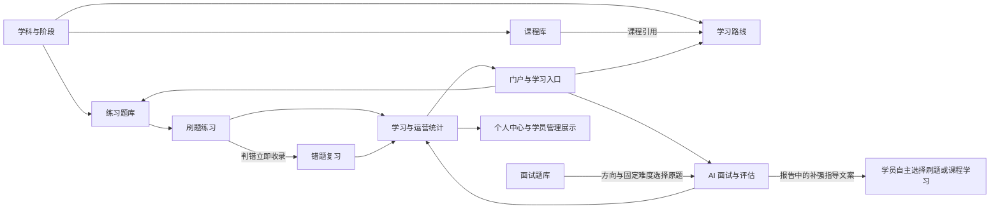

# 云枢智学：需求与功能模块梳理

> 阶段：项目设计第一阶段。
> 状态：功能模块与业务方向基线已确认。2026-10-30 用户“全部选A”，采纳集中清单全部 48 项 A；后续已确认上传资源用 MinIO、前端由 Nginx 部署，模块职责不变。E1—E5 其他事实与明确留待详细设计的参数仍待补充，开发配置见[开发环境说明](../operations/开发环境-Docker-Compose.md)。

> 后续实施：用户已明确授权基础工程开发，后端业务包边界与两端工程已按本模块规划建立，尚未实现各业务用例。当前状态与验证见[基础工程开发指南](../operations/基础工程开发指南.md)。
> 编写日期：2026-10-30。
> 范围：功能、模块职责、业务协作与核心流程；不涉及技术选型、数据库、API 或业务代码。

> 阶段衔接：T2A 已确认 M01—M15。用户随后另行明确要求数据库设计，现由 03 和 schema.sql 展开表结构；API 及业务开发未启动。

## 1. 依据与使用说明

### 1.1 已阅读的材料

- [需求文档](../云枢智学-需求文档.md)：产品范围、角色、功能与业务规则的主要依据。
- [原型说明](../../prototype/README.md)：用于理解页面组织；其中部分描述与实际页面不一致。
- `prototype/portal/` 下全部 13 个学员端页面。
- `prototype/admin/` 下全部 12 个管理端页面。
- [原型公共脚本](../../prototype/js/common.js)：用于核对分类、角色、题目来源、统计与交互示例。

阅读包含页面正文、动态表单和业务交互脚本。原型中的演示数据、模拟评分、静态统计和未实现跳转不能直接作为正式业务规则。

### 1.2 结论的确认状态

- **依据明确**：材料已清楚描述、未发现相反口径，可据此梳理功能。
- **已确认划分**：T2A 采纳本文功能归属；功能模块不等同于独立服务或部署单元。
- **待确认**：材料存在冲突或缺口，仅记录事实及影响，不选择具体规则。

本轮已按用户确认同步需求和设计。未修改原型 HTML/JS；原型剩余差异见其 README，旧演示行为不能推翻已确认规则。新歧义仍需明确确认，不在实施中默认为需求。

## 2. 产品范围与角色

### 2.1 产品范围

产品定位为 AI 赋能的智能面试训练平台。学员端围绕学习路线、题库练习、错题复习、AI 面试与报告开展训练；管理端维护内容、学员、内部用户、权限及平台基本信息。

需求明确学员端与管理端独立部署、登录态各自独立。本阶段仅记录此既有边界，不展开部署方案。

内容组织中已明确的关系：

- 学科包含多个阶段，练习题归属于阶段。
- 课程库独立维护，课程可被多条学习路线引用。
- 学习路线关联学科，通过课程顺序表达学习顺序，可补充跨学科课程。
- 练习题库与面试题库在需求和原型中分别管理，不将两者合并。
- 面试题按学科 / 技术方向归属，仅有 Markdown 上传解析和手工录入两种来源；不设独立知识库、不保留原文档（Q01 已确认）。

### 2.2 角色边界

| 角色 | 已确认职责与可用能力 | 已确认边界 |
|---|---|---|
| 游客 | 浏览首页、注册、登录、找回密码 | 其他学习页面需登录（U1A） |
| 学员 | 练习、错题、路线、面试、个人资料与学习数据 | 方向在路线/面试选择，不新增个人资料方向字段（U4A） |
| 超级管理员 | 全部管理权限，系统内置唯一账号 | 禁止删除、禁用、切换角色；可维护资料与密码（U6A） |
| 内容审核 | 只读五项内容管理、审核练习题；无增删改、导入导出权限 | 不授予学员和系统管理；现有动作权限补齐（U5A） |
| 运营人员 | 维护内容及学员，不进入系统管理，不具备审核权限 | 上架申请送审，不直接绕过审核（U5A、C3A） |

后台账号只登录管理端，不登录学员端（U2A）；首页页脚仍有公开管理后台登录入口。自定义角色可创建、配置并分配；普通登录为浏览器会话，记住登录学员 7 天、后台 1 天；禁用/删除/重置密码使该账号已有会话失效，权限变更刷新授权。

### 2.3 已明确的范围限制

- 练习模式为顺序练习、随机练习；原型宣传文案中的“模拟考试”不直接列为功能。
- 报告中的推荐题目、推荐课程、推荐再次面试为指导文案，不据此增加推荐结果列表或跨页推荐功能。
- 课程学习以外部链接跳转为主，未定义平台内视频播放与课程完成操作。
- 系统设置仅含名称、描述、Logo、默认头像；主题词表及好评率由运行配置维护，不新增模型、安全、词表或评价采集页面。
- 首页支持、关于两组链接本期占位，不开发对应页面；注册协议勾选保留需求约定。
- 逻辑删除保留记录，恢复通过受控运维处理，不新增回收站；有效内容引用阻止内容删除，已有训练保留当时依据。第三方登录仅占位，通知仅占位，不提供报告下载/分享或音视频回放。

## 3. 已确认功能模块与职责划分

以下为业务功能模块，不等同于页面、代码目录、服务或部署单元。

| 编号 | 模块 | 主要功能与职责 | 职责边界 | 依据 |
|---|---|---|---|---|
| M01 | 门户与学习入口 | 首页介绍、功能入口、热门阶段、新手引导、学习概览及近 7 天练习展示；管理后台入口展示 | 提供导航和汇总展示，答题、面试和资料维护由对应模块完成 | §3.1 |
| M02 | 学员账号与个人中心 | 注册、密码/验证码登录、找回密码、退出；头像和基本信息维护；个人学习数据展示；账号操作安全与频控 | 管理学员自身账号和资料；后台内部账号由 M12 管理；个人数据口径由 M13 汇总 | §3.2、3.3、6 |
| M03 | 学科与阶段 | 学科和阶段维护、排序、启禁用及数量展示；初始 8 学科，可新增并联动前台方向 | 有效引用阻止删除；禁用不供新训练，已开始训练可完成 | §1.1、4.3.1；C1/C7/C8A |
| M04 | 练习题库 | 管理题目及选项、参考答案/解析、类型、难度、标签、阶段；Excel 导入导出；审核、驳回、重新提交、上下架；学员按学科/阶段浏览、筛选、搜索、查看解析与发起练习 | 负责练习内容维护与查阅；实际作答会话属于 M05；不承担面试题维护 | §3.4、4.3.3 |
| M05 | 刷题练习 | 顺序/随机、指定入口、答题卡、计时、客观判分、简答 AI 批改、解析、结束及本地恢复 | 客观题查看解析/离开/结束时判定一次；错误立即收录 M06，有效判分计入 M13；恢复按端/账号隔离 | §3.1、3.5；P1/P2/P5/P6A |
| M06 | 错题复习 | 列表、筛选、错误次数、连续纠正进度、Top3、重做、掌握/移除和批量操作 | 连续正确 3 次掌握，答错清纠正并加错误；掌握后再错回待复习，移除后再错重收录；不收面试题 | §3.6、5；P2—P4A |
| M07 | 课程库 | 独立人工维护名称、封面、时长、学科、来源和外链；筛选、导入预览等 | 保留其他来源，BV 仅 B 站显示，播放量缺失不显示；不新增采集和课程完成跟踪 | §4.3.2；L2/L3A |
| M08 | 学习路线 | 关联学科、路线资料、状态、课程引用、跨学科补充、排序、移除、预览和外链学习 | 同学科至多启用一条，可保留其他禁用路线；移除仅解除引用 | §3.7、4.3.5；L1A |
| M09 | 面试题库 | 方向归属、筛选、未分类、详情、录题、Markdown 解析预览/导入、主题/难度维护及删除 | 不设知识库、不留原文档；词表运行配置；向 M10 提供原题，题干/答案录入后只读 | §4.3.4；Q01、C9/I1A |
| M10 | AI 面试与评估 | 配置、原题选取、配额、对话、语音、计时、评分、恢复、报告、历史趋势及只读文本回放 | 固定难度、不重复题；首题准备后成功创建扣次；超时 0 分；零作答无评分报告；AI 只评分/反馈/报告，不生成题 | §3.8；I1—I14A |
| M11 | 学员管理 | 管理端查询学员、查看资料和学习/面试汇总、启禁用、删除及批量操作 | 学员由前台注册产生，不提供后台新增/编辑资料功能；不管理后台内部账号 | §4.4 |
| M12 | 后台账号与角色权限 | 后台身份、用户管理、自定义角色与授权、批量动作、会话失效 | 后台身份不登录学员端；保护唯一超级管理员；补齐现有动作权限，不增加检索测试业务 | §1.2、4.0、4.1、4.5；U2/U5—U7A |
| M13 | 学习与运营统计 | 两端学习和运营汇总、增长、分布及后台最近活动 | 练习按有效判分次数，完成题目另去重，正确率按通过比例；按北京时间业务日；面试消费与报告分别统计，不含已学课程 | §3.1、3.3、3.6、3.8、4.2、4.4；P7/T4/O1A |
| M14 | 操作日志 | 筛选、详情、分页、CSV 导出、清空及用户最近操作 | 只记录后台操作，看板最近活动与其同口径；保留期/备份要求待 E4 | §4.2、4.5；O1A |
| M15 | 平台基本设置 | 名称、描述、Logo、默认头像；重置与保存 | 不增加主题词表、AI 模型或评价配置页面；词表/好评率属运行配置 | §4.5.4；C9/O3A |

账号登录失败锁定、验证码获取/校验限制和操作频控已在需求中明确纳入本期。本文保留这些业务约束，不设计具体实现。

## 4. 页面与模块对应

### 4.1 学员端（13 页）

| 原型页面 | 主责模块 | 协作模块 |
|---|---|---|
| `portal/index.html` | M01 门户与学习入口 | M02、M03、M04、M05、M08、M10、M13 |
| `portal/login.html` | M02 学员账号与个人中心 | — |
| `portal/register.html` | M02 学员账号与个人中心 | — |
| `portal/forgot-password.html` | M02 学员账号与个人中心 | — |
| `portal/profile.html` | M02 学员账号与个人中心 | M13 |
| `portal/questions.html` | M04 练习题库 | M03、M05 |
| `portal/practice.html` | M05 刷题练习 | M04、M06、M13 |
| `portal/wrong-book.html` | M06 错题复习 | M04、M13 |
| `portal/routes.html` | M08 学习路线 | M03、M07 |
| `portal/ai-config.html` | M10 AI 面试与评估 | M02、M03；方向随有效学科 |
| `portal/ai-interview.html` | M10 AI 面试与评估 | M09 原题选择，AI 评估 |
| `portal/interview-report.html` | M10 AI 面试与评估 | M13 |
| `portal/interview-history.html` | M10 AI 面试与评估 | M13 |

### 4.2 管理端（12 页）

| 原型页面 | 主责模块 | 协作模块 |
|---|---|---|
| `admin/login.html` | M12 后台账号与角色权限 | — |
| `admin/index.html` | M13 学习与运营统计 | M08、M14（仅后台操作） |
| `admin/subjects.html` | M03 学科与阶段 | M04、M07、M08 |
| `admin/courses.html` | M07 课程库 | M03、M08 |
| `admin/questions.html` | M04 练习题库 | M03、M12 |
| `admin/question-bank.html` | M09 面试题库 | M03 学科归属、运行配置词表；不扩展 M15 |
| `admin/routes.html` | M08 学习路线 | M03、M07 |
| `admin/students.html` | M11 学员管理 | M02、M13 |
| `admin/users.html` | M12 后台账号与角色权限 | M14 |
| `admin/roles.html` | M12 后台账号与角色权限 | 各管理功能的可用范围 |
| `admin/logs.html` | M14 操作日志 | M12 |
| `admin/settings.html` | M15 平台基本设置 | M01、M02 及两端展示 |

原型根目录 `index.html` 是原型导航，未列为新增业务页面。公共脚本与样式属于原型支撑材料，不单列业务模块。

## 5. 模块关系



图示为已确认业务协作，不表示技术调用、数据存储或系统部署。

- **分类与内容**：M03 提供练习题和路线的学科上下文；阶段是练习题归属依据。课程独立维护，路线通过引用形成有序课程清单。
- **练习与复习**：M04 提供内容，M05 判分并立即更新错误到 M06；重做结果和有效判分计入 M13；同次结果不得重复入账。
- **面试与评估**：M10 依配置从 M09 选原题，AI 评分、反馈并生成报告，不改写/生成面试题；题量不足不创建、不扣次。
- **账号与管理**：M02 管理学员自身账号，M11 管理学员使用状态，M12 管理后台用户和授权；两类用户不能按原型演示数据合并。
- **横向展示与管理**：M13 汇总业务结果；M14 支持后台操作追溯；M15 提供平台基本展示信息。后台模块的可用操作受 M12 授权约束。

## 6. 核心业务流程

### 6.1 注册、登录与个人资料

1. 游客通过手机号、验证码、密码与协议勾选完成单页注册。
2. 注册后进入个人中心完善资料；方向在路线/面试选择，不新增个人资料方向字段。
3. 学员通过账号密码或手机验证码登录，进入所需学习功能。
4. 忘记密码时依次完成手机验证、重置密码、重新登录。
5. 后台账号通过独立后台登录页登录；忘记密码提示联系超级管理员。

共同约束：连续 5 次密码错误锁定 5 分钟；登录成功清零失败计数。验证码同手机号 60 秒一次、每日最多 10 次，同一验证码连续校验失败 5 次失效；相关账号操作及发起面试存在频控要求。

第三方登录本期占位，不实际接入；后台账号不能登录学员端。记住登录学员 7 天、后台 1 天，禁用/删除/重置密码失效旧会话。

### 6.2 练习题内容维护与审核发布

```text
学科、阶段准备 → 新增题目 → 待审核
                            ├─ 审核通过 → 已上架 → 下架 → 已下架
                            │                            └─ 重新上架申请 → 待审核
                            └─ 审核不通过 → 已驳回 → 重新提交 → 待审核
```

内容审核或超级管理员审核，运营不审核。Excel 单次最多 500 道，导入进入待审核；批量上架同样送审，不直接发布。

本期移除草稿枚举和操作；上架题编辑先下架，修改后重新送审。导入无效项阻止整批，警告确认，重复题跳过并明示，其余写入整体提交；准确判重规则留后续细化。

### 6.3 题库浏览、刷题与中断恢复

1. 学员按学科、阶段浏览练习题，可筛选题型、难度、关键词并查看解析。
2. 阶段入口选模式；单题和首页随机 10 题直接执行；继续学习优先恢复，无会话回题库。
3. 选择顺序或随机模式后，展示题目、答题卡、进度和计时。
4. 客观题选择答案并查看判定/解析；简答提交后展示 AI 评分、评语、关键点及参考答案，得分达到 6/10 视为通过。
5. 已批改题目不可修改；未提交简答不可查看解析、不可进入下一题。
6. 结束时若存在未作答简答，提示并跳转该题；否则二次确认，含未完成题数提示，确认后停止计时、清除本次会话并返回题库。
7. 再次进入检测到未完成练习时，可继续恢复，或清空后重新选择模式。

客观题查看解析、离开或结束时最终判定一次，未作答不计对错；判错立即收录。题序、答案、批改、评分、用时及位置按端/账号持久保存，同浏览器关闭重开可恢复；退出清快照，不清已提交结果，不承诺跨设备。

### 6.4 错题复习与掌握

1. 浏览错题统计、高频待复习错题 Top3，按状态、分类、时间和排序条件查看错题。
2. 可对单题或批量执行标记掌握、移除；批量操作二次确认。
3. 进入待复习错题重做，逐题选择并提交答案，展示正确/错误及解析。
4. 连续正确 3 次掌握，中途错误纠正归零并增加错误次数。
5. 无选项题目展示“自行复习”提示及正确答案，不自行增加简答 AI 重批改流程。

错误次数达到 3 为高频、2 为多次，其余为偶尔；已掌握置灰，再次答错回待复习并清纠正；移除后再错重收录，按新一轮计数。简答低于 6 分收录，面试题不收录。

### 6.5 课程维护与路线学习

1. 管理人员维护课程资料，或粘贴文本批量解析、检查有效/警告/无效项后确认导入。
2. 新建路线、关联学科、填写展示资料和启禁用状态。
3. 从独立课程库选择课程，必要时补充跨学科课程；调整学习顺序或移除引用。
4. 管理端预览学员视角；学员按学科查看路线、课程数量、总时长与有序课程。
5. 学员点击课程外链前往学习。

课程可多路线复用、同路线不重复。同学科至多启用一条路线；外链学习不跟踪完成，移除已学课程统计。保留其他来源，BV 仅 B 站展示，播放量缺失不显示，资料人工维护。

### 6.6 面试题维护

共同明确的流程：录入或导入题目 → 查询/筛选与查看详情 → 维护主题、难度 → 删除。

Markdown 导入支持 `#` 至 `###` 标题切题，标题作为题干、正文作为参考答案，先预览样例及行号，再统一指定主题、难度和标签后导入，单次最多 500 道。

录入/上传按方向归属，不设知识库、不留原文档，只留来源；修改内容重传或删除重录，不提供按已存文档重解析。“检索测试”权限移除，词表通过运行配置维护。逻辑删除不提供恢复页面，受控运维可处理记录恢复，不再误称绝对不可恢复。

### 6.7 AI 面试、报告与再次训练

1. 学员选择技术方向、难度及题数；题数为 3/5/8/10/15，默认 10；每题回答超时固定 5 分钟。
2. 按方向和固定难度选择足量不重复原题；不足不创建、不扣次。每日最多 5 次，北京时间次日 0 点重置；成功创建且首题准备完成时扣次。
3. 发起面试后逐题对话作答，支持文本与语音输入、语音播报及重播。
4. 每题提交后展示分析、评分、思考与下一题；逐题得分为 0—10，进度、平均分和侧栏同步展示。
5. 全部完成后查看报告；提前结束有有效已计分用户回答则出部分报告，零作答记放弃、不评分。超时项计 0 分但不是用户提交，未到达题不计分。
6. 恢复不延长每题 5 分钟期限、不重复扣次；超时记 0 分进入下一题。重开关闭旧会话，新会话查配额并计次。
7. 报告展示综合评分、6 个能力维度、优点、待提升项和指导建议；有同方向历史成绩时显示趋势。
8. 学员查看历史记录或再次面试；依据报告指导，自主选择刷题、路线学习或再练一场。

主动放弃不返还；确认平台故障导致无法使用才返还，结果未知不贸然退款；仅报告失败重试报告不扣次。“再来一次”复用配置并查配额。综合分为已计分题平均×10，准确度为达 6 分比例；各方向固定六维/尺度，具体内容留评估设计；趋势基准为最近同方向完整有效报告，可跨难度并提示。回放仅文本问答/得分/点评，不含音视频、下载或分享；语音不支持时提示文字作答。

### 6.8 后台管理与运营查看

1. 超级管理员维护内部用户、预置角色与权限；后台用户按授权访问内容或学员管理功能。
2. 运营人员查询学员、查看学习与面试汇总，执行启禁用或删除及批量操作。
3. 数据看板汇总学科、题目、注册用户和面试数据，展示增长趋势、学科分布及最近活动。
4. 有权限人员查看、筛选、导出操作日志，清空操作需二次确认；维护平台基本设置。

禁用/删除/重置密码失效已有会话；学员逻辑删除后禁登录，保留训练和审计事实。内容有有效引用禁止删除；后台看板最近活动与操作日志同口径；通知仅占位。

## 7. 确认记录与剩余输入

2026-10-30 用户对[集中清单](./00.设计待确认清单.md)回复“全部选A”。全部 48 项 A 已采纳，原待选择队列关闭，B 仅保留决策背景。

| 类别 | 已确认编号 | 本文落实 |
|---|---|---|
| 技术与模块 | T1—T4 | 认可 M01—M15 边界；具体技术见 02 |
| 账号权限 | U1—U8 | 游客、独立身份、占位、角色、超级管理员保护及会话政策 |
| 内容审核 | C1—C9 | 动态学科、移除草稿、送审、导入/批量、引用、运行词表 |
| 练习错题 | P1—P7 | 判分、即时收录、连续掌握、恢复与统计 |
| 路线课程 | L1—L3 | 单有效路线、移除已学课程统计、其他来源人工维护 |
| 面试报告 | I1—I14 | Q02 由 I1A 关闭；原题、固定难度、配额、超时、报告及文本回放 |
| 运营展示 | O1—O3 | 后台活动、通知占位及运营提供好评率 |

### 7.1 组合约束

- 题量不足不创建、不扣次；成功创建且首题准备完成后扣次。零作答主动放弃仍按已消费处理。
- 继续原会话不扣次、不延长期限；重开关闭旧会话并新计次；仅报告失败重试报告不重复扣次。
- 零作答指无有效用户提交，不以自动超时 0 分生成有效报告；有有效已计分回答时，报告含超时项、排除未到达题，部分报告显示完成度。
- 配额消费和有效报告分别统计；部分报告不作以后趋势比较基准，合法 0 分报告不排除。
- 无效项阻止整批导入，重复项跳过明示，其余整体提交；批量上架不绕过审核。
- 清理本地快照不撤销已提交事实；内容有有效引用先处理关联，历史训练保留当时依据。

### 7.2 尚待补充与细化

- E1—E5 资源、容量、预算/数据约束、恢复/保留目标及供应商未提供，不视为默认选择或自动暂缓。
- 六维具体名称/尺度、完整权限矩阵在后续细化，不重问已确认方向；精确判重口径由数据库阶段 DB3A 关闭，规范化实现需验证。
- 数据库阶段 DB1/DB3/DB4 已选 A：删除账号保留手机号/邮箱占用、未删除题精确判重、练习简答参考答案必填；DB2 并行面试数量仍待确认。后续判重标准以需求 §7.2 和 03 为准。
- 原型 HTML/JS 作为旧交互参考，其剩余差异已在 README 登记，本次未改业务代码。

## 8. 当前需求快照与阶段边界

- **已确认**：Q01、Q02（I1A）、全部 48 项 A；15 个功能模块和主要流程形成已确认基线。
- **本轮新增**：同步需求和两阶段设计，关闭旧选择队列，记录组合约束及原型差异。
- **待补充**：E1—E5 和明确留待后续的细化项。
- **阶段边界**：仅同步文档，不展开表结构、具体 API 或业务开发。
- **后续授权**：本阶段完成后，用户明确要求数据库设计，见[03.数据库设计](./03.数据库设计.md)；上行记录的是前一轮边界，不阻止本轮已授权的表结构与 SQL 产出。

### 确认记录

| 日期 | 用户确认 | 结果 |
|---|---|---|
| 2026-10-30 | Q01 选 A | 方向题库、Markdown/手录、不设知识库、不留原文档 |
| 2026-10-30 | 全部选A | T/U/C/P/L/I/O 共 48 项采用 A；E 类仍待补充 |
