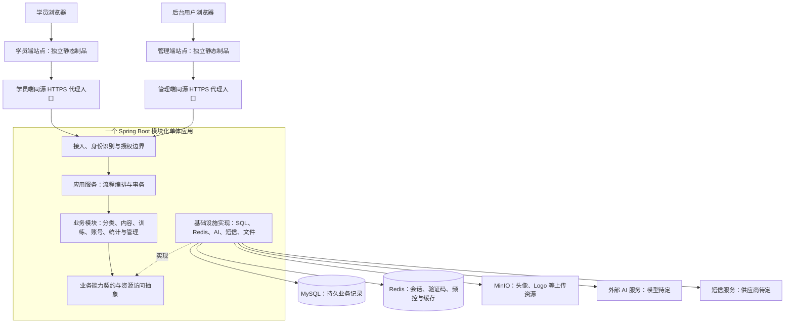
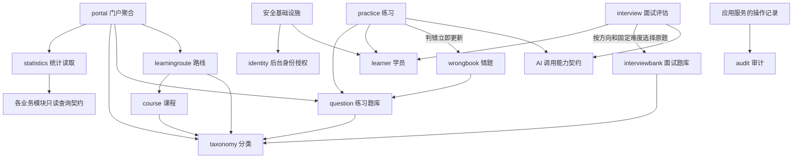
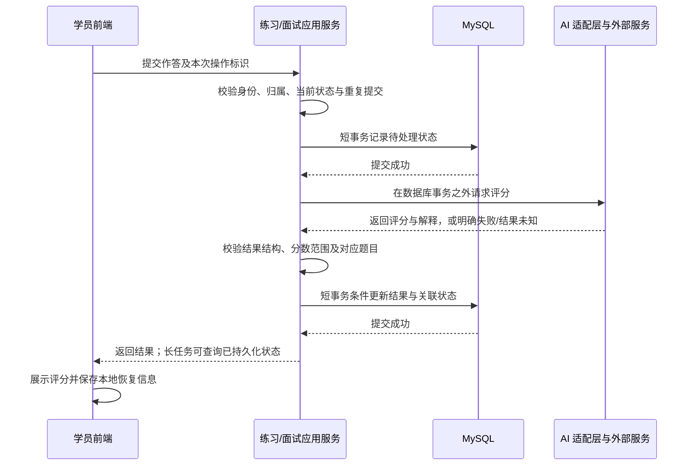

# 云枢智学：技术选型与整体架构设计

> 阶段：项目设计第二阶段。
> 状态：总体方案基线已确认。2026-10-30 用户“全部选A”，配套技术、模块/目录及业务规则全部按集中清单 A 落实；E1—E5 与明确留待详细设计的参数尚待补充。
> 日期：2026-10-30。
> 范围：技术路线、整体架构、模块位置与依赖、目录规划、关键决策及风险。不包含具体表结构、字段、HTTP 路径、请求响应定义或业务代码。

## 1. 设计依据与约束

### 1.1 项目依据

| 材料 | 本阶段采用的内容 | 使用边界 |
|---|---|---|
| [第一阶段功能模块梳理](./01.功能模块梳理.md) | M01—M15、原型页面映射和业务流程 | T2A 已确认职责划分，全部 48 项 A 已同步；后续细化不得隐含变更 |
| [需求文档](../云枢智学-需求文档.md) | 两端、内容审核、训练、配额、统计与授权 | Q01 及 48 项业务选择已同步；E 类事实不默认补全 |
| [页面原型](../../prototype/README.md)及实际 HTML/公共脚本 | 页面职责、交互和已有展示范围 | 实际页面优先用于核对事实；README 的旧描述、MockData 和模拟评分不作为新增功能依据 |
| [数据库规范](../rules/database-rules.md) | 自增主键、禁止物理外键、应用维护关联完整性、业务唯一约束及时间策略要求 | 本阶段只确定遵循方式，不设计表和字段 |
| [API 规范](../rules/api-rules.md) | 默认 REST HTTP、服务端校验、统一响应与分页、正确使用 HTTP 状态码 | 不展开接口清单与契约 |
| [AGENTS.md](../../AGENTS.md)及本轮交互 | 重大决策确认、歧义逐轮澄清、同步受影响文档、禁止提前开发 | 本次仅修改设计及关联需求文档 |

总体设计启动时，项目文件为文档和静态原型，尚无业务工程或依赖清单。此后已确认下表技术路线，并于 2026-10-30 根据用户独立授权搭建前后端基础工程，见[基础工程开发指南](../operations/基础工程开发指南.md)。原型 README 中的早期建议不覆盖后续已确认决策。

### 1.2 本轮已经确认的决策

| 决策 | 用户确认内容 | 本文落实位置 |
|---|---|---|
| Q01：面试题库范围 | 按实际原型，以学科/方向归属；Markdown 上传解析和手工录题；不设独立知识库、不保留原文档 | M09 边界、文件处理及 AI 依赖说明；已同步需求 §4.3.4 和第一阶段文档 |
| D01：后端路线 | Java 21 + Spring Boot 4.1.x，模块化单体 | 技术选型、后端分层、模块依赖和目录 |
| D02：数据与缓存 | MySQL 8.4 LTS + Redis 8.x；Redis 用于会话、验证码、频控及缓存；面试日配额以持久记录校验 | 存储职责、故障边界与部署依赖 |
| D03：前端路线 | 2026-10-30 用户选择 A：Vue 3 + TypeScript + Vite，两端使用 Vue Router、Pinia，管理端使用 Element Plus | 前端技术选型及两端应用规划；该次只确认前端组合；图表及工程工具后由 T1A 追加确认 |

用户已确认集中清单全部 48 项 A。下文已纳入该清单的技术建议按此转为采纳方案；准确补丁、供应商、生产拓扑和后续细化参数不自动冻结。公开资料支持能力/兼容性核对，不等于已经完成运行验证。

### 1.3 架构设计原则

- 保留学员端与管理端各自独立构建、发布和登录的边界；后端业务能力按职责共享。
- 用模块边界隔离业务，用数据库本地事务处理需要共同成功的修改；不以模块数量推导服务数量。
- 将 AI、短信、文件存储等外部依赖放在适配层，核心业务规则不依赖特定供应商。
- 账号授权、答案判定、成绩、配额和关联完整性由后端负责；前端本地进度仅辅助恢复交互。
- 目前不具备用户规模、并发、可用性目标、团队分工和部署预算资料，不假设规模，不承诺吞吐量或恢复时间。

## 2. 技术选型

### 2.1 已确认技术组合及实施边界

| 领域 | 技术方案 | 依据与适用职责 | 状态 |
|---|---|---|---|
| 学员端 | Vue 3 + TypeScript + Vite；Vue Router；Pinia；原型样式组件化 | 题库、练习、面试及恢复交互 | 已确认（D03、T2A） |
| 管理端 | 同一 Vue 技术体系；Element Plus 管理表格、表单、弹窗和权限树 | 管理端以列表、筛选、批量操作和编辑表单为主，适合复用成熟基础组件 | 已确认（D03） |
| 图表 | Apache ECharts，按需引入 | 两端图表与报告展示 | 已确认（T1A） |
| 前端工程 | pnpm workspace；Node.js 24 LTS；ESLint、Prettier、类型检查 | 两端共享工具、独立构建 | 已确认（T1A），准确版本待验证 |
| 后端运行时 | Eclipse Temurin / OpenJDK 21 | Java 运行环境 | 已确认（D01、T1A），补丁待锁定 |
| 后端框架 | Spring Boot 4.1.x + Spring MVC；Jakarta Validation | 内容管理、事务编排、参数校验和普通 HTTP 请求；面试长耗时处理可使用 MVC 异步能力 | 框架系列已确认 |
| 构建 | Maven Wrapper，Maven 3.9.x 系列；单后端工程 | 统一构建与依赖管理 | 已确认（T1/T2A），补丁待验证 |
| 认证与授权 | Spring Security + Spring Session Data Redis | 两端身份隔离；普通浏览器会话，记住学员 7 天/后台 1 天；禁用/删除/重置密码使旧会话失效 | 已确认（T1、U2/U5—U7A） |
| 数据访问 | MyBatis 3.5.x + Starter 4.1.x；Spring 事务 | SQL 和逻辑关联显式维护，不创建物理外键 | 已确认（T1A），版本验证后锁定 |
| 业务数据库 | MySQL 8.4 LTS，InnoDB | 账号、分类、内容、路线引用、练习结果、错题、面试、角色权限及操作日志等持久记录 | 已确认 |
| 会话、缓存、频控 | Redis 8.x + Spring Data Redis | 登录会话、验证码、失败锁定与请求频控、短期内容缓存；配额核验以 MySQL 持久记录为准 | 已确认 |
| 数据变更管理 | Flyway 版本化迁移 | 后续经确认的数据库变更 | 已确认（T1A），本阶段不生成脚本 |
| Excel / CSV | Apache POI；Apache Commons CSV | XLS/XLSX 导入导出、CSV 日志 | 已确认（T1A） |
| Markdown | commonmark-java + 题库切分规则 | 服务端解析及来源定位 | 已确认（T1A），细节按既有题库规范 |
| AI 接入 | 后端模型适配，供应商正式 HTTP API / SDK | 简答/面试评分、反馈、报告；面试题从维护题库选原题 | 职责已确认（I1A），服务商/模型待 E5 |
| 语音 | 浏览器 Web Speech API、能力检测 | 不支持时提示文字作答，逐项实测 | 已确认（I14A） |
| 文件 | 存储抽象；头像、Logo 等上传资源使用 MinIO | 持久文件存对象存储；导入临时文件按期限清理；Vue 构建产物仍由 Nginx 部署 | 2026-10-30 用户确认 MinIO；开发 Compose 已生成，生产拓扑与维护参数待 E1/E5 |
| 访问与部署 | Nginx + HTTPS、容器、开发/测试 Compose | 生产拓扑按实际约束确定 | 工程方向采纳，生产资源待 E1—E4 |
| 验证与可观测性 | JUnit、Spring Boot Test、存储集成验证；Vitest、Playwright；Actuator、结构化日志 | 验证关键流程、授权、并发和恢复 | 工具方向已确认（T1A），本阶段不创建测试代码 |

此表明确技术系列，不宣称已经锁定或测试过整套依赖。实施准备时记录 JDK、Node、框架、驱动、解析库和镜像的准确版本，使用依赖管理、锁文件与镜像版本固定构建输入，避免使用未固定的 `latest`。

### 2.2 版本核对与资料依据

- Spring Boot 官方系统要求覆盖 Java 21；已核对页面当前稳定分支为 4.1.x。本项目按用户确认采用这一系列，不采用预览版本。[Spring Boot 系统要求](https://docs.spring.io/spring-boot/system-requirements.html)
- Temurin 官方支持路线包含 Java 21 LTS，该发行版已随 T1A 采纳；社区维护不等于项目已经购买商业 SLA。[Temurin 支持路线](https://adoptium.net/support)
- MyBatis 官方发布记录已有 Starter 4.1.0，并升级到 Spring Boot 4.1.0 与 MyBatis-Spring 4.1.0，据此采用配套 4.1.x；不将适用于 Boot 3.x 的 Starter 3.x 混入。[MyBatis 官方发布记录](https://github.com/mybatis/spring-boot-starter/releases)
- Vue 官方工具链支持 Vite，并列出 Vue Router、Pinia；TypeScript 与 Vite 组合有官方使用说明。[Vue 工具链](https://vuejs.org/guide/scaling-up/tooling.html)、[Vue TypeScript](https://vuejs.org/guide/typescript/overview)
- Element Plus 的 Vue 组件体系用于后台基础交互，已随 D03 确认；ECharts 提供本项目需要的图表类型，已随 T1A 确认采用。[Element Plus 安装与兼容](https://element-plus.org/en-US/guide/installation.html)、[Apache ECharts](https://echarts.apache.org/en/index.html)
- Node.js 官方发布列表列有维护中的 24 LTS，建议作为已有生态较成熟的构建基线；Vite 的 Node 版本下限仍应在锁定具体版本时复核。[Node.js 发布状态](https://nodejs.org/en/about/previous-releases)、[Vite 指南](https://vite.dev/guide/)
- MySQL 8.4 属于 LTS 系列，适合优先稳定行为的业务系统；本项目不依赖更新系列的专有能力。[MySQL 发布模型](https://dev.mysql.com/doc/refman/8.4/en/mysql-releases.html)
- Spring Session 提供 Redis 支撑的服务端会话；两端隔离仍需项目明确配置和验证，不能认为引入依赖后自动满足。[Spring Session Redis](https://docs.spring.io/spring-session/reference/guides/boot-redis.html)
- Apache POI 分别支持 XLS、XLSX，匹配需求的两种导入格式。[Apache POI 组件](https://poi.apache.org/components/)

### 2.3 主要替代方案与取舍

| 决策点 | 采用/建议方案 | 本项目的取舍依据 |
|---|---|---|
| Vue 与 React | 已确认 Vue 3 | 两者均能完成需求；用户已选择统一两端的 Vue 技术路线（D03），不据此推断团队经验或现有资产 |
| SPA 与服务端渲染 | 采用两套 SPA（T2A） | 当前无明确 SEO 指标；新增 SSR 需要单独评估 |
| Java 与 Python/TypeScript 后端 | 已确认 Java/Spring Boot | 统一事务、权限和管理功能；AI 调用可在 Java 内接入外部服务。当前无本地模型训练、推理服务或 Python 算法代码的需求证据 |
| 模块化单体与微服务 | 已确认模块化单体 | 内容、训练与权限仍存在较多关联业务，尚无必须独立扩容或独立团队发布的证据；保留模块边界供以后评估 |
| MyBatis 与 JPA | 已确认 MyBatis（T1A） | 列表、统计、批量和逻辑关联显式维护，需维护 SQL |
| MySQL 与 PostgreSQL | 已确认 MySQL | 当前主要为关系型业务记录，未定义必须依赖 PostgreSQL 特有能力的需求；已有自增主键规则与 MySQL 路线可一致落实 |
| 服务端会话与自包含 JWT | 已确认服务端会话（T1A） | 可失效会话支撑禁用、密码重置及授权刷新 |
| HTTP 与 WebSocket | 已确认普通 HTTP（T3A） | 逐题文本交互不要求全双工，慢任务查询结果 |
| SSE 与普通响应 | 普通响应优先，慢任务查询补充 | 当前无明确逐字流式输出需求；若以后确认需要单向流式事件，可使用 Spring MVC SSE，而不改造整套后端为响应式应用 |
| 自建模型平台与外部模型调用 | 建议外部模型适配 | 当前需求是应用能力，不含模型训练或 GPU 运维；具体供应商、成本和数据发送范围需确认 |

搜索引擎、向量数据库、独立消息中间件、微服务治理及 Kubernetes 不列为当前基线。Q01 排除独立知识库，I1/I2A 进一步确认按方向和固定难度选择原题；本期不增加动态生成、动态调难或语义检索。新增需求须另行评估。

## 3. 整体架构

### 3.1 系统形态

采用已确认模块化单体，两套前端独立构建部署，通过各自站点的同源代理访问同一后端（T2A）。

后端初期形成一个可运行制品，内部按业务模块组织。共享一个后端应用不表示共享账号、会话或权限；前端独立部署也不要求建设两套重复业务服务。



图示为逻辑协作，不代表物理服务器数量。两套站点建议使用不同域名/子域名，以独立 Cookie 和前端存储隔离；具体域名、生产是否使用托管数据库及机器数量仍需确认。

### 3.2 技术分层及职责

| 层次 | 主要职责 | 依赖规则 |
|---|---|---|
| 前端展示层 | 路由、页面、表单、图表、会话进度及交互恢复；展示服务端结果 | 通过统一请求工具访问后端，不直接连接数据库、Redis、模型或短信服务 |
| 后端接入层 | 区分学员/后台入口、认证授权、输入校验、请求转换、异常与响应处理 | 调用应用服务，不在 Controller 内直接编写业务 SQL 或调用模型 |
| 应用服务层 | 编排用例、授权后的业务检查、事务边界、并发/幂等控制、跨模块协作 | 调用业务规则和模块契约；不依赖其他模块的 Controller |
| 业务规则层 | 题目审核、练习判定、错题状态、课程引用、面试状态等规则 | 不依赖 HTTP、MyBatis、Redis 或供应商 SDK；未确认规则不预置为事实 |
| 基础设施层 | 持久化、缓存、会话仓库、文件、Excel/Markdown 解析、AI 与短信适配、受控任务执行 | 实现上层定义的资源能力，技术对象不向业务调用方泄露 |
| 运行支撑 | 配置、密钥、健康状态、日志、镜像和代理 | 为应用提供运行条件，不新增业务菜单 |

采用“按业务模块聚合、模块内部按需要分层”的组织方式。简单内容维护不必为每个动作建立完整领域模型；关键训练和审核流程需要集中维护状态及业务约束。

跨模块关系由应用服务编排，模块提供可调用的业务契约。契约是进程内边界，本阶段不定义为远程 API，也不为每个模块引入网络调用。

## 4. 模块在架构中的位置

### 4.1 M01—M15 映射

表中 `modules/*` 为 T2A 采纳的后端业务包，同包功能仍有独立用例边界。

| 模块 | 前端位置 | 后端业务包与职责 | 必要依赖/协作 |
|---|---|---|---|
| M01 门户与学习入口 | portal 首页、新手引导 | `modules/portal`：组合首页展示；不拥有练习和面试结果 | 分类、题库、路线、统计的只读能力 |
| M02 学员账号与个人中心 | portal 账号页、个人中心 | `modules/learner`：学员注册、登录用例、资料维护与自身访问范围 | 安全基础设施、短信、文件；统计查询 |
| M03 学科与阶段 | portal 分类展示；admin 学科管理 | `modules/taxonomy`：内容分类、阶段归属及排序/启禁用规则 | 向题目、课程、路线及面试题提供分类校验 |
| M04 练习题库 | portal 题库；admin 题库管理 | `modules/question`：练习内容、题目状态和审核、导入导出、检索与统计查询 | 学科阶段校验；后台授权；审计记录 |
| M05 刷题练习 | portal 练习页 | `modules/practice`：会话与答题用例、客观判定、简答评分请求及结果接受 | 题库、学员和 AI；错误立即更新，结果只计一次 |
| M06 错题复习 | portal 错题页 | `modules/wrongbook`：错题状态、重做和掌握/移除用例 | 原题和学员；连续三次掌握，错则清纠正，掌握后再错回待复习 |
| M07 课程库 | admin 课程管理；portal 课程展示 | `modules/course`：课程元信息、来源和批量导入 | 学科归属校验；向路线提供可引用课程 |
| M08 学习路线 | portal 路线；admin 路线管理 | `modules/learningroute`：路线资料、启禁用、课程引用及排序 | 学科校验、课程读取/可引用校验 |
| M09 面试题库 | admin 面试题库 | `modules/interviewbank`：方向归属、手工录题、Markdown 导入、主题/难度维护 | 学科归属、导入解析；词表运行配置，不扩展平台设置 |
| M10 AI 面试与评估 | portal 配置、面试、报告、历史 | `modules/interview`：面试生命周期、提交/评分/报告/记录及配额核验 | 学员、AI 与面试题库；按方向及固定难度选原题 |
| M11 学员管理 | admin 学员管理 | `modules/learner` 下后台用例：查询、详情、状态与删除操作 | 复用学员身份和状态；统计读取；不得绕过学员规则直接改存储 |
| M12 后台账号与角色权限 | admin 登录、用户与角色页 | `modules/identity`：内部用户、角色、授权和后台登录用例 | 安全与会话基础设施；审计；不与学员身份合并 |
| M13 学习与运营统计 | 两端统计展示 | `modules/statistics`：聚合查询、统一口径与读模型 | 分类、内容、学员、练习、错题、面试的已提交事实 |
| M14 操作日志 | admin 日志、用户最近操作 | `modules/audit`：后台操作记录、查询、导出/清空 | 记录调用时的身份及操作上下文，不反向执行业务修改 |
| M15 平台基本设置 | admin 设置；两端展示 | `modules/settings`：名称、描述、Logo、默认头像 | 文件存储、可重建设置缓存 |

M02 与 M11 放在同一学员模块，是为了复用同一学员状态与资料维护规则；前台和后台接入、授权及应用用例分开。M12 只管理后台身份，U2A 明确后台账号不能登录学员端。

### 4.2 模块依赖方向



- 题库不反向调用练习、课程不反向编排路线；C7A 确认存在有效内容引用时拒绝删除，应用用例协调引用校验，避免模块相互注入。历史训练保留当时依据。
- 不允许跨模块直接调用对方 Mapper、复用对方数据库实体进行写入，或通过“公共工具类”隐藏跨模块修改。
- 统计通过只读契约聚合；若需跨模块聚合 SQL，应明确只读范围与变更责任，不把统计查询权限扩展成业务写权限。
- 审计只接受必要操作上下文；审计模块不反向查询并触发原业务，避免循环依赖。
- AI、Redis、短信和文件是基础设施能力，不各自形成新的用户功能模块。

本节图示表达运行时业务协作；基础设施与业务之间通过契约和启动装配连接，不据此允许基础设施实现反向依赖具体业务服务。

## 5. 前后端协作与关键处理流程

### 5.1 普通管理与学习查询

浏览器通过自身站点的 HTTPS 代理访问后端。后端确认调用方身份类型、权限和资源范围，应用服务调用业务模块读取或更新记录，持久化完成后返回结果，前端更新视图。

表单必填、手机号和文件类型等前端校验用于即时反馈；后端执行同样的必要校验和业务授权。管理端按钮隐藏不能替代后端授权；属于其他学员的练习、错题、面试与报告必须执行归属校验。

普通请求建议采用 REST 风格 HTTP 和 JSON，导入、下载采用相应文件传输形式。最终路径、响应结构、分页字段和错误码留到 API 设计阶段，遵守项目规范。

### 5.2 答题与 AI 评分



上图描述技术处理边界；有效判分只计一次，错误立即更新错题。面试次数在成功创建且首题准备完成时扣减，不在每次评分时重复扣。

- 客观题由后端依据参考答案判定，前端不提交可直接作为成绩的“正确/错误”结论。
- 简答批改和面试评估使用独立的提示模板及结果校验。AI 生成的分数、文本和 Markdown 作为外部输入处理，展示时转义/净化，不直接信任 HTML。
- 同一次作答的重试复用操作标识，依赖数据库唯一性和状态条件防止重复接受；不能只用禁用发送按钮或 Redis 锁保证一次记分。
- 模型请求失败不得伪造成评分成功；请求超时不等于供应商未执行，结果不明时不能盲目重发计费请求。是否支持按供应商请求标识查询/幂等，需选定供应商后核实。
- 模型网络调用不包在数据库事务里，避免长时间占用连接和记录锁。

### 5.3 长耗时与报告生成

建议使用 Spring MVC 异步处理和独立、有界的 AI 执行资源，避免模型延迟占满普通内容查询线程。Spring MVC 原生支持异步返回和 SSE，不需要为此引入第二套 Web 框架。[Spring MVC 异步请求](https://docs.spring.io/spring-framework/reference/web/webmvc/mvc-ann-async.html)

若评分或报告耗时超出普通请求预算，建议保存任务状态后由前端查询结果；任务属于 M05/M10 的内部执行机制，不新增任务管理页面。需要恢复的工作必须有持久状态、超时标记和重启后检查，不能仅依赖进程内 `@Async` 或内存队列。

若以后运行多个后端实例，任务领取和完成必须通过持久状态条件更新避免重复处理；是否重试、是否可重放外部调用取决于供应商能力。没有获得明确结果的任务不自动视为失败后再次扣次数。

每题回答期限、HTTP 等待时间、模型超时及内部任务期限不同。I6A 已确认题目 5 分钟，超时记 0 分推进，恢复不延长；其他超时值留实施验证，模型故障不当作学员超时。

### 5.4 导入和文件协作

1. 管理端选择 Excel 或 Markdown，前端展示选中文件、初步限制及预览。
2. 后端复核身份、权限、格式、大小、可解析性及题数，按需求的最多 500 道校验。
3. 解析结果和预览与当前用户/本次导入绑定，确认时重新校验，不接受浏览器任意拼装为可信导入结果。
4. C3—C6A：无效项阻止整批，警告确认；重复题跳过并报告，其余写入整体提交；练习题导入待审核。
5. 临时上传文件在处理后按受控期限清理。Q01 明确不保留 Markdown 源文档，不把文件存储扩展成知识库档案。

头像、Logo、默认头像属于持久文件；文件本体由存储适配管理，数据库维护其业务关联。文件上传和数据库提交无法依靠同一个本地事务原子完成，需处理失败遗留文件和无效引用。原型中的课程封面与视频链接不意味着必须下载或代理外部内容。

## 6. 存储、缓存与一致性

### 6.1 资源职责

| 资源 | 应承担的内容 | 不应承担的内容 |
|---|---|---|
| MySQL | 持久业务事实、身份与权限、审核/作答结果、错题状态、面试/报告、配额核验依据、操作审计及配置 | 头像等文件二进制、浏览器暂存视图、未确认的知识库文档体系 |
| Redis | 失效可管理的会话、验证码和短期校验状态、锁定/频控窗口、带期限的可重建读缓存 | 唯一成绩、唯一面试报告、唯一日配额消费依据 |
| 文件存储 | 头像、Logo、默认头像等长期文件；受控临时导入文件 | 按 Q01 已排除的持久 Markdown 原文档管理 |
| 浏览器本地存储 | 已要求的练习/面试恢复快照、新手引导记录等交互信息 | 登录密钥、AI 密钥、可信评分、全局配额、后台角色授权 |

### 6.2 数据库约束落实

遵守项目数据库规范：后续模型统一自增主键、逻辑关联，不创建物理外键；应用在同一必要事务内完成关联校验和状态修改。排序、审核、账号唯一性及重复提交等规则应结合数据库约束和并发控制，不能只做前端或“先查后写”判断。

逻辑删除不新增恢复页面；有效内容引用阻止内容删除，历史训练保留当时依据。禁用阶段/下架题目不供新训练，已开始训练可完成；学员删除禁止登录并保留训练/审计事实，恢复经受控运维处理（C7/C8/U8A）。

T4A 已确认 UTC 持久化，Asia/Shanghai 业务日、每日重置及展示；不依赖服务器默认时区，本阶段不定义具体字段。

### 6.3 缓存与控制状态

- 内容、分类和基本设置采用按需读取、有限期限缓存；写操作提交成功后失效相关缓存，不能在事务提交前发布未完成状态。
- 审核、下架、阶段禁用和权限变更影响可见性：关键操作必须重新检查数据库权威状态或可验证的版本，不能仅信任旧页面和普通 TTL 缓存。
- Redis 中的会话、验证码和频控状态不能与可随意淘汰的内容缓存等同处理。建议至少明确前缀、容量及过期管理；若同实例承载全部用途，选用不随意驱逐控制状态的策略并限制缓存规模，避免内存压力提前清除锁定状态。
- 验证码消费、获取窗口及失败计数需要原子操作；Redis 支持原子执行 Lua 脚本，但短脚本仍会占用服务处理时间，实施时保持逻辑精简。[Redis Lua 执行语义](https://redis.io/docs/latest/develop/programmability/eval-intro/)
- Redis 不可用时，普通可重建缓存可绕过读 MySQL；会话无法验证、验证码或频控无法保证的操作建议明确返回暂不可用，不降级成无校验放行。具体故障交互在实施前确认。

Redis 重启/故障后的锁定和频控连续性需要结合持久化、托管高可用以及恢复流程设计；不能认为设置 TTL 就能抵抗故障丢失。会话失效可以要求重新登录，但不能默默恢复不受限的敏感操作。建议在相关控制状态恢复可信前保持敏感操作受限，或从可信持久依据恢复窗口；具体恢复方案在部署设计时确定。

### 6.4 事务、统计与日配额

- 核心状态与必要关联更新在同次本地事务内，同一结果只接受一次；P1/P2/P7 确认有效判分入账和即时错题更新。
- 统计优先使用 MySQL 持久事实与聚合查询，必要时缓存。若后续确认需要异步读模型，再建立持久待处理标记和可重建方式，不把普通内存事件当作可靠消息。
- 面试日配额以持久记录校验，并在明确的业务扣减时点执行原子校验和占用；Redis 可作提示缓存或辅助限流，不能清空 Redis 后就重新获得当日次数。
- I4—I8A：成功创建且首题准备完成原子扣次，创建失败不扣；主动放弃不退，确认平台不可用才退；仅报告失败重试不扣；恢复不扣，重开关闭旧会话并按新会话计次。结果未知不能直接当失败返还。
- C4—C6A：批量先全量校验、整体成功或失败；导入重复项跳过明示，其余整体写入。外部服务和文件副作用不包含在数据库事务内。

## 7. 账号、AI 与外部依赖边界

### 7.1 两端独立认证与权限

建议由 Spring Security 负责认证授权，由 Spring Session + Redis 保存可失效的服务端会话。学员与后台入口分别匹配安全策略，必须校验身份类别，不能只凭相同数字 ID 或浏览器传入的角色判断身份。

两套站点采用各自宿主范围的安全 Cookie，建议启用 HttpOnly、Secure 和合适的 SameSite；Cookie 认证保留 CSRF 防护。不得依赖共享父域 Cookie 自动登录另一端，前端状态和恢复快照也按端、账号与会话区分。Spring Security 的 CSRF 机制需结合 SPA 令牌传递配置，不能简单全局关闭。[Spring Security CSRF](https://docs.spring.io/spring-security/reference/servlet/exploits/csrf.html)

同一后端应用默认的一套 HttpSession 配置不会自动实现所有隔离目标。实施时必须核对不同入口的 Cookie 解析、会话身份类别、认证上下文与 Redis 逻辑隔离，并验证登录一端不会获得另一端权限。

前端隐藏无权入口，后端再次授权与归属校验；U5A 已批准按现有功能补齐动作权限、分配自定义角色，移除无功能的检索测试。

U2/U5—U7A：后台账号只登录后台；自定义角色可分配；普通登录用浏览器会话，记住学员 7 天/后台 1 天；禁用/删除/重置密码失效该账号会话，权限修改刷新授权。唯一超级管理员不得删除、禁用或改角色；浏览器会话恢复行为需验收。

### 7.2 AI 接入与职责隔离

- M05 负责简答批改业务，M10 负责面试评估与报告；共享模型适配能力，但提示模板、结果结构及业务验收各自维护。
- 服务商密钥仅由后端环境配置或密钥管理设施注入，不放入前端构建变量、数据库展示配置、原型或日志。
- 输入只包含本次业务必要的题目和作答上下文；是否向供应商发送个人资料、保留多久，以及服务部署区域需要明确，不能默认上传整个账号资料。
- 模型结果需检查结构、分值和本次请求关联。不能以一个通用提示词同时替代题库审核、分数入账、错误掌握等业务规则。
- 设置调用超时、并发上限和每次上下文预算；重试仅对确认可安全重试的失败执行，不使用无界重试。
- 不在系统设置中增加模型选择、密钥编辑等页面；当前供应商配置属于运行配置。若以后需要产品化管理，先确认功能范围。
- I1—I3A：从 M09 按方向和固定难度选择足量不重复原题，不足不创建、不扣次；AI 只评分、反馈、报告，不生成或动态调难。

### 7.3 短信、语音和课程外链

短信通过供应商适配发送，验证码生成、校验及既定频控在后端执行，前端 60 秒倒计时只做交互反馈。供应商、模板、签名及测试资源由后续接入决策确定。

I14A 确认浏览器语音能力检测并逐项实测，不支持时提示文字作答，不模拟识别。回放仅文本问答/得分/点评，不增加录音、音视频、报告下载或分享。

L1—L3A：每学科至多一条启用路线，保留其他来源，外链按来源展示，BV 仅 B 站显示、播放量缺失不显示，人工维护元信息；不采集、不跟踪完成，移除已学课程统计。

## 8. 项目与目录规划

### 8.1 根目录建议

T2A 确认单仓库，保留现有 docs、prototype 和 AGENTS.md。以下是已采纳目录规划；总体设计阶段未创建工程或部署配置，后续已另行授权生成开发 Compose，见本文末尾补充记录。

```text
云枢智学/
├── AGENTS.md
├── docs/
│   ├── 云枢智学-需求文档.md
│   ├── rules/                         # 数据库、API 规范
│   ├── design/                        # 分阶段设计与确认记录
│   └── operations/                    # 后续部署、备份、恢复说明
├── prototype/                         # 原型参考，保留原有结构
├── frontend/
│   ├── apps/
│   │   ├── portal/                    # 学员端独立应用
│   │   └── admin/                     # 管理端独立应用
│   ├── packages/
│   │   ├── ui/                        # 无账号状态的通用视觉组件与样式变量
│   │   ├── shared/                    # 通用工具、稳定业务枚举与类型
│   │   └── http/                      # 请求/错误处理工具，不共享登录实例
│   ├── package.json
│   ├── pnpm-workspace.yaml
│   └── pnpm-lock.yaml
├── backend/
│   ├── pom.xml                        # 一个 Maven 后端工程
│   ├── mvnw / mvnw.cmd / .mvn/         # 固定构建工具
│   └── src/
│       ├── main/
│       │   ├── java/<项目基础包>/
│       │   │   ├── bootstrap/         # 启动与装配
│       │   │   ├── platform/          # 安全、通用技术适配及运行支撑
│       │   │   └── modules/           # 按业务边界组织，见下表
│       │   └── resources/
│       │       ├── application.yml    # 非敏感默认配置
│       │       ├── mapper/            # 各模块 SQL 映射，按模块分目录
│       │       └── db/migration/      # 表设计确认后的版本化变更脚本
│       └── test/                      # 后端规则、集成及边界验证
├── tests/
│   └── e2e/                           # 两端关键业务链路验证
├── deploy/
│   ├── nginx/                         # 两端静态资源及同源反向代理模板
│   ├── docker/                        # 各独立制品的镜像定义
│   └── compose/                       # 开发/测试环境编排，生产按审批方案
├── scripts/                           # 后续构建、备份等运维辅助脚本
└── .env.example                       # 仅列变量用途与示例占位，无真实密钥
```

后端基础工程采用 `com.yunshu.zhixue` 为基础包，保留中文项目根目录；`bootstrap/platform/modules` 按本设计组织。

### 8.2 前端应用内部结构

两套应用各自拥有 `src/app`（路由、初始化、布局）、`src/features`（按功能组织页面与用例）、`src/components`（本端共用组件）、`src/assets` 和 `src/styles`。

每个功能内按需要放置页面、组件、请求封装、类型及状态，例如学员端 `practice`、`wrongbook`、`interview`，管理端 `subjects`、`questions`、`courses`、`users`、`roles`。具体页面归属沿用第一阶段 25 页映射，不新增功能目录对应的新业务。

两端各自创建请求客户端、路由守卫、登录状态和错误跳转，公共包只复用能力，不共享登录态实例。Pinia 保存可变交互状态；已确认成绩及配额以服务端结果为准，恢复快照带版本和身份范围。

### 8.3 后端业务包与内部结构

`modules/` 按 T2A 包含：`portal`、`learner`、`taxonomy`、`question`、`practice`、`wrongbook`、`course`、`learningroute`、`interviewbank`、`interview`、`identity`、`statistics`、`audit`、`settings`。

```text
modules/<业务模块>/
├── contract/                          # 对其他模块公开的进程内能力与稳定类型
├── web/
│   ├── portal/                        # 本模块学员端接入，若需要
│   └── admin/                         # 本模块后台接入，若需要
├── application/                       # 用例编排、事务、幂等和授权后的检查
├── domain/                            # 有必要集中维护的业务规则与状态
└── infrastructure/                    # 本模块持久化实现及专用技术适配
```

`platform/` 建议按 `security`、`redis`、`ai`、`sms`、`storage`、`importexport`、`observability` 等组织技术实现。业务专用模板与判定留在所属模块，平台代码不反向调用业务服务；身份查询由业务契约或装配提供。

目录按实际需要建立，不为简单查询强制生成所有层。暂不拆成 15 个 Maven 子工程；若以后需要构建级隔离或独立发布，先依据模块依赖和实际交付需求评估。

## 9. 运行部署、配置与演进

### 9.1 制品和部署职责

- 学员端静态制品、管理端静态制品、后端应用制品分别构建；共享源码不要求三者同时发布。
- Nginx 提供 HTTPS、静态路由回退、请求转发及上传限制；后端继续执行身份、权限和业务校验，不将授权委托给代理路径。
- MySQL、Redis 和文件持久数据不放在可随发布删除的容器可写层中；升级应用不清空业务记录与会话控制数据。
- 用户已确认上传资源使用 MinIO，开发环境以单节点容器和独立数据卷承载；Vue 构建产物仍由 Nginx 部署。生产 MinIO 的部署位置、维护来源、备份、恢复及容量仍按 E 类输入确定，不将开发单节点配置视为已批准生产拓扑。
- 运行配置与产品基本设置分开：数据库、模型、短信和文件服务密钥由部署环境注入；M15 只维护需求中定义的平台展示信息。

开发和测试可使用 Compose 编排依赖。生产采用单机容器、托管数据服务还是多实例部署，在容量、预算和恢复要求明确后确认；不将开发编排图当作已批准的生产拓扑。[Docker Compose 模型](https://docs.docker.com/compose/intro/compose-application-model/)

### 9.2 监控、备份与验收方向

建议记录请求关联标识、异常、数据库/Redis 健康、AI 调用时延与错误、待处理任务数量和模型调用量。业务操作日志与技术日志分开；不在日志中记录密码、验证码、会话凭据、模型密钥及不必要的完整个人资料。

MySQL 和持久文件需要可恢复备份与恢复演练；Redis 的控制状态需要明确故障恢复行为。备份频率、保留期、恢复时间、允许丢失的数据窗口及告警方式待用户结合部署目标确认，本阶段不写成既定 SLA。

后续重点验证：学员/后台会话隔离、越权访问、审核与上下架状态、重复作答/并发结束、配额并发、AI 结果未知、进程重启后任务处理、导入格式及数量限制。当前仅完成文档和官方资料核对，尚未运行依赖集成、性能或部署验证。

### 9.3 扩展条件

先通过索引与查询优化、连接池和 AI 并发隔离、合理缓存解决已测量的问题。需要横向扩展时复核共享文件、会话、任务领取和幂等；只有某模块确有独立扩容/发布价值且职责稳定时，再评估拆服务。

AI 并发容量需要结合“到达速率 × 实际调用时长”、供应商额度和峰值行为测量；仅凭每人每日 5 次无法推导整体并发。不会在缺少数据时预设服务器规格或保证响应时长。


## 10. 确认记录、实施边界与风险

### 10.1 已确认决策

2026-10-30 用户“全部选A”，[集中记录](./00.设计待确认清单.md)全部 48 项 A 采纳；B 仅保留历史背景。

| 决策 | 确认结果 | 落实 |
|---|---|---|
| Q01 | 保持确认 | 方向题库、不设知识库、不留原文档 |
| Q02 / I1 | 确认 A | 原题出题，AI 评分、反馈、报告 |
| D01—D03 | 保持确认 | Java/Boot、MySQL/Redis、Vue 两端 |
| D04 / T1、U2/U5—U7 | 确认 A | MyBatis、Security/Session、独立身份、会话及角色权限 |
| D05 / T3 | 确认 A | 普通 HTTP，慢任务持久状态及结果查询 |
| D06 | 上传资源采用 MinIO，保留存储抽象 | 2026-10-30 用户确认；开发 Compose 已生成，生产云平台、维护与容量方案及 AI/短信供应商仍待 E1/E5 |
| D07 / T4 | 确认 A | UTC 存储，北京时间业务日/展示 |
| D08 / T2 | 确认 A | 单仓库、两端制品、单后端按业务包组织，认可 M01—M15 |
| C/P/L/I/O 全部选择 | 确认 A | 需求及第一阶段同步，不再保留待选业务分支 |

### 10.2 组合约束

- 固定方向/难度选足量原题；成功创建且首题准备完成扣次。零作答主动放弃不自动返还；确认平台不可用才返还。
- 继续不扣次、不延长题目期限；重开关闭旧会话并新计次；仅报告失败重试不扣次。
- 零作答指无有效用户提交，自动超时 0 分不是用户回答；有有效已计分回答时部分报告含超时项、排除未到达题并显示完成度。
- 总分为已计分平均×10，准确度为达 6 分比例；方向固定六维。历史趋势参考此前最近同方向完整有效报告，可跨难度；部分报告不作历史基准，合法 0 分不排除。
- 判分次数含重复和错题重做，完成题目另去重；错误立即收录，连续三次掌握。配额消费数和有效报告数分别汇总。
- 导入无效阻止整批、重复跳过明示，其余整体提交；批量不绕过审核；数据库事务不覆盖外部副作用。
- 词表/好评率运行配置，不扩展设置页；第三方登录、通知只占位；无音视频、报告下载/分享业务。

### 10.3 剩余输入与细化

| 类型 | 内容 | 边界 |
|---|---|---|
| E1—E5 | 资源/区域/域名、容量、预算/数据约束、恢复与保留目标、服务商 | 不默认补全，不冻结机器规格、SLA 或采购 |
| 业务细化 | 六维名称/尺度、完整动作权限矩阵；判重口径已由后续 DB3A 确认，规范化实现另验证 | 按已确认方向细化，不隐含加功能 |
| 实施参数 | 补丁、文件限制/清理、请求超时、并发池、频控恢复与备份参数 | 依实际容量和供应商能力验证，不宣称已通过集成/性能测试 |

### 10.4 风险与应对

| 风险 | 应对 |
|---|---|
| 两端会话串用、授权缓存滞后 | 身份/宿主隔离，验证失效、刷新及资源归属 |
| 无物理外键的引用及历史完整性 | 应用事务、有效引用校验，保留训练时内容依据 |
| AI 延迟、成本及结果未知 | 有界资源、持久状态、唯一接受与输出校验；供应商能力待核实 |
| Redis 丢控制状态 | 关键操作不无校验放行，配额持久校验，恢复机制随生产方案验证 |
| 本地快照篡改或串账号 | 身份隔离，结果与期限以服务端为准，清本地不删持久事实 |
| 浏览器和依赖环境差异 | 按锁定依赖与目标浏览器实测，不用原型模拟替代验收 |
| 容量与恢复目标未知 | E 类补充前只冻结逻辑架构，不承诺机器规格或 SLA |
| 发行版许可差异 | 按实际发行和使用方式核对条款 |

Redis 8 按实际发行和使用方式核对许可，不套用旧版 BSD 假设。[Redis 官方许可说明](https://redis.io/legal/licenses/)

## 11. 当前需求快照与阶段边界

- **已确认**：Q01、D01—D03、全部 48 项 A；总体技术、模块及目录基线确定。
- **本轮新增**：同步需求、两阶段设计、决策记录和原型差异，关闭旧选择队列。
- **待补充**：E1—E5，及六维内容、判重/权限矩阵和实施参数的后续细化。
- **阶段边界**：本次只同步文档，未生成工程、表结构、接口或业务代码；批准不自动启动下一阶段。

### 后续数据库阶段授权与确认（2026-10-30）

用户已另行明确要求数据库设计，已按本架构产出[03.数据库设计](./03.数据库设计.md)与建表 SQL；上文边界记录的是总体设计确认时的范围。

DB1A 确认学员删除后身份仍唯一占用，DB3A 确认精确判重规范，DB4A 确认练习简答参考答案必填；DB2 同学员并行未结束面试数量尚待回答。E1—E5 继续待补充，不改变 MySQL 8.4 目标，也不据本机验证版本改选数据库。API/业务代码阶段仍未启动。

### 开发环境与文件存储补充确认（2026-10-30）

用户明确要求生成 Docker Compose，并确认 MinIO 只承载头像、Logo 等上传资源，Vue 的 HTML/JS/CSS 仍由 Nginx 部署。已生成 MySQL 8.4、Redis 8、MinIO 及一次性私有桶/应用账号初始化任务，详见[开发环境说明](../operations/开发环境-Docker-Compose.md)。桶保持私有，资源访问延续现有后端文件接口鉴权；未改变数据库结构或接口契约。本次授权仅生成基础设施配置及文档，未构建镜像、启动容器或编写业务代码。E1/E5 的存储产品选择已补充，其他生产事实仍待提供。

### 基础工程开发授权与落地（2026-10-30）

用户随后明确要求进入功能开发并先搭建后端和前端基础工程。已按本架构创建 Java 21 / Spring Boot 4.1.2 / MyBatis Starter 4.1.0 后端、pnpm 10.30.3 workspace 与两套 Vue 应用，精确版本见[基础工程开发指南](../operations/基础工程开发指南.md)，覆盖前文“准确版本待验证”的工程实施状态。Maven Wrapper 固定 3.9.11，数据库迁移默认关闭；未导入业务表或生成默认账号。现有 Docker 依赖保留运行，基础工程已验证依赖连接、会话/CSRF 隔离及两端构建和页面启动。早期“未创建工程”描述保留为设计阶段的历史边界，不再阻止本次明确授权的基础实现。
