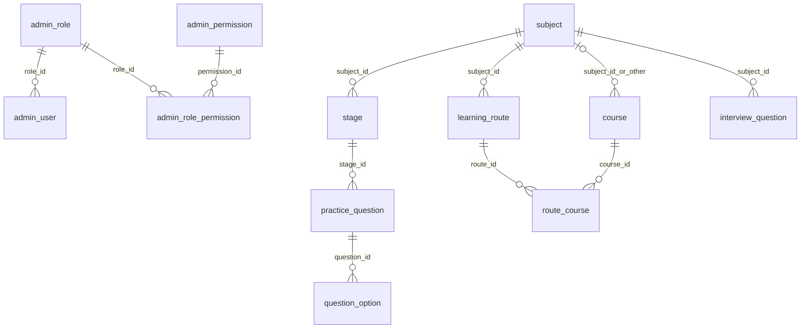
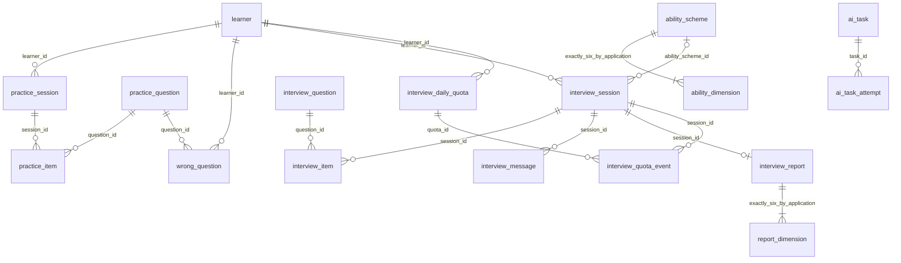

# 云枢智学：数据库设计

> 日期：2026-10-30。
> 状态：数据库结构审阅稿，等待用户审核；DB1、DB3、DB4 已确认 A，DB2（同一学员是否只允许一场未结束面试）仍待回答。不得将未确认的唯一约束当作既定规则。
> 目标：MySQL 8.4 LTS、InnoDB、utf8mb4；全部表使用自增主键，全部跨表关联为逻辑关联，禁止物理外键。
> SQL：[scripts/sql/schema.sql](../../scripts/sql/schema.sql)。本阶段不定义 API、不编写业务代码。

> 后续文件存储确认（2026-10-30）：上传资源使用 MinIO，Vue 构建产物仍由 Nginx 部署；复用现有 `file_asset.storage_provider/bucket_name/object_key`，不新增或修改数据库字段。开发桶与账号由 [Compose 初始化任务](../../deploy/compose/compose.dev.yaml)创建，结构迁移和业务初始化仍单独处理；其他 E 类生产输入继续待补充。

> 基础工程落地（2026-10-30）：已接入 MySQL/MyBatis 与 Flyway，使用应用账号完成连接验证；Flyway 默认关闭，未执行建表 SQL 或写入业务初始数据，本文表结构不变。见[开发指南](../operations/基础工程开发指南.md)。

## 1. 设计依据与确认边界

- [需求文档](../云枢智学-需求文档.md)、[功能模块梳理](./01.功能模块梳理.md)、[整体架构设计](./02.整体架构设计.md)。
- [数据库规范](../rules/database-rules.md)：小写下划线命名、统一单数表名、明确数据类型/空值、自增主键、业务唯一约束、禁止物理外键、应用维护关联完整性。
- [设计选择记录](./00.设计待确认清单.md)：已确认的 48 项 A 是业务基线，不重新打开已关闭的业务分支。
- 已阅读原型题库表单、课程/路线表单、题目来源及训练交互；原型没有标为必填的课程链接、路线描述/学历说明保持可空，不擅自增加表单必填。

### 1.1 本阶段补充确认

| 编号 | 状态 | 对结构的影响 |
|---|---|---|
| DB1 | 已选 A：学员删除后原手机号/邮箱继续占用 | `learner.phone`、`email` 全历史唯一，不能靠软删除释放身份；邮箱可空且 NULL 可多条 |
| DB2 | 待回答：A 至多一场未结束；B 允许并行 | 保留 `open_learner_id` 辅助列但暂不创建唯一索引，不默认允许或禁止并行；SQL 为待确认草案 |
| DB3 | 已选 A：未删除题精确判重 | 同归属、题型/难度、题干与选项/答案/解析比较；忽略来源/主题/标签；唯一指纹仅对未删除题生效 |
| DB4 | 已选 A：练习简答参考答案必填 | 源题和练习快照有条件非空校验；面试题参考答案仍允许为空 |

DB2 若选 A，将在 `interview_session.open_learner_id` 上增加唯一索引，涵盖 `preparing/active`；重新开始先终结旧会话再创建。若选 B，移除该辅助列，保留启动幂等和每场配额核验。当前 SQL 未通过省略索引替用户选择 B，也不应直接部署。

### 1.2 不建立的业务体系

不建独立知识库/源文档、课程完成跟踪、第三方绑定、通知、音视频、报告分享/下载或推荐列表表。面试题只留来源元信息，不保留 Markdown 本体。主题词表、好评率、模型/短信密钥为运行配置，不加入平台基本设置表。

## 2. 实体分组与模块映射

本设计包含 **30 张表**。业务实体和技术支撑记录分开：AI 任务、尝试记录、配额守卫是已确认一致性/恢复机制，不对应新增用户页面。

| 模块 | 表 | 主要职责 |
|---|---|---|
| M02/M11 | learner | 学员身份、资料、状态、认证版本 |
| M12 | admin_user、admin_role、admin_permission、admin_role_permission | 独立后台身份、单角色分配、自定义角色、动作授权 |
| M03 | subject、stage | 学科、阶段、启禁用与排序；方向复用学科 ID |
| M07/M08 | course、learning_route、route_course | 独立课程、同学科唯一启用路线、课程复用与排序 |
| M04 | practice_question、question_option | 练习题、客观答案、审核状态、去重 |
| M05/M06 | practice_session、practice_item、wrong_question | 正常练习和错题重做事实、历史快照、错题复习周期 |
| M09 | interview_question | 与练习题独立的面试原题、只读内容和来源元信息 |
| M10 | interview_session、interview_item、interview_message、interview_report | 会话配置、选题快照、截止时间、作答、文本回放和有效报告 |
| M10 | ability_scheme、ability_dimension、report_dimension | 每方向六维及版本、历史评分尺度和结果快照 |
| M10 | interview_daily_quota、interview_quota_event | 日配额原子守卫与不可重复扣减/返还事实 |
| M05/M10 | ai_task、ai_task_attempt | 持久任务、领取租约、供应商调用、结果未知和恢复核对 |
| M14/M15 | admin_operation_log、platform_setting | 后台审计与基本展示设置 |
| 文件支撑 | file_asset | 头像/Logo/默认头像的存储元信息，不保存二进制/密钥 |
| M01/M13 | 不单独建立业务表 | 门户读取内容与运营运行配置；统计从持久作答、消费、报告和账号事实聚合 |

### 2.1 账号与内容关系



### 2.2 训练、报告与配额关系



图中所有连线仅表示逻辑关系，不产生数据库物理外键。`ai_task` 三种目标中恰有一种非空，通过 CHECK 约束；具体目标和归属存在性由应用检查。

## 3. 统一字段与数据约定

| 项 | 设计规则 |
|---|---|
| 主键 | 所有表 `id BIGINT UNSIGNED NOT NULL AUTO_INCREMENT`；业务请求标识、编码不替代自增主键 |
| 逻辑关联 | 同类型 BIGINT UNSIGNED 的 `*_id`；不声明 REFERENCES/FK，不生成级联动作；ID 必须大于 0，存在性和归属由应用事务验证 |
| 时间 | DATETIME(3) 存 UTC，连接初始化为 +00:00；DATE 业务日由应用用 Asia/Shanghai 计算，不依赖服务器默认时区 |
| 创建/更新 | 所有表都有 created_at/updated_at；业务发生/提交/判分时间独立保存，不能用 updated_at 代替历史时间 |
| 逻辑删除 | 允许删除/移除的实体有 deleted_at，NULL 表示未删除；业务事实不提供删除功能的表不设伪删除开关 |
| 字符集 | utf8mb4_0900_as_ci；技术编码/请求键/手机号显式使用 ascii_bin；邮箱/后台登录名大小写不敏感，保存前规范化 |
| 空值 | 真正未知/未产生/选填用 NULL，空字符串不代替未填写；“其他学科”是 course.subject_id 的明确业务 NULL，不是未校验缺失 |
| 状态 | VARCHAR/整数配 CHECK 有限枚举；状态不是任意字符串；练习题无草稿 |
| 分数 | DECIMAL 精确保存，题分 0—10、报告展示分 0—100；未知成绩 NULL，不以 0 冒充失败或未批改 |
| 时长 | 整数秒，不拼接小时/分钟文本；显示时转换；累计时长不盲信客户端数据 |
| JSON | 仅标签数组、选项/作答快照、AI 结构化结果及文案数组等明确结构；不把需排序/关联/查询的主关系藏进 JSON，不使用逗号拼接 |
| 版本 | revision/auth_version/permission_version/version 表达不同并发/失效目的，不混为一个全局版本 |
| 敏感信息 | 只存密码散列，密钥/验证码/登录令牌不入这些表；审计 details 必须脱敏，AI 输入只保留必要题目与作答上下文 |

`CHECK` 对 NULL 的 UNKNOWN 结果不会自动拒绝，所以关键状态约束显式包含 IS NOT NULL，并以失败用例验证。唯一索引允许多条 NULL，故有意使用生成辅助列处理当前有效关系；不能错误地用 `(业务值, deleted_at)` 保障活动记录唯一。[MySQL CHECK](https://dev.mysql.com/doc/refman/8.4/en/create-table-check-constraints.html)、[唯一索引 NULL 规则](https://dev.mysql.com/doc/refman/8.4/en/create-index.html)

生成列不引用自增 id，只引用普通业务字段；不使用子查询生成跨表状态。[MySQL 生成列限制](https://dev.mysql.com/doc/refman/8.4/en/create-table-generated-columns.html)

## 4. 逐表字段、键和约束

以下字段及约束由与 SQL 相同的结构元数据生成。主键、审计列在每表完整列出。生成列由数据库维护，不应出现在业务写入赋值中。列出的最大长度为本次结构设计建议，需随接口校验保持一致。

### 4.1 `file_asset`：持久文件元信息

所属：文件基础设施。删除能力：支持逻辑删除/移除，具体策略见第 6 节。

| 字段 | 数据类型 | 空值/默认/生成规则 | 含义及逻辑关联 |
|---|---|---|---|
| `id` | `BIGINT UNSIGNED` | `NOT NULL AUTO_INCREMENT` | 自增主键 |
| `storage_provider` | `VARCHAR(32)` | `NOT NULL` | 存储适配标识，不含密钥 |
| `bucket_name` | `VARCHAR(128)` | `NULL DEFAULT NULL` | 对象存储桶；本地存储可空 |
| `object_key` | `VARCHAR(512)` | `NOT NULL` | 不可变存储对象标识，相对存储根目录 |
| `original_name` | `VARCHAR(255)` | `NOT NULL` | 上传文件原始名称 |
| `media_type` | `VARCHAR(100)` | `NOT NULL` | 服务端确认的媒体类型 |
| `size_bytes` | `BIGINT UNSIGNED` | `NOT NULL` | 文件大小，字节 |
| `sha256` | `BINARY(32)` | `NOT NULL` | 文件内容摘要，仅完整性与排查，不强制全局去重 |
| `asset_kind` | `VARCHAR(20)` | `NOT NULL` | avatar/logo/default_avatar |
| `uploaded_by_learner_id` | `BIGINT UNSIGNED` | `NULL DEFAULT NULL` | 逻辑关联 learner.id |
| `uploaded_by_admin_id` | `BIGINT UNSIGNED` | `NULL DEFAULT NULL` | 逻辑关联 admin_user.id |
| `created_at` | `DATETIME(3)` | `NOT NULL DEFAULT CURRENT_TIMESTAMP(3)` | 创建时间，UTC |
| `updated_at` | `DATETIME(3)` | `NOT NULL DEFAULT CURRENT_TIMESTAMP(3) ON UPDATE CURRENT_TIMESTAMP(3)` | 最后更新时间，UTC |
| `deleted_at` | `DATETIME(3)` | `NULL DEFAULT NULL` | 逻辑删除时间；NULL 为未删除，UTC |

键与索引：

- `PRIMARY KEY (id)`，自增。
- ``KEY `idx_asset_owner_learner` (`uploaded_by_learner_id`,`deleted_at`)``。
- ``KEY `idx_asset_owner_admin` (`uploaded_by_admin_id`,`deleted_at`)``。

CHECK（本表命名顺序与 SQL 一致）：

- `ck_file_asset_1`：``asset_kind IN ('avatar','logo','default_avatar')``。
- `ck_file_asset_2`：``(uploaded_by_learner_id IS NOT NULL AND uploaded_by_admin_id IS NULL) OR (uploaded_by_learner_id IS NULL AND uploaded_by_admin_id IS NOT NULL)``。
- `ck_file_asset_3`：```uploaded_by_learner_id` IS NULL OR `uploaded_by_learner_id` > 0``。
- `ck_file_asset_4`：```uploaded_by_admin_id` IS NULL OR `uploaded_by_admin_id` > 0``。

### 4.2 `learner`：学员账号与个人资料

所属：M02/M11。删除能力：支持逻辑删除/移除，具体策略见第 6 节。

| 字段 | 数据类型 | 空值/默认/生成规则 | 含义及逻辑关联 |
|---|---|---|---|
| `id` | `BIGINT UNSIGNED` | `NOT NULL AUTO_INCREMENT` | 自增主键 |
| `phone` | `CHAR(11) CHARACTER SET ascii COLLATE ascii_bin` | `NOT NULL` | 手机号登录；逻辑删除后仍保留唯一占用（DB1A） |
| `email` | `VARCHAR(254) COLLATE utf8mb4_0900_as_ci` | `NULL DEFAULT NULL` | 选填邮箱；空串转 NULL，登录匹配不区分大小写 |
| `password_hash` | `VARCHAR(255) CHARACTER SET ascii COLLATE ascii_bin` | `NOT NULL` | 单向密码散列，不存原始密码 |
| `nickname` | `VARCHAR(64)` | `NOT NULL` | 可编辑展示用户名，不要求唯一 |
| `gender` | `VARCHAR(8)` | `NOT NULL DEFAULT 'secret'` | male/female/secret |
| `avatar_file_id` | `BIGINT UNSIGNED` | `NULL DEFAULT NULL` | 逻辑关联 file_asset.id |
| `status` | `TINYINT UNSIGNED` | `NOT NULL DEFAULT 1` | 1 启用，0 禁用 |
| `auth_version` | `BIGINT UNSIGNED` | `NOT NULL DEFAULT 1` | 会话撤销/认证状态版本，Redis 会话记录同版本 |
| `last_login_at` | `DATETIME(3)` | `NULL DEFAULT NULL` | 从未登录时为空，UTC |
| `created_at` | `DATETIME(3)` | `NOT NULL DEFAULT CURRENT_TIMESTAMP(3)` | 创建时间，UTC |
| `updated_at` | `DATETIME(3)` | `NOT NULL DEFAULT CURRENT_TIMESTAMP(3) ON UPDATE CURRENT_TIMESTAMP(3)` | 最后更新时间，UTC |
| `deleted_at` | `DATETIME(3)` | `NULL DEFAULT NULL` | 逻辑删除时间；NULL 为未删除，UTC |

键与索引：

- `PRIMARY KEY (id)`，自增。
- ``KEY `idx_learner_status_created` (`deleted_at`,`status`,`created_at`,`id`)``。
- ``UNIQUE KEY `uk_learner_phone` (`phone`)``。
- ``UNIQUE KEY `uk_learner_email` (`email`)``。

CHECK（本表命名顺序与 SQL 一致）：

- `ck_learner_1`：``phone REGEXP '^[0-9]{11}$'``。
- `ck_learner_2`：``gender IN ('male','female','secret')``。
- `ck_learner_3`：``status IN (0,1)``。
- `ck_learner_4`：``auth_version >= 1``。
- `ck_learner_5`：``email IS NULL OR CHAR_LENGTH(TRIM(email)) > 0``。
- `ck_learner_6`：``CHAR_LENGTH(TRIM(nickname)) > 0``。
- `ck_learner_7`：```avatar_file_id` IS NULL OR `avatar_file_id` > 0``。

### 4.3 `admin_role`：后台角色

所属：M12。删除能力：支持逻辑删除/移除，具体策略见第 6 节。

| 字段 | 数据类型 | 空值/默认/生成规则 | 含义及逻辑关联 |
|---|---|---|---|
| `id` | `BIGINT UNSIGNED` | `NOT NULL AUTO_INCREMENT` | 自增主键 |
| `role_code` | `VARCHAR(64) CHARACTER SET ascii COLLATE ascii_bin` | `NOT NULL` | 唯一角色编码，包括三个预置角色；历史编码保留 |
| `role_name` | `VARCHAR(64)` | `NOT NULL` | 角色显示名称 |
| `description` | `VARCHAR(500)` | `NULL DEFAULT NULL` | 角色描述 |
| `is_builtin` | `TINYINT UNSIGNED` | `NOT NULL DEFAULT 0` | 1 内置、0 自定义 |
| `permission_version` | `BIGINT UNSIGNED` | `NOT NULL DEFAULT 1` | 全量覆盖授权后的版本，刷新权限缓存 |
| `created_at` | `DATETIME(3)` | `NOT NULL DEFAULT CURRENT_TIMESTAMP(3)` | 创建时间，UTC |
| `updated_at` | `DATETIME(3)` | `NOT NULL DEFAULT CURRENT_TIMESTAMP(3) ON UPDATE CURRENT_TIMESTAMP(3)` | 最后更新时间，UTC |
| `deleted_at` | `DATETIME(3)` | `NULL DEFAULT NULL` | 逻辑删除时间；NULL 为未删除，UTC |

键与索引：

- `PRIMARY KEY (id)`，自增。
- ``UNIQUE KEY `uk_admin_role_code` (`role_code`)``。

CHECK（本表命名顺序与 SQL 一致）：

- `ck_admin_role_1`：``is_builtin IN (0,1)``。
- `ck_admin_role_2`：``permission_version >= 1``。
- `ck_admin_role_3`：``CHAR_LENGTH(role_code) > 0``。
- `ck_admin_role_4`：``CHAR_LENGTH(TRIM(role_name)) > 0``。

### 4.4 `admin_user`：后台内部账号

所属：M12。删除能力：支持逻辑删除/移除，具体策略见第 6 节。

| 字段 | 数据类型 | 空值/默认/生成规则 | 含义及逻辑关联 |
|---|---|---|---|
| `id` | `BIGINT UNSIGNED` | `NOT NULL AUTO_INCREMENT` | 自增主键 |
| `username` | `VARCHAR(64) COLLATE utf8mb4_0900_as_ci` | `NOT NULL` | 登录用户名，历史名称占用，不区分大小写 |
| `phone` | `CHAR(11) CHARACTER SET ascii COLLATE ascii_bin` | `NOT NULL` | 必填联系手机号，不作为学员身份 |
| `email` | `VARCHAR(254)` | `NULL DEFAULT NULL` | 选填联系邮箱 |
| `password_hash` | `VARCHAR(255) CHARACTER SET ascii COLLATE ascii_bin` | `NOT NULL` | 密码散列；默认重置密码由安全运行配置提供 |
| `role_id` | `BIGINT UNSIGNED` | `NOT NULL` | 逻辑关联 admin_role.id |
| `avatar_file_id` | `BIGINT UNSIGNED` | `NULL DEFAULT NULL` | 逻辑关联 file_asset.id |
| `status` | `TINYINT UNSIGNED` | `NOT NULL DEFAULT 1` | 0 禁用、1 启用 |
| `system_identity` | `VARCHAR(32) CHARACTER SET ascii COLLATE ascii_bin` | `NULL DEFAULT NULL` | 仅唯一超级管理员为 super_admin；其他账号 NULL，禁止客户端设置 |
| `auth_version` | `BIGINT UNSIGNED` | `NOT NULL DEFAULT 1` | 认证失效版本 |
| `last_login_at` | `DATETIME(3)` | `NULL DEFAULT NULL` | UTC，首次登录前空 |
| `created_at` | `DATETIME(3)` | `NOT NULL DEFAULT CURRENT_TIMESTAMP(3)` | 创建时间，UTC |
| `updated_at` | `DATETIME(3)` | `NOT NULL DEFAULT CURRENT_TIMESTAMP(3) ON UPDATE CURRENT_TIMESTAMP(3)` | 最后更新时间，UTC |
| `deleted_at` | `DATETIME(3)` | `NULL DEFAULT NULL` | 逻辑删除时间；NULL 为未删除，UTC |

键与索引：

- `PRIMARY KEY (id)`，自增。
- ``UNIQUE KEY `uk_admin_username` (`username`)``。
- ``UNIQUE KEY `uk_admin_system_identity` (`system_identity`)``。
- ``KEY `idx_admin_role_status` (`role_id`,`deleted_at`,`status`)``。

CHECK（本表命名顺序与 SQL 一致）：

- `ck_admin_user_1`：``status IN (0,1)``。
- `ck_admin_user_2`：``phone REGEXP '^[0-9]{11}$'``。
- `ck_admin_user_3`：``system_identity IS NULL OR (system_identity = 'super_admin' AND status = 1 AND deleted_at IS NULL)``。
- `ck_admin_user_4`：``auth_version >= 1``。
- `ck_admin_user_5`：``CHAR_LENGTH(TRIM(username)) > 0``。
- `ck_admin_user_6`：```role_id` IS NULL OR `role_id` > 0``。
- `ck_admin_user_7`：```avatar_file_id` IS NULL OR `avatar_file_id` > 0``。

### 4.5 `admin_permission`：后台动作权限目录

所属：M12。删除能力：业务事实/内部记录，不提供面向用户的删除能力；不自动物理清理。

| 字段 | 数据类型 | 空值/默认/生成规则 | 含义及逻辑关联 |
|---|---|---|---|
| `id` | `BIGINT UNSIGNED` | `NOT NULL AUTO_INCREMENT` | 自增主键 |
| `permission_code` | `VARCHAR(96) CHARACTER SET ascii COLLATE ascii_bin` | `NOT NULL` | 稳定权限编码，完整矩阵后续细化 |
| `permission_name` | `VARCHAR(64)` | `NOT NULL` | 动作名称 |
| `group_code` | `VARCHAR(64) CHARACTER SET ascii COLLATE ascii_bin` | `NOT NULL` | 菜单/功能分组编码 |
| `sort_order` | `INT UNSIGNED` | `NOT NULL DEFAULT 0` | 展示排序 |
| `is_enabled` | `TINYINT UNSIGNED` | `NOT NULL DEFAULT 1` | 目录项有效标志；由迁移/运行维护，不新增业务页面 |
| `created_at` | `DATETIME(3)` | `NOT NULL DEFAULT CURRENT_TIMESTAMP(3)` | 创建时间，UTC |
| `updated_at` | `DATETIME(3)` | `NOT NULL DEFAULT CURRENT_TIMESTAMP(3) ON UPDATE CURRENT_TIMESTAMP(3)` | 最后更新时间，UTC |

键与索引：

- `PRIMARY KEY (id)`，自增。
- ``UNIQUE KEY `uk_permission_code` (`permission_code`)``。
- ``KEY `idx_permission_group_sort` (`group_code`,`sort_order`)``。

CHECK（本表命名顺序与 SQL 一致）：

- `ck_admin_permission_1`：``is_enabled IN (0,1)``。

### 4.6 `admin_role_permission`：角色动作授权

所属：M12。删除能力：支持逻辑删除/移除，具体策略见第 6 节。

| 字段 | 数据类型 | 空值/默认/生成规则 | 含义及逻辑关联 |
|---|---|---|---|
| `id` | `BIGINT UNSIGNED` | `NOT NULL AUTO_INCREMENT` | 自增主键 |
| `role_id` | `BIGINT UNSIGNED` | `NOT NULL` | 逻辑关联 admin_role.id |
| `permission_id` | `BIGINT UNSIGNED` | `NOT NULL` | 逻辑关联 admin_permission.id |
| `active_permission_id` | `BIGINT UNSIGNED` | `GENERATED ALWAYS AS (CASE WHEN deleted_at IS NULL THEN permission_id ELSE NULL END) STORED` | 当前有效授权辅助列 |
| `created_at` | `DATETIME(3)` | `NOT NULL DEFAULT CURRENT_TIMESTAMP(3)` | 创建时间，UTC |
| `updated_at` | `DATETIME(3)` | `NOT NULL DEFAULT CURRENT_TIMESTAMP(3) ON UPDATE CURRENT_TIMESTAMP(3)` | 最后更新时间，UTC |
| `deleted_at` | `DATETIME(3)` | `NULL DEFAULT NULL` | 逻辑删除时间；NULL 为未删除，UTC |

键与索引：

- `PRIMARY KEY (id)`，自增。
- ``UNIQUE KEY `uk_role_permission_active` (`role_id`,`active_permission_id`)``。
- ``KEY `idx_role_permission_reverse` (`permission_id`,`deleted_at`,`role_id`)``。

CHECK（本表命名顺序与 SQL 一致）：

- `ck_admin_role_permission_1`：```role_id` IS NULL OR `role_id` > 0``。
- `ck_admin_role_permission_2`：```permission_id` IS NULL OR `permission_id` > 0``。

### 4.7 `subject`：学科/面试方向

所属：M03。删除能力：支持逻辑删除/移除，具体策略见第 6 节。

| 字段 | 数据类型 | 空值/默认/生成规则 | 含义及逻辑关联 |
|---|---|---|---|
| `id` | `BIGINT UNSIGNED` | `NOT NULL AUTO_INCREMENT` | 自增主键 |
| `subject_code` | `VARCHAR(64) CHARACTER SET ascii COLLATE ascii_bin` | `NOT NULL` | 稳定编码，名称可修改，不以名称关联 |
| `subject_name` | `VARCHAR(100)` | `NOT NULL` | 学科名称 |
| `icon` | `VARCHAR(64)` | `NOT NULL` | Emoji/展示图标 |
| `description` | `VARCHAR(1000)` | `NOT NULL` | 学科描述 |
| `theme_color` | `CHAR(7) CHARACTER SET ascii` | `NOT NULL` | 主题色 #RRGGBB |
| `sort_order` | `INT UNSIGNED` | `NOT NULL DEFAULT 0` | 越小越靠前，同序用 id 稳定排序 |
| `created_at` | `DATETIME(3)` | `NOT NULL DEFAULT CURRENT_TIMESTAMP(3)` | 创建时间，UTC |
| `updated_at` | `DATETIME(3)` | `NOT NULL DEFAULT CURRENT_TIMESTAMP(3) ON UPDATE CURRENT_TIMESTAMP(3)` | 最后更新时间，UTC |
| `deleted_at` | `DATETIME(3)` | `NULL DEFAULT NULL` | 逻辑删除时间；NULL 为未删除，UTC |

键与索引：

- `PRIMARY KEY (id)`，自增。
- ``UNIQUE KEY `uk_subject_code` (`subject_code`)``。
- ``KEY `idx_subject_sort` (`deleted_at`,`sort_order`,`id`)``。

CHECK（本表命名顺序与 SQL 一致）：

- `ck_subject_1`：``CHAR_LENGTH(TRIM(subject_name)) > 0``。
- `ck_subject_2`：``theme_color REGEXP '^#[0-9A-Fa-f]{6}$'``。

### 4.8 `stage`：学科阶段

所属：M03。删除能力：支持逻辑删除/移除，具体策略见第 6 节。

| 字段 | 数据类型 | 空值/默认/生成规则 | 含义及逻辑关联 |
|---|---|---|---|
| `id` | `BIGINT UNSIGNED` | `NOT NULL AUTO_INCREMENT` | 自增主键 |
| `subject_id` | `BIGINT UNSIGNED` | `NOT NULL` | 逻辑关联 subject.id |
| `stage_name` | `VARCHAR(100)` | `NOT NULL` | 阶段名称 |
| `icon` | `VARCHAR(64)` | `NULL DEFAULT NULL` | 空则展示默认图标 |
| `sort_order` | `INT UNSIGNED` | `NOT NULL DEFAULT 0` | 学科内排序 |
| `is_enabled` | `TINYINT UNSIGNED` | `NOT NULL DEFAULT 1` | 1 启用、0 禁用 |
| `created_at` | `DATETIME(3)` | `NOT NULL DEFAULT CURRENT_TIMESTAMP(3)` | 创建时间，UTC |
| `updated_at` | `DATETIME(3)` | `NOT NULL DEFAULT CURRENT_TIMESTAMP(3) ON UPDATE CURRENT_TIMESTAMP(3)` | 最后更新时间，UTC |
| `deleted_at` | `DATETIME(3)` | `NULL DEFAULT NULL` | 逻辑删除时间；NULL 为未删除，UTC |

键与索引：

- `PRIMARY KEY (id)`，自增。
- ``KEY `idx_stage_subject_sort` (`subject_id`,`deleted_at`,`is_enabled`,`sort_order`,`id`)``。

CHECK（本表命名顺序与 SQL 一致）：

- `ck_stage_1`：``is_enabled IN (0,1)``。
- `ck_stage_2`：``CHAR_LENGTH(TRIM(stage_name)) > 0``。
- `ck_stage_3`：```subject_id` IS NULL OR `subject_id` > 0``。

### 4.9 `course`：独立课程库

所属：M07。删除能力：支持逻辑删除/移除，具体策略见第 6 节。

| 字段 | 数据类型 | 空值/默认/生成规则 | 含义及逻辑关联 |
|---|---|---|---|
| `id` | `BIGINT UNSIGNED` | `NOT NULL AUTO_INCREMENT` | 自增主键 |
| `subject_id` | `BIGINT UNSIGNED` | `NULL DEFAULT NULL` | NULL 仅表示明确选择其他学科兜底，不是省略必选项；关联 `subject.id` |
| `title` | `VARCHAR(255)` | `NOT NULL` | 课程标题 |
| `source` | `VARCHAR(12)` | `NOT NULL` | bilibili/other |
| `course_url` | `VARCHAR(2048)` | `NULL DEFAULT NULL` | 选填外链；未配置时空，不伪造链接 |
| `bvid` | `VARCHAR(32) CHARACTER SET ascii COLLATE ascii_bin` | `NULL DEFAULT NULL` | B 站 BV 号，其他来源为空；唯一标识见原型说明 |
| `cover_url` | `VARCHAR(2048)` | `NULL DEFAULT NULL` | 人工维护封面 URL |
| `duration_seconds` | `INT UNSIGNED` | `NOT NULL` | 总时长，统一秒；表单转换不混存小时/分钟字符串 |
| `play_count` | `BIGINT UNSIGNED` | `NULL DEFAULT NULL` | 未知为空，不以 0 冒充已知播放量 |
| `created_at` | `DATETIME(3)` | `NOT NULL DEFAULT CURRENT_TIMESTAMP(3)` | 创建时间，UTC |
| `updated_at` | `DATETIME(3)` | `NOT NULL DEFAULT CURRENT_TIMESTAMP(3) ON UPDATE CURRENT_TIMESTAMP(3)` | 最后更新时间，UTC |
| `deleted_at` | `DATETIME(3)` | `NULL DEFAULT NULL` | 逻辑删除时间；NULL 为未删除，UTC |

键与索引：

- `PRIMARY KEY (id)`，自增。
- ``KEY `idx_course_subject` (`subject_id`,`deleted_at`,`source`,`id`)``。
- ``UNIQUE KEY `uk_course_bvid` (`bvid`)``。

CHECK（本表命名顺序与 SQL 一致）：

- `ck_course_1`：``source IN ('bilibili','other')``。
- `ck_course_2`：``source = 'bilibili' OR bvid IS NULL``。
- `ck_course_3`：``duration_seconds > 0``。
- `ck_course_4`：``CHAR_LENGTH(TRIM(title)) > 0``。
- `ck_course_5`：``course_url IS NULL OR CHAR_LENGTH(TRIM(course_url)) > 0``。
- `ck_course_6`：```subject_id` IS NULL OR `subject_id` > 0``。

### 4.10 `learning_route`：学习路线

所属：M08。删除能力：支持逻辑删除/移除，具体策略见第 6 节。

| 字段 | 数据类型 | 空值/默认/生成规则 | 含义及逻辑关联 |
|---|---|---|---|
| `id` | `BIGINT UNSIGNED` | `NOT NULL AUTO_INCREMENT` | 自增主键 |
| `subject_id` | `BIGINT UNSIGNED` | `NOT NULL` | 逻辑关联 subject.id |
| `route_name` | `VARCHAR(150)` | `NOT NULL` | 路线名称 |
| `icon` | `VARCHAR(64)` | `NULL DEFAULT NULL` | 图标 |
| `suitable_education` | `VARCHAR(255)` | `NULL DEFAULT NULL` | 选填学历/人群说明，空不冒充已填写 |
| `description` | `TEXT` | `NULL DEFAULT NULL` | 选填路线描述 |
| `is_enabled` | `TINYINT UNSIGNED` | `NOT NULL DEFAULT 1` | 同学科最多一条启用路线 |
| `enabled_subject_id` | `BIGINT UNSIGNED` | `GENERATED ALWAYS AS (CASE WHEN deleted_at IS NULL AND is_enabled = 1 THEN subject_id ELSE NULL END) STORED` | 同学科唯一有效路线辅助列 |
| `created_at` | `DATETIME(3)` | `NOT NULL DEFAULT CURRENT_TIMESTAMP(3)` | 创建时间，UTC |
| `updated_at` | `DATETIME(3)` | `NOT NULL DEFAULT CURRENT_TIMESTAMP(3) ON UPDATE CURRENT_TIMESTAMP(3)` | 最后更新时间，UTC |
| `deleted_at` | `DATETIME(3)` | `NULL DEFAULT NULL` | 逻辑删除时间；NULL 为未删除，UTC |

键与索引：

- `PRIMARY KEY (id)`，自增。
- ``UNIQUE KEY `uk_route_enabled_subject` (`enabled_subject_id`)``。
- ``KEY `idx_route_subject` (`subject_id`,`deleted_at`,`id`)``。

CHECK（本表命名顺序与 SQL 一致）：

- `ck_learning_route_1`：``is_enabled IN (0,1)``。
- `ck_learning_route_2`：``CHAR_LENGTH(TRIM(route_name)) > 0``。
- `ck_learning_route_3`：```subject_id` IS NULL OR `subject_id` > 0``。

### 4.11 `route_course`：路线课程引用与排序

所属：M08。删除能力：支持逻辑删除/移除，具体策略见第 6 节。

| 字段 | 数据类型 | 空值/默认/生成规则 | 含义及逻辑关联 |
|---|---|---|---|
| `id` | `BIGINT UNSIGNED` | `NOT NULL AUTO_INCREMENT` | 自增主键 |
| `route_id` | `BIGINT UNSIGNED` | `NOT NULL` | 逻辑关联 learning_route.id |
| `course_id` | `BIGINT UNSIGNED` | `NOT NULL` | 逻辑关联 course.id |
| `sort_order` | `INT UNSIGNED` | `NOT NULL` | 从 1 开始的路线内序号 |
| `active_course_id` | `BIGINT UNSIGNED` | `GENERATED ALWAYS AS (CASE WHEN deleted_at IS NULL THEN course_id ELSE NULL END) STORED` | 有效课程引用去重 |
| `active_sort_order` | `INT UNSIGNED` | `GENERATED ALWAYS AS (CASE WHEN deleted_at IS NULL THEN sort_order ELSE NULL END) STORED` | 有效排序去重 |
| `created_at` | `DATETIME(3)` | `NOT NULL DEFAULT CURRENT_TIMESTAMP(3)` | 创建时间，UTC |
| `updated_at` | `DATETIME(3)` | `NOT NULL DEFAULT CURRENT_TIMESTAMP(3) ON UPDATE CURRENT_TIMESTAMP(3)` | 最后更新时间，UTC |
| `deleted_at` | `DATETIME(3)` | `NULL DEFAULT NULL` | 逻辑删除时间；NULL 为未删除，UTC |

键与索引：

- `PRIMARY KEY (id)`，自增。
- ``UNIQUE KEY `uk_route_course_active` (`route_id`,`active_course_id`)``。
- ``UNIQUE KEY `uk_route_course_sort` (`route_id`,`active_sort_order`)``。
- ``KEY `idx_route_course_reverse` (`course_id`,`deleted_at`,`route_id`)``。

CHECK（本表命名顺序与 SQL 一致）：

- `ck_route_course_1`：``sort_order >= 1``。
- `ck_route_course_2`：```route_id` IS NULL OR `route_id` > 0``。
- `ck_route_course_3`：```course_id` IS NULL OR `course_id` > 0``。

### 4.12 `practice_question`：练习题库

所属：M04。删除能力：支持逻辑删除/移除，具体策略见第 6 节。

| 字段 | 数据类型 | 空值/默认/生成规则 | 含义及逻辑关联 |
|---|---|---|---|
| `id` | `BIGINT UNSIGNED` | `NOT NULL AUTO_INCREMENT` | 自增主键 |
| `stage_id` | `BIGINT UNSIGNED` | `NOT NULL` | 逻辑关联 stage.id |
| `question_type` | `VARCHAR(8)` | `NOT NULL` | single/multiple/judge/short |
| `difficulty` | `TINYINT UNSIGNED` | `NOT NULL` | 1 简单、2 中等、3 困难 |
| `stem` | `MEDIUMTEXT` | `NOT NULL` | 题干，可包含已校验 Markdown |
| `reference_answer` | `MEDIUMTEXT` | `NULL DEFAULT NULL` | 简答必填参考答案（DB4A），客观题答案由选项表达 |
| `analysis` | `MEDIUMTEXT` | `NULL DEFAULT NULL` | 题目解析 |
| `tags` | `JSON` | `NOT NULL DEFAULT (JSON_ARRAY())` | 标签字符串数组，非逗号拼接 |
| `status` | `VARCHAR(16)` | `NOT NULL DEFAULT 'pending_review'` | pending_review/published/unpublished/rejected；无草稿 |
| `revision` | `INT UNSIGNED` | `NOT NULL DEFAULT 1` | 内容/状态并发版本，不表示新版本继续在线 |
| `content_fingerprint` | `BINARY(32)` | `NOT NULL` | DB3A 规范化内容 SHA-256，不含来源/标签/主题；范围由唯一索引表达 |
| `created_by_admin_id` | `BIGINT UNSIGNED` | `NOT NULL` | 逻辑关联 admin_user.id |
| `updated_by_admin_id` | `BIGINT UNSIGNED` | `NOT NULL` | 逻辑关联 admin_user.id |
| `reviewed_by_admin_id` | `BIGINT UNSIGNED` | `NULL DEFAULT NULL` | 逻辑关联 admin_user.id |
| `reviewed_at` | `DATETIME(3)` | `NULL DEFAULT NULL` | UTC，未审核为空 |
| `rejection_reason` | `VARCHAR(1000)` | `NULL DEFAULT NULL` | 驳回说明，历史审批事件记录操作日志 |
| `active_fingerprint` | `BINARY(32)` | `GENERATED ALWAYS AS (CASE WHEN deleted_at IS NULL THEN content_fingerprint ELSE NULL END) STORED` | 未删除题内容唯一性辅助列 |
| `created_at` | `DATETIME(3)` | `NOT NULL DEFAULT CURRENT_TIMESTAMP(3)` | 创建时间，UTC |
| `updated_at` | `DATETIME(3)` | `NOT NULL DEFAULT CURRENT_TIMESTAMP(3) ON UPDATE CURRENT_TIMESTAMP(3)` | 最后更新时间，UTC |
| `deleted_at` | `DATETIME(3)` | `NULL DEFAULT NULL` | 逻辑删除时间；NULL 为未删除，UTC |

键与索引：

- `PRIMARY KEY (id)`，自增。
- ``KEY `idx_question_stage_filter` (`stage_id`,`deleted_at`,`status`,`question_type`,`difficulty`,`id`)``。
- ``KEY `idx_question_status_time` (`status`,`deleted_at`,`created_at`,`id`)``。
- ``UNIQUE KEY `uk_practice_question_fingerprint` (`stage_id`,`question_type`,`difficulty`,`active_fingerprint`)``。

CHECK（本表命名顺序与 SQL 一致）：

- `ck_practice_question_1`：``question_type IN ('single','multiple','judge','short')``。
- `ck_practice_question_2`：``difficulty BETWEEN 1 AND 3``。
- `ck_practice_question_3`：``status IN ('pending_review','published','unpublished','rejected')``。
- `ck_practice_question_4`：``JSON_TYPE(tags) = 'ARRAY'``。
- `ck_practice_question_5`：``revision >= 1``。
- `ck_practice_question_6`：``CHAR_LENGTH(TRIM(stem)) > 0``。
- `ck_practice_question_7`：```stage_id` IS NULL OR `stage_id` > 0``。
- `ck_practice_question_8`：```created_by_admin_id` IS NULL OR `created_by_admin_id` > 0``。
- `ck_practice_question_9`：```updated_by_admin_id` IS NULL OR `updated_by_admin_id` > 0``。
- `ck_practice_question_10`：```reviewed_by_admin_id` IS NULL OR `reviewed_by_admin_id` > 0``。
- `ck_practice_question_11`：``question_type <> 'short' OR (reference_answer IS NOT NULL AND CHAR_LENGTH(TRIM(reference_answer)) > 0)``。

### 4.13 `question_option`：练习题选项与客观答案

所属：M04。删除能力：支持逻辑删除/移除，具体策略见第 6 节。

| 字段 | 数据类型 | 空值/默认/生成规则 | 含义及逻辑关联 |
|---|---|---|---|
| `id` | `BIGINT UNSIGNED` | `NOT NULL AUTO_INCREMENT` | 自增主键 |
| `question_id` | `BIGINT UNSIGNED` | `NOT NULL` | 逻辑关联 practice_question.id |
| `option_key` | `VARCHAR(8) CHARACTER SET ascii COLLATE ascii_bin` | `NOT NULL` | 稳定选项键，展示字母按顺序生成 |
| `option_text` | `TEXT` | `NOT NULL` | 选项内容，判断题也使用两项 |
| `sort_order` | `SMALLINT UNSIGNED` | `NOT NULL` | 从 1 开始 |
| `is_correct` | `TINYINT UNSIGNED` | `NOT NULL` | 是否正确答案 |
| `active_option_key` | `VARCHAR(8) CHARACTER SET ascii COLLATE ascii_bin` | `GENERATED ALWAYS AS (CASE WHEN deleted_at IS NULL THEN option_key ELSE NULL END) STORED` | 有效选项键辅助列 |
| `active_sort_order` | `SMALLINT UNSIGNED` | `GENERATED ALWAYS AS (CASE WHEN deleted_at IS NULL THEN sort_order ELSE NULL END) STORED` | 有效选项排序辅助列 |
| `created_at` | `DATETIME(3)` | `NOT NULL DEFAULT CURRENT_TIMESTAMP(3)` | 创建时间，UTC |
| `updated_at` | `DATETIME(3)` | `NOT NULL DEFAULT CURRENT_TIMESTAMP(3) ON UPDATE CURRENT_TIMESTAMP(3)` | 最后更新时间，UTC |
| `deleted_at` | `DATETIME(3)` | `NULL DEFAULT NULL` | 逻辑删除时间；NULL 为未删除，UTC |

键与索引：

- `PRIMARY KEY (id)`，自增。
- ``UNIQUE KEY `uk_question_option_key` (`question_id`,`active_option_key`)``。
- ``UNIQUE KEY `uk_question_option_sort` (`question_id`,`active_sort_order`)``。

CHECK（本表命名顺序与 SQL 一致）：

- `ck_question_option_1`：``is_correct IN (0,1)``。
- `ck_question_option_2`：``sort_order >= 1``。
- `ck_question_option_3`：``CHAR_LENGTH(option_key) > 0``。
- `ck_question_option_4`：```question_id` IS NULL OR `question_id` > 0``。

### 4.14 `practice_session`：练习/错题重做会话

所属：M05/M06。删除能力：业务事实/内部记录，不提供面向用户的删除能力；不自动物理清理。

| 字段 | 数据类型 | 空值/默认/生成规则 | 含义及逻辑关联 |
|---|---|---|---|
| `id` | `BIGINT UNSIGNED` | `NOT NULL AUTO_INCREMENT` | 自增主键 |
| `learner_id` | `BIGINT UNSIGNED` | `NOT NULL` | 逻辑关联 learner.id |
| `entry_kind` | `VARCHAR(12)` | `NOT NULL` | stage/single/random/wrong_review |
| `practice_mode` | `VARCHAR(8)` | `NOT NULL` | ordered/random/single |
| `subject_id` | `BIGINT UNSIGNED` | `NULL DEFAULT NULL` | 逻辑关联 subject.id |
| `stage_id` | `BIGINT UNSIGNED` | `NULL DEFAULT NULL` | 逻辑关联 stage.id |
| `title_snapshot` | `VARCHAR(150)` | `NOT NULL` | 练习标题快照 |
| `status` | `VARCHAR(12)` | `NOT NULL DEFAULT 'active'` | active/ended/abandoned |
| `start_request_id` | `VARCHAR(64) CHARACTER SET ascii COLLATE ascii_bin` | `NOT NULL` | 客户端同一启动意图的稳定幂等标识，不是主键 |
| `started_at` | `DATETIME(3)` | `NOT NULL` | UTC |
| `ended_at` | `DATETIME(3)` | `NULL DEFAULT NULL` | UTC，未结束空 |
| `elapsed_seconds` | `INT UNSIGNED` | `NOT NULL DEFAULT 0` | 校验后的累计练习用时，不盲信客户端 |
| `question_count` | `SMALLINT UNSIGNED` | `NOT NULL` | 本次实际题目数 |
| `created_at` | `DATETIME(3)` | `NOT NULL DEFAULT CURRENT_TIMESTAMP(3)` | 创建时间，UTC |
| `updated_at` | `DATETIME(3)` | `NOT NULL DEFAULT CURRENT_TIMESTAMP(3) ON UPDATE CURRENT_TIMESTAMP(3)` | 最后更新时间，UTC |

键与索引：

- `PRIMARY KEY (id)`，自增。
- ``UNIQUE KEY `uk_practice_start` (`learner_id`,`start_request_id`)``。
- ``KEY `idx_practice_learner_time` (`learner_id`,`started_at`,`id`)``。

CHECK（本表命名顺序与 SQL 一致）：

- `ck_practice_session_1`：``entry_kind IN ('stage','single','random','wrong_review')``。
- `ck_practice_session_2`：``practice_mode IN ('ordered','random','single')``。
- `ck_practice_session_3`：``status IN ('active','ended','abandoned')``。
- `ck_practice_session_4`：``question_count > 0``。
- `ck_practice_session_5`：``(status = 'active' AND ended_at IS NULL) OR (status <> 'active' AND ended_at IS NOT NULL)``。
- `ck_practice_session_6`：``ended_at IS NULL OR ended_at >= started_at``。
- `ck_practice_session_7`：```learner_id` IS NULL OR `learner_id` > 0``。
- `ck_practice_session_8`：```subject_id` IS NULL OR `subject_id` > 0``。
- `ck_practice_session_9`：```stage_id` IS NULL OR `stage_id` > 0``。

### 4.15 `practice_item`：练习题快照、作答与批改事实

所属：M05/M06。删除能力：业务事实/内部记录，不提供面向用户的删除能力；不自动物理清理。

| 字段 | 数据类型 | 空值/默认/生成规则 | 含义及逻辑关联 |
|---|---|---|---|
| `id` | `BIGINT UNSIGNED` | `NOT NULL AUTO_INCREMENT` | 自增主键 |
| `session_id` | `BIGINT UNSIGNED` | `NOT NULL` | 逻辑关联 practice_session.id |
| `learner_id` | `BIGINT UNSIGNED` | `NOT NULL` | 逻辑关联 learner.id |
| `question_id` | `BIGINT UNSIGNED` | `NOT NULL` | 逻辑关联 practice_question.id |
| `wrong_question_id` | `BIGINT UNSIGNED` | `NULL DEFAULT NULL` | 逻辑关联 wrong_question.id |
| `item_no` | `SMALLINT UNSIGNED` | `NOT NULL` | 固定题序，1 起 |
| `question_revision` | `INT UNSIGNED` | `NOT NULL` | 取题时源题版本 |
| `subject_id` | `BIGINT UNSIGNED` | `NOT NULL` | 逻辑关联 subject.id |
| `stage_id` | `BIGINT UNSIGNED` | `NOT NULL` | 逻辑关联 stage.id |
| `subject_name_snapshot` | `VARCHAR(100)` | `NOT NULL` | 历史方向名称 |
| `stage_name_snapshot` | `VARCHAR(100)` | `NOT NULL` | 历史阶段名 |
| `question_type` | `VARCHAR(8)` | `NOT NULL` | 取题时题型 |
| `difficulty` | `TINYINT UNSIGNED` | `NOT NULL` | 取题时难度 |
| `stem_snapshot` | `MEDIUMTEXT` | `NOT NULL` | 题干快照 |
| `options_snapshot` | `JSON` | `NULL DEFAULT NULL` | 有序选项数组，含稳定键/内容/正确标记；简答为空 |
| `reference_answer_snapshot` | `MEDIUMTEXT` | `NULL DEFAULT NULL` | 参考答案快照 |
| `analysis_snapshot` | `MEDIUMTEXT` | `NULL DEFAULT NULL` | 解析快照 |
| `selected_option_keys` | `JSON` | `NULL DEFAULT NULL` | 客观作答键数组，不保存逗号串 |
| `answer_text` | `MEDIUMTEXT` | `NULL DEFAULT NULL` | 简答实际文本 |
| `submit_request_id` | `VARCHAR(64) CHARACTER SET ascii COLLATE ascii_bin` | `NULL DEFAULT NULL` | 同次提交稳定标识，提交后不可替换 |
| `status` | `VARCHAR(12)` | `NOT NULL DEFAULT 'unanswered'` | unanswered/grading/graded/failed |
| `score` | `DECIMAL(4,2)` | `NULL DEFAULT NULL` | 0—10；客观题正确 10、错误 0；未批改 NULL |
| `is_correct` | `TINYINT UNSIGNED` | `GENERATED ALWAYS AS (CASE WHEN status = 'graded' THEN score >= 6 ELSE NULL END) STORED` | 唯一正确性来源，未批改空 |
| `feedback` | `TEXT` | `NULL DEFAULT NULL` | 简答评语 |
| `key_points` | `JSON` | `NULL DEFAULT NULL` | 简答关键点数组 |
| `submitted_at` | `DATETIME(3)` | `NULL DEFAULT NULL` | 实际提交 UTC |
| `graded_at` | `DATETIME(3)` | `NULL DEFAULT NULL` | 批改结果接受时间 UTC |
| `graded_business_date` | `DATE` | `NULL DEFAULT NULL` | 判分日，Asia/Shanghai；用于练习统计和学习日 |
| `result_applied_at` | `DATETIME(3)` | `NULL DEFAULT NULL` | 统计/错题已同步应用时间，须与接受结果同事务 |
| `created_at` | `DATETIME(3)` | `NOT NULL DEFAULT CURRENT_TIMESTAMP(3)` | 创建时间，UTC |
| `updated_at` | `DATETIME(3)` | `NOT NULL DEFAULT CURRENT_TIMESTAMP(3) ON UPDATE CURRENT_TIMESTAMP(3)` | 最后更新时间，UTC |

键与索引：

- `PRIMARY KEY (id)`，自增。
- ``UNIQUE KEY `uk_practice_item_no` (`session_id`,`item_no`)``。
- ``UNIQUE KEY `uk_practice_item_question` (`session_id`,`question_id`)``。
- ``UNIQUE KEY `uk_practice_submit_request` (`learner_id`,`submit_request_id`)``。
- ``KEY `idx_practice_learner_day` (`learner_id`,`graded_business_date`,`is_correct`,`id`)``。
- ``KEY `idx_practice_question_stats` (`question_id`,`status`,`learner_id`,`id`)``。

CHECK（本表命名顺序与 SQL 一致）：

- `ck_practice_item_1`：``question_type IN ('single','multiple','judge','short')``。
- `ck_practice_item_2`：``difficulty BETWEEN 1 AND 3``。
- `ck_practice_item_3`：``item_no >= 1``。
- `ck_practice_item_4`：``status IN ('unanswered','grading','graded','failed')``。
- `ck_practice_item_5`：``(status = 'graded' AND score IS NOT NULL AND score BETWEEN 0 AND 10 AND graded_at IS NOT NULL AND graded_business_date IS NOT NULL AND result_applied_at IS NOT NULL) OR (status <> 'graded' AND score IS NULL AND graded_at IS NULL AND graded_business_date IS NULL AND result_applied_at IS NULL)``。
- `ck_practice_item_6`：``selected_option_keys IS NULL OR JSON_TYPE(selected_option_keys) = 'ARRAY'``。
- `ck_practice_item_7`：``options_snapshot IS NULL OR JSON_TYPE(options_snapshot) = 'ARRAY'``。
- `ck_practice_item_8`：```session_id` IS NULL OR `session_id` > 0``。
- `ck_practice_item_9`：```learner_id` IS NULL OR `learner_id` > 0``。
- `ck_practice_item_10`：```question_id` IS NULL OR `question_id` > 0``。
- `ck_practice_item_11`：```wrong_question_id` IS NULL OR `wrong_question_id` > 0``。
- `ck_practice_item_12`：```subject_id` IS NULL OR `subject_id` > 0``。
- `ck_practice_item_13`：```stage_id` IS NULL OR `stage_id` > 0``。
- `ck_practice_item_14`：``status = 'unanswered' OR (submitted_at IS NOT NULL AND submit_request_id IS NOT NULL AND ((question_type = 'short' AND answer_text IS NOT NULL AND CHAR_LENGTH(TRIM(answer_text)) > 0) OR (question_type <> 'short' AND selected_option_keys IS NOT NULL AND JSON_TYPE(selected_option_keys) = 'ARRAY' AND JSON_LENGTH(selected_option_keys) >= 1)))``。
- `ck_practice_item_15`：``question_type = 'short' OR score IS NULL OR score IN (0,10)``。
- `ck_practice_item_16`：``key_points IS NULL OR JSON_TYPE(key_points) = 'ARRAY'``。
- `ck_practice_item_17`：``(question_type = 'short' AND reference_answer_snapshot IS NOT NULL AND CHAR_LENGTH(TRIM(reference_answer_snapshot)) > 0 AND options_snapshot IS NULL) OR (question_type <> 'short' AND options_snapshot IS NOT NULL AND JSON_TYPE(options_snapshot) = 'ARRAY' AND JSON_LENGTH(options_snapshot) >= 2)``。

### 4.16 `wrong_question`：学员错题复习周期

所属：M06。删除能力：支持逻辑删除/移除，具体策略见第 6 节。

| 字段 | 数据类型 | 空值/默认/生成规则 | 含义及逻辑关联 |
|---|---|---|---|
| `id` | `BIGINT UNSIGNED` | `NOT NULL AUTO_INCREMENT` | 自增主键 |
| `learner_id` | `BIGINT UNSIGNED` | `NOT NULL` | 逻辑关联 learner.id |
| `question_id` | `BIGINT UNSIGNED` | `NOT NULL` | 逻辑关联 practice_question.id |
| `first_wrong_item_id` | `BIGINT UNSIGNED` | `NOT NULL` | 逻辑关联 practice_item.id |
| `last_wrong_item_id` | `BIGINT UNSIGNED` | `NOT NULL` | 逻辑关联 practice_item.id |
| `wrong_count` | `INT UNSIGNED` | `NOT NULL DEFAULT 1` | 本轮错误次数，重做错也增加 |
| `correct_streak` | `TINYINT UNSIGNED` | `NOT NULL DEFAULT 0` | 当前连续正确次数，错则 0 |
| `status` | `VARCHAR(8)` | `NOT NULL DEFAULT 'pending'` | pending/mastered |
| `mastered_method` | `VARCHAR(8)` | `NULL DEFAULT NULL` | auto/manual；未掌握空 |
| `mastered_at` | `DATETIME(3)` | `NULL DEFAULT NULL` | UTC，重新错后清除 |
| `last_wrong_at` | `DATETIME(3)` | `NOT NULL` | 最近错时间 UTC |
| `active_question_id` | `BIGINT UNSIGNED` | `GENERATED ALWAYS AS (CASE WHEN deleted_at IS NULL THEN question_id ELSE NULL END) STORED` | 同学员当前唯一错题，移除后可新建周期 |
| `created_at` | `DATETIME(3)` | `NOT NULL DEFAULT CURRENT_TIMESTAMP(3)` | 创建时间，UTC |
| `updated_at` | `DATETIME(3)` | `NOT NULL DEFAULT CURRENT_TIMESTAMP(3) ON UPDATE CURRENT_TIMESTAMP(3)` | 最后更新时间，UTC |
| `deleted_at` | `DATETIME(3)` | `NULL DEFAULT NULL` | 逻辑删除时间；NULL 为未删除，UTC |

键与索引：

- `PRIMARY KEY (id)`，自增。
- ``UNIQUE KEY `uk_wrong_active` (`learner_id`,`active_question_id`)``。
- ``KEY `idx_wrong_recent` (`learner_id`,`deleted_at`,`status`,`last_wrong_at`,`id`)``。
- ``KEY `idx_wrong_top` (`learner_id`,`deleted_at`,`status`,`wrong_count`,`last_wrong_at`)``。

CHECK（本表命名顺序与 SQL 一致）：

- `ck_wrong_question_1`：``wrong_count >= 1``。
- `ck_wrong_question_2`：``correct_streak BETWEEN 0 AND 3``。
- `ck_wrong_question_3`：``status IN ('pending','mastered')``。
- `ck_wrong_question_4`：``(status = 'pending' AND mastered_method IS NULL AND mastered_at IS NULL AND correct_streak < 3) OR (status = 'mastered' AND mastered_method IS NOT NULL AND mastered_method IN ('auto','manual') AND mastered_at IS NOT NULL AND (mastered_method = 'manual' OR correct_streak = 3))``。
- `ck_wrong_question_5`：```learner_id` IS NULL OR `learner_id` > 0``。
- `ck_wrong_question_6`：```question_id` IS NULL OR `question_id` > 0``。
- `ck_wrong_question_7`：```first_wrong_item_id` IS NULL OR `first_wrong_item_id` > 0``。
- `ck_wrong_question_8`：```last_wrong_item_id` IS NULL OR `last_wrong_item_id` > 0``。

### 4.17 `interview_question`：独立面试题库

所属：M09。删除能力：支持逻辑删除/移除，具体策略见第 6 节。

| 字段 | 数据类型 | 空值/默认/生成规则 | 含义及逻辑关联 |
|---|---|---|---|
| `id` | `BIGINT UNSIGNED` | `NOT NULL AUTO_INCREMENT` | 自增主键 |
| `subject_id` | `BIGINT UNSIGNED` | `NOT NULL` | 逻辑关联 subject.id |
| `stem` | `MEDIUMTEXT` | `NOT NULL` | 录入后只读题干 |
| `reference_answer` | `MEDIUMTEXT` | `NULL DEFAULT NULL` | 允许空，不能伪造参考答案 |
| `difficulty` | `TINYINT UNSIGNED` | `NOT NULL DEFAULT 2` | 1/2/3，允许编辑 |
| `topic` | `VARCHAR(100)` | `NULL DEFAULT NULL` | 未分类用 NULL；词表运行配置，允许词表外旧值 |
| `tags` | `JSON` | `NOT NULL DEFAULT (JSON_ARRAY())` | 标签数组，录入后只读 |
| `origin` | `VARCHAR(8)` | `NOT NULL` | markdown/manual |
| `source_document_name` | `VARCHAR(255)` | `NULL DEFAULT NULL` | 仅原文件名，不存源文件或知识库 ID |
| `source_question_no` | `SMALLINT UNSIGNED` | `NULL DEFAULT NULL` | 导入文件内题号，1 起 |
| `source_line_no` | `INT UNSIGNED` | `NULL DEFAULT NULL` | 源 Markdown 行号，1 起 |
| `created_by_admin_id` | `BIGINT UNSIGNED` | `NOT NULL` | 逻辑关联 admin_user.id |
| `content_fingerprint` | `BINARY(32)` | `NOT NULL` | DB3A 规范化内容 SHA-256，不含来源/标签/主题；范围由唯一索引表达 |
| `active_fingerprint` | `BINARY(32)` | `GENERATED ALWAYS AS (CASE WHEN deleted_at IS NULL THEN content_fingerprint ELSE NULL END) STORED` | 当前去重辅助列 |
| `created_at` | `DATETIME(3)` | `NOT NULL DEFAULT CURRENT_TIMESTAMP(3)` | 创建时间，UTC |
| `updated_at` | `DATETIME(3)` | `NOT NULL DEFAULT CURRENT_TIMESTAMP(3) ON UPDATE CURRENT_TIMESTAMP(3)` | 最后更新时间，UTC |
| `deleted_at` | `DATETIME(3)` | `NULL DEFAULT NULL` | 逻辑删除时间；NULL 为未删除，UTC |

键与索引：

- `PRIMARY KEY (id)`，自增。
- ``KEY `idx_interview_question_pick` (`subject_id`,`deleted_at`,`difficulty`,`id`)``。
- ``KEY `idx_interview_question_topic` (`subject_id`,`deleted_at`,`topic`,`difficulty`,`id`)``。
- ``UNIQUE KEY `uk_interview_question_fingerprint` (`subject_id`,`difficulty`,`active_fingerprint`)``。

CHECK（本表命名顺序与 SQL 一致）：

- `ck_interview_question_1`：``difficulty BETWEEN 1 AND 3``。
- `ck_interview_question_2`：``origin IN ('markdown','manual')``。
- `ck_interview_question_3`：``JSON_TYPE(tags) = 'ARRAY'``。
- `ck_interview_question_4`：``CHAR_LENGTH(TRIM(stem)) > 0``。
- `ck_interview_question_5`：``(origin = 'manual' AND source_document_name IS NULL AND source_question_no IS NULL AND source_line_no IS NULL) OR (origin = 'markdown' AND source_document_name IS NOT NULL AND source_question_no IS NOT NULL AND source_question_no >= 1 AND source_line_no IS NOT NULL AND source_line_no >= 1)``。
- `ck_interview_question_6`：```subject_id` IS NULL OR `subject_id` > 0``。
- `ck_interview_question_7`：```created_by_admin_id` IS NULL OR `created_by_admin_id` > 0``。

### 4.18 `ability_scheme`：方向六维评价版本

所属：M10 内部配置。删除能力：支持逻辑删除/移除，具体策略见第 6 节。

| 字段 | 数据类型 | 空值/默认/生成规则 | 含义及逻辑关联 |
|---|---|---|---|
| `id` | `BIGINT UNSIGNED` | `NOT NULL AUTO_INCREMENT` | 自增主键 |
| `subject_id` | `BIGINT UNSIGNED` | `NOT NULL` | 逻辑关联 subject.id |
| `version_no` | `INT UNSIGNED` | `NOT NULL` | 方向内版本，不变更既有报告 |
| `scheme_name` | `VARCHAR(100)` | `NOT NULL` | 内部方案名 |
| `is_enabled` | `TINYINT UNSIGNED` | `NOT NULL DEFAULT 0` | 是否当前有效；启用前应用校验恰有六维 |
| `enabled_subject_id` | `BIGINT UNSIGNED` | `GENERATED ALWAYS AS (CASE WHEN deleted_at IS NULL AND is_enabled = 1 THEN subject_id ELSE NULL END) STORED` | 同方向唯一启用方案 |
| `created_at` | `DATETIME(3)` | `NOT NULL DEFAULT CURRENT_TIMESTAMP(3)` | 创建时间，UTC |
| `updated_at` | `DATETIME(3)` | `NOT NULL DEFAULT CURRENT_TIMESTAMP(3) ON UPDATE CURRENT_TIMESTAMP(3)` | 最后更新时间，UTC |
| `deleted_at` | `DATETIME(3)` | `NULL DEFAULT NULL` | 逻辑删除时间；NULL 为未删除，UTC |

键与索引：

- `PRIMARY KEY (id)`，自增。
- ``UNIQUE KEY `uk_ability_scheme_version` (`subject_id`,`version_no`)``。
- ``UNIQUE KEY `uk_ability_scheme_enabled` (`enabled_subject_id`)``。

CHECK（本表命名顺序与 SQL 一致）：

- `ck_ability_scheme_1`：``version_no >= 1``。
- `ck_ability_scheme_2`：``is_enabled IN (0,1)``。
- `ck_ability_scheme_3`：```subject_id` IS NULL OR `subject_id` > 0``。

### 4.19 `ability_dimension`：固定六维定义

所属：M10 内部配置。删除能力：业务事实/内部记录，不提供面向用户的删除能力；不自动物理清理。

| 字段 | 数据类型 | 空值/默认/生成规则 | 含义及逻辑关联 |
|---|---|---|---|
| `id` | `BIGINT UNSIGNED` | `NOT NULL AUTO_INCREMENT` | 自增主键 |
| `scheme_id` | `BIGINT UNSIGNED` | `NOT NULL` | 逻辑关联 ability_scheme.id |
| `dimension_code` | `VARCHAR(64) CHARACTER SET ascii COLLATE ascii_bin` | `NOT NULL` | 方案内稳定维度码 |
| `dimension_name` | `VARCHAR(100)` | `NOT NULL` | 维度名称待后续评估设计确定，不填演示样例 |
| `sort_order` | `TINYINT UNSIGNED` | `NOT NULL` | 1—6 |
| `scoring_rubric` | `TEXT` | `NOT NULL` | 评分尺度与指导，方案启用后不可原地更改，另建版本 |
| `created_at` | `DATETIME(3)` | `NOT NULL DEFAULT CURRENT_TIMESTAMP(3)` | 创建时间，UTC |
| `updated_at` | `DATETIME(3)` | `NOT NULL DEFAULT CURRENT_TIMESTAMP(3) ON UPDATE CURRENT_TIMESTAMP(3)` | 最后更新时间，UTC |

键与索引：

- `PRIMARY KEY (id)`，自增。
- ``UNIQUE KEY `uk_ability_dimension_code` (`scheme_id`,`dimension_code`)``。
- ``UNIQUE KEY `uk_ability_dimension_sort` (`scheme_id`,`sort_order`)``。

CHECK（本表命名顺序与 SQL 一致）：

- `ck_ability_dimension_1`：``sort_order BETWEEN 1 AND 6``。
- `ck_ability_dimension_2`：```scheme_id` IS NULL OR `scheme_id` > 0``。

### 4.20 `interview_session`：面试会话及配置快照

所属：M10。删除能力：业务事实/内部记录，不提供面向用户的删除能力；不自动物理清理。

| 字段 | 数据类型 | 空值/默认/生成规则 | 含义及逻辑关联 |
|---|---|---|---|
| `id` | `BIGINT UNSIGNED` | `NOT NULL AUTO_INCREMENT` | 自增主键 |
| `learner_id` | `BIGINT UNSIGNED` | `NOT NULL` | 逻辑关联 learner.id |
| `subject_id` | `BIGINT UNSIGNED` | `NOT NULL` | 逻辑关联 subject.id |
| `ability_scheme_id` | `BIGINT UNSIGNED` | `NULL DEFAULT NULL` | 首题准备前可空；激活前必须有有效六维方案；关联 `ability_scheme.id` |
| `direction_name_snapshot` | `VARCHAR(100)` | `NOT NULL` | 方向名称快照 |
| `difficulty` | `TINYINT UNSIGNED` | `NOT NULL` | 固定难度 |
| `question_count` | `TINYINT UNSIGNED` | `NOT NULL` | 3/5/8/10/15 |
| `answer_timeout_seconds` | `SMALLINT UNSIGNED` | `NOT NULL DEFAULT 300` | 固定每题 300 秒 |
| `status` | `VARCHAR(16)` | `NOT NULL DEFAULT 'preparing'` | preparing/active/completed/ended_early/abandoned/failed |
| `start_request_id` | `VARCHAR(64) CHARACTER SET ascii COLLATE ascii_bin` | `NOT NULL` | 一次启动意图稳定标识 |
| `quota_business_date` | `DATE` | `NULL DEFAULT NULL` | 消费归属北京时间自然日；未扣次前空 |
| `started_at` | `DATETIME(3)` | `NULL DEFAULT NULL` | 成功创建并首题就绪 UTC |
| `ended_at` | `DATETIME(3)` | `NULL DEFAULT NULL` | 终结 UTC |
| `elapsed_seconds` | `INT UNSIGNED` | `NOT NULL DEFAULT 0` | 后端确认用时 |
| `failure_code` | `VARCHAR(64) CHARACTER SET ascii COLLATE ascii_bin` | `NULL DEFAULT NULL` | 结构化失败原因，不写供应商密钥/堆栈 |
| `version` | `INT UNSIGNED` | `NOT NULL DEFAULT 1` | 状态并发控制版本 |
| `open_learner_id` | `BIGINT UNSIGNED` | `GENERATED ALWAYS AS (CASE WHEN status IN ('preparing','active') THEN learner_id ELSE NULL END) STORED` | 待 DB2 决定是否启用唯一索引；不引用自增 id |
| `created_at` | `DATETIME(3)` | `NOT NULL DEFAULT CURRENT_TIMESTAMP(3)` | 创建时间，UTC |
| `updated_at` | `DATETIME(3)` | `NOT NULL DEFAULT CURRENT_TIMESTAMP(3) ON UPDATE CURRENT_TIMESTAMP(3)` | 最后更新时间，UTC |

键与索引：

- `PRIMARY KEY (id)`，自增。
- ``UNIQUE KEY `uk_interview_start` (`learner_id`,`start_request_id`)``。
- ``KEY `idx_interview_learner_time` (`learner_id`,`started_at`,`id`)``。
- ``KEY `idx_interview_trend` (`learner_id`,`subject_id`,`status`,`started_at`,`id`)``。

CHECK（本表命名顺序与 SQL 一致）：

- `ck_interview_session_1`：``difficulty BETWEEN 1 AND 3``。
- `ck_interview_session_2`：``question_count IN (3,5,8,10,15)``。
- `ck_interview_session_3`：``answer_timeout_seconds = 300``。
- `ck_interview_session_4`：``status IN ('preparing','active','completed','ended_early','abandoned','failed')``。
- `ck_interview_session_5`：``status <> 'active' OR (started_at IS NOT NULL AND quota_business_date IS NOT NULL AND ability_scheme_id IS NOT NULL)``。
- `ck_interview_session_6`：``version >= 1``。
- `ck_interview_session_7`：``ended_at IS NULL OR started_at IS NULL OR ended_at >= started_at``。
- `ck_interview_session_8`：```learner_id` IS NULL OR `learner_id` > 0``。
- `ck_interview_session_9`：```subject_id` IS NULL OR `subject_id` > 0``。
- `ck_interview_session_10`：```ability_scheme_id` IS NULL OR `ability_scheme_id` > 0``。

### 4.21 `interview_item`：面试原题快照与逐题作答

所属：M10。删除能力：业务事实/内部记录，不提供面向用户的删除能力；不自动物理清理。

| 字段 | 数据类型 | 空值/默认/生成规则 | 含义及逻辑关联 |
|---|---|---|---|
| `id` | `BIGINT UNSIGNED` | `NOT NULL AUTO_INCREMENT` | 自增主键 |
| `session_id` | `BIGINT UNSIGNED` | `NOT NULL` | 逻辑关联 interview_session.id |
| `learner_id` | `BIGINT UNSIGNED` | `NOT NULL` | 逻辑关联 learner.id |
| `question_id` | `BIGINT UNSIGNED` | `NOT NULL` | 逻辑关联 interview_question.id |
| `item_no` | `TINYINT UNSIGNED` | `NOT NULL` | 固定题序 |
| `stem_snapshot` | `MEDIUMTEXT` | `NOT NULL` | 面试原题，不由模型改写 |
| `reference_answer_snapshot` | `MEDIUMTEXT` | `NULL DEFAULT NULL` | 可空参考答案 |
| `topic_snapshot` | `VARCHAR(100)` | `NULL DEFAULT NULL` | 取题时主题 |
| `difficulty` | `TINYINT UNSIGNED` | `NOT NULL` | 固定难度快照 |
| `status` | `VARCHAR(12)` | `NOT NULL DEFAULT 'waiting'` | waiting/asking/grading/graded/timed_out/failed |
| `asked_at` | `DATETIME(3)` | `NULL DEFAULT NULL` | 题目开始 UTC |
| `deadline_at` | `DATETIME(3)` | `NULL DEFAULT NULL` | 服务端截止 UTC，不随本地恢复改变 |
| `answer_text` | `MEDIUMTEXT` | `NULL DEFAULT NULL` | 有效用户作答；超时未答不伪造文本 |
| `submit_request_id` | `VARCHAR(64) CHARACTER SET ascii COLLATE ascii_bin` | `NULL DEFAULT NULL` | 单次答案幂等键 |
| `answered_at` | `DATETIME(3)` | `NULL DEFAULT NULL` | 有效提交 UTC，不含自动超时 |
| `answered_business_date` | `DATE` | `NULL DEFAULT NULL` | 有效作答的北京时间自然日，用于学习日 |
| `score` | `DECIMAL(4,2)` | `NULL DEFAULT NULL` | 0—10，超时强制 0，未批改空 |
| `feedback` | `TEXT` | `NULL DEFAULT NULL` | 评分反馈 |
| `key_points` | `JSON` | `NULL DEFAULT NULL` | 关键点评价数组 |
| `graded_at` | `DATETIME(3)` | `NULL DEFAULT NULL` | 计分 UTC |
| `created_at` | `DATETIME(3)` | `NOT NULL DEFAULT CURRENT_TIMESTAMP(3)` | 创建时间，UTC |
| `updated_at` | `DATETIME(3)` | `NOT NULL DEFAULT CURRENT_TIMESTAMP(3) ON UPDATE CURRENT_TIMESTAMP(3)` | 最后更新时间，UTC |

键与索引：

- `PRIMARY KEY (id)`，自增。
- ``UNIQUE KEY `uk_interview_item_no` (`session_id`,`item_no`)``。
- ``UNIQUE KEY `uk_interview_item_question` (`session_id`,`question_id`)``。
- ``UNIQUE KEY `uk_interview_submit` (`learner_id`,`submit_request_id`)``。
- ``KEY `idx_interview_answer_day` (`learner_id`,`answered_business_date`,`id`)``。
- ``KEY `idx_interview_deadline` (`status`,`deadline_at`,`id`)``。

CHECK（本表命名顺序与 SQL 一致）：

- `ck_interview_item_1`：``item_no BETWEEN 1 AND 15``。
- `ck_interview_item_2`：``difficulty BETWEEN 1 AND 3``。
- `ck_interview_item_3`：``status IN ('waiting','asking','grading','graded','timed_out','failed')``。
- `ck_interview_item_4`：``(status IN ('graded','timed_out') AND score IS NOT NULL AND score BETWEEN 0 AND 10 AND graded_at IS NOT NULL) OR (status NOT IN ('graded','timed_out') AND score IS NULL AND graded_at IS NULL)``。
- `ck_interview_item_5`：``status <> 'timed_out' OR (score = 0 AND answered_at IS NULL AND answered_business_date IS NULL)``。
- `ck_interview_item_6`：``(asked_at IS NULL AND deadline_at IS NULL) OR (asked_at IS NOT NULL AND deadline_at IS NOT NULL AND deadline_at = asked_at + INTERVAL 300 SECOND)``。
- `ck_interview_item_7`：``(answered_at IS NULL AND answered_business_date IS NULL) OR (answered_at IS NOT NULL AND answered_business_date IS NOT NULL AND answer_text IS NOT NULL AND CHAR_LENGTH(TRIM(answer_text)) > 0 AND deadline_at IS NOT NULL AND answered_at <= deadline_at)``。
- `ck_interview_item_8`：``status NOT IN ('asking','grading','graded','timed_out') OR (asked_at IS NOT NULL AND deadline_at IS NOT NULL)``。
- `ck_interview_item_9`：``status <> 'graded' OR (answered_at IS NOT NULL AND answered_business_date IS NOT NULL AND answer_text IS NOT NULL)``。
- `ck_interview_item_10`：``status <> 'timed_out' OR answer_text IS NULL``。
- `ck_interview_item_11`：``answered_at IS NULL OR submit_request_id IS NOT NULL``。
- `ck_interview_item_12`：``status <> 'grading' OR answered_at IS NOT NULL``。
- `ck_interview_item_13`：``key_points IS NULL OR JSON_TYPE(key_points) = 'ARRAY'``。
- `ck_interview_item_14`：```session_id` IS NULL OR `session_id` > 0``。
- `ck_interview_item_15`：```learner_id` IS NULL OR `learner_id` > 0``。
- `ck_interview_item_16`：```question_id` IS NULL OR `question_id` > 0``。

### 4.22 `interview_message`：面试文本回放消息

所属：M10。删除能力：业务事实/内部记录，不提供面向用户的删除能力；不自动物理清理。

| 字段 | 数据类型 | 空值/默认/生成规则 | 含义及逻辑关联 |
|---|---|---|---|
| `id` | `BIGINT UNSIGNED` | `NOT NULL AUTO_INCREMENT` | 自增主键 |
| `session_id` | `BIGINT UNSIGNED` | `NOT NULL` | 逻辑关联 interview_session.id |
| `item_id` | `BIGINT UNSIGNED` | `NULL DEFAULT NULL` | 逻辑关联 interview_item.id |
| `message_no` | `INT UNSIGNED` | `NOT NULL` | 会话内稳定递增顺序 |
| `sender_role` | `VARCHAR(12)` | `NOT NULL` | assistant/user/system |
| `message_kind` | `VARCHAR(16)` | `NOT NULL` | greeting/question/answer/feedback/closing/notice |
| `content` | `MEDIUMTEXT` | `NOT NULL` | 用于回放的文本，非音频/视频 |
| `sent_at` | `DATETIME(3)` | `NOT NULL` | 实际消息 UTC |
| `dedup_key` | `VARCHAR(64) CHARACTER SET ascii COLLATE ascii_bin` | `NOT NULL` | 同一次已接受消息的稳定标识，阻止重试重复入库 |
| `created_at` | `DATETIME(3)` | `NOT NULL DEFAULT CURRENT_TIMESTAMP(3)` | 创建时间，UTC |
| `updated_at` | `DATETIME(3)` | `NOT NULL DEFAULT CURRENT_TIMESTAMP(3) ON UPDATE CURRENT_TIMESTAMP(3)` | 最后更新时间，UTC |

键与索引：

- `PRIMARY KEY (id)`，自增。
- ``UNIQUE KEY `uk_message_no` (`session_id`,`message_no`)``。
- ``UNIQUE KEY `uk_message_dedup` (`session_id`,`dedup_key`)``。
- ``KEY `idx_message_item` (`item_id`,`message_no`)``。

CHECK（本表命名顺序与 SQL 一致）：

- `ck_interview_message_1`：``sender_role IN ('assistant','user','system')``。
- `ck_interview_message_2`：``message_kind IN ('greeting','question','answer','feedback','closing','notice')``。
- `ck_interview_message_3`：``message_no >= 1``。
- `ck_interview_message_4`：```session_id` IS NULL OR `session_id` > 0``。
- `ck_interview_message_5`：```item_id` IS NULL OR `item_id` > 0``。

### 4.23 `interview_report`：有效面试报告快照

所属：M10。删除能力：业务事实/内部记录，不提供面向用户的删除能力；不自动物理清理。

| 字段 | 数据类型 | 空值/默认/生成规则 | 含义及逻辑关联 |
|---|---|---|---|
| `id` | `BIGINT UNSIGNED` | `NOT NULL AUTO_INCREMENT` | 自增主键 |
| `session_id` | `BIGINT UNSIGNED` | `NOT NULL` | 逻辑关联 interview_session.id |
| `learner_id` | `BIGINT UNSIGNED` | `NOT NULL` | 逻辑关联 learner.id |
| `subject_id` | `BIGINT UNSIGNED` | `NOT NULL` | 逻辑关联 subject.id |
| `ability_scheme_id` | `BIGINT UNSIGNED` | `NOT NULL` | 逻辑关联 ability_scheme.id |
| `report_kind` | `VARCHAR(8)` | `NOT NULL` | complete/partial，零有效提交不创建有效报告 |
| `total_score` | `DECIMAL(5,2)` | `NOT NULL` | 已计分题平均×10；0—100 |
| `accuracy_percent` | `DECIMAL(5,2)` | `NOT NULL` | 计分题中 >=6 分的比例×100 |
| `planned_count` | `TINYINT UNSIGNED` | `NOT NULL` | 配置题数 |
| `scored_count` | `TINYINT UNSIGNED` | `NOT NULL` | 已计分含超时，不含未到达题 |
| `human_answer_count` | `TINYINT UNSIGNED` | `NOT NULL` | 有效已计分用户回答，必须 >=1 |
| `timeout_count` | `TINYINT UNSIGNED` | `NOT NULL` | 超时计分数量 |
| `duration_seconds` | `INT UNSIGNED` | `NOT NULL` | 报告用时快照 |
| `strengths` | `JSON` | `NOT NULL` | 优点字符串数组 |
| `weaknesses` | `JSON` | `NOT NULL` | 问题/指导建议对象数组 |
| `improvement_suggestions` | `JSON` | `NOT NULL` | 改进建议数组 |
| `guidance_cards` | `JSON` | `NOT NULL` | 题目/课程/再面试三类指导文案，无推荐列表或跳转 |
| `generated_at` | `DATETIME(3)` | `NOT NULL` | 报告生成接受时间 UTC |
| `started_at_snapshot` | `DATETIME(3)` | `NOT NULL` | 面试发生时间 UTC，用于稳定历史比较 |
| `direction_name_snapshot` | `VARCHAR(100)` | `NOT NULL` | 方向名快照 |
| `difficulty` | `TINYINT UNSIGNED` | `NOT NULL` | 难度快照 |
| `created_at` | `DATETIME(3)` | `NOT NULL DEFAULT CURRENT_TIMESTAMP(3)` | 创建时间，UTC |
| `updated_at` | `DATETIME(3)` | `NOT NULL DEFAULT CURRENT_TIMESTAMP(3) ON UPDATE CURRENT_TIMESTAMP(3)` | 最后更新时间，UTC |

键与索引：

- `PRIMARY KEY (id)`，自增。
- ``UNIQUE KEY `uk_report_session` (`session_id`)``。
- ``KEY `idx_report_history` (`learner_id`,`started_at_snapshot`,`id`)``。
- ``KEY `idx_report_trend` (`learner_id`,`subject_id`,`report_kind`,`started_at_snapshot`,`id`)``。

CHECK（本表命名顺序与 SQL 一致）：

- `ck_interview_report_1`：``report_kind IN ('complete','partial')``。
- `ck_interview_report_2`：``total_score BETWEEN 0 AND 100``。
- `ck_interview_report_3`：``accuracy_percent BETWEEN 0 AND 100``。
- `ck_interview_report_4`：``planned_count IN (3,5,8,10,15)``。
- `ck_interview_report_5`：``human_answer_count >= 1 AND scored_count = human_answer_count + timeout_count AND scored_count <= planned_count``。
- `ck_interview_report_6`：``(report_kind = 'complete' AND scored_count = planned_count) OR (report_kind = 'partial' AND scored_count < planned_count)``。
- `ck_interview_report_7`：``difficulty BETWEEN 1 AND 3``。
- `ck_interview_report_8`：``JSON_TYPE(strengths) = 'ARRAY' AND JSON_TYPE(weaknesses) = 'ARRAY' AND JSON_TYPE(improvement_suggestions) = 'ARRAY' AND JSON_TYPE(guidance_cards) = 'ARRAY' AND JSON_LENGTH(guidance_cards) = 3``。
- `ck_interview_report_9`：```session_id` IS NULL OR `session_id` > 0``。
- `ck_interview_report_10`：```learner_id` IS NULL OR `learner_id` > 0``。
- `ck_interview_report_11`：```subject_id` IS NULL OR `subject_id` > 0``。
- `ck_interview_report_12`：```ability_scheme_id` IS NULL OR `ability_scheme_id` > 0``。

### 4.24 `report_dimension`：报告六维分数快照

所属：M10。删除能力：业务事实/内部记录，不提供面向用户的删除能力；不自动物理清理。

| 字段 | 数据类型 | 空值/默认/生成规则 | 含义及逻辑关联 |
|---|---|---|---|
| `id` | `BIGINT UNSIGNED` | `NOT NULL AUTO_INCREMENT` | 自增主键 |
| `report_id` | `BIGINT UNSIGNED` | `NOT NULL` | 逻辑关联 interview_report.id |
| `dimension_id` | `BIGINT UNSIGNED` | `NOT NULL` | 逻辑关联 ability_dimension.id |
| `dimension_code_snapshot` | `VARCHAR(64) CHARACTER SET ascii COLLATE ascii_bin` | `NOT NULL` | 维度码快照 |
| `dimension_name_snapshot` | `VARCHAR(100)` | `NOT NULL` | 维度名称快照 |
| `rubric_snapshot` | `TEXT` | `NOT NULL` | 当时评分尺度 |
| `sort_order` | `TINYINT UNSIGNED` | `NOT NULL` | 1—6 |
| `score` | `DECIMAL(5,2)` | `NOT NULL` | 展示分 0—100，具体维度评分规则后续审定 |
| `commentary` | `TEXT` | `NULL DEFAULT NULL` | 维度评价 |
| `created_at` | `DATETIME(3)` | `NOT NULL DEFAULT CURRENT_TIMESTAMP(3)` | 创建时间，UTC |
| `updated_at` | `DATETIME(3)` | `NOT NULL DEFAULT CURRENT_TIMESTAMP(3) ON UPDATE CURRENT_TIMESTAMP(3)` | 最后更新时间，UTC |

键与索引：

- `PRIMARY KEY (id)`，自增。
- ``UNIQUE KEY `uk_report_dimension` (`report_id`,`dimension_id`)``。
- ``UNIQUE KEY `uk_report_dimension_sort` (`report_id`,`sort_order`)``。

CHECK（本表命名顺序与 SQL 一致）：

- `ck_report_dimension_1`：``sort_order BETWEEN 1 AND 6``。
- `ck_report_dimension_2`：``score BETWEEN 0 AND 100``。
- `ck_report_dimension_3`：```report_id` IS NULL OR `report_id` > 0``。
- `ck_report_dimension_4`：```dimension_id` IS NULL OR `dimension_id` > 0``。

### 4.25 `interview_daily_quota`：面试日配额并发守卫

所属：M10。删除能力：业务事实/内部记录，不提供面向用户的删除能力；不自动物理清理。

| 字段 | 数据类型 | 空值/默认/生成规则 | 含义及逻辑关联 |
|---|---|---|---|
| `id` | `BIGINT UNSIGNED` | `NOT NULL AUTO_INCREMENT` | 自增主键 |
| `learner_id` | `BIGINT UNSIGNED` | `NOT NULL` | 逻辑关联 learner.id |
| `business_date` | `DATE` | `NOT NULL` | 北京时间消费归属日 |
| `daily_limit` | `TINYINT UNSIGNED` | `NOT NULL DEFAULT 5` | 本期固定 5 |
| `charged_count` | `INT UNSIGNED` | `NOT NULL DEFAULT 0` | 该日累计成功扣次数，退款不回写原流水 |
| `refunded_count` | `INT UNSIGNED` | `NOT NULL DEFAULT 0` | 该日累计确认返还次数 |
| `used_count` | `INT` | `GENERATED ALWAYS AS (CAST(charged_count AS SIGNED) - CAST(refunded_count AS SIGNED)) STORED` | 当前净消费，避免无符号减法下溢 |
| `version` | `BIGINT UNSIGNED` | `NOT NULL DEFAULT 1` | 条件更新并发版本 |
| `created_at` | `DATETIME(3)` | `NOT NULL DEFAULT CURRENT_TIMESTAMP(3)` | 创建时间，UTC |
| `updated_at` | `DATETIME(3)` | `NOT NULL DEFAULT CURRENT_TIMESTAMP(3) ON UPDATE CURRENT_TIMESTAMP(3)` | 最后更新时间，UTC |

键与索引：

- `PRIMARY KEY (id)`，自增。
- ``UNIQUE KEY `uk_quota_learner_day` (`learner_id`,`business_date`)``。

CHECK（本表命名顺序与 SQL 一致）：

- `ck_interview_daily_quota_1`：``daily_limit = 5``。
- `ck_interview_daily_quota_2`：``refunded_count <= charged_count``。
- `ck_interview_daily_quota_3`：``used_count BETWEEN 0 AND 5``。
- `ck_interview_daily_quota_4`：``version >= 1``。
- `ck_interview_daily_quota_5`：```learner_id` IS NULL OR `learner_id` > 0``。

### 4.26 `interview_quota_event`：配额扣减/返还事实

所属：M10。删除能力：业务事实/内部记录，不提供面向用户的删除能力；不自动物理清理。

| 字段 | 数据类型 | 空值/默认/生成规则 | 含义及逻辑关联 |
|---|---|---|---|
| `id` | `BIGINT UNSIGNED` | `NOT NULL AUTO_INCREMENT` | 自增主键 |
| `quota_id` | `BIGINT UNSIGNED` | `NOT NULL` | 逻辑关联 interview_daily_quota.id |
| `session_id` | `BIGINT UNSIGNED` | `NOT NULL` | 逻辑关联 interview_session.id |
| `learner_id` | `BIGINT UNSIGNED` | `NOT NULL` | 逻辑关联 learner.id |
| `business_date` | `DATE` | `NOT NULL` | 归原消费日；跨日退款不占用新日 |
| `event_type` | `VARCHAR(8)` | `NOT NULL` | charge/refund，每会话至多各一条 |
| `reason_code` | `VARCHAR(64) CHARACTER SET ascii COLLATE ascii_bin` | `NOT NULL` | create_ready/platform_failure 等受控原因 |
| `occurred_at` | `DATETIME(3)` | `NOT NULL` | UTC |
| `created_at` | `DATETIME(3)` | `NOT NULL DEFAULT CURRENT_TIMESTAMP(3)` | 创建时间，UTC |
| `updated_at` | `DATETIME(3)` | `NOT NULL DEFAULT CURRENT_TIMESTAMP(3) ON UPDATE CURRENT_TIMESTAMP(3)` | 最后更新时间，UTC |

键与索引：

- `PRIMARY KEY (id)`，自增。
- ``UNIQUE KEY `uk_quota_event_once` (`session_id`,`event_type`)``。
- ``KEY `idx_quota_event_reconcile` (`quota_id`,`event_type`,`id`)``。
- ``KEY `idx_quota_event_learner` (`learner_id`,`business_date`,`event_type`)``。

CHECK（本表命名顺序与 SQL 一致）：

- `ck_interview_quota_event_1`：``event_type IN ('charge','refund')``。
- `ck_interview_quota_event_2`：```quota_id` IS NULL OR `quota_id` > 0``。
- `ck_interview_quota_event_3`：```session_id` IS NULL OR `session_id` > 0``。
- `ck_interview_quota_event_4`：```learner_id` IS NULL OR `learner_id` > 0``。

### 4.27 `ai_task`：持久 AI 工作状态

所属：M05/M10 技术支撑。删除能力：业务事实/内部记录，不提供面向用户的删除能力；不自动物理清理。

| 字段 | 数据类型 | 空值/默认/生成规则 | 含义及逻辑关联 |
|---|---|---|---|
| `id` | `BIGINT UNSIGNED` | `NOT NULL AUTO_INCREMENT` | 自增主键 |
| `learner_id` | `BIGINT UNSIGNED` | `NOT NULL` | 逻辑关联 learner.id |
| `task_type` | `VARCHAR(20)` | `NOT NULL` | practice_grade/interview_grade/interview_report |
| `practice_item_id` | `BIGINT UNSIGNED` | `NULL DEFAULT NULL` | 逻辑关联 practice_item.id |
| `interview_item_id` | `BIGINT UNSIGNED` | `NULL DEFAULT NULL` | 逻辑关联 interview_item.id |
| `interview_session_id` | `BIGINT UNSIGNED` | `NULL DEFAULT NULL` | 逻辑关联 interview_session.id |
| `status` | `VARCHAR(12)` | `NOT NULL DEFAULT 'pending'` | pending/running/succeeded/failed/unknown/cancelled |
| `prompt_version` | `VARCHAR(64) CHARACTER SET ascii COLLATE ascii_bin` | `NOT NULL` | 可追踪提示模板版本，不存密钥 |
| `input_snapshot` | `JSON` | `NOT NULL` | 必要题目/作答上下文，访问受控；不打入普通日志 |
| `result_payload` | `JSON` | `NULL DEFAULT NULL` | 待校验/已校验结构结果；业务接受必须另过状态条件 |
| `attempt_count` | `INT UNSIGNED` | `NOT NULL DEFAULT 0` | 已发起外部请求次数 |
| `available_at` | `DATETIME(3)` | `NOT NULL` | UTC，允许执行时间 |
| `lease_owner` | `VARCHAR(64) CHARACTER SET ascii COLLATE ascii_bin` | `NULL DEFAULT NULL` | 执行者标识 |
| `lease_expires_at` | `DATETIME(3)` | `NULL DEFAULT NULL` | UTC，过期只触发核对，不自动重发外部调用 |
| `finished_at` | `DATETIME(3)` | `NULL DEFAULT NULL` | UTC |
| `failure_code` | `VARCHAR(64) CHARACTER SET ascii COLLATE ascii_bin` | `NULL DEFAULT NULL` | 受控失败原因 |
| `version` | `BIGINT UNSIGNED` | `NOT NULL DEFAULT 1` | 领取/接受结果版本 |
| `created_at` | `DATETIME(3)` | `NOT NULL DEFAULT CURRENT_TIMESTAMP(3)` | 创建时间，UTC |
| `updated_at` | `DATETIME(3)` | `NOT NULL DEFAULT CURRENT_TIMESTAMP(3) ON UPDATE CURRENT_TIMESTAMP(3)` | 最后更新时间，UTC |

键与索引：

- `PRIMARY KEY (id)`，自增。
- ``UNIQUE KEY `uk_ai_practice_target` (`task_type`,`practice_item_id`)``。
- ``UNIQUE KEY `uk_ai_interview_target` (`task_type`,`interview_item_id`)``。
- ``UNIQUE KEY `uk_ai_report_target` (`task_type`,`interview_session_id`)``。
- ``KEY `idx_ai_task_pick` (`status`,`available_at`,`id`)``。
- ``KEY `idx_ai_task_lease` (`status`,`lease_expires_at`,`id`)``。

CHECK（本表命名顺序与 SQL 一致）：

- `ck_ai_task_1`：``task_type IN ('practice_grade','interview_grade','interview_report')``。
- `ck_ai_task_2`：``status IN ('pending','running','succeeded','failed','unknown','cancelled')``。
- `ck_ai_task_3`：``(task_type = 'practice_grade' AND practice_item_id IS NOT NULL AND interview_item_id IS NULL AND interview_session_id IS NULL) OR (task_type = 'interview_grade' AND practice_item_id IS NULL AND interview_item_id IS NOT NULL AND interview_session_id IS NULL) OR (task_type = 'interview_report' AND practice_item_id IS NULL AND interview_item_id IS NULL AND interview_session_id IS NOT NULL)``。
- `ck_ai_task_4`：``version >= 1``。
- `ck_ai_task_5`：```learner_id` IS NULL OR `learner_id` > 0``。
- `ck_ai_task_6`：```practice_item_id` IS NULL OR `practice_item_id` > 0``。
- `ck_ai_task_7`：```interview_item_id` IS NULL OR `interview_item_id` > 0``。
- `ck_ai_task_8`：```interview_session_id` IS NULL OR `interview_session_id` > 0``。

### 4.28 `ai_task_attempt`：外部模型调用尝试记录

所属：AI 技术支撑。删除能力：业务事实/内部记录，不提供面向用户的删除能力；不自动物理清理。

| 字段 | 数据类型 | 空值/默认/生成规则 | 含义及逻辑关联 |
|---|---|---|---|
| `id` | `BIGINT UNSIGNED` | `NOT NULL AUTO_INCREMENT` | 自增主键 |
| `task_id` | `BIGINT UNSIGNED` | `NOT NULL` | 逻辑关联 ai_task.id |
| `attempt_no` | `INT UNSIGNED` | `NOT NULL` | 同任务从 1 递增 |
| `provider_code` | `VARCHAR(64) CHARACTER SET ascii COLLATE ascii_bin` | `NOT NULL` | 运行配置中的服务商标识 |
| `model_code` | `VARCHAR(128)` | `NOT NULL` | 实际模型标识 |
| `provider_request_id` | `VARCHAR(128) CHARACTER SET ascii COLLATE ascii_bin` | `NULL DEFAULT NULL` | 供应商受理标识，未知时空 |
| `status` | `VARCHAR(12)` | `NOT NULL` | running/succeeded/failed/unknown |
| `started_at` | `DATETIME(3)` | `NOT NULL` | UTC |
| `finished_at` | `DATETIME(3)` | `NULL DEFAULT NULL` | UTC |
| `input_tokens` | `INT UNSIGNED` | `NULL DEFAULT NULL` | 未知时空，不以 0 冒充用量 |
| `output_tokens` | `INT UNSIGNED` | `NULL DEFAULT NULL` | 供应商报告的输出用量 |
| `failure_code` | `VARCHAR(64) CHARACTER SET ascii COLLATE ascii_bin` | `NULL DEFAULT NULL` | 受控失败原因 |
| `created_at` | `DATETIME(3)` | `NOT NULL DEFAULT CURRENT_TIMESTAMP(3)` | 创建时间，UTC |
| `updated_at` | `DATETIME(3)` | `NOT NULL DEFAULT CURRENT_TIMESTAMP(3) ON UPDATE CURRENT_TIMESTAMP(3)` | 最后更新时间，UTC |

键与索引：

- `PRIMARY KEY (id)`，自增。
- ``UNIQUE KEY `uk_ai_attempt_no` (`task_id`,`attempt_no`)``。
- ``KEY `idx_ai_provider_request` (`provider_code`,`provider_request_id`)``。

CHECK（本表命名顺序与 SQL 一致）：

- `ck_ai_task_attempt_1`：``attempt_no >= 1``。
- `ck_ai_task_attempt_2`：``status IN ('running','succeeded','failed','unknown')``。
- `ck_ai_task_attempt_3`：``finished_at IS NULL OR finished_at >= started_at``。
- `ck_ai_task_attempt_4`：```task_id` IS NULL OR `task_id` > 0``。

### 4.29 `platform_setting`：平台基本设置单例

所属：M15。删除能力：业务事实/内部记录，不提供面向用户的删除能力；不自动物理清理。

| 字段 | 数据类型 | 空值/默认/生成规则 | 含义及逻辑关联 |
|---|---|---|---|
| `id` | `BIGINT UNSIGNED` | `NOT NULL AUTO_INCREMENT` | 自增主键 |
| `setting_key` | `VARCHAR(32) CHARACTER SET ascii COLLATE ascii_bin` | `NOT NULL DEFAULT 'platform'` | 固定 platform，唯一单例 |
| `platform_name` | `VARCHAR(100)` | `NOT NULL` | 平台名称 |
| `description` | `TEXT` | `NULL DEFAULT NULL` | 平台描述 |
| `logo_file_id` | `BIGINT UNSIGNED` | `NULL DEFAULT NULL` | 逻辑关联 file_asset.id |
| `default_avatar_file_id` | `BIGINT UNSIGNED` | `NULL DEFAULT NULL` | 逻辑关联 file_asset.id |
| `updated_by_admin_id` | `BIGINT UNSIGNED` | `NOT NULL` | 逻辑关联 admin_user.id |
| `created_at` | `DATETIME(3)` | `NOT NULL DEFAULT CURRENT_TIMESTAMP(3)` | 创建时间，UTC |
| `updated_at` | `DATETIME(3)` | `NOT NULL DEFAULT CURRENT_TIMESTAMP(3) ON UPDATE CURRENT_TIMESTAMP(3)` | 最后更新时间，UTC |

键与索引：

- `PRIMARY KEY (id)`，自增。
- ``UNIQUE KEY `uk_platform_setting` (`setting_key`)``。

CHECK（本表命名顺序与 SQL 一致）：

- `ck_platform_setting_1`：``setting_key = 'platform'``。
- `ck_platform_setting_2`：``CHAR_LENGTH(TRIM(platform_name)) > 0``。
- `ck_platform_setting_3`：```logo_file_id` IS NULL OR `logo_file_id` > 0``。
- `ck_platform_setting_4`：```default_avatar_file_id` IS NULL OR `default_avatar_file_id` > 0``。
- `ck_platform_setting_5`：```updated_by_admin_id` IS NULL OR `updated_by_admin_id` > 0``。

### 4.30 `admin_operation_log`：后台操作日志

所属：M14。删除能力：支持逻辑删除/移除，具体策略见第 6 节。

| 字段 | 数据类型 | 空值/默认/生成规则 | 含义及逻辑关联 |
|---|---|---|---|
| `id` | `BIGINT UNSIGNED` | `NOT NULL AUTO_INCREMENT` | 自增主键 |
| `admin_user_id` | `BIGINT UNSIGNED` | `NOT NULL` | 逻辑关联 admin_user.id |
| `username_snapshot` | `VARCHAR(64)` | `NOT NULL` | 操作时用户名称，账号删除后仍可读 |
| `operation_type` | `VARCHAR(12)` | `NOT NULL` | login/create/update/delete/status/review/export/import/reset/other |
| `action_name` | `VARCHAR(100)` | `NOT NULL` | 具体动作展示 |
| `target_type` | `VARCHAR(64) CHARACTER SET ascii COLLATE ascii_bin` | `NULL DEFAULT NULL` | 资源类别；可无具体目标 |
| `target_id` | `BIGINT UNSIGNED` | `NULL DEFAULT NULL` | 对应 target_type 的逻辑业务目标，不是物理外键 |
| `target_summary` | `VARCHAR(500)` | `NULL DEFAULT NULL` | 当时目标展示摘要 |
| `ip_address` | `VARBINARY(16)` | `NOT NULL` | INET6_ATON 编码，兼容 IPv4/IPv6 |
| `request_id` | `VARCHAR(64) CHARACTER SET ascii COLLATE ascii_bin` | `NOT NULL` | 请求关联标识，不包含凭据 |
| `operation_result` | `VARCHAR(8)` | `NOT NULL` | success/failure |
| `details` | `JSON` | `NULL DEFAULT NULL` | 脱敏结构化变化/摘要，不含密码验证码密钥 |
| `occurred_at` | `DATETIME(3)` | `NOT NULL` | UTC |
| `created_at` | `DATETIME(3)` | `NOT NULL DEFAULT CURRENT_TIMESTAMP(3)` | 创建时间，UTC |
| `updated_at` | `DATETIME(3)` | `NOT NULL DEFAULT CURRENT_TIMESTAMP(3) ON UPDATE CURRENT_TIMESTAMP(3)` | 最后更新时间，UTC |
| `deleted_at` | `DATETIME(3)` | `NULL DEFAULT NULL` | 逻辑删除时间；NULL 为未删除，UTC |

键与索引：

- `PRIMARY KEY (id)`，自增。
- ``KEY `idx_log_type_time` (`deleted_at`,`operation_type`,`occurred_at`,`id`)``。
- ``KEY `idx_log_user_time` (`admin_user_id`,`deleted_at`,`occurred_at`,`id`)``。
- ``KEY `idx_log_target` (`target_type`,`target_id`,`occurred_at`)``。

CHECK（本表命名顺序与 SQL 一致）：

- `ck_admin_operation_log_1`：``operation_type IN ('login','create','update','delete','status','review','export','import','reset','other')``。
- `ck_admin_operation_log_2`：``operation_result IN ('success','failure')``。
- `ck_admin_operation_log_3`：``OCTET_LENGTH(ip_address) IN (4,16)``。
- `ck_admin_operation_log_4`：```admin_user_id` IS NULL OR `admin_user_id` > 0``。

## 5. 逻辑关联完整性与应用责任

### 5.1 关联存在性与归属

不创建物理外键不是放弃完整性。服务端必须在用例事务内验证：

- 后台用户绑定未删除角色；受保护 system_identity 与 super_admin 角色一致，禁止通过清空标识/换角色绕过保护；数据库唯一标识只保证至多一个，恰有一个由受控初始化和业务保护保证。
- 角色授权仅引用有效权限；删除角色时拒绝仍有未删除后台用户（含禁用用户）的角色。全量覆盖授权与权限版本更新同事务。
- 阶段属于有效学科，练习题属于有效阶段；课程只能选有效学科或明确“其他学科”。面试方向使用 subject.id，不把学科名称当外部键。
- 路线添加有效课程，同一课程只引用一次；同学科最多启用一条由唯一生成列保障，跨学科补充仍允许。
- practice_item/interview_item 的 learner_id 必须等于所属会话 learner_id；冗余归属为统计/授权索引服务，不是独立可编辑字段。
- 正常练习或错题重做的源题、错题周期和快照一致；first/last_wrong_item_id 必须来自该学员对该原题的真实判错。
- 面试 item 来自所选方向/固定难度，单场不重复；题目数必须等于配置数。相同会话的消息、报告、配额和 AI 目标不能串入其他学员/会话。
- 报告引用会话采用的六维方案，每条 report_dimension 属于该方案；启用方案、提交有效报告时必须在事务中验证恰有六行，SQL 的 1—6 唯一序号只能保证不超过六行。
- 文件所有者、用途和媒体类型与引用匹配；持久引用只能指向已确认写入成功的文件。操作日志 target_type/target_id 是明确的资源类型与目标，不由数据库猜测多态关联。

### 5.2 内容、快照与去重

练习 item 保存题干、题型、难度、选项及正确标记、参考答案、解析和方向/阶段名；面试 item 保存原题和参考答案，报告保存方向、分数与六维名称/尺度。编辑/删除源内容不改写已开始训练和历史报告，不从当前可变题干重算历史成绩。

选项快照完整保存供判分/解析使用；返回前端时必须按业务状态过滤正确标记和参考答案，不能把存储快照当作默认可公开响应。

DB3A 的规范化只统一 CRLF/CR 为 LF、去字段首尾空白，不合并内部空白、不改变选项顺序；使用有字段边界的规范 JSON/长度编码产生 UTF-8 字节，再计算 SHA-256。JSON 标签/主题/来源不入指纹。

- 练习范围由唯一索引的 stage_id、question_type、difficulty 表达；指纹覆盖题干、按顺序排列的选项文本/正确标记、参考答案、解析，不含内部 ID 或技术选项键。
- 面试范围为 subject_id、difficulty；题型固定为面试问答，指纹覆盖题干、可空参考答案；没有的解析字段不虚构。
- 无文本与空文本经既定入库规范化，面试空参考答案统一 NULL；标签顺序不影响判重，因为不入指纹。
- 指纹必须由后端根据将入库的数据计算，不能相信浏览器上传摘要；唯一冲突后对规范内容核对并按 C5 跳过/提示，不静默覆盖。编辑主题/难度也需检查目标分组的唯一性。
- 题目 deleted_at 不为空时辅助指纹变 NULL，允许再次导入为新题；历史 item 仍指向原 id。恢复旧题须重查当前唯一冲突，不能覆盖新题。

### 5.3 关键跨行约束

单选恰一正确项、多选至少一正确项、所有客观题至少两项、判断题恰两项和一个正确答案，由应用在题目/选项事务中校验；简答不建立选项且参考答案必填。不能宣称无物理外键的表级 CHECK 可以完成这些跨行检查。

路线/选项排序交换需锁定父记录，在同一事务中先转为不冲突的正数临时序号，再写最终序号；不能直接两条 UPDATE 对调而触发即时唯一冲突，也不能临时写 0 违反 CHECK。预先校验暂存区间不溢出字段。

## 6. 逻辑删除与历史保留

| 对象 | 删除/移除策略 | 关联与恢复 |
|---|---|---|
| learner | deleted_at + 禁用 + auth_version 更新，失效 Redis 会话 | DB1A 手机/邮箱继续占用；训练/面试/配额/审计保留，不转移历史到新账号 |
| admin_user | 逻辑删除并失效会话，保留日志中的用户快照 | 唯一超级管理员不允许删/禁用/改角色，标识不可通过业务入口清空；登录名保留唯一占用 |
| admin_role | 逻辑删除，先检查用户引用 | 有未删除用户（含禁用）时拒绝；内置超级角色保护，历史 code 不复用 |
| admin_role_permission | 覆盖授权时逻辑移除旧关联、插入新关联 | 同事务更新角色授权版本；允许多轮历史移除，不使用单一布尔删除组合键造成第二次删除冲突 |
| subject/stage | 有未删除有效内容引用则拒绝，先处理关联 | 学科要核对阶段/课程/路线/面试题/有效六维配置；阶段核对题目；历史训练不是无限禁止删除的依据 |
| course | 有未移除路线引用则拒绝；其余逻辑删除 | BV 标识唯一，依原型课程身份约定保留；恢复前检查约束，不采集外部内容 |
| learning_route/route_course | 路线删除时同事务逻辑移除其课程引用；从路线移除不删除课程 | 启用唯一约束立即更新；父级是否仍有其他业务有效引用先校验 |
| practice_question/question_option | 题目逻辑删除并同事务逻辑移除其当前选项；选项编辑亦逻辑移除旧项 | 已下发 item 保留快照，已开始训练可完成；错题历史保留，源题不可再练时不新发训练，提示内容不可用 |
| interview_question | 逻辑删除，不留原文件供重新解析 | 面试快照/回放/报告保留；记录恢复经受控运维，不提供新页面 |
| wrong_question | 移除是结束当前复习周期，设置 deleted_at | 再次答错新建周期、重新计数；不要覆盖旧周期或其历史重做引用 |
| ability_scheme/dimension | 方案启用后定义不可原地改，另建版本；停用后可留存 | 已被会话/报告引用的定义保留；六维配置通过运行/受控维护，不新增页面 |
| file_asset | 业务引用解除且无有效引用后才标记删除 | 文件对象与元信息清理由受控任务协调，不能用数据库删除假装远端已原子删除；保留期限待 E4 |
| admin_operation_log | 清空执行逻辑删除，保留期/备份待 E4 | 清空动作本身重新记录，不用 TRUNCATE；不清训练事实 |
| 会话/item/message/report、quota、AI 任务 | 作为业务事实/内部恢复记录保留，无面向用户的删除能力 | 账号/内容删除不级联清除；归档/物理清理在 E4 明确后单独审核，不自动加定时清理 |
| platform_setting | 单例更新/恢复默认，不提供删除 | 默认值来自受控配置，不以假值填补未知服务资源 |

上述全部为逻辑关联校验，无 SQL ON DELETE CASCADE、触发器或物理外键。引用检查和并发添加引用必须锁定同一父记录或采用等价并发协调，不能只先 COUNT 再无锁删除。

## 7. 事务、幂等与恢复

### 7.1 练习判分和错题

锁定/条件更新当前 item，仅从未接受的状态写入一次结果。在同一事务中完成 score、graded_at、graded_business_date、result_applied_at、错题周期更新；统计读取持久事实，不重复加外部计数。

客观题只接受合法选项集合，由服务端精确比较；多选漏选/多选均不正确。简答先接受真实答案，再在事务外调用 AI，回来后依据任务/会话状态条件接受；不允许同一 item 创建多份逻辑批改任务。最终题目锁定在应用层执行，SQL 不声称阻止拥有直接 UPDATE 权限者改历史。

当前错题的唯一生成列约束防止并发重复创建；重做失败增加 wrong_count 并清 streak，连续第三次正确在同一事务设 mastered；手工掌握可不满三次，故 CHECK 不错误要求所有 mastered 都 streak=3。

### 7.2 面试创建与配额

准备阶段验证足量原题及有效六维方案，固定选题/顺序和快照。模型/文件等外部调用不持有数据库事务；首题准备就绪后在短事务内：

1. 查重启动 request_id；初始化或锁定学员/业务日配额行。
2. 执行带 `used_count < daily_limit` 条件的原子 UPDATE；受影响 0 行即无可用次数。
3. 将会话转 active，填写 started_at/quota_business_date，插入唯一 charge 流水。
4. 全部成功才提交；任一步失败回滚，不能只扣次数而没有有效会话。

日配额 generated used_count=charged_count-refunded_count，CHECK 固定 0—5；不能用普通先查剩余再无条件更新。业务日以首题就绪并成功创建时的北京时间计算；跨午夜需在最终事务重新核对日期。

返还以原消费日 quota 行为准，核对已 charge、未 refund、原学员/会话及确认平台失败，再同事务增加 refunded_count/写唯一 refund 流水。重复返还被唯一键阻止，不能当作当日新额度凭空返还；报告失败只重试报告任务。

### 7.3 截止时间、结束和报告

item 首次进入 asking 时由后端设置 asked_at/deadline_at，固定 300 秒。答案接受与超时推进竞争同一 item 状态，只有一个可胜出；deadline 索引用于扫描 asking，不能把 grading 中模型耗时当成学员超时。

结束时冻结会话接受边界，先结算已受理批改；模型失败按任务失败/可恢复处理，不能假造 0 分。报告从已确定题目结果生成：无有效用户提交不创建有效报告；超时计 0、未到达题排除；有已计分用户回答才生成部分/完整报告。

报告主记录和恰六条维度在同一事务提交，session_id 唯一防重复生成。报告行只存已接受的有效结果，待生成/失败由 ai_task 表示，避免列表把空报告计入平均分。六维分数不作为综合分公式的另一个隐含分母。

### 7.4 AI 任务

逻辑任务按类型和单一目标唯一，attempt 单独记录多次经过核实的外部调用。领取任务用状态/版本条件和 lease；调用在事务外；结果接受时核对目标、lease/版本及业务终结状态。

租约过期只证明执行者失联，不能证明供应商未执行。标为 unknown 并查询/核对供应商请求标识；没有确认幂等能力时不自动重发计费调用。供应商请求 ID 和用量可空，不能用伪造成功、0 token 或无界重试掩盖缺失。

## 8. 索引与查询覆盖

| 场景 | 主要索引/策略 |
|---|---|
| 手机/邮箱登录 | learner 全历史唯一；后台 username 独立唯一，不合并身份空间 |
| 学科阶段/路线课程 | subject/stage 排序索引；route_course 当前课程及位置唯一，反向 course_id 索引支撑引用检查 |
| 学员题库/审核列表 | stage/status/type/difficulty 组合，另有 status/创建时间；按实际过滤选择扫描范围 |
| 面试方向选题/未分类 | subject/difficulty/id；subject/topic/difficulty 支撑主题 NULL；不使用 ORDER BY RAND 全表排序作为容量承诺 |
| 最近错题/Top3 | 学员、删除、状态、最近错时间；另有错误次数索引 |
| 练习量/正确率/学习日 | practice_item 的 learner/graded_business_date/is_correct；面试有效 answered_business_date；timeout 不冒充有效用户学习日 |
| 题目答题次数/做过人数 | question/status/learner；COUNT 结果是判分次数，人数另 DISTINCT learner |
| 面试历史/趋势 | learner/时间；趋势另加 subject/report_kind，基准只取此前 complete 有效报告；0 分不排除 |
| 配额、重复提交、消息回放 | 学员/日唯一、会话/事件唯一、request 唯一、message_no 顺序 |
| 待执行任务/超时题 | ai_task status/available_at、status/lease_expires_at；interview_item status/deadline |
| 日志/最近操作 | 删除/类型/时间、用户/时间、资源类型/ID/时间 |

关键词包含搜索目前采用参数化 LIKE，与其他已选过滤组合；普通 B-tree 不保证优化前置百分号搜索。数据规模 E2 未提供，不先引入搜索引擎/分区/读写分离。上线前按真实组合 EXPLAIN 和数据量评估，不能以空表执行成功声称性能达标。

不保存会漂移的题目人数、路线总时长、课程数量、平均分等重复业务事实列；优先按数据源聚合和可重建缓存。学习日按 practice graded_business_date 与有效面试 answered_business_date 合并去重，连续天数在北京时间自然日计算。

## 9. 初始化、执行与变更

`schema.sql` 只含 30 张表定义及当前会话字符集/时区设置，无 DROP、TRUNCATE、建库、建账号、物理外键、触发器、业务样例或明文/固定密码。执行者先准备经授权的空审阅库；脚本不以 IF NOT EXISTS 掩盖结构差异，DDL 不能作为整段事务回滚。

审核通过后纳入 Flyway 初始迁移；已有库后续使用增量迁移，不反复执行此空库基线。示例从项目根目录在已授权空库执行（账号/库名自行替换，密码交互输入）：

```powershell
mysql --default-character-set=utf8mb4 --user=review_user --password --database=yunshu_review --execute="source scripts/sql/schema.sql"
```

初始化还需要三个内置角色、完整权限目录/绑定、唯一超级账号的安全散列、基本设置和初始学科；本脚本不擅自写默认密码、占位账号或未审定六维名称。模型、短信、对象存储真实资源不从 SQL 虚构。E 类未明确前不增加物理分片、数据库主从或具体备份 SLA。

## 10. 规范与需求覆盖检查

| 检查 | 结论及边界 |
|---|---|
| 表/字段命名 | 统一单数小写 snake_case，引用字段有业务含义，反引号保护 SQL 标识符 |
| 自增主键 | 30/30 表为 id BIGINT UNSIGNED AUTO_INCREMENT，业务唯一键不替代主键 |
| 禁物理外键 | SQL 与数据库实查均无物理外键；也不通过 ORM/迁移补建 |
| 类型/空值 | 精确 DECIMAL 分数、整数时长、UTC 日期时间、明确选填/未知 NULL、JSON 有结构；无手机号 0/未知成绩 0 等掩盖缺失默认 |
| 业务唯一性 | 账号、编码、有效路线、课程引用/排序、当前错题、题目指纹、消息、报告、配额事件、AI 目标有相应唯一约束；DB2 尚不冻结 |
| 训练与历史 | 结构支持内容快照、一次接受、错题复习周期、文本回放和报告尺度快照 |
| 删除 | 逻辑删除/事实保留明确；恢复受控且重新校验唯一冲突，不通过无约束级联清理 |
| 本期范围 | 不包含原型外新增业务体系，运行配置不冒充设置页面 |
| 服务端责任 | 父记录存在性/归属、跨行数量/状态/排序、不可修改历史和权限校验仍须应用实现，本次只设计，没有声称完成代码验证 |

## 11. SQL 验证结果与限制

- SQL 的 SHA-256：`6afb236ffaf00a55fea8c8e8808bd259a413607d0d818bf1eb138223239f44e7`。
- 在单独初始化、仅绑定本机 33077 的 **MySQL 8.0.26 临时实例**中执行成功：30 张表、30 个自增主键、0 个物理外键、180 个 CHECK。未连接或修改用户现有数据库。
- 44/44 项运行检查通过，包括并发配额、身份保留、唯一有效路线、重复关系、错题周期、去重、简答参考答案、NULL 分数、零作答报告和 AI 目标。
- 六个并发条件更新竞争同一配额行，恰五个成功；这是数据库守卫测试，不是尚未编写的完整业务事务/应用压测。
- 目标版本仍为 MySQL 8.4 LTS；本机只有 8.0.26，Docker 服务不可用。已核对 8.4 官方文档，但 **尚未在 8.4 原生环境实跑**，不能将补充兼容测试当作 8.4 上线验收。

| 检查用例 | 结果 |
|---|---|
| learner insert | 通过 |
| delete learner keeps identity | 通过 |
| deleted phone cannot be reused | 通过 |
| deleted email cannot be reused case-insensitively | 通过 |
| nullable email allows many | 通过 |
| single active route | 通过 |
| second active route rejected | 通过 |
| disabled route allowed | 通过 |
| route course insert | 通过 |
| route duplicate course rejected | 通过 |
| route unlink permits new relation | 通过 |
| wrong cycle insert | 通过 |
| wrong duplicate active rejected | 通过 |
| wrong second cycle after removal | 通过 |
| wrong cannot have pending streak 3 | 通过 |
| quota initialize | 通过 |
| quota five charges allowed | 通过 |
| quota sixth charge rejected | 通过 |
| quota refund cannot exceed charge | 通过 |
| quota refund opens one slot | 通过 |
| quota charge ledger insert | 通过 |
| quota duplicate charge rejected | 通过 |
| short answer cannot omit reference | 通过 |
| practice fingerprint insert | 通过 |
| practice duplicate fingerprint rejected | 通过 |
| practice delete allows new duplicate cycle | 通过 |
| superadmin insert | 通过 |
| second superadmin rejected | 通过 |
| superadmin disable rejected | 通过 |
| superadmin logical delete rejected | 通过 |
| graded item requires nonnull score | 通过 |
| valid zero score report accepted | 通过 |
| zero human answer report rejected | 通过 |
| invalid answer deadline rejected | 通过 |
| ai task target insert | 通过 |
| ai duplicate logical task rejected | 通过 |
| ai invalid mixed target rejected | 通过 |
| course nullable optional fields | 通过 |
| course bilibili identity insert | 通过 |
| course BV identity duplicate rejected | 通过 |
| valid practice score accepted | 通过 |
| same session question cannot count twice | 通过 |
| quota concurrent fixture | 通过 |
| six concurrent quota claims accept exactly five | 通过 |

## 12. 待确认、待输入与阶段结论

1. **DB2 仍待选择**：A 最多一场未结束（建议）；B 多场并行。SQL 未创建唯一 open_learner_id 索引，不据此默认并行已获批准。答复后同步索引和验证。
2. E1—E5 实际资源、容量、预算/数据约束、恢复/保留目标及供应商仍待补充；不影响当前关系模型审阅，但阻塞对应生产参数定稿。
3. 每方向六维名称/尺度、完整权限矩阵需后续审定；结构已支持，不填原型某方向样例充当全专业定义。
4. 目标 MySQL 8.4 原生执行与实际规模查询验证尚待相应环境；代码侧关联与事务保证留实施验收。

当前需求快照：DB1/DB3/DB4 已确认 A；本轮新增 30 表结构、完整字段/索引/约束、逻辑关系及 SQL 验证；DB2 和上述输入保持待确认。数据库文档及 SQL 均待用户审核，本阶段不进入 API 或业务代码开发。
