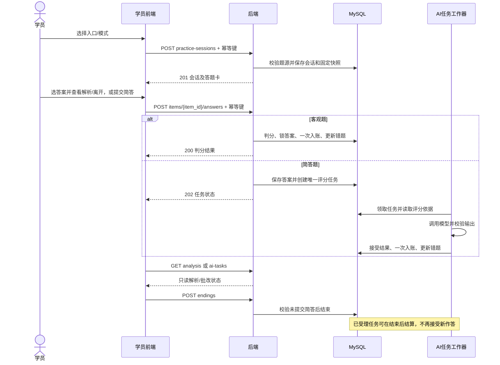
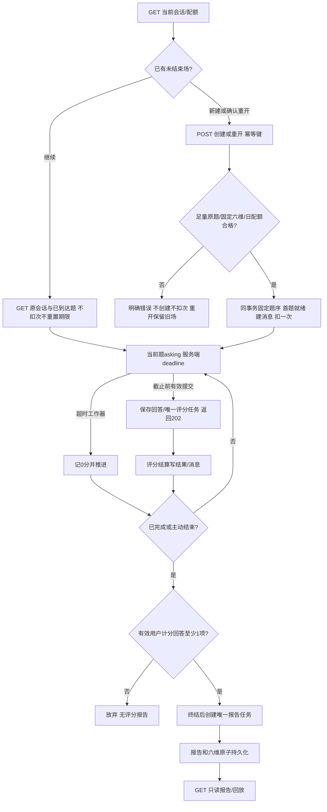

# 云枢智学：API 接口设计

> 阶段：项目设计第四阶段；日期：2026-10-30。
> 状态：**接口契约审阅稿，等待用户整体审核；没有实现接口或业务代码。**
> 业务基线：01、02、03、需求及实际原型；48 项 A、DB1—DB4 与 API-N1—N6 的已确认选择优先于原型演示行为。

## 1. 依据、确认记录与阅读方式

- [需求文档](../云枢智学-需求文档.md)、[功能模块](./01.功能模块梳理.md)、[整体架构](./02.整体架构设计.md)、[数据库设计](./03.数据库设计.md)、[建表 SQL](../../scripts/sql/schema.sql)。
- [API 规范](../rules/api-rules.md)、[数据库规范](../rules/database-rules.md)、项目 AGENTS.md、prototype 下 13 个门户及 12 个后台页面、README 和公共交互脚本。
- 项目中未发现 CLAUDE.md。**API-N1 已确认 A：本轮以 docs/rules/api-rules.md 为接口规范依据**，不声称已读取不存在的文件。

| 补充确认 | 用户已确认的规则 | 落点 |
|---|---|---|
| DB2A | 每学员最多一场 preparing/active 面试；重入恢复，重开先关闭旧场 | 当前面试、创建/重开；03 与 SQL 同步唯一索引 |
| API-N2A | 精选题与后台题库数量/学科分布来源为练习题库；首页只计可用已上架题；累计注册包括已删除账号 | 首页、看板、内容统计 |
| API-N3A | 刷题可在已提交简答批改中结束；拒绝新作答，已受理结果继续且只入账一次 | 提交、结束、异步任务 |
| API-N4A | 首页随机10题不足10题时提示，不创建、不重复凑题 | 练习创建 |
| API-N5A | 只能分配权限不超自身的非超级角色；授权不得超过自身；超级账号资料/密码仅本人维护 | 用户编辑、可选角色、角色授权 |
| API-N6A | 今日未学习时保留截至昨日连续段；昨日也未学习为0 | 学习统计 |

以上选择已确认；**下文具体路径、DTO、状态码、权限叶子编码及工程上限是本轮提出的接口方案，须经本次整体审核后冻结**，不把尚未审阅的契约写成用户已逐条批准。部署 E1—E5 与各方向六维评估内容保留待补充；后续已确认上传资源使用 MinIO，见下方补充说明。

文件存储补充确认（2026-10-30）：头像、Logo 等上传资源使用 MinIO 私有桶，Vue 构建产物仍由 Nginx 部署。文件上传与读取保持本文既有后端接口和用途/所有权授权，公开接口仅提供当前公开用途资源；本轮不新增浏览器直传接口或修改响应契约。开发编排见[开发环境说明](../operations/开发环境-Docker-Compose.md)，生产域名、签名外部地址、维护及备份参数仍待部署设计确定。

基础工程实现状态（2026-10-30）：根据用户独立开发授权，已实现本规范的统一响应/错误基础、请求追踪、snake_case、UTC 毫秒格式，以及 AUTH-P01/AUTH-A01 两端 CSRF 握手和 Redis 会话边界。其他业务接口尚未实现，不以模拟响应替代；现有业务路径和 DTO 契约未改动。Actuator 健康接口用于工程运维，不使用业务信封。验证与启动见[基础工程开发指南](../operations/基础工程开发指南.md)。

接口目录用于定位；每个接口卡片规定方法、路径、权限、参数模型、响应模型和规则；模型字段表逐项给出类型、必填性、来源及校验，三者组合构成完整契约。数据库来源均以 schema.sql 实际列为准。控制字段/派生字段不是新数据库字段。

## 2. 统一协议

### 2.1 路径、方法与序列化

| 项目 | 本轮方案 |
|---|---|
| 根路径 | `/api/v1/public` 匿名展示；`/api/v1/portal` 学员；`/api/v1/admin` 后台 |
| 命名 | 路径小写 kebab-case 资源名，JSON/Query snake_case；UTF-8 JSON，上传 multipart；禁止未知输入字段 |
| ID | 数据库 BIGINT UNSIGNED 标识以十进制字符串传输：1..18446744073709551615，不含符号/前导零；客户端不传新增记录主键 |
| Count | BIGINT 计数以非负十进制字符串传输，0..18446744073709551615；普通页码、题数等 integer 为 JSON 整数 |
| Decimal / SignedDecimal | 精确小数字符串，保留2位，例如 `"6.00"`、`"-3.50"`；分数按存储列范围校验；比例0..100，空分母为null |
| UTCDateTime | ISO8601 UTC，固定毫秒及Z，如 `2026-10-30T04:00:00.000Z`；数据库UTC DATETIME(3) |
| BusinessDate | `YYYY-MM-DD`；业务日/连续学习/日配额均按 Asia/Shanghai，展示时可转本地时间 |
| 空值 | 输出字段存在且无值用null，集合用[]；PATCH省略是不改，显式null仅对允许清空字段有效；空请求体/空PATCH拒绝 |
| 布尔与枚举 | 布尔输出true/false；账号status仍0/1整数；业务枚举见§2.4，拒绝未列值及错误类型 |
| GET | 读取不提交作答、不激活下一题、不超时结算、不扣次、不创建任务/报告；允许安全握手、访问日志等非领域附带行为 |
| PUT / PATCH / DELETE | PUT全量替换声明资源；PATCH只允许列出的字段；DELETE按逻辑删除/解除引用规则，统一200信封 |

GET 的安全语义依据 [RFC 9110 §9.2.1](https://www.rfc-editor.org/rfc/rfc9110.html#section-9.2.1)。自动超时及评分结算由后台任务推进，读取接口不能成为推进业务的唯一途径。

### 2.2 信封与分页

JSON 响应固定字段：`code:string`、`message:string`、`data:T|null`、`request_id:string`、`error:Error|null`。成功code固定OK，error=null；失败data=null，code为稳定业务错误码，error含 `field_errors:FieldError[]` 和 `details:object`；FieldError为 `{field:string,code:string,message:string}`。details仅放各错误已声明的安全提示字段，不放堆栈、SQL、供应商原始响应或凭据。

HTTP状态与业务结果一致。创建201、异步受理202、普通成功200；无需响应体时仍200且data=null，不与204混用。异步任务尚未成功也可查询200，必须看task.status；202只表示受理，不能显示为已经评分成功。request_id为服务端生成的追踪标识（1..64 ASCII），与持久化日志request_id对应，不接受任意客户端值作信任依据；响应头同步X-Request-ID。

`Page<T>` 固定为 `{items:T[],page:integer,page_size:integer,total:Count,total_pages:Count}`；页码从1、默认20条、上限100；面试题库仅10/20/50。越界页返回空items及实际total，不默默改页码。不分页的学科、角色、答题卡及路线课程是有限业务集合；增量消息用MessagePage，不能混用分页响应。所有排序有稳定id次序，拒绝未声明sort值。

二进制下载不包装JSON：Excel、CSV、图片使用对应Content-Type，附件文件名由后端安全生成；开始输出前完成鉴权/参数校验，错误仍用JSON信封。图片允许302到授权短时签名地址；签名不是公开业务ID，不记录到业务日志。动态个人/权限/令牌数据Cache-Control:no-store，公共展示可短时缓存并随设置/内容提交失效。

### 2.3 认证、CSRF 与权限

两套独立Redis Session、独立Cookie命名空间（建议PORTAL_SESSION、ADMIN_SESSION），各端仅接受本端身份。Cookie设置HttpOnly、生产Secure、Host-only、SameSite=Lax；具体宿主和反向代理布局随E1确定。不能仅凭路径不同就假定Spring自动隔离会话。记住登录按已确认学员7天、后台1天；不记住为浏览器会话，退出或账号禁用/删除/改密按auth_version撤销。

每端先GET auth/csrf，将返回token放X-CSRF-TOKEN；所有POST/PUT/PATCH/DELETE，包括匿名登录、注册、短信、重置和退出均校验本端CSRF。登录轮换SessionId与CSRF，登录/退出后重新获取令牌；会话Cookie不出现在JSON/URL。采用Spring Security既有CSRF机制并验证SPA登录后令牌刷新流程，参考 [官方CSRF文档](https://docs.spring.io/spring-security/reference/servlet/exploits/csrf.html)；Redis会话接入参考 [Spring Session官方指南](https://docs.spring.io/spring-session/reference/guides/boot-redis.html)。这不替代两端隔离测试。

权限顺序：认证有效且账号启用 → 动作权限 → 资源归属/父子关系 → 当前状态/版本/业务约束。学员主体一律由会话取得，不接受learner_id参数冒用；别人的会话/题目/错题/文件统一404，不泄漏存在性。后台动作依据有效permission_code，菜单隐藏不能代替服务端鉴权。permission_version变化刷新授权，账号auth_version变化拒绝旧会话。

API-N5A按权限集合包含关系校验：可分配角色权限⊆操作者当前有效权限，且目标非超级角色；新授权集合⊆操作者权限。超级身份唯一，不能新建第二个、修改其角色、禁用或删除；其资料/密码只允许本人维护，角色/用户管理权限不能绕过。预置审核/运营角色仍受已确认的职责上界约束。该规则不额外创建账号等级字段。

### 2.4 枚举与状态（沿用数据库）

| 字段 | 合法值/数据库CHECK |
|---|---|
| learner.gender | (gender IN ('male','female','secret')) |
| learner.status | (status IN (0,1)) |
| admin_user.status | (status IN (0,1))；(system_identity IS NULL OR (system_identity = 'super_admin' AND status = 1 AND deleted_at IS NULL)) |
| practice_question.question_type | (question_type IN ('single','multiple','judge','short'))；(question_type <> 'short' OR (reference_answer IS NOT NULL AND CHAR_LENGTH(TRIM(reference_answer)) > 0)) |
| practice_question.difficulty | (difficulty BETWEEN 1 AND 3) |
| practice_question.status | (status IN ('pending_review','published','unpublished','rejected')) |
| practice_session.entry_kind | (entry_kind IN ('stage','single','random','wrong_review')) |
| practice_session.practice_mode | (practice_mode IN ('ordered','random','single')) |
| practice_session.status | (status IN ('active','ended','abandoned'))；((status = 'active' AND ended_at IS NULL) OR (status <> 'active' AND ended_at IS NOT NULL)) |
| practice_item.status | (status IN ('unanswered','grading','graded','failed'))；((status = 'graded' AND score IS NOT NULL AND score BETWEEN 0 AND 10 AND graded_at IS NOT NULL AND graded_business_date IS NOT NULL AND result_applied_at IS NOT NULL) OR (status <> 'graded' AND score IS NULL AND graded_at IS NULL AND graded_business_date IS NULL AND result_applied_at IS NULL))；(status = 'unanswered' OR (submitted_at IS NOT NULL AND submit_request_id IS NOT NULL AND ((question_type = 'short' AND answer_text IS NOT NULL AND CHAR_LENGTH(TRIM(answer_text)) > 0) OR (question_type <> 'short' AND selected_option_keys IS NOT NULL AND JSON_TYPE(selected_option_keys) = 'ARRAY' AND JSON_LENGTH(selected_option_keys) >= 1)))) |
| wrong_question.status | (status IN ('pending','mastered'))；((status = 'pending' AND mastered_method IS NULL AND mastered_at IS NULL AND correct_streak < 3) OR (status = 'mastered' AND mastered_method IS NOT NULL AND mastered_method IN ('auto','manual') AND mastered_at IS NOT NULL AND (mastered_method = 'manual' OR correct_streak = 3))) |
| wrong_question.mastered_method | ((status = 'pending' AND mastered_method IS NULL AND mastered_at IS NULL AND correct_streak < 3) OR (status = 'mastered' AND mastered_method IS NOT NULL AND mastered_method IN ('auto','manual') AND mastered_at IS NOT NULL AND (mastered_method = 'manual' OR correct_streak = 3))) |
| course.source | (source IN ('bilibili','other'))；(source = 'bilibili' OR bvid IS NULL) |
| interview_question.origin | (origin IN ('markdown','manual'))；((origin = 'manual' AND source_document_name IS NULL AND source_question_no IS NULL AND source_line_no IS NULL) OR (origin = 'markdown' AND source_document_name IS NOT NULL AND source_question_no IS NOT NULL AND source_question_no >= 1 AND source_line_no IS NOT NULL AND source_line_no >= 1)) |
| interview_question.difficulty | (difficulty BETWEEN 1 AND 3) |
| interview_session.status | (status IN ('preparing','active','completed','ended_early','abandoned','failed'))；(status <> 'active' OR (started_at IS NOT NULL AND quota_business_date IS NOT NULL AND ability_scheme_id IS NOT NULL)) |
| interview_session.question_count | (question_count IN (3,5,8,10,15)) |
| interview_session.answer_timeout_seconds | (answer_timeout_seconds = 300) |
| interview_item.status | (status IN ('waiting','asking','grading','graded','timed_out','failed'))；((status IN ('graded','timed_out') AND score IS NOT NULL AND score BETWEEN 0 AND 10 AND graded_at IS NOT NULL) OR (status NOT IN ('graded','timed_out') AND score IS NULL AND graded_at IS NULL))；(status <> 'timed_out' OR (score = 0 AND answered_at IS NULL AND answered_business_date IS NULL))；(status NOT IN ('asking','grading','graded','timed_out') OR (asked_at IS NOT NULL AND deadline_at IS NOT NULL))；(status <> 'graded' OR (answered_at IS NOT NULL AND answered_business_date IS NOT NULL AND answer_text IS NOT NULL))；(status <> 'timed_out' OR answer_text IS NULL)；(status <> 'grading' OR answered_at IS NOT NULL) |
| interview_message.sender_role | (sender_role IN ('assistant','user','system')) |
| interview_message.message_kind | (message_kind IN ('greeting','question','answer','feedback','closing','notice')) |
| interview_report.report_kind | (report_kind IN ('complete','partial'))；((report_kind = 'complete' AND scored_count = planned_count) OR (report_kind = 'partial' AND scored_count < planned_count)) |
| ai_task.task_type | (task_type IN ('practice_grade','interview_grade','interview_report'))；((task_type = 'practice_grade' AND practice_item_id IS NOT NULL AND interview_item_id IS NULL AND interview_session_id IS NULL) OR (task_type = 'interview_grade' AND practice_item_id IS NULL AND interview_item_id IS NOT NULL AND interview_session_id IS NULL) OR (task_type = 'interview_report' AND practice_item_id IS NULL AND interview_item_id IS NULL AND interview_session_id IS NOT NULL)) |
| ai_task.status | (status IN ('pending','running','succeeded','failed','unknown','cancelled')) |
| file_asset.asset_kind | (asset_kind IN ('avatar','logo','default_avatar')) |
| admin_operation_log.operation_type | (operation_type IN ('login','create','update','delete','status','review','export','import','reset','other')) |
| admin_operation_log.operation_result | (operation_result IN ('success','failure')) |


### 2.5 输入校验与工程边界

所有Query/Path/Body/上传均后端校验；路径ID必填。字符串按Unicode字符校验并额外校验数据库UTF-8字节上限：TEXT 65535、MEDIUMTEXT 16777215字节，不能因字符数合格而截断。VARCHAR不得超过字典标注长度；选项键/标签去重，题型/正确答案数量、引用父子关系需跨字段校验。JSON输出为白名单DTO，不直接序列化实体。

输入的分数、统计、状态推进、审核人、操作者、时间戳、内容指纹、会话版本自增、文件存储键/所有者、系统身份/生成列等由服务端负责，禁止Mass Assignment。expected_revision/version/旧顺序是并发控制条件，不是写入任意新版本。URL仅http/https合法地址；课程封面/视频外链不代抓取。Markdown/富文本安全渲染，SQL参数化，CSV/XLSX按文本输出可能被解释为公式的值。

下列**新增工程上限为本轮建议，随整体契约审阅**，并非新增业务功能：图片2MiB且边长≤4096；Excel10MiB且最多500题；Markdown2MiB且最多500题；课程粘贴文本1MiB；批量ID≤500、路线课程≤500、完整排序≤10000、选项≤100、标签≤20且每项≤50字符、作答≤10000字符。JSON普通请求体建议≤2MiB（单次大型题目/排序需在该总预算内）；只放宽到存储约束以内也须更新契约和网关配置，不静默截断。导入已有500题限制仅限导入，不当作导出500题限制。

密码、手机号验证码规则遵循需求：注册6..20字符、短信60秒/次和每手机号每日10次、校验失败5次失效、密码连续错误5次锁定5分钟、邮箱/手机号登录按端区分。登录输入上限128、重置/后台新密码6..128为工程方案；实现散列器须支持该上限且不静默截断。邮件空串转NULL；DB1A删除账号仍占用身份，不开放重注册绕过；既有账号正常改邮箱遵循当前唯一列，不虚构曾用邮箱表。

所有DTO集合应校验长度；未另写的输出集合由本次业务规模或分页控制，不允许客户端提交任意对象。输入ID[]最多500，排序列表例外最多10000，permission_ids最多有效权限目录项数，查询字符串keyword≤100、临时preview_id为1..128 ASCII，代码/令牌/文件名只在规定位置。ConfirmInput只表达二次确认，不能替代授权。

### 2.6 幂等、并发与事务

创建练习/面试（含重开）及题目作答必须携带 `Idempotency-Key`：8..64 ASCII `[A-Za-z0-9_-]`，缺失400。分别落入已有start_request_id/submit_request_id，唯一范围为当前学员及相应表。相同键、相同可比较的持久输入重放原会话/题目/任务；不同配置或作答409 IDEMPOTENCY_CONFLICT；先查键后校验终态，以免合法重放被误拒。普通CRUD不承诺额外持久幂等键；相同资源的PUT/状态修改以最终状态幂等。

幂等输入比较只依据现有已保存配置/快照/答案；不新增请求指纹列或幂等表。题目答案只能接受一次，入账由result_applied与事务保证；配额按日守卫行/事件唯一约束保证；报告每场唯一，六维和报告原子写入。唯一冲突必须读取核验既有记录，不能把所有重复键都当成功。

题目更新比较revision；面试结束比较version；角色授权比较permission_version；路线课程/排序比较客户端读到的完整旧列表，并锁定同一父对象。没有version的其他普通资料PATCH按列更新，后写覆盖同字段，不假造乐观锁列。批量先校验全体再单事务处理，任何关联/权限/状态失败整批回滚。

导入预览是绑定操作者/导入类型的Redis临时资源，响应expires_at以实际配置为准，不入新表、不保留上传原文档。确认只接收preview_id和确认警告，不让客户端替换解析行；无效项阻止整批，合法重复按DB3跳过并明示，其余整体写入。确认时重验权限、引用及并发新增重复。成功回执可临时缓存；**数据库提交与Redis回执不原子**，崩溃后无法核实整批结果时返回503 IMPORT_RESULT_UNKNOWN，停止自动重放并核查，不宣称端到端恰好一次、不新增导入批次模型。到期410须重新预览；未授权或其他人预览统一404。

验证码/重置凭据为一次性Redis控制状态；领取后提交失败或未知需按可核实结果处理，不能无条件恢复可用、不能以重放绕过验证。Redis不可用时认证敏感操作失败关闭；持久训练/配额事实以MySQL为准。外部AI调用不包在数据库长事务中；unknown不自动视作失败重试，任务重试必须复用同一逻辑目标并按架构的结果去重/租约验证。

### 2.7 状态码与错误目录

每个接口继承此表的通用错误，卡片另列关键业务错误。错误message可本地化，code稳定；4xx不给堆栈。details按表白名单提供；未列错误details={}。

| HTTP | code | 处理及安全details |
|---|---|---|
| 400 | VALIDATION_FAILED / UNKNOWN_FIELD / INVALID_OPTION_SET / IDEMPOTENCY_KEY_REQUIRED | field_errors定位字段；不回显密码/验证码 |
| 400 | AGREEMENT_REQUIRED / CODE_INVALID / CODE_EXPIRED / RESET_PROOF_INVALID | 修正输入或重新验证 |
| 401 | AUTH_REQUIRED / SESSION_EXPIRED / INVALID_CREDENTIALS | 同端重新登录；凭据错误不区分账号是否存在 |
| 403 | PERMISSION_DENIED / CSRF_INVALID / ACCOUNT_DISABLED / PROTECTED_ACCOUNT / ROLE_GRANT_EXCEEDS_SELF | 无权限不得重试绕过 |
| 404 | RESOURCE_NOT_FOUND | 不存在、逻辑删除或越主体归属统一返回 |
| 409 | PHONE_IN_USE / EMAIL_IN_USE / USERNAME_IN_USE / ROLE_CODE_IN_USE / DUPLICATE_CONTENT / BV_ID_IN_USE | 唯一值冲突，不展示其他账号资料 |
| 409 | IDEMPOTENCY_CONFLICT / STALE_VERSION / ORDER_CONFLICT | 重新读取后由用户决定；STALE_VERSION可返回current_version |
| 409 | ANSWER_LOCKED / SESSION_ENDED / QUESTION_NOT_CURRENT / QUESTION_NOT_REACHED / ANSWER_DEADLINE_PASSED / GRADING_PENDING / ANSWER_REQUIRED | 根据当前状态恢复展示，不盲重发新答案 |
| 409 | SHORT_ANSWER_REQUIRED / UNANSWERED_CONFIRMATION_REQUIRED | 分别details.first_unsubmitted_item_id:ID、unanswered_count:integer |
| 409 | INTERVIEW_ALREADY_OPEN / INTERVIEW_QUOTA_EXHAUSTED | 分别details.current_interview_id:ID、remaining_count:0及resets_at:UTCDateTime |
| 409 | INVALID_STATE / CONTENT_REFERENCED / ROUTE_ALREADY_ENABLED / ROLE_IN_USE / IMPORT_WARNINGS_UNCONFIRMED | 状态不允许或有效引用阻止操作；引用提示仅给授权范围内数量 |
| 410 | IMPORT_PREVIEW_EXPIRED | 重新上传/粘贴并预览，不回放过期确认 |
| 413 | PAYLOAD_TOO_LARGE | 明确本次允许大小；前后端/网关一致 |
| 415 | UNSUPPORTED_MEDIA_TYPE | 上传格式/JSON媒体类型不匹配 |
| 422 | QUESTION_POOL_INSUFFICIENT / NO_RETRYABLE_QUESTIONS / INVALID_REFERENCE / ASSET_NOT_USABLE / IMPORT_VALIDATION_FAILED / EXPORT_SCOPE_TOO_LARGE | 题源不足details={required_count,available_count}；不自动减题/凑题；导出超预算须收窄筛选，绝不截断 |
| 429 | TOO_FREQUENT / ACCOUNT_LOCKED / SMS_DAILY_LIMIT | Retry-After秒数，提示稍后重试；锁定按需求5分钟 |
| 500 | INTERNAL_ERROR | 提供request_id便于排查，不泄漏内部原因 |
| 503 | SMS_UNAVAILABLE / EVALUATION_CONFIG_UNAVAILABLE / AI_UNAVAILABLE / DEPENDENCY_UNAVAILABLE / IMPORT_RESULT_UNKNOWN / RESET_RESULT_UNKNOWN | 区分不可用和提交结果未知，未知先核查持久结果，不自动复制操作 |

数据库唯一冲突映射409，CHECK/服务端参数校验映射400或422，事务死锁只在可安全重做的数据库短事务范围内有限重试；不能据此重复短信或模型调用。异常在统一处理层映射，业务日志仅存脱敏摘要；无有效后台主体的失败登录进入技术安全日志，不伪造admin_user_id=0写审计表。

## 3. 接口目录

以下参数模型标为“无”表示不接受未声明的Query/Body；路径参数均必填，继承ID规则；preview_id是临时ASCII资源标识。所有写接口继承CSRF；只有标注幂等键的接口要求Idempotency-Key。

| 编号/模块 | 方法 | 路径 | 用途 | 输入 → data |
|---|---|---|---|---|
| PUB01 / M01/M15 | GET | `/api/v1/public/platform` | 读取公开平台名称/描述/Logo和默认头像 |  → PlatformView |
| PUB02 / M01/M13 | GET | `/api/v1/public/home` | 首页公共统计和热门阶段 |  → HomeView |
| PUB03 / M15 | GET | `/api/v1/public/files/{file_id}/content` | 读取当前平台Logo/默认头像 |  → FileBytes |
| AUTH-P01 / M02 | GET | `/api/v1/portal/auth/csrf` | 获取本端CSRF令牌 |  → Csrf |
| AUTH-P02 / M02 | POST | `/api/v1/portal/auth/password-sessions` | 账号密码登录 |  / PasswordLogin → AuthSession |
| AUTH-P03 / M02 | GET | `/api/v1/portal/auth/session` | 当前登录主体/权限/可见菜单 |  → AuthSession |
| AUTH-P04 / M02 | DELETE | `/api/v1/portal/auth/session` | 退出本端登录 |  → null |
| AUTH-A01 / M12 | GET | `/api/v1/admin/auth/csrf` | 获取本端CSRF令牌 |  → Csrf |
| AUTH-A02 / M12 | POST | `/api/v1/admin/auth/password-sessions` | 账号密码登录 |  / PasswordLogin → AuthSession |
| AUTH-A03 / M12 | GET | `/api/v1/admin/auth/session` | 当前登录主体/权限/可见菜单 |  → AuthSession |
| AUTH-A04 / M12 | DELETE | `/api/v1/admin/auth/session` | 退出本端登录 |  → null |
| AUTH-P05 / M02 | POST | `/api/v1/portal/auth/sms-codes` | 获取指定用途短信验证码 |  / SmsInput → SmsReceipt |
| AUTH-P06 / M02 | POST | `/api/v1/portal/auth/sms-sessions` | 手机号验证码登录 |  / SmsLogin → AuthSession |
| AUTH-P07 / M02 | POST | `/api/v1/portal/auth/registrations` | 注册并进入个人中心 |  / RegisterInput → AuthSession |
| AUTH-P08 / M02 | POST | `/api/v1/portal/auth/password-reset-proofs` | 找回密码第1步：验证手机 |  / ResetProofInput → ResetProof |
| AUTH-P09 / M02 | POST | `/api/v1/portal/auth/password-resets` | 找回密码第2步：重置 |  / ResetPasswordInput → null |
| ME01 / M02 | GET | `/api/v1/portal/me` | 个人中心基本资料 |  → LearnerMe |
| ME02 / M02 | PATCH | `/api/v1/portal/me` | 保存个人资料 |  / ProfilePatch → LearnerMe |
| ME03 / M13 | GET | `/api/v1/portal/me/learning-statistics` | 个人中心/首页学习统计 |  → LearningStats |
| FILE-P01 / M02/M15 | POST | `/api/v1/portal/files` | 上传持久图片 |  / multipart:UploadInput → FileView |
| FILE-P02 / M02/M15 | GET | `/api/v1/portal/files/{file_id}/content` | 授权读取/预览图片 |  → FileBytes |
| FILE-A01 / M02/M15 | POST | `/api/v1/admin/files` | 上传持久图片 |  / multipart:UploadInput → FileView |
| FILE-A02 / M02/M15 | GET | `/api/v1/admin/files/{file_id}/content` | 授权读取/预览图片 |  → FileBytes |
| CONTENT-P01 / M03 | GET | `/api/v1/portal/subjects` | 学科入口及统计 |  → SubjectView[] |
| CONTENT-P02 / M03 | GET | `/api/v1/portal/subjects/{subject_id}/stages` | 学科阶段列表 |  → StageView[] |
| CONTENT-P03 / M04 | GET | `/api/v1/portal/stages/{stage_id}/questions` | 阶段题目筛选分页 | QuestionFilter → Page<QuestionPublic> |
| CONTENT-P04 / M04 | GET | `/api/v1/portal/questions/{question_id}` | 单题基本内容 |  → QuestionPublic |
| CONTENT-P05 / M04 | GET | `/api/v1/portal/questions/{question_id}/analysis` | 题库查看答案解析 |  → QuestionAnalysis |
| CONTENT-P06 / M08 | GET | `/api/v1/portal/subjects/{subject_id}/learning-route` | 学科唯一启用路线和有序课程 |  → RouteView\|null |
| PRACTICE01 / M05/M06 | POST | `/api/v1/portal/practice-sessions` | 按入口创建练习/错题重做 |  / PracticeStart → PracticeSessionView |
| PRACTICE02 / M05 | GET | `/api/v1/portal/practice-sessions/{session_id}` | 读取会话及答题卡 |  → PracticeSessionView |
| PRACTICE03 / M05 | GET | `/api/v1/portal/practice-sessions/{session_id}/items/{item_id}` | 读取本人当前/已下发题目 |  → PracticeItemView |
| PRACTICE04 / M05 | GET | `/api/v1/portal/practice-sessions/{session_id}/items/{item_id}/analysis` | 读取练习解析/简答评分 |  → PracticeAnalysis |
| PRACTICE05 / M05/M06 | POST | `/api/v1/portal/practice-sessions/{session_id}/items/{item_id}/answers` | 提交客观/简答并判分 |  / PracticeAnswer → AnswerReceipt |
| PRACTICE06 / M05 | POST | `/api/v1/portal/practice-sessions/{session_id}/endings` | 二次确认结束刷题 |  / PracticeEnd → PracticeSessionView |
| PRACTICE07 / M05/M10 | GET | `/api/v1/portal/ai-tasks/{task_id}` | 查询本人异步评分/报告状态 |  → TaskView |
| WRONG01 / M06 | GET | `/api/v1/portal/wrong-questions` | 本人错题筛选分页 | WrongFilter → Page<WrongView> |
| WRONG02 / M06 | GET | `/api/v1/portal/wrong-questions/summary` | 错题统计及高频Top3 |  → WrongSummary |
| WRONG03 / M06 | GET | `/api/v1/portal/wrong-questions/{wrong_id}` | 错题快照详情 |  → WrongView |
| WRONG04 / M06 | POST | `/api/v1/portal/wrong-questions/{wrong_id}/mastery-marks` | 手工标记掌握 |  / ConfirmInput → MutationReceipt |
| WRONG05 / M06 | DELETE | `/api/v1/portal/wrong-questions/{wrong_id}` | 移除当前错题周期 |  → MutationReceipt |
| WRONG06 / M06 | POST | `/api/v1/portal/wrong-questions/batch-operations` | 批量掌握/移除 |  / BatchInput → BatchReceipt |
| INTERVIEW01 / M10 | GET | `/api/v1/portal/interview-options` | 读取面试方向与固定选项 |  → InterviewOptions |
| INTERVIEW02 / M10 | GET | `/api/v1/portal/interview-quota` | 今日剩余面试次数 |  → QuotaView |
| INTERVIEW03 / M10 | GET | `/api/v1/portal/interviews/current` | 发现当前未结束面试 |  → InterviewSessionView\|null |
| INTERVIEW04 / M10 | POST | `/api/v1/portal/interviews` | 创建并开始面试 |  / InterviewStart → InterviewSessionView |
| INTERVIEW05 / M10 | GET | `/api/v1/portal/interviews/{session_id}` | 面试进度/题目摘要 |  → InterviewSessionView |
| INTERVIEW06 / M10 | GET | `/api/v1/portal/interviews/{session_id}/items/{item_id}` | 已到达题目内容和本人作答 |  → InterviewItemView |
| INTERVIEW07 / M10 | GET | `/api/v1/portal/interviews/{session_id}/messages` | 文本对话增量读取 | MessageQuery → MessagePage |
| INTERVIEW08 / M10 | POST | `/api/v1/portal/interviews/{session_id}/items/{item_id}/answers` | 提交当前面试回答 |  / InterviewAnswer → AnswerReceipt |
| INTERVIEW09 / M10 | POST | `/api/v1/portal/interviews/{session_id}/endings` | 结束并冻结面试接收边界 |  / InterviewEnd → EndingReceipt |
| INTERVIEW10 / M10 | POST | `/api/v1/portal/interviews/{session_id}/restarts` | 关闭指定旧场并按新配置重开 |  / InterviewStart → InterviewSessionView |
| INTERVIEW11 / M10 | GET | `/api/v1/portal/interviews/{session_id}/report` | 读取报告或当前生成状态 |  → ReportState |
| INTERVIEW12 / M10 | POST | `/api/v1/portal/interviews/{session_id}/report-requests` | 确保/安全重试报告生成 |  / ConfirmInput → ReportState |
| INTERVIEW13 / M10 | GET | `/api/v1/portal/interviews` | 面试记录分页 | PageQuery → Page<InterviewHistory> |
| INTERVIEW14 / M10/M13 | GET | `/api/v1/portal/interview-statistics` | 面试记录统计卡 |  → InterviewStats |
| INTERVIEW15 / M10 | GET | `/api/v1/portal/interviews/{session_id}/replay` | 文本回放资源 | MessageQuery → MessagePage |
| ADMIN01 / M13 | GET | `/api/v1/admin/dashboard` | 数据看板聚合 | DashboardQuery → Dashboard |
| LOOKUP01 / M03 | GET | `/api/v1/admin/subject-options` | 内容表单学科选项 |  → SubjectMini[] |
| LOOKUP02 / M03 | GET | `/api/v1/admin/stage-options` | 题目表单阶段选项 | StageOptionsQuery → StageView[] |
| LOOKUP03 / M07/M08 | GET | `/api/v1/admin/course-options` | 路线表单/详情选课 | CourseOptionsQuery → Page<CourseOption> |
| LOOKUP04 / M12 | GET | `/api/v1/admin/assignable-roles` | 后台用户表单角色选项 |  → RoleMini[] |
| SUBJECT01 / M03 | GET | `/api/v1/admin/subjects` | 学科管理完整列表 | SubjectFilter → SubjectView[] |
| SUBJECT02 / M03 | POST | `/api/v1/admin/subjects` | 新增学科 |  / SubjectInput → SubjectView |
| SUBJECT03 / M03 | PATCH | `/api/v1/admin/subjects/{subject_id}` | 编辑学科 |  / Patch<SubjectInput> → SubjectView |
| SUBJECT04 / M03 | DELETE | `/api/v1/admin/subjects/{subject_id}` | 删除无有效引用学科 |  → MutationReceipt |
| SUBJECT05 / M03 | PUT | `/api/v1/admin/subject-order` | 学科上移/下移后的全量排序 |  / OrderInput → SubjectView[] |
| STAGE01 / M03 | GET | `/api/v1/admin/subjects/{subject_id}/stages` | 学科下全部未删除阶段 |  → StageView[] |
| STAGE02 / M03 | POST | `/api/v1/admin/subjects/{subject_id}/stages` | 新增阶段 |  / StageInput → StageView |
| STAGE03 / M03 | PATCH | `/api/v1/admin/stages/{stage_id}` | 编辑阶段 |  / Patch<StageInput> → StageView |
| STAGE04 / M03 | PATCH | `/api/v1/admin/stages/{stage_id}/availability` | 阶段启禁用 |  / EnabledInput → StageView |
| STAGE05 / M03 | DELETE | `/api/v1/admin/stages/{stage_id}` | 删除无题目引用阶段 |  → MutationReceipt |
| STAGE06 / M03 | PUT | `/api/v1/admin/subjects/{subject_id}/stage-order` | 阶段上移/下移 |  / OrderInput → StageView[] |
| COURSE01 / M07 | GET | `/api/v1/admin/courses` | 课程筛选分页 | CourseFilter → Page<CourseView> |
| COURSE02 / M07 | GET | `/api/v1/admin/courses/statistics` | 课程统计卡 |  → ContentStatistics |
| COURSE03 / M07 | POST | `/api/v1/admin/courses` | 新增课程 |  / CourseInput → CourseView |
| COURSE04 / M07 | GET | `/api/v1/admin/courses/{course_id}` | 编辑回显课程 |  → CourseView |
| COURSE05 / M07 | PATCH | `/api/v1/admin/courses/{course_id}` | 编辑课程 |  / Patch<CourseInput> → CourseView |
| COURSE06 / M07 | DELETE | `/api/v1/admin/courses/{course_id}` | 删除无有效路线引用课程 |  → MutationReceipt |
| COURSE07 / M07 | POST | `/api/v1/admin/courses/import-previews` | 课程粘贴文本解析预览 |  / CourseTextImport → ImportPreview |
| COURSE08 / M07 | POST | `/api/v1/admin/courses/import-previews/{preview_id}/confirmations` | 确认课程批量导入 |  / ImportConfirm → ImportReceipt |
| QUESTION01 / M04 | GET | `/api/v1/admin/questions` | 练习题管理分页 | QuestionFilter → Page<QuestionAdmin> |
| QUESTION02 / M04 | GET | `/api/v1/admin/questions/statistics` | 练习题统计卡 |  → ContentStatistics |
| QUESTION03 / M04 | GET | `/api/v1/admin/questions/{question_id}` | 题目详情及答题统计 |  → QuestionAdmin |
| QUESTION04 / M04 | POST | `/api/v1/admin/questions` | 新增题目送审 |  / QuestionInput → QuestionAdmin |
| QUESTION05 / M04 | PUT | `/api/v1/admin/questions/{question_id}` | 完整编辑题目 |  / QuestionUpdate → QuestionAdmin |
| QUESTION06 / M04 | POST | `/api/v1/admin/questions/{question_id}/review-decisions` | 审核通过/驳回 |  / ReviewInput → QuestionAdmin |
| QUESTION07 / M04 | POST | `/api/v1/admin/questions/{question_id}/publication-requests` | 已下架题申请上架 |  / RevisionInput → QuestionAdmin |
| QUESTION08 / M04 | POST | `/api/v1/admin/questions/{question_id}/submissions` | 驳回题重新提交 |  / RevisionInput → QuestionAdmin |
| QUESTION09 / M04 | POST | `/api/v1/admin/questions/{question_id}/withdrawals` | 已上架题下架 |  / RevisionInput → QuestionAdmin |
| QUESTION10 / M04 | DELETE | `/api/v1/admin/questions/{question_id}` | 逻辑删除题及当前选项 |  → MutationReceipt |
| QUESTION11 / M04 | POST | `/api/v1/admin/questions/batch-operations` | 批量送审/下架/删除 |  / BatchInput → BatchReceipt |
| QUESTION12 / M04 | GET | `/api/v1/admin/questions/import-template` | 下载Excel导入模板 |  → ExcelBytes |
| QUESTION13 / M04 | POST | `/api/v1/admin/questions/import-previews` | Excel解析预览 |  / multipart:ExcelUpload → ImportPreview |
| QUESTION14 / M04 | POST | `/api/v1/admin/questions/import-previews/{preview_id}/confirmations` | 确认题目导入送审 |  / ImportConfirm → ImportReceipt |
| QUESTION15 / M04 | GET | `/api/v1/admin/questions/export` | 导出筛选题目Excel | ExportQuestionFilter → ExcelBytes |
| BANK01 / M09 | GET | `/api/v1/admin/interview-questions` | 面试题总览分页 | InterviewBankFilter → Page<InterviewQuestionAdmin> |
| BANK02 / M09 | GET | `/api/v1/admin/interview-question-topics` | 词表主题与题数 | BankSubjectQuery → TopicView[] |
| BANK03 / M09 | GET | `/api/v1/admin/interview-questions/{question_id}` | 面试题只读内容详情 |  → InterviewQuestionAdmin |
| BANK04 / M09 | POST | `/api/v1/admin/interview-questions` | 手工录入面试题 |  / InterviewQuestionInput → InterviewQuestionAdmin |
| BANK05 / M09 | PATCH | `/api/v1/admin/interview-questions/{question_id}` | 仅编辑主题/难度 |  / InterviewQuestionPatch → InterviewQuestionAdmin |
| BANK06 / M09 | DELETE | `/api/v1/admin/interview-questions/{question_id}` | 逻辑删除面试原题 |  → MutationReceipt |
| BANK07 / M09 | POST | `/api/v1/admin/interview-questions/import-previews` | Markdown上传解析预览 |  / multipart:MarkdownUpload → ImportPreview |
| BANK08 / M09 | POST | `/api/v1/admin/interview-questions/import-previews/{preview_id}/confirmations` | 确认Markdown导入 |  / MarkdownConfirm → ImportReceipt |
| ROUTE01 / M08 | GET | `/api/v1/admin/learning-routes` | 路线卡片列表 |  → RouteView[] |
| ROUTE02 / M08 | POST | `/api/v1/admin/learning-routes` | 新建路线与初始选课 |  / RouteInput → RouteView |
| ROUTE03 / M08 | GET | `/api/v1/admin/learning-routes/{route_id}` | 路线详情/预览 |  → RouteView |
| ROUTE04 / M08 | PATCH | `/api/v1/admin/learning-routes/{route_id}` | 编辑路线基本信息 |  / RoutePatch → RouteView |
| ROUTE05 / M08 | PATCH | `/api/v1/admin/learning-routes/{route_id}/availability` | 启禁用路线 |  / EnabledInput → RouteView |
| ROUTE06 / M08 | PUT | `/api/v1/admin/learning-routes/{route_id}/courses` | 全量保存课程引用和顺序 |  / RouteCoursesInput → RouteView |
| ROUTE07 / M08 | DELETE | `/api/v1/admin/learning-routes/{route_id}` | 删除路线及解除引用 |  → MutationReceipt |
| LEARNER01 / M11 | GET | `/api/v1/admin/learners` | 学员管理分页 | LearnerFilter → Page<LearnerAdmin> |
| LEARNER02 / M11 | GET | `/api/v1/admin/learners/{learner_id}` | 学员资料及统计详情 |  → LearnerAdmin |
| LEARNER03 / M11 | PATCH | `/api/v1/admin/learners/{learner_id}/status` | 启禁用学员 |  / StatusInput → LearnerAdmin |
| LEARNER04 / M11 | DELETE | `/api/v1/admin/learners/{learner_id}` | 逻辑删除学员 |  → MutationReceipt |
| LEARNER05 / M11 | POST | `/api/v1/admin/learners/batch-operations` | 批量启用/禁用/删除 |  / BatchInput → BatchReceipt |
| USER01 / M12 | GET | `/api/v1/admin/users` | 后台内部用户分页 | UserFilter → Page<UserAdmin> |
| USER02 / M12 | GET | `/api/v1/admin/users/{user_id}` | 内部用户资料 |  → UserAdmin |
| USER03 / M12 | GET | `/api/v1/admin/users/{user_id}/recent-operations` | 用户详情最近操作 | PageQuery → Page<LogView> |
| USER04 / M12 | POST | `/api/v1/admin/users` | 新增内部用户 |  / UserInput → UserAdmin |
| USER05 / M12 | PATCH | `/api/v1/admin/users/{user_id}` | 编辑内部账号 |  / UserPatch → UserAdmin |
| USER06 / M12 | PATCH | `/api/v1/admin/users/{user_id}/status` | 启禁用内部账号 |  / StatusInput → UserAdmin |
| USER07 / M12 | POST | `/api/v1/admin/users/{user_id}/password-resets` | 重置内部账号为配置默认密码 |  / ConfirmInput → MutationReceipt |
| USER08 / M12 | DELETE | `/api/v1/admin/users/{user_id}` | 逻辑删除内部账号 |  → MutationReceipt |
| USER09 / M12 | POST | `/api/v1/admin/users/batch-operations` | 批量启禁用/删除内部账号 |  / BatchInput → BatchReceipt |
| ROLE01 / M12 | GET | `/api/v1/admin/roles` | 角色卡片和权限标签 |  → RoleView[] |
| ROLE02 / M12 | POST | `/api/v1/admin/roles` | 新增自定义角色 |  / RoleInput → RoleView |
| ROLE03 / M12 | GET | `/api/v1/admin/roles/{role_id}/permissions` | 读取角色权限树 |  → RolePermissionsView |
| ROLE04 / M12 | PUT | `/api/v1/admin/roles/{role_id}/permissions` | 全量覆盖角色授权 |  / RolePermissionsInput → RolePermissionsView |
| ROLE05 / M12 | DELETE | `/api/v1/admin/roles/{role_id}` | 删除无用户角色 |  → MutationReceipt |
| LOG01 / M14 | GET | `/api/v1/admin/operation-logs` | 日志筛选分页 | LogFilter → Page<LogView> |
| LOG02 / M14 | GET | `/api/v1/admin/operation-logs/{log_id}` | 操作日志详情 |  → LogView |
| LOG03 / M14 | GET | `/api/v1/admin/operation-logs/export` | 直接下载筛选日志CSV | ExportLogFilter → CsvBytes |
| LOG04 / M14 | POST | `/api/v1/admin/operation-log-clearances` | 二次确认清空日志 |  / ConfirmInput → ClearReceipt |
| SETTING01 / M15 | GET | `/api/v1/admin/platform-settings` | 基本信息编辑回显 |  → SettingView |
| SETTING02 / M15 | GET | `/api/v1/admin/platform-settings/defaults` | 读取重置表单默认值 |  → SettingView |
| SETTING03 / M15 | PUT | `/api/v1/admin/platform-settings` | 保存基本信息 |  / SettingInput → SettingView |

## 4. 逐接口契约

### PUB01 读取公开平台名称/描述/Logo和默认头像

`GET /api/v1/public/platform`

| 项目 | 契约 |
|---|---|
| 所属模块 | M01/M15 |
| 认证与权限 | 匿名 |
| Query | 无 |
| 请求体 | 无 |
| 成功HTTP / data | 200 / [PlatformView](#dto-platformview) |
| 幂等 | 不额外要求幂等键；按资源/状态语义及§2.6处理 |
| 涉及存储 | platform_setting,file_asset |

业务规则：仅公开展示字段，缓存失效跟随基本设置提交；不得返回密钥、运行词表或上传元信息。

失败：继承§2.7通用错误，状态不合法409 INVALID_STATE，关系无效422 INVALID_REFERENCE。

### PUB02 首页公共统计和热门阶段

`GET /api/v1/public/home`

| 项目 | 契约 |
|---|---|
| 所属模块 | M01/M13 |
| 认证与权限 | 匿名 |
| Query | 无 |
| 请求体 | 无 |
| 成功HTTP / data | 200 / [HomeView](#dto-homeview) |
| 幂等 | 不额外要求幂等键；按资源/状态语义及§2.6处理 |
| 涉及存储 | subject,stage,practice_question,learner,interview_daily_quota |

业务规则：按API-N2A，首页题数只计可用已上架练习题，累计注册保留逻辑删除账号；不返回个人学习记录，好评率来自有依据运行配置。

失败：继承§2.7通用错误，状态不合法409 INVALID_STATE，关系无效422 INVALID_REFERENCE。

### PUB03 读取当前平台Logo/默认头像

`GET /api/v1/public/files/{file_id}/content`

| 项目 | 契约 |
|---|---|
| 所属模块 | M15 |
| 认证与权限 | 匿名，仅当前基本设置实际引用的公开文件 |
| Path参数 | file_id：ID → file_asset.id（必填） |
| Query | 无 |
| 请求体 | 无 |
| 成功HTTP / data | 200 / [FileBytes](#dto-filebytes) |
| 幂等 | 不额外要求幂等键；按资源/状态语义及§2.6处理 |
| 涉及存储 | file_asset,platform_setting |

业务规则：其他文件即便ID存在也404，不公开未绑定上传物或学员私有头像；只读，不改变引用。

失败：继承§2.7通用错误，状态不合法409 INVALID_STATE，关系无效422 INVALID_REFERENCE。

### AUTH-P01 获取本端CSRF令牌

`GET /api/v1/portal/auth/csrf`

| 项目 | 契约 |
|---|---|
| 所属模块 | M02 |
| 认证与权限 | 匿名安全握手 |
| Query | 无 |
| 请求体 | 无 |
| 成功HTTP / data | 200 / [Csrf](#dto-csrf) |
| 幂等 | 不额外要求幂等键；按资源/状态语义及§2.6处理 |
| 涉及存储 | 仅运行配置/Redis临时或安全状态，不新增表 |

业务规则：安全会话/令牌在Redis，可设置本端Cookie；无领域数据变更；Cache-Control:no-store。

失败：继承§2.7通用错误，状态不合法409 INVALID_STATE，关系无效422 INVALID_REFERENCE。

### AUTH-P02 账号密码登录

`POST /api/v1/portal/auth/password-sessions`

| 项目 | 契约 |
|---|---|
| 所属模块 | M02 |
| 认证与权限 | 匿名+本端CSRF |
| Query | 无 |
| 请求体 | [PasswordLogin](#dto-passwordlogin) |
| 成功HTTP / data | 201 / [AuthSession](#dto-authsession) |
| 幂等 | 不额外要求幂等键；按资源/状态语义及§2.6处理 |
| 涉及存储 | learner |

业务规则：按端查询账号，拒绝身份串用；连续错误锁定规则及频控按需求；成功轮换SessionId/CSRF，更新last_login_at；无Bearer明文令牌。

失败：401 INVALID_CREDENTIALS；403 ACCOUNT_DISABLED；429 ACCOUNT_LOCKED/TOO_FREQUENT；继承§2.7通用错误，状态不合法409 INVALID_STATE，关系无效422 INVALID_REFERENCE。

### AUTH-P03 当前登录主体/权限/可见菜单

`GET /api/v1/portal/auth/session`

| 项目 | 契约 |
|---|---|
| 所属模块 | M02 |
| 认证与权限 | 学员登录 |
| Query | 无 |
| 请求体 | 无 |
| 成功HTTP / data | 200 / [AuthSession](#dto-authsession) |
| 幂等 | 不额外要求幂等键；按资源/状态语义及§2.6处理 |
| 涉及存储 | learner |

业务规则：无有效身份401；每次校验账号状态/认证版本，后台刷新权限版本；不将前端传来的角色当授权。

失败：继承§2.7通用错误，状态不合法409 INVALID_STATE，关系无效422 INVALID_REFERENCE。

### AUTH-P04 退出本端登录

`DELETE /api/v1/portal/auth/session`

| 项目 | 契约 |
|---|---|
| 所属模块 | M02 |
| 认证与权限 | 本端CSRF；允许已无认证主体 |
| Query | 无 |
| 请求体 | 无 |
| 成功HTTP / data | 200 / `null` |
| 幂等 | 不额外要求幂等键；按资源/状态语义及§2.6处理 |
| 涉及存储 | 仅运行配置/Redis临时或安全状态，不新增表 |

业务规则：使当前Redis会话无效并过期本端Cookie，200统一信封data=null；不影响另一端；前端清本账号恢复快照。

失败：继承§2.7通用错误，状态不合法409 INVALID_STATE，关系无效422 INVALID_REFERENCE。

### AUTH-A01 获取本端CSRF令牌

`GET /api/v1/admin/auth/csrf`

| 项目 | 契约 |
|---|---|
| 所属模块 | M12 |
| 认证与权限 | 匿名安全握手 |
| Query | 无 |
| 请求体 | 无 |
| 成功HTTP / data | 200 / [Csrf](#dto-csrf) |
| 幂等 | 不额外要求幂等键；按资源/状态语义及§2.6处理 |
| 涉及存储 | 仅运行配置/Redis临时或安全状态，不新增表 |

业务规则：安全会话/令牌在Redis，可设置本端Cookie；无领域数据变更；Cache-Control:no-store。

失败：继承§2.7通用错误，状态不合法409 INVALID_STATE，关系无效422 INVALID_REFERENCE。

### AUTH-A02 账号密码登录

`POST /api/v1/admin/auth/password-sessions`

| 项目 | 契约 |
|---|---|
| 所属模块 | M12 |
| 认证与权限 | 匿名+本端CSRF |
| Query | 无 |
| 请求体 | [PasswordLogin](#dto-passwordlogin) |
| 成功HTTP / data | 201 / [AuthSession](#dto-authsession) |
| 幂等 | 不额外要求幂等键；按资源/状态语义及§2.6处理 |
| 涉及存储 | admin_user |

业务规则：按端查询账号，拒绝身份串用；连续错误锁定规则及频控按需求；成功轮换SessionId/CSRF，更新last_login_at；无Bearer明文令牌。

失败：401 INVALID_CREDENTIALS；403 ACCOUNT_DISABLED；429 ACCOUNT_LOCKED/TOO_FREQUENT；继承§2.7通用错误，状态不合法409 INVALID_STATE，关系无效422 INVALID_REFERENCE。

### AUTH-A03 当前登录主体/权限/可见菜单

`GET /api/v1/admin/auth/session`

| 项目 | 契约 |
|---|---|
| 所属模块 | M12 |
| 认证与权限 | 后台登录 |
| Query | 无 |
| 请求体 | 无 |
| 成功HTTP / data | 200 / [AuthSession](#dto-authsession) |
| 幂等 | 不额外要求幂等键；按资源/状态语义及§2.6处理 |
| 涉及存储 | admin_user,admin_role,admin_role_permission,admin_permission |

业务规则：无有效身份401；每次校验账号状态/认证版本，后台刷新权限版本；不将前端传来的角色当授权。

失败：继承§2.7通用错误，状态不合法409 INVALID_STATE，关系无效422 INVALID_REFERENCE。

### AUTH-A04 退出本端登录

`DELETE /api/v1/admin/auth/session`

| 项目 | 契约 |
|---|---|
| 所属模块 | M12 |
| 认证与权限 | 本端CSRF；允许已无认证主体 |
| Query | 无 |
| 请求体 | 无 |
| 成功HTTP / data | 200 / `null` |
| 幂等 | 不额外要求幂等键；按资源/状态语义及§2.6处理 |
| 涉及存储 | 仅运行配置/Redis临时或安全状态，不新增表 |

业务规则：使当前Redis会话无效并过期本端Cookie，200统一信封data=null；不影响另一端；前端清本账号恢复快照。

失败：继承§2.7通用错误，状态不合法409 INVALID_STATE，关系无效422 INVALID_REFERENCE。

### AUTH-P05 获取指定用途短信验证码

`POST /api/v1/portal/auth/sms-codes`

| 项目 | 契约 |
|---|---|
| 所属模块 | M02 |
| 认证与权限 | 匿名+本端CSRF |
| Query | 无 |
| 请求体 | [SmsInput](#dto-smsinput) |
| 成功HTTP / data | 200 / [SmsReceipt](#dto-smsreceipt) |
| 幂等 | 不额外要求幂等键；按资源/状态语义及§2.6处理 |
| 涉及存储 | 仅运行配置/Redis临时或安全状态，不新增表 |

业务规则：同手机号60秒一次/每日10次跨用途合计；用途绑定；不返回验证码，不自动创建账号；请求频控按IP与手机号。

失败：429 SMS_DAILY_LIMIT/TOO_FREQUENT；503 SMS_UNAVAILABLE；继承§2.7通用错误，状态不合法409 INVALID_STATE，关系无效422 INVALID_REFERENCE。

### AUTH-P06 手机号验证码登录

`POST /api/v1/portal/auth/sms-sessions`

| 项目 | 契约 |
|---|---|
| 所属模块 | M02 |
| 认证与权限 | 匿名+本端CSRF |
| Query | 无 |
| 请求体 | [SmsLogin](#dto-smslogin) |
| 成功HTTP / data | 201 / [AuthSession](#dto-authsession) |
| 幂等 | 不额外要求幂等键；按资源/状态语义及§2.6处理 |
| 涉及存储 | learner |

业务规则：仅已有有效学员，未注册引导注册，不隐式自动注册；验证码失败5次失效；成功后消费验证码并轮换会话。

失败：401 INVALID_CREDENTIALS；403 ACCOUNT_DISABLED；429 TOO_FREQUENT；继承§2.7通用错误，状态不合法409 INVALID_STATE，关系无效422 INVALID_REFERENCE。

### AUTH-P07 注册并进入个人中心

`POST /api/v1/portal/auth/registrations`

| 项目 | 契约 |
|---|---|
| 所属模块 | M02 |
| 认证与权限 | 匿名+本端CSRF |
| Query | 无 |
| 请求体 | [RegisterInput](#dto-registerinput) |
| 成功HTTP / data | 201 / [AuthSession](#dto-authsession) |
| 幂等 | 不额外要求幂等键；按资源/状态语义及§2.6处理 |
| 涉及存储 | learner |

业务规则：协议true、两次密码一致、register验证码；手机号含逻辑删除历史均唯一；后端生成非空初始昵称，gender=secret、avatar为空；成功建立普通浏览器会话以进入个人中心，昵称模板为展示实现提案。

失败：409 PHONE_IN_USE；400 AGREEMENT_REQUIRED/CODE_INVALID；继承§2.7通用错误，状态不合法409 INVALID_STATE，关系无效422 INVALID_REFERENCE。

### AUTH-P08 找回密码第1步：验证手机

`POST /api/v1/portal/auth/password-reset-proofs`

| 项目 | 契约 |
|---|---|
| 所属模块 | M02 |
| 认证与权限 | 匿名+本端CSRF |
| Query | 无 |
| 请求体 | [ResetProofInput](#dto-resetproofinput) |
| 成功HTTP / data | 200 / [ResetProof](#dto-resetproof) |
| 幂等 | 不额外要求幂等键；按资源/状态语义及§2.6处理 |
| 涉及存储 | 仅运行配置/Redis临时或安全状态，不新增表 |

业务规则：验证password_reset用途验证码后生成短时一次性Redis凭据；不修改密码。

失败：400 CODE_INVALID/CODE_EXPIRED；429 TOO_FREQUENT；继承§2.7通用错误，状态不合法409 INVALID_STATE，关系无效422 INVALID_REFERENCE。

### AUTH-P09 找回密码第2步：重置

`POST /api/v1/portal/auth/password-resets`

| 项目 | 契约 |
|---|---|
| 所属模块 | M02 |
| 认证与权限 | 匿名+本端CSRF |
| Query | 无 |
| 请求体 | [ResetPasswordInput](#dto-resetpasswordinput) |
| 成功HTTP / data | 200 / `null` |
| 幂等 | 不额外要求幂等键；按资源/状态语义及§2.6处理 |
| 涉及存储 | learner |

业务规则：原子领取一次性重置凭据后更新散列/auth_version，撤销该学员全部会话；成功后回登录而非自动登录；数据库提交未知不释放凭据允许盲重试。

失败：400 RESET_PROOF_INVALID；503 RESET_RESULT_UNKNOWN；继承§2.7通用错误，状态不合法409 INVALID_STATE，关系无效422 INVALID_REFERENCE。

### ME01 个人中心基本资料

`GET /api/v1/portal/me`

| 项目 | 契约 |
|---|---|
| 所属模块 | M02 |
| 认证与权限 | 学员登录 |
| Query | 无 |
| 请求体 | 无 |
| 成功HTTP / data | 200 / [LearnerMe](#dto-learnerme) |
| 幂等 | 不额外要求幂等键；按资源/状态语义及§2.6处理 |
| 涉及存储 | learner,file_asset,platform_setting |

业务规则：手机号只返回phone_masked；不返回password_hash/auth_version，前台用户名对应nickname。

失败：继承§2.7通用错误，状态不合法409 INVALID_STATE，关系无效422 INVALID_REFERENCE。

### ME02 保存个人资料

`PATCH /api/v1/portal/me`

| 项目 | 契约 |
|---|---|
| 所属模块 | M02 |
| 认证与权限 | 学员登录 |
| Query | 无 |
| 请求体 | [ProfilePatch](#dto-profilepatch) |
| 成功HTTP / data | 200 / [LearnerMe](#dto-learnerme) |
| 幂等 | 不额外要求幂等键；按资源/状态语义及§2.6处理 |
| 涉及存储 | learner,file_asset |

业务规则：只改声明字段，邮箱历史唯一；avatar必须本人有效头像；修改邮箱后旧值不再登录，不新增曾用邮箱别名表。

失败：409 EMAIL_IN_USE；422 ASSET_NOT_USABLE；继承§2.7通用错误，状态不合法409 INVALID_STATE，关系无效422 INVALID_REFERENCE。

### ME03 个人中心/首页学习统计

`GET /api/v1/portal/me/learning-statistics`

| 项目 | 契约 |
|---|---|
| 所属模块 | M13 |
| 认证与权限 | 学员登录 |
| Query | 无 |
| 请求体 | 无 |
| 成功HTTP / data | 200 / [LearningStats](#dto-learningstats) |
| 幂等 | 不额外要求幂等键；按资源/状态语义及§2.6处理 |
| 涉及存储 | practice_item,wrong_question,interview_item,interview_daily_quota |

业务规则：P7和API-N6A：练习含重复/错题重做，完成题另去重；今日未学习保留昨日连续段；近7日含今日；无分母比例null；不返回已学课程。

失败：继承§2.7通用错误，状态不合法409 INVALID_STATE，关系无效422 INVALID_REFERENCE。

### FILE-P01 上传持久图片

`POST /api/v1/portal/files`

| 项目 | 契约 |
|---|---|
| 所属模块 | M02/M15 |
| 认证与权限 | 学员登录 |
| Query | 无 |
| 请求体 | `multipart/form-data`，[UploadInput](#dto-uploadinput) |
| 成功HTTP / data | 201 / [FileView](#dto-fileview) |
| 幂等 | 不额外要求幂等键；按资源/状态语义及§2.6处理 |
| 涉及存储 | file_asset |

业务规则：限定用途avatar；后端识别真实格式/大小/像素，生成object_key/sha256和主体字段；不接受客户端存储桶、所有者、绝对路径或密钥；上传失败不写成功元信息。

失败：继承§2.7通用错误，状态不合法409 INVALID_STATE，关系无效422 INVALID_REFERENCE。

### FILE-P02 授权读取/预览图片

`GET /api/v1/portal/files/{file_id}/content`

| 项目 | 契约 |
|---|---|
| 所属模块 | M02/M15 |
| 认证与权限 | 学员登录 |
| Path参数 | file_id：ID → file_asset.id（必填） |
| Query | 无 |
| 请求体 | 无 |
| 成功HTTP / data | 200 / [FileBytes](#dto-filebytes) |
| 幂等 | 不额外要求幂等键；按资源/状态语义及§2.6处理 |
| 涉及存储 | file_asset |

业务规则：学员只读本人当前/待绑定合法头像；管理端读本次授权配置用途文件。不可用或无归属统一404；不信任任意远端URL。

失败：继承§2.7通用错误，状态不合法409 INVALID_STATE，关系无效422 INVALID_REFERENCE。

### FILE-A01 上传持久图片

`POST /api/v1/admin/files`

| 项目 | 契约 |
|---|---|
| 所属模块 | M02/M15 |
| 认证与权限 | setting:update |
| Query | 无 |
| 请求体 | `multipart/form-data`，[UploadInput](#dto-uploadinput) |
| 成功HTTP / data | 201 / [FileView](#dto-fileview) |
| 幂等 | 不额外要求幂等键；按资源/状态语义及§2.6处理 |
| 涉及存储 | file_asset |

业务规则：限定用途logo/default_avatar；后端识别真实格式/大小/像素，生成object_key/sha256和主体字段；不接受客户端存储桶、所有者、绝对路径或密钥；上传失败不写成功元信息。

失败：继承§2.7通用错误，状态不合法409 INVALID_STATE，关系无效422 INVALID_REFERENCE。

### FILE-A02 授权读取/预览图片

`GET /api/v1/admin/files/{file_id}/content`

| 项目 | 契约 |
|---|---|
| 所属模块 | M02/M15 |
| 认证与权限 | 后台登录；设置用途需setting:view或setting:update；当前学员头像需learner:view；当前内部用户头像需admin_user:view |
| Path参数 | file_id：ID → file_asset.id（必填） |
| Query | 无 |
| 请求体 | 无 |
| 成功HTTP / data | 200 / [FileBytes](#dto-filebytes) |
| 幂等 | 不额外要求幂等键；按资源/状态语义及§2.6处理 |
| 涉及存储 | file_asset |

业务规则：设置用途只读本端授权上传及平台当前引用；学员/内部用户头像仅限有对应查看权限且当前资料实际引用的文件；未绑定他人头像及无权限文件统一404，不开放全部上传查询。

失败：继承§2.7通用错误，状态不合法409 INVALID_STATE，关系无效422 INVALID_REFERENCE。

### CONTENT-P01 学科入口及统计

`GET /api/v1/portal/subjects`

| 项目 | 契约 |
|---|---|
| 所属模块 | M03 |
| 认证与权限 | 学员登录 |
| Query | 无 |
| 请求体 | 无 |
| 成功HTTP / data | 200 / [SubjectView[]](#dto-subjectview[]) |
| 幂等 | 不额外要求幂等键；按资源/状态语义及§2.6处理 |
| 涉及存储 | subject,stage,course,practice_question,learning_route |

业务规则：只未删除学科，按sort_order/id；学员计数只取可见内容，无学科启禁用字段。

失败：继承§2.7通用错误，状态不合法409 INVALID_STATE，关系无效422 INVALID_REFERENCE。

### CONTENT-P02 学科阶段列表

`GET /api/v1/portal/subjects/{subject_id}/stages`

| 项目 | 契约 |
|---|---|
| 所属模块 | M03 |
| 认证与权限 | 学员登录 |
| Path参数 | subject_id：ID → subject.id（必填） |
| Query | 无 |
| 请求体 | 无 |
| 成功HTTP / data | 200 / [StageView[]](#dto-stageview[]) |
| 幂等 | 不额外要求幂等键；按资源/状态语义及§2.6处理 |
| 涉及存储 | subject,stage,practice_question |

业务规则：只启用未删除阶段，空数组表达无阶段，不返回管理状态下的题目。

失败：继承§2.7通用错误，状态不合法409 INVALID_STATE，关系无效422 INVALID_REFERENCE。

### CONTENT-P03 阶段题目筛选分页

`GET /api/v1/portal/stages/{stage_id}/questions`

| 项目 | 契约 |
|---|---|
| 所属模块 | M04 |
| 认证与权限 | 学员登录 |
| Path参数 | stage_id：ID → stage.id（必填） |
| Query | [QuestionFilter](#dto-questionfilter) |
| 请求体 | 无 |
| 成功HTTP / data | 200 / `Page<QuestionPublic>`（§2.2）→ [QuestionPublic](#dto-questionpublic) |
| 幂等 | 不额外要求幂等键；按资源/状态语义及§2.6处理 |
| 涉及存储 | practice_question,question_option,practice_item,stage,subject |

业务规则：路径stage_id为权威，Query.stage_id必须省略；学员禁止status参数；仅可用已上架题；不含答案/正确标记。

失败：继承§2.7通用错误，状态不合法409 INVALID_STATE，关系无效422 INVALID_REFERENCE。

### CONTENT-P04 单题基本内容

`GET /api/v1/portal/questions/{question_id}`

| 项目 | 契约 |
|---|---|
| 所属模块 | M04 |
| 认证与权限 | 学员登录 |
| Path参数 | question_id：ID → practice_question.id（必填） |
| Query | 无 |
| 请求体 | 无 |
| 成功HTTP / data | 200 / [QuestionPublic](#dto-questionpublic) |
| 幂等 | 不额外要求幂等键；按资源/状态语义及§2.6处理 |
| 涉及存储 | practice_question,question_option,stage,subject |

业务规则：仅当前可用题；查看不创建练习、不累计做题次数。

失败：继承§2.7通用错误，状态不合法409 INVALID_STATE，关系无效422 INVALID_REFERENCE。

### CONTENT-P05 题库查看答案解析

`GET /api/v1/portal/questions/{question_id}/analysis`

| 项目 | 契约 |
|---|---|
| 所属模块 | M04 |
| 认证与权限 | 学员登录 |
| Path参数 | question_id：ID → practice_question.id（必填） |
| Query | 无 |
| 请求体 | 无 |
| 成功HTTP / data | 200 / [QuestionAnalysis](#dto-questionanalysis) |
| 幂等 | 不额外要求幂等键；按资源/状态语义及§2.6处理 |
| 涉及存储 | practice_question,question_option |

业务规则：这是已定义题库查阅，不要求先答题；不判分、不收录错题。

失败：继承§2.7通用错误，状态不合法409 INVALID_STATE，关系无效422 INVALID_REFERENCE。

### CONTENT-P06 学科唯一启用路线和有序课程

`GET /api/v1/portal/subjects/{subject_id}/learning-route`

| 项目 | 契约 |
|---|---|
| 所属模块 | M08 |
| 认证与权限 | 学员登录 |
| Path参数 | subject_id：ID → subject.id（必填） |
| Query | 无 |
| 请求体 | 无 |
| 成功HTTP / data | 200 / [RouteView\|null](#dto-routeview\|null) |
| 幂等 | 不额外要求幂等键；按资源/状态语义及§2.6处理 |
| 涉及存储 | learning_route,route_course,course |

业务规则：无路线data=null，路线无课程返回courses=[]；外链只读，不创建学习完成记录；缺失链接返回null，由前端禁用外跳并提示暂未配置。

失败：继承§2.7通用错误，状态不合法409 INVALID_STATE，关系无效422 INVALID_REFERENCE。

### PRACTICE01 按入口创建练习/错题重做

`POST /api/v1/portal/practice-sessions`

| 项目 | 契约 |
|---|---|
| 所属模块 | M05/M06 |
| 认证与权限 | 学员登录 |
| Query | 无 |
| 请求体 | [PracticeStart](#dto-practicestart) |
| 成功HTTP / data | 201/200 / [PracticeSessionView](#dto-practicesessionview) |
| 幂等 | Idempotency-Key → practice_session.start_request_id |
| 涉及存储 | practice_session,practice_item,practice_question,question_option,wrong_question |

业务规则：同键相同配置返回原会话200，不重排题序；random恰10题，不足按API-N4A拒绝；阶段按选择模式全量固定题序；单题直接single；错题取本人可重做待复习项，无选项仍仅自行复习。

失败：409 IDEMPOTENCY_CONFLICT；422 QUESTION_POOL_INSUFFICIENT/NO_RETRYABLE_QUESTIONS；继承§2.7通用错误，状态不合法409 INVALID_STATE，关系无效422 INVALID_REFERENCE。

### PRACTICE02 读取会话及答题卡

`GET /api/v1/portal/practice-sessions/{session_id}`

| 项目 | 契约 |
|---|---|
| 所属模块 | M05 |
| 认证与权限 | 学员登录；当前主体归属校验 |
| Path参数 | session_id：ID → practice_session.id（必填） |
| Query | 无 |
| 请求体 | 无 |
| 成功HTTP / data | 200 / [PracticeSessionView](#dto-practicesessionview) |
| 幂等 | 不额外要求幂等键；按资源/状态语义及§2.6处理 |
| 涉及存储 | practice_session,practice_item |

业务规则：本地保存当前题号、模式及快照；读取不改变题序/计时，不新增current_item_no列或跨设备同步功能。

失败：继承§2.7通用错误，状态不合法409 INVALID_STATE，关系无效422 INVALID_REFERENCE。

### PRACTICE03 读取本人当前/已下发题目

`GET /api/v1/portal/practice-sessions/{session_id}/items/{item_id}`

| 项目 | 契约 |
|---|---|
| 所属模块 | M05 |
| 认证与权限 | 学员登录；当前主体归属校验 |
| Path参数 | session_id：ID → practice_session.id（必填）；item_id：ID → practice_item.id（必填） |
| Query | 无 |
| 请求体 | 无 |
| 成功HTTP / data | 200 / [PracticeItemView](#dto-practiceitemview) |
| 幂等 | 不额外要求幂等键；按资源/状态语义及§2.6处理 |
| 涉及存储 | practice_item |

业务规则：校验item属于session和主体；用快照展示，选项不含正确标记，未批改不泄露参考答案。

失败：继承§2.7通用错误，状态不合法409 INVALID_STATE，关系无效422 INVALID_REFERENCE。

### PRACTICE04 读取练习解析/简答评分

`GET /api/v1/portal/practice-sessions/{session_id}/items/{item_id}/analysis`

| 项目 | 契约 |
|---|---|
| 所属模块 | M05 |
| 认证与权限 | 学员登录；当前主体归属校验 |
| Path参数 | session_id：ID → practice_session.id（必填）；item_id：ID → practice_item.id（必填） |
| Query | 无 |
| 请求体 | 无 |
| 成功HTTP / data | 200 / [PracticeAnalysis](#dto-practiceanalysis) |
| 幂等 | 不额外要求幂等键；按资源/状态语义及§2.6处理 |
| 涉及存储 | practice_item |

业务规则：客观未作答可查解析但不记对错；已有选答案先POST提交再GET解析；简答未提交拒绝、批改中409，仅已批改回显评分。

失败：409 ANSWER_REQUIRED/GRADING_PENDING；继承§2.7通用错误，状态不合法409 INVALID_STATE，关系无效422 INVALID_REFERENCE。

### PRACTICE05 提交客观/简答并判分

`POST /api/v1/portal/practice-sessions/{session_id}/items/{item_id}/answers`

| 项目 | 契约 |
|---|---|
| 所属模块 | M05/M06 |
| 认证与权限 | 学员登录；当前主体归属校验 |
| Path参数 | session_id：ID → practice_session.id（必填）；item_id：ID → practice_item.id（必填） |
| Query | 无 |
| 请求体 | [PracticeAnswer](#dto-practiceanswer) |
| 成功HTTP / data | 200/202 / [AnswerReceipt](#dto-answerreceipt) |
| 幂等 | Idempotency-Key → practice_item.submit_request_id |
| 涉及存储 | practice_item,practice_session,wrong_question,ai_task |

业务规则：客观在查看解析/离开/完成前调用一次；简答异步202；已批改不可改；同次请求只入账一次，判错即时更新错题；重做仅更新当前周期。结束会话拒绝新的作答，已受理任务可完成（API-N3A）。

失败：409 ANSWER_LOCKED/SESSION_ENDED/IDEMPOTENCY_CONFLICT；400 INVALID_OPTION_SET；继承§2.7通用错误，状态不合法409 INVALID_STATE，关系无效422 INVALID_REFERENCE。

### PRACTICE06 二次确认结束刷题

`POST /api/v1/portal/practice-sessions/{session_id}/endings`

| 项目 | 契约 |
|---|---|
| 所属模块 | M05 |
| 认证与权限 | 学员登录；当前主体归属校验 |
| Path参数 | session_id：ID → practice_session.id（必填） |
| Query | 无 |
| 请求体 | [PracticeEnd](#dto-practiceend) |
| 成功HTTP / data | 200 / [PracticeSessionView](#dto-practicesessionview) |
| 幂等 | 不额外要求幂等键；按资源/状态语义及§2.6处理 |
| 涉及存储 | practice_session,practice_item |

业务规则：有未提交简答409并给first_unsubmitted_item_id；有未答客观且未确认409含计数；允许已提交评分继续，结束后不再收新答案；仅清本地快照，不撤销服务端事实；重复结束返回当前结果。

失败：409 SHORT_ANSWER_REQUIRED/UNANSWERED_CONFIRMATION_REQUIRED；继承§2.7通用错误，状态不合法409 INVALID_STATE，关系无效422 INVALID_REFERENCE。

### PRACTICE07 查询本人异步评分/报告状态

`GET /api/v1/portal/ai-tasks/{task_id}`

| 项目 | 契约 |
|---|---|
| 所属模块 | M05/M10 |
| 认证与权限 | 学员登录；当前主体归属校验 |
| Path参数 | task_id：ID → ai_task.id（必填） |
| Query | 无 |
| 请求体 | 无 |
| 成功HTTP / data | 200 / [TaskView](#dto-taskview) |
| 幂等 | 不额外要求幂等键；按资源/状态语义及§2.6处理 |
| 涉及存储 | ai_task |

业务规则：只返回安全投影；unknown不当成功或可任意重试；不暴露输入/提示词/结果原文/供应商请求ID/worker租约。

失败：继承§2.7通用错误，状态不合法409 INVALID_STATE，关系无效422 INVALID_REFERENCE。

### WRONG01 本人错题筛选分页

`GET /api/v1/portal/wrong-questions`

| 项目 | 契约 |
|---|---|
| 所属模块 | M06 |
| 认证与权限 | 学员登录；当前主体归属校验 |
| Query | [WrongFilter](#dto-wrongfilter) |
| 请求体 | 无 |
| 成功HTTP / data | 200 / `Page<WrongView>`（§2.2）→ [WrongView](#dto-wrongview) |
| 幂等 | 不额外要求幂等键；按资源/状态语义及§2.6处理 |
| 涉及存储 | wrong_question,practice_item,practice_question |

业务规则：只未移除周期，分类与原错误快照关联；状态过滤不改状态。

失败：继承§2.7通用错误，状态不合法409 INVALID_STATE，关系无效422 INVALID_REFERENCE。

### WRONG02 错题统计及高频Top3

`GET /api/v1/portal/wrong-questions/summary`

| 项目 | 契约 |
|---|---|
| 所属模块 | M06 |
| 认证与权限 | 学员登录；当前主体归属校验 |
| Query | 无 |
| 请求体 | 无 |
| 成功HTTP / data | 200 / [WrongSummary](#dto-wrongsummary) |
| 幂等 | 不额外要求幂等键；按资源/状态语义及§2.6处理 |
| 涉及存储 | wrong_question,practice_item |

业务规则：统计当前未移除全部周期，不随列表过滤改变；Top3仅待复习。

失败：继承§2.7通用错误，状态不合法409 INVALID_STATE，关系无效422 INVALID_REFERENCE。

### WRONG03 错题快照详情

`GET /api/v1/portal/wrong-questions/{wrong_id}`

| 项目 | 契约 |
|---|---|
| 所属模块 | M06 |
| 认证与权限 | 学员登录；当前主体归属校验 |
| Path参数 | wrong_id：ID → wrong_question.id（必填） |
| Query | 无 |
| 请求体 | 无 |
| 成功HTTP / data | 200 / [WrongView](#dto-wrongview) |
| 幂等 | 不额外要求幂等键；按资源/状态语义及§2.6处理 |
| 涉及存储 | wrong_question,practice_item |

业务规则：只本人当前周期，展示错误当时答案；删除/不可用原题仍可复习历史，但不新发重做。

失败：继承§2.7通用错误，状态不合法409 INVALID_STATE，关系无效422 INVALID_REFERENCE。

### WRONG04 手工标记掌握

`POST /api/v1/portal/wrong-questions/{wrong_id}/mastery-marks`

| 项目 | 契约 |
|---|---|
| 所属模块 | M06 |
| 认证与权限 | 学员登录；当前主体归属校验 |
| Path参数 | wrong_id：ID → wrong_question.id（必填） |
| Query | 无 |
| 请求体 | [ConfirmInput](#dto-confirminput) |
| 成功HTTP / data | 200 / [MutationReceipt](#dto-mutationreceipt) |
| 幂等 | 不额外要求幂等键；按资源/状态语义及§2.6处理 |
| 涉及存储 | wrong_question |

业务规则：写status=mastered、method=manual、时间，不伪造连续3次；重复掌握幂等；无取消掌握新接口。

失败：继承§2.7通用错误，状态不合法409 INVALID_STATE，关系无效422 INVALID_REFERENCE。

### WRONG05 移除当前错题周期

`DELETE /api/v1/portal/wrong-questions/{wrong_id}`

| 项目 | 契约 |
|---|---|
| 所属模块 | M06 |
| 认证与权限 | 学员登录；当前主体归属校验 |
| Path参数 | wrong_id：ID → wrong_question.id（必填） |
| Query | 无 |
| 请求体 | 无 |
| 成功HTTP / data | 200 / [MutationReceipt](#dto-mutationreceipt) |
| 幂等 | 不额外要求幂等键；按资源/状态语义及§2.6处理 |
| 涉及存储 | wrong_question |

业务规则：逻辑移除，不删练习事实；再次错新周期；重复删除对本人已删除周期可返回changed=false。

失败：继承§2.7通用错误，状态不合法409 INVALID_STATE，关系无效422 INVALID_REFERENCE。

### WRONG06 批量掌握/移除

`POST /api/v1/portal/wrong-questions/batch-operations`

| 项目 | 契约 |
|---|---|
| 所属模块 | M06 |
| 认证与权限 | 学员登录；当前主体归属校验 |
| Query | 无 |
| 请求体 | [BatchInput](#dto-batchinput) |
| 成功HTTP / data | 200 / [BatchReceipt](#dto-batchreceipt) |
| 幂等 | 不额外要求幂等键；按资源/状态语义及§2.6处理 |
| 涉及存储 | wrong_question |

业务规则：operation仅mark_mastered/remove；全体必须本人，整批验证和提交，无部分成功。

失败：继承§2.7通用错误，状态不合法409 INVALID_STATE，关系无效422 INVALID_REFERENCE。

### INTERVIEW01 读取面试方向与固定选项

`GET /api/v1/portal/interview-options`

| 项目 | 契约 |
|---|---|
| 所属模块 | M10 |
| 认证与权限 | 学员登录 |
| Query | 无 |
| 请求体 | 无 |
| 成功HTTP / data | 200 / [InterviewOptions](#dto-interviewoptions) |
| 幂等 | 不额外要求幂等键；按资源/状态语义及§2.6处理 |
| 涉及存储 | subject |

业务规则：方向来自有效学科；不提供修改每题超时、动态难度或模型参数的接口。

失败：继承§2.7通用错误，状态不合法409 INVALID_STATE，关系无效422 INVALID_REFERENCE。

### INTERVIEW02 今日剩余面试次数

`GET /api/v1/portal/interview-quota`

| 项目 | 契约 |
|---|---|
| 所属模块 | M10 |
| 认证与权限 | 学员登录；当前主体归属校验 |
| Query | 无 |
| 请求体 | 无 |
| 成功HTTP / data | 200 / [QuotaView](#dto-quotaview) |
| 幂等 | 不额外要求幂等键；按资源/状态语义及§2.6处理 |
| 涉及存储 | interview_daily_quota |

业务规则：无当日行返回5剩余但不通过GET插入行；UTC响应重置时间来自北京时间次日0点。

失败：继承§2.7通用错误，状态不合法409 INVALID_STATE，关系无效422 INVALID_REFERENCE。

### INTERVIEW03 发现当前未结束面试

`GET /api/v1/portal/interviews/current`

| 项目 | 契约 |
|---|---|
| 所属模块 | M10 |
| 认证与权限 | 学员登录；当前主体归属校验 |
| Query | 无 |
| 请求体 | 无 |
| 成功HTTP / data | 200 / [InterviewSessionView\|null](#dto-interviewsessionview\|null) |
| 幂等 | 不额外要求幂等键；按资源/状态语义及§2.6处理 |
| 涉及存储 | interview_session,interview_item |

业务规则：DB2A至多一场preparing/active；不存在null；只读，不扣次、不延长期限。

失败：继承§2.7通用错误，状态不合法409 INVALID_STATE，关系无效422 INVALID_REFERENCE。

### INTERVIEW04 创建并开始面试

`POST /api/v1/portal/interviews`

| 项目 | 契约 |
|---|---|
| 所属模块 | M10 |
| 认证与权限 | 学员登录 |
| Query | 无 |
| 请求体 | [InterviewStart](#dto-interviewstart) |
| 成功HTTP / data | 201/200 / [InterviewSessionView](#dto-interviewsessionview) |
| 幂等 | Idempotency-Key → interview_session.start_request_id |
| 涉及存储 | interview_session,interview_item,interview_message,interview_daily_quota,interview_quota_event,ability_scheme |

业务规则：同键先查原场相同配置则200；其他未结束场409给current_interview_id；纯数据库准备足量原题/六维，首题ready后同事务创建active、固定题序、激活首题、消息、扣次；任一失败不扣。

失败：409 INTERVIEW_ALREADY_OPEN/IDEMPOTENCY_CONFLICT/INTERVIEW_QUOTA_EXHAUSTED；422 QUESTION_POOL_INSUFFICIENT；503 EVALUATION_CONFIG_UNAVAILABLE；继承§2.7通用错误，状态不合法409 INVALID_STATE，关系无效422 INVALID_REFERENCE。

### INTERVIEW05 面试进度/题目摘要

`GET /api/v1/portal/interviews/{session_id}`

| 项目 | 契约 |
|---|---|
| 所属模块 | M10 |
| 认证与权限 | 学员登录；当前主体归属校验 |
| Path参数 | session_id：ID → interview_session.id（必填） |
| Query | 无 |
| 请求体 | 无 |
| 成功HTTP / data | 200 / [InterviewSessionView](#dto-interviewsessionview) |
| 幂等 | 不额外要求幂等键；按资源/状态语义及§2.6处理 |
| 涉及存储 | interview_session,interview_item |

业务规则：未到达题只返回编号/状态，不含题干/答案；读取不驱动下一题，server_time用于显示校时。

失败：继承§2.7通用错误，状态不合法409 INVALID_STATE，关系无效422 INVALID_REFERENCE。

### INTERVIEW06 已到达题目内容和本人作答

`GET /api/v1/portal/interviews/{session_id}/items/{item_id}`

| 项目 | 契约 |
|---|---|
| 所属模块 | M10 |
| 认证与权限 | 学员登录；当前主体归属校验 |
| Path参数 | session_id：ID → interview_session.id（必填）；item_id：ID → interview_item.id（必填） |
| Query | 无 |
| 请求体 | 无 |
| 成功HTTP / data | 200 / [InterviewItemView](#dto-interviewitemview) |
| 幂等 | 不额外要求幂等键；按资源/状态语义及§2.6处理 |
| 涉及存储 | interview_item |

业务规则：未到达题409QUESTION_NOT_REACHED，侧栏仅定位历史，不可借GET提前激活题。

失败：继承§2.7通用错误，状态不合法409 INVALID_STATE，关系无效422 INVALID_REFERENCE。

### INTERVIEW07 文本对话增量读取

`GET /api/v1/portal/interviews/{session_id}/messages`

| 项目 | 契约 |
|---|---|
| 所属模块 | M10 |
| 认证与权限 | 学员登录；当前主体归属校验 |
| Path参数 | session_id：ID → interview_session.id（必填） |
| Query | [MessageQuery](#dto-messagequery) |
| 请求体 | 无 |
| 成功HTTP / data | 200 / [MessagePage](#dto-messagepage) |
| 幂等 | 不额外要求幂等键；按资源/状态语义及§2.6处理 |
| 涉及存储 | interview_message |

业务规则：消息按序，after_message_no仅控制读取；无新消息200空数组；前端语音本地播报，不新增语音服务。

失败：继承§2.7通用错误，状态不合法409 INVALID_STATE，关系无效422 INVALID_REFERENCE。

### INTERVIEW08 提交当前面试回答

`POST /api/v1/portal/interviews/{session_id}/items/{item_id}/answers`

| 项目 | 契约 |
|---|---|
| 所属模块 | M10 |
| 认证与权限 | 学员登录；当前主体归属校验 |
| Path参数 | session_id：ID → interview_session.id（必填）；item_id：ID → interview_item.id（必填） |
| Query | 无 |
| 请求体 | [InterviewAnswer](#dto-interviewanswer) |
| 成功HTTP / data | 200/202 / [AnswerReceipt](#dto-answerreceipt) |
| 幂等 | Idempotency-Key → interview_item.submit_request_id |
| 涉及存储 | interview_item,ai_task,interview_message |

业务规则：只当前asking、有效截止内首次答案；事务记录答案/学习日/消息/任务，202；同键重放返回原结果/任务，不重新计分；评分结算或超时工作才激活下一题并写截止时间。

失败：409 QUESTION_NOT_CURRENT/ANSWER_LOCKED/ANSWER_DEADLINE_PASSED/IDEMPOTENCY_CONFLICT；继承§2.7通用错误，状态不合法409 INVALID_STATE，关系无效422 INVALID_REFERENCE。

### INTERVIEW09 结束并冻结面试接收边界

`POST /api/v1/portal/interviews/{session_id}/endings`

| 项目 | 契约 |
|---|---|
| 所属模块 | M10 |
| 认证与权限 | 学员登录；当前主体归属校验 |
| Path参数 | session_id：ID → interview_session.id（必填） |
| Query | 无 |
| 请求体 | [InterviewEnd](#dto-interviewend) |
| 成功HTTP / data | 200/202 / [EndingReceipt](#dto-endingreceipt) |
| 幂等 | 不额外要求幂等键；按资源/状态语义及§2.6处理 |
| 涉及存储 | interview_session,interview_item,ai_task,interview_report |

业务规则：先终结/冻结会话，已受理评分允许结算但不激活后题；有待结算202，否则200；零有效提交abandoned无评分报告；部分/完整报告由事实决定，客户端不能填score或完成状态；主动结束不返还。

失败：409 STALE_VERSION；无新成绩时不造0分报告；继承§2.7通用错误，状态不合法409 INVALID_STATE，关系无效422 INVALID_REFERENCE。

### INTERVIEW10 关闭指定旧场并按新配置重开

`POST /api/v1/portal/interviews/{session_id}/restarts`

| 项目 | 契约 |
|---|---|
| 所属模块 | M10 |
| 认证与权限 | 学员登录；当前主体归属校验 |
| Path参数 | session_id：ID → interview_session.id（必填） |
| Query | 无 |
| 请求体 | [InterviewStart](#dto-interviewstart) |
| 成功HTTP / data | 201/200 / [InterviewSessionView](#dto-interviewsessionview) |
| 幂等 | Idempotency-Key → 新场start_request_id |
| 涉及存储 | interview_session,interview_item,interview_quota_event,interview_daily_quota |

业务规则：仅preparing/active旧场；先验证新题源/配额，再同事务终结旧场并新建/扣次，失败保留旧场；同键命中新场只返回原结果，不再执行关旧场；不增加restart_of列。历史再来一次走普通创建，复制原配置。

失败：继承§2.7通用错误，状态不合法409 INVALID_STATE，关系无效422 INVALID_REFERENCE。

### INTERVIEW11 读取报告或当前生成状态

`GET /api/v1/portal/interviews/{session_id}/report`

| 项目 | 契约 |
|---|---|
| 所属模块 | M10 |
| 认证与权限 | 学员登录；当前主体归属校验 |
| Path参数 | session_id：ID → interview_session.id（必填） |
| Query | 无 |
| 请求体 | 无 |
| 成功HTTP / data | 200 / [ReportState](#dto-reportstate) |
| 幂等 | 不额外要求幂等键；按资源/状态语义及§2.6处理 |
| 涉及存储 | interview_report,report_dimension,ai_task,interview_session |

业务规则：始终只读200；未请求/处理中/失败/未知/零作答分别标状态，未完成不返回伪报告。

失败：继承§2.7通用错误，状态不合法409 INVALID_STATE，关系无效422 INVALID_REFERENCE。

### INTERVIEW12 确保/安全重试报告生成

`POST /api/v1/portal/interviews/{session_id}/report-requests`

| 项目 | 契约 |
|---|---|
| 所属模块 | M10 |
| 认证与权限 | 学员登录；当前主体归属校验 |
| Path参数 | session_id：ID → interview_session.id（必填） |
| Query | 无 |
| 请求体 | [ConfirmInput](#dto-confirminput) |
| 成功HTTP / data | 200/202 / [ReportState](#dto-reportstate) |
| 幂等 | 不额外要求幂等键；按资源/状态语义及§2.6处理 |
| 涉及存储 | ai_task,interview_session,interview_report |

业务规则：会话已终结且有有效作答才受理；同会话逻辑任务/报告唯一；已ready200，待生成202；仅确认安全可重试失败才重排原任务，unknown不盲重发；不扣新面试次数。

失败：409 INTERVIEW_NOT_ENDED/NO_VALID_ANSWERS/RESULT_UNKNOWN；继承§2.7通用错误，状态不合法409 INVALID_STATE，关系无效422 INVALID_REFERENCE。

### INTERVIEW13 面试记录分页

`GET /api/v1/portal/interviews`

| 项目 | 契约 |
|---|---|
| 所属模块 | M10 |
| 认证与权限 | 学员登录；当前主体归属校验 |
| Query | [PageQuery](#dto-pagequery) |
| 请求体 | 无 |
| 成功HTTP / data | 200 / `Page<InterviewHistory>`（§2.2）→ [InterviewHistory](#dto-interviewhistory) |
| 幂等 | 不额外要求幂等键；按资源/状态语义及§2.6处理 |
| 涉及存储 | interview_session,interview_report,interview_quota_event |

业务规则：按started_at/id倒序，启动失败未消费记录不混入消费历史；有消费但无报告用null/放弃状态展示，不伪造分数。

失败：继承§2.7通用错误，状态不合法409 INVALID_STATE，关系无效422 INVALID_REFERENCE。

### INTERVIEW14 面试记录统计卡

`GET /api/v1/portal/interview-statistics`

| 项目 | 契约 |
|---|---|
| 所属模块 | M10/M13 |
| 认证与权限 | 学员登录；当前主体归属校验 |
| Query | 无 |
| 请求体 | 无 |
| 成功HTTP / data | 200 / [InterviewStats](#dto-interviewstats) |
| 幂等 | 不额外要求幂等键；按资源/状态语义及§2.6处理 |
| 涉及存储 | interview_daily_quota,interview_session,interview_report |

业务规则：消费次数与报告数分开，平均/最高仅有效报告；已退还平台失败不计净消费。

失败：继承§2.7通用错误，状态不合法409 INVALID_STATE，关系无效422 INVALID_REFERENCE。

### INTERVIEW15 文本回放资源

`GET /api/v1/portal/interviews/{session_id}/replay`

| 项目 | 契约 |
|---|---|
| 所属模块 | M10 |
| 认证与权限 | 学员登录；当前主体归属校验 |
| Path参数 | session_id：ID → interview_session.id（必填） |
| Query | [MessageQuery](#dto-messagequery) |
| 请求体 | 无 |
| 成功HTTP / data | 200 / [MessagePage](#dto-messagepage) |
| 幂等 | 不额外要求幂等键；按资源/状态语义及§2.6处理 |
| 涉及存储 | interview_message,interview_item |

业务规则：只读文本、逐题得分/点评通过INTERVIEW05/06配合；无音频文件、下载或分享令牌。

失败：继承§2.7通用错误，状态不合法409 INVALID_STATE，关系无效422 INVALID_REFERENCE。

### ADMIN01 数据看板聚合

`GET /api/v1/admin/dashboard`

| 项目 | 契约 |
|---|---|
| 所属模块 | M13 |
| 认证与权限 | dashboard:view |
| Query | [DashboardQuery](#dto-dashboardquery) |
| 请求体 | 无 |
| 成功HTTP / data | 200 / [Dashboard](#dto-dashboard) |
| 幂等 | 不额外要求幂等键；按资源/状态语义及§2.6处理 |
| 涉及存储 | subject,practice_question,stage,learner,interview_daily_quota,admin_operation_log |

业务规则：按API-N2A，题库统计均指练习库；累计注册含已删除；最近活动与后台日志一致；时间按北京时间。

失败：继承§2.7通用错误，状态不合法409 INVALID_STATE，关系无效422 INVALID_REFERENCE。

### LOOKUP01 内容表单学科选项

`GET /api/v1/admin/subject-options`

| 项目 | 契约 |
|---|---|
| 所属模块 | M03 |
| 认证与权限 | 任一需要学科引用的内容查看/创建/编辑/导入权限 |
| Query | 无 |
| 请求体 | 无 |
| 成功HTTP / data | 200 / [SubjectMini[]](#dto-subjectmini[]) |
| 幂等 | 不额外要求幂等键；按资源/状态语义及§2.6处理 |
| 涉及存储 | subject |

业务规则：仅有效学科基本字段，授权按本轮权限映射表，不因写题权限暴露其他模块管理数据。

失败：继承§2.7通用错误，状态不合法409 INVALID_STATE，关系无效422 INVALID_REFERENCE。

### LOOKUP02 题目表单阶段选项

`GET /api/v1/admin/stage-options`

| 项目 | 契约 |
|---|---|
| 所属模块 | M03 |
| 认证与权限 | question:view或question:create或question:update或question:import或stage:view |
| Query | [StageOptionsQuery](#dto-stageoptionsquery) |
| 请求体 | 无 |
| 成功HTTP / data | 200 / [StageView[]](#dto-stageview[]) |
| 幂等 | 不额外要求幂等键；按资源/状态语义及§2.6处理 |
| 涉及存储 | stage,subject |

业务规则：按学科分组，标出禁用，不返回删除阶段；禁用阶段可维护内容但不会供新训练。

失败：继承§2.7通用错误，状态不合法409 INVALID_STATE，关系无效422 INVALID_REFERENCE。

### LOOKUP03 路线表单/详情选课

`GET /api/v1/admin/course-options`

| 项目 | 契约 |
|---|---|
| 所属模块 | M07/M08 |
| 认证与权限 | course:view或route:create或route:update或route:compose |
| Query | [CourseOptionsQuery](#dto-courseoptionsquery) |
| 请求体 | 无 |
| 成功HTTP / data | 200 / `Page<CourseOption>`（§2.2）→ [CourseOption](#dto-courseoption) |
| 幂等 | 不额外要求幂等键；按资源/状态语义及§2.6处理 |
| 涉及存储 | course,route_course |

业务规则：支持本学科和其他学科；仅未删除课程，已添加只读标记；route_id另校验路线访问。

失败：继承§2.7通用错误，状态不合法409 INVALID_STATE，关系无效422 INVALID_REFERENCE。

### LOOKUP04 后台用户表单角色选项

`GET /api/v1/admin/assignable-roles`

| 项目 | 契约 |
|---|---|
| 所属模块 | M12 |
| 认证与权限 | admin_user:create或admin_user:update |
| Query | 无 |
| 请求体 | 无 |
| 成功HTTP / data | 200 / [RoleMini[]](#dto-rolemini[]) |
| 幂等 | 不额外要求幂等键；按资源/状态语义及§2.6处理 |
| 涉及存储 | admin_role,admin_role_permission |

业务规则：排除超级/删除角色；按API-N5A仅返回权限不超过操作者的可分配角色。

失败：继承§2.7通用错误，状态不合法409 INVALID_STATE，关系无效422 INVALID_REFERENCE。

### SUBJECT01 学科管理完整列表

`GET /api/v1/admin/subjects`

| 项目 | 契约 |
|---|---|
| 所属模块 | M03 |
| 认证与权限 | subject:view |
| Query | [SubjectFilter](#dto-subjectfilter) |
| 请求体 | 无 |
| 成功HTTP / data | 200 / [SubjectView[]](#dto-subjectview[]) |
| 幂等 | 不额外要求幂等键；按资源/状态语义及§2.6处理 |
| 涉及存储 | subject,stage,course,learning_route,practice_question |

业务规则：包含当前未删除学科，显示管理统计，返回stage_count等不扩展DB字段。

失败：继承§2.7通用错误，状态不合法409 INVALID_STATE，关系无效422 INVALID_REFERENCE。

### SUBJECT02 新增学科

`POST /api/v1/admin/subjects`

| 项目 | 契约 |
|---|---|
| 所属模块 | M03 |
| 认证与权限 | subject:create |
| Query | 无 |
| 请求体 | [SubjectInput](#dto-subjectinput) |
| 成功HTTP / data | 201 / [SubjectView](#dto-subjectview) |
| 幂等 | 不额外要求幂等键；按资源/状态语义及§2.6处理 |
| 涉及存储 | subject,admin_operation_log |

业务规则：subject_code由后端生成，新增后前台方向联动；无学科启用字段/接口。

失败：继承§2.7通用错误，状态不合法409 INVALID_STATE，关系无效422 INVALID_REFERENCE。

### SUBJECT03 编辑学科

`PATCH /api/v1/admin/subjects/{subject_id}`

| 项目 | 契约 |
|---|---|
| 所属模块 | M03 |
| 认证与权限 | subject:update |
| Path参数 | subject_id：ID → subject.id（必填） |
| Query | 无 |
| 请求体 | 全部字段可选、至少一项的 [SubjectInput](#dto-subjectinput) |
| 成功HTTP / data | 200 / [SubjectView](#dto-subjectview) |
| 幂等 | 不额外要求幂等键；按资源/状态语义及§2.6处理 |
| 涉及存储 | subject,admin_operation_log |

业务规则：字段白名单；稳定code不可改；不回写历史训练中的方向名称快照。

失败：继承§2.7通用错误，状态不合法409 INVALID_STATE，关系无效422 INVALID_REFERENCE。

### SUBJECT04 删除无有效引用学科

`DELETE /api/v1/admin/subjects/{subject_id}`

| 项目 | 契约 |
|---|---|
| 所属模块 | M03 |
| 认证与权限 | subject:delete |
| Path参数 | subject_id：ID → subject.id（必填） |
| Query | 无 |
| 请求体 | 无 |
| 成功HTTP / data | 200 / [MutationReceipt](#dto-mutationreceipt) |
| 幂等 | 不额外要求幂等键；按资源/状态语义及§2.6处理 |
| 涉及存储 | subject,stage,course,learning_route,interview_question,ability_scheme,admin_operation_log |

业务规则：锁父级并查所有有效内容引用，存在则409；不级联清训练历史。

失败：409 CONTENT_REFERENCED；继承§2.7通用错误，状态不合法409 INVALID_STATE，关系无效422 INVALID_REFERENCE。

### SUBJECT05 学科上移/下移后的全量排序

`PUT /api/v1/admin/subject-order`

| 项目 | 契约 |
|---|---|
| 所属模块 | M03 |
| 认证与权限 | subject:reorder |
| Query | 无 |
| 请求体 | [OrderInput](#dto-orderinput) |
| 成功HTTP / data | 200 / [SubjectView[]](#dto-subjectview[]) |
| 幂等 | 不额外要求幂等键；按资源/状态语义及§2.6处理 |
| 涉及存储 | subject,admin_operation_log |

业务规则：完整当前ID集合，比较expected_ids后重排；不新增排序版本列。

失败：409 ORDER_CONFLICT；继承§2.7通用错误，状态不合法409 INVALID_STATE，关系无效422 INVALID_REFERENCE。

### STAGE01 学科下全部未删除阶段

`GET /api/v1/admin/subjects/{subject_id}/stages`

| 项目 | 契约 |
|---|---|
| 所属模块 | M03 |
| 认证与权限 | stage:view或subject:view |
| Path参数 | subject_id：ID → subject.id（必填） |
| Query | 无 |
| 请求体 | 无 |
| 成功HTTP / data | 200 / [StageView[]](#dto-stageview[]) |
| 幂等 | 不额外要求幂等键；按资源/状态语义及§2.6处理 |
| 涉及存储 | stage |

业务规则：管理端包含禁用阶段。

失败：继承§2.7通用错误，状态不合法409 INVALID_STATE，关系无效422 INVALID_REFERENCE。

### STAGE02 新增阶段

`POST /api/v1/admin/subjects/{subject_id}/stages`

| 项目 | 契约 |
|---|---|
| 所属模块 | M03 |
| 认证与权限 | stage:create |
| Path参数 | subject_id：ID → subject.id（必填） |
| Query | 无 |
| 请求体 | [StageInput](#dto-stageinput) |
| 成功HTTP / data | 201 / [StageView](#dto-stageview) |
| 幂等 | 不额外要求幂等键；按资源/状态语义及§2.6处理 |
| 涉及存储 | stage,admin_operation_log |

业务规则：subject_id取路径；is_enabled默认true，不从客户端接受其他父级。

失败：继承§2.7通用错误，状态不合法409 INVALID_STATE，关系无效422 INVALID_REFERENCE。

### STAGE03 编辑阶段

`PATCH /api/v1/admin/stages/{stage_id}`

| 项目 | 契约 |
|---|---|
| 所属模块 | M03 |
| 认证与权限 | stage:update |
| Path参数 | stage_id：ID → stage.id（必填） |
| Query | 无 |
| 请求体 | 全部字段可选、至少一项的 [StageInput](#dto-stageinput) |
| 成功HTTP / data | 200 / [StageView](#dto-stageview) |
| 幂等 | 不额外要求幂等键；按资源/状态语义及§2.6处理 |
| 涉及存储 | stage,admin_operation_log |

业务规则：不提供迁移至其他学科的新功能；不改历史阶段快照。

失败：继承§2.7通用错误，状态不合法409 INVALID_STATE，关系无效422 INVALID_REFERENCE。

### STAGE04 阶段启禁用

`PATCH /api/v1/admin/stages/{stage_id}/availability`

| 项目 | 契约 |
|---|---|
| 所属模块 | M03 |
| 认证与权限 | stage:status |
| Path参数 | stage_id：ID → stage.id（必填） |
| Query | 无 |
| 请求体 | [EnabledInput](#dto-enabledinput) |
| 成功HTTP / data | 200 / [StageView](#dto-stageview) |
| 幂等 | 不额外要求幂等键；按资源/状态语义及§2.6处理 |
| 涉及存储 | stage,admin_operation_log |

业务规则：只改stage.is_enabled；禁用不供新列表/训练，旧快照可完成。

失败：继承§2.7通用错误，状态不合法409 INVALID_STATE，关系无效422 INVALID_REFERENCE。

### STAGE05 删除无题目引用阶段

`DELETE /api/v1/admin/stages/{stage_id}`

| 项目 | 契约 |
|---|---|
| 所属模块 | M03 |
| 认证与权限 | stage:delete |
| Path参数 | stage_id：ID → stage.id（必填） |
| Query | 无 |
| 请求体 | 无 |
| 成功HTTP / data | 200 / [MutationReceipt](#dto-mutationreceipt) |
| 幂等 | 不额外要求幂等键；按资源/状态语义及§2.6处理 |
| 涉及存储 | stage,practice_question,admin_operation_log |

业务规则：有未删除源题拒绝，不能仅查上架题；保留历史。

失败：409 CONTENT_REFERENCED；继承§2.7通用错误，状态不合法409 INVALID_STATE，关系无效422 INVALID_REFERENCE。

### STAGE06 阶段上移/下移

`PUT /api/v1/admin/subjects/{subject_id}/stage-order`

| 项目 | 契约 |
|---|---|
| 所属模块 | M03 |
| 认证与权限 | stage:reorder |
| Path参数 | subject_id：ID → subject.id（必填） |
| Query | 无 |
| 请求体 | [OrderInput](#dto-orderinput) |
| 成功HTTP / data | 200 / [StageView[]](#dto-stageview[]) |
| 幂等 | 不额外要求幂等键；按资源/状态语义及§2.6处理 |
| 涉及存储 | stage,subject,admin_operation_log |

业务规则：同学科全部未删除阶段集合，含禁用；expected_ids冲突409。

失败：继承§2.7通用错误，状态不合法409 INVALID_STATE，关系无效422 INVALID_REFERENCE。

### COURSE01 课程筛选分页

`GET /api/v1/admin/courses`

| 项目 | 契约 |
|---|---|
| 所属模块 | M07 |
| 认证与权限 | course:view |
| Query | [CourseFilter](#dto-coursefilter) |
| 请求体 | 无 |
| 成功HTTP / data | 200 / `Page<CourseView>`（§2.2）→ [CourseView](#dto-courseview) |
| 幂等 | 不额外要求幂等键；按资源/状态语义及§2.6处理 |
| 涉及存储 | course,subject |

业务规则：遵循通用校验、权限、稳定排序及逻辑删除过滤；只返回声明DTO。

失败：继承§2.7通用错误，状态不合法409 INVALID_STATE，关系无效422 INVALID_REFERENCE。

### COURSE02 课程统计卡

`GET /api/v1/admin/courses/statistics`

| 项目 | 契约 |
|---|---|
| 所属模块 | M07 |
| 认证与权限 | course:view |
| Query | 无 |
| 请求体 | 无 |
| 成功HTTP / data | 200 / [ContentStatistics](#dto-contentstatistics) |
| 幂等 | 不额外要求幂等键；按资源/状态语义及§2.6处理 |
| 涉及存储 | course,subject |

业务规则：metric为course_count,total_duration_seconds,subject_count；兜底其他学科不计subject_count；不随列表过滤变。

失败：继承§2.7通用错误，状态不合法409 INVALID_STATE，关系无效422 INVALID_REFERENCE。

### COURSE03 新增课程

`POST /api/v1/admin/courses`

| 项目 | 契约 |
|---|---|
| 所属模块 | M07 |
| 认证与权限 | course:create |
| Query | 无 |
| 请求体 | [CourseInput](#dto-courseinput) |
| 成功HTTP / data | 201 / [CourseView](#dto-courseview) |
| 幂等 | 不额外要求幂等键；按资源/状态语义及§2.6处理 |
| 涉及存储 | course,admin_operation_log |

业务规则：有效学科或显式other；BV唯一；元信息人工维护，URL只验证不抓取。

失败：继承§2.7通用错误，状态不合法409 INVALID_STATE，关系无效422 INVALID_REFERENCE。

### COURSE04 编辑回显课程

`GET /api/v1/admin/courses/{course_id}`

| 项目 | 契约 |
|---|---|
| 所属模块 | M07 |
| 认证与权限 | course:view |
| Path参数 | course_id：ID → course.id（必填） |
| Query | 无 |
| 请求体 | 无 |
| 成功HTTP / data | 200 / [CourseView](#dto-courseview) |
| 幂等 | 不额外要求幂等键；按资源/状态语义及§2.6处理 |
| 涉及存储 | course |

业务规则：遵循通用校验、权限、稳定排序及逻辑删除过滤；只返回声明DTO。

失败：继承§2.7通用错误，状态不合法409 INVALID_STATE，关系无效422 INVALID_REFERENCE。

### COURSE05 编辑课程

`PATCH /api/v1/admin/courses/{course_id}`

| 项目 | 契约 |
|---|---|
| 所属模块 | M07 |
| 认证与权限 | course:update |
| Path参数 | course_id：ID → course.id（必填） |
| Query | 无 |
| 请求体 | 全部字段可选、至少一项的 [CourseInput](#dto-courseinput) |
| 成功HTTP / data | 200 / [CourseView](#dto-courseview) |
| 幂等 | 不额外要求幂等键；按资源/状态语义及§2.6处理 |
| 涉及存储 | course,admin_operation_log |

业务规则：至少一项，显式null仅清选填；时长/来源更新需重新验证，其他来源BV必须null。

失败：继承§2.7通用错误，状态不合法409 INVALID_STATE，关系无效422 INVALID_REFERENCE。

### COURSE06 删除无有效路线引用课程

`DELETE /api/v1/admin/courses/{course_id}`

| 项目 | 契约 |
|---|---|
| 所属模块 | M07 |
| 认证与权限 | course:delete |
| Path参数 | course_id：ID → course.id（必填） |
| Query | 无 |
| 请求体 | 无 |
| 成功HTTP / data | 200 / [MutationReceipt](#dto-mutationreceipt) |
| 幂等 | 不额外要求幂等键；按资源/状态语义及§2.6处理 |
| 涉及存储 | course,route_course,admin_operation_log |

业务规则：任一未移除路线引用均阻止，不仅启用路线。

失败：409 CONTENT_REFERENCED；继承§2.7通用错误，状态不合法409 INVALID_STATE，关系无效422 INVALID_REFERENCE。

### COURSE07 课程粘贴文本解析预览

`POST /api/v1/admin/courses/import-previews`

| 项目 | 契约 |
|---|---|
| 所属模块 | M07 |
| 认证与权限 | course:import |
| Query | 无 |
| 请求体 | [CourseTextImport](#dto-coursetextimport) |
| 成功HTTP / data | 201 / [ImportPreview](#dto-importpreview) |
| 幂等 | 不额外要求幂等键；按资源/状态语义及§2.6处理 |
| 涉及存储 | 仅运行配置/Redis临时或安全状态，不新增表 |

业务规则：预览只写短期Redis/临时资源，不创建课程；解析分钟为秒。

失败：继承§2.7通用错误，状态不合法409 INVALID_STATE，关系无效422 INVALID_REFERENCE。

### COURSE08 确认课程批量导入

`POST /api/v1/admin/courses/import-previews/{preview_id}/confirmations`

| 项目 | 契约 |
|---|---|
| 所属模块 | M07 |
| 认证与权限 | course:import |
| Path参数 | preview_id：string 1..128 ASCII；临时导入预览资源，无对应持久列（必填） |
| Query | 无 |
| 请求体 | [ImportConfirm](#dto-importconfirm) |
| 成功HTTP / data | 200 / [ImportReceipt](#dto-importreceipt) |
| 幂等 | 不额外要求幂等键；按资源/状态语义及§2.6处理 |
| 涉及存储 | course,admin_operation_log |

业务规则：preview_id为绑定本人的临时预览资源；绑定当前身份；无效阻止整批；警告确认；不宣称跨崩溃回执精确重放。

失败：继承§2.7通用错误，状态不合法409 INVALID_STATE，关系无效422 INVALID_REFERENCE。

### QUESTION01 练习题管理分页

`GET /api/v1/admin/questions`

| 项目 | 契约 |
|---|---|
| 所属模块 | M04 |
| 认证与权限 | question:view |
| Query | [QuestionFilter](#dto-questionfilter) |
| 请求体 | 无 |
| 成功HTTP / data | 200 / `Page<QuestionAdmin>`（§2.2）→ [QuestionAdmin](#dto-questionadmin) |
| 幂等 | 不额外要求幂等键；按资源/状态语义及§2.6处理 |
| 涉及存储 | practice_question,question_option |

业务规则：四状态无草稿；含管理员答案投影。

失败：继承§2.7通用错误，状态不合法409 INVALID_STATE，关系无效422 INVALID_REFERENCE。

### QUESTION02 练习题统计卡

`GET /api/v1/admin/questions/statistics`

| 项目 | 契约 |
|---|---|
| 所属模块 | M04 |
| 认证与权限 | question:view |
| Query | 无 |
| 请求体 | 无 |
| 成功HTTP / data | 200 / [ContentStatistics](#dto-contentstatistics) |
| 幂等 | 不额外要求幂等键；按资源/状态语义及§2.6处理 |
| 涉及存储 | practice_question |

业务规则：metric为total,published,pending_review,single,multiple,judge,short，全部仅未删除练习题，不混面试题。

失败：继承§2.7通用错误，状态不合法409 INVALID_STATE，关系无效422 INVALID_REFERENCE。

### QUESTION03 题目详情及答题统计

`GET /api/v1/admin/questions/{question_id}`

| 项目 | 契约 |
|---|---|
| 所属模块 | M04 |
| 认证与权限 | question:view |
| Path参数 | question_id：ID → practice_question.id（必填） |
| Query | 无 |
| 请求体 | 无 |
| 成功HTTP / data | 200 / [QuestionAdmin](#dto-questionadmin) |
| 幂等 | 不额外要求幂等键；按资源/状态语义及§2.6处理 |
| 涉及存储 | practice_question,question_option,practice_item |

业务规则：遵循通用校验、权限、稳定排序及逻辑删除过滤；只返回声明DTO。

失败：继承§2.7通用错误，状态不合法409 INVALID_STATE，关系无效422 INVALID_REFERENCE。

### QUESTION04 新增题目送审

`POST /api/v1/admin/questions`

| 项目 | 契约 |
|---|---|
| 所属模块 | M04 |
| 认证与权限 | question:create |
| Query | 无 |
| 请求体 | [QuestionInput](#dto-questioninput) |
| 成功HTTP / data | 201 / [QuestionAdmin](#dto-questionadmin) |
| 幂等 | 不额外要求幂等键；按资源/状态语义及§2.6处理 |
| 涉及存储 | practice_question,question_option,admin_operation_log |

业务规则：题/选项/指纹同事务；初始pending_review；单选/判断恰一正确，多选至少一，简答必有参考且无选项。

失败：继承§2.7通用错误，状态不合法409 INVALID_STATE，关系无效422 INVALID_REFERENCE。

### QUESTION05 完整编辑题目

`PUT /api/v1/admin/questions/{question_id}`

| 项目 | 契约 |
|---|---|
| 所属模块 | M04 |
| 认证与权限 | question:update |
| Path参数 | question_id：ID → practice_question.id（必填） |
| Query | 无 |
| 请求体 | [QuestionUpdate](#dto-questionupdate) |
| 成功HTTP / data | 200 / [QuestionAdmin](#dto-questionadmin) |
| 幂等 | 不额外要求幂等键；按资源/状态语义及§2.6处理 |
| 涉及存储 | practice_question,question_option,admin_operation_log |

业务规则：比较revision；published编辑先下架再送审且同事务，pending保持pending，rejected/unpublished编辑不跳过重新提交流程；重算指纹，历史快照不变。

失败：409 STALE_VERSION/DUPLICATE_CONTENT；继承§2.7通用错误，状态不合法409 INVALID_STATE，关系无效422 INVALID_REFERENCE。

### QUESTION06 审核通过/驳回

`POST /api/v1/admin/questions/{question_id}/review-decisions`

| 项目 | 契约 |
|---|---|
| 所属模块 | M04 |
| 认证与权限 | question:review |
| Path参数 | question_id：ID → practice_question.id（必填） |
| Query | 无 |
| 请求体 | [ReviewInput](#dto-reviewinput) |
| 成功HTTP / data | 200 / [QuestionAdmin](#dto-questionadmin) |
| 幂等 | 不额外要求幂等键；按资源/状态语义及§2.6处理 |
| 涉及存储 | practice_question,admin_operation_log |

业务规则：仅pending_review，approve→published、reject→rejected；审核人和时间来自后端；递增revision；预置operator不能审核。

失败：继承§2.7通用错误，状态不合法409 INVALID_STATE，关系无效422 INVALID_REFERENCE。

### QUESTION07 已下架题申请上架

`POST /api/v1/admin/questions/{question_id}/publication-requests`

| 项目 | 契约 |
|---|---|
| 所属模块 | M04 |
| 认证与权限 | question:submit |
| Path参数 | question_id：ID → practice_question.id（必填） |
| Query | 无 |
| 请求体 | [RevisionInput](#dto-revisioninput) |
| 成功HTTP / data | 200 / [QuestionAdmin](#dto-questionadmin) |
| 幂等 | 不额外要求幂等键；按资源/状态语义及§2.6处理 |
| 涉及存储 | practice_question,admin_operation_log |

业务规则：仅unpublished→pending_review，不能直接published。

失败：继承§2.7通用错误，状态不合法409 INVALID_STATE，关系无效422 INVALID_REFERENCE。

### QUESTION08 驳回题重新提交

`POST /api/v1/admin/questions/{question_id}/submissions`

| 项目 | 契约 |
|---|---|
| 所属模块 | M04 |
| 认证与权限 | question:submit |
| Path参数 | question_id：ID → practice_question.id（必填） |
| Query | 无 |
| 请求体 | [RevisionInput](#dto-revisioninput) |
| 成功HTTP / data | 200 / [QuestionAdmin](#dto-questionadmin) |
| 幂等 | 不额外要求幂等键；按资源/状态语义及§2.6处理 |
| 涉及存储 | practice_question,admin_operation_log |

业务规则：仅rejected→pending_review；新审核轮次清当前审核字段，历史在脱敏审计保留。

失败：继承§2.7通用错误，状态不合法409 INVALID_STATE，关系无效422 INVALID_REFERENCE。

### QUESTION09 已上架题下架

`POST /api/v1/admin/questions/{question_id}/withdrawals`

| 项目 | 契约 |
|---|---|
| 所属模块 | M04 |
| 认证与权限 | question:withdraw |
| Path参数 | question_id：ID → practice_question.id（必填） |
| Query | 无 |
| 请求体 | [RevisionInput](#dto-revisioninput) |
| 成功HTTP / data | 200 / [QuestionAdmin](#dto-questionadmin) |
| 幂等 | 不额外要求幂等键；按资源/状态语义及§2.6处理 |
| 涉及存储 | practice_question,admin_operation_log |

业务规则：仅published→unpublished；旧训练继续，后续新练习不取。

失败：继承§2.7通用错误，状态不合法409 INVALID_STATE，关系无效422 INVALID_REFERENCE。

### QUESTION10 逻辑删除题及当前选项

`DELETE /api/v1/admin/questions/{question_id}`

| 项目 | 契约 |
|---|---|
| 所属模块 | M04 |
| 认证与权限 | question:delete |
| Path参数 | question_id：ID → practice_question.id（必填） |
| Query | 无 |
| 请求体 | 无 |
| 成功HTTP / data | 200 / [MutationReceipt](#dto-mutationreceipt) |
| 幂等 | 不额外要求幂等键；按资源/状态语义及§2.6处理 |
| 涉及存储 | practice_question,question_option,admin_operation_log |

业务规则：同事务逻辑删除所属选项，历史练习/错题快照保留；不是物理级联。

失败：继承§2.7通用错误，状态不合法409 INVALID_STATE，关系无效422 INVALID_REFERENCE。

### QUESTION11 批量送审/下架/删除

`POST /api/v1/admin/questions/batch-operations`

| 项目 | 契约 |
|---|---|
| 所属模块 | M04 |
| 认证与权限 | 按operation分别question:submit或question:withdraw或question:delete |
| Query | 无 |
| 请求体 | [BatchInput](#dto-batchinput) |
| 成功HTTP / data | 200 / [BatchReceipt](#dto-batchreceipt) |
| 幂等 | 不额外要求幂等键；按资源/状态语义及§2.6处理 |
| 涉及存储 | practice_question,question_option,admin_operation_log |

业务规则：operation仅publish_request/withdraw/delete；每项状态合法才整体提交；批量上架不绕过审核。

失败：继承§2.7通用错误，状态不合法409 INVALID_STATE，关系无效422 INVALID_REFERENCE。

### QUESTION12 下载Excel导入模板

`GET /api/v1/admin/questions/import-template`

| 项目 | 契约 |
|---|---|
| 所属模块 | M04 |
| 认证与权限 | question:import |
| Query | 无 |
| 请求体 | 无 |
| 成功HTTP / data | 200 / [ExcelBytes](#dto-excelbytes) |
| 幂等 | 不额外要求幂等键；按资源/状态语义及§2.6处理 |
| 涉及存储 | 仅运行配置/Redis临时或安全状态，不新增表 |

业务规则：表头题目/阶段/类型/难度/选项A-D/正确答案/解析；简答正确答案映射reference_answer；不创建导入记录。

失败：继承§2.7通用错误，状态不合法409 INVALID_STATE，关系无效422 INVALID_REFERENCE。

### QUESTION13 Excel解析预览

`POST /api/v1/admin/questions/import-previews`

| 项目 | 契约 |
|---|---|
| 所属模块 | M04 |
| 认证与权限 | question:import |
| Query | 无 |
| 请求体 | `multipart/form-data`，[ExcelUpload](#dto-excelupload) |
| 成功HTTP / data | 201 / [ImportPreview](#dto-importpreview) |
| 幂等 | 不额外要求幂等键；按资源/状态语义及§2.6处理 |
| 涉及存储 | 仅运行配置/Redis临时或安全状态，不新增表 |

业务规则：500题限制是业务上限；后端解析校验类型、阶段及简答参考答案，不能只信前端预览。

失败：继承§2.7通用错误，状态不合法409 INVALID_STATE，关系无效422 INVALID_REFERENCE。

### QUESTION14 确认题目导入送审

`POST /api/v1/admin/questions/import-previews/{preview_id}/confirmations`

| 项目 | 契约 |
|---|---|
| 所属模块 | M04 |
| 认证与权限 | question:import |
| Path参数 | preview_id：string 1..128 ASCII；临时导入预览资源，无对应持久列（必填） |
| Query | 无 |
| 请求体 | [ImportConfirm](#dto-importconfirm) |
| 成功HTTP / data | 200 / [ImportReceipt](#dto-importreceipt) |
| 幂等 | 不额外要求幂等键；按资源/状态语义及§2.6处理 |
| 涉及存储 | practice_question,question_option,admin_operation_log |

业务规则：按DB3去重，重复跳过明示，其余整体写入pending_review，不绕过审核。

失败：继承§2.7通用错误，状态不合法409 INVALID_STATE，关系无效422 INVALID_REFERENCE。

### QUESTION15 导出筛选题目Excel

`GET /api/v1/admin/questions/export`

| 项目 | 契约 |
|---|---|
| 所属模块 | M04 |
| 认证与权限 | question:export |
| Query | [ExportQuestionFilter](#dto-exportquestionfilter) |
| 请求体 | 无 |
| 成功HTTP / data | 200 / [ExcelBytes](#dto-excelbytes) |
| 幂等 | 不额外要求幂等键；按资源/状态语义及§2.6处理 |
| 涉及存储 | practice_question,question_option,stage,subject |

业务规则：导出筛选全部匹配，不按页面截断；超工程安全范围422要求收窄，不静默只导500；CSV/Excel公式注入字符按文本转义。

失败：继承§2.7通用错误，状态不合法409 INVALID_STATE，关系无效422 INVALID_REFERENCE。

### BANK01 面试题总览分页

`GET /api/v1/admin/interview-questions`

| 项目 | 契约 |
|---|---|
| 所属模块 | M09 |
| 认证与权限 | interview_question:view |
| Query | [InterviewBankFilter](#dto-interviewbankfilter) |
| 请求体 | 无 |
| 成功HTTP / data | 200 / `Page<InterviewQuestionAdmin>`（§2.2）→ [InterviewQuestionAdmin](#dto-interviewquestionadmin) |
| 幂等 | 不额外要求幂等键；按资源/状态语义及§2.6处理 |
| 涉及存储 | interview_question,subject |

业务规则：遵循通用校验、权限、稳定排序及逻辑删除过滤；只返回声明DTO。

失败：继承§2.7通用错误，状态不合法409 INVALID_STATE，关系无效422 INVALID_REFERENCE。

### BANK02 词表主题与题数

`GET /api/v1/admin/interview-question-topics`

| 项目 | 契约 |
|---|---|
| 所属模块 | M09 |
| 认证与权限 | interview_question:view |
| Query | [BankSubjectQuery](#dto-banksubjectquery) |
| 请求体 | 无 |
| 成功HTTP / data | 200 / [TopicView[]](#dto-topicview[]) |
| 幂等 | 不额外要求幂等键；按资源/状态语义及§2.6处理 |
| 涉及存储 | interview_question |

业务规则：subject_id可选限制方向；运行词表含0题主题及已有词表外主题，不新增词表写接口。

失败：继承§2.7通用错误，状态不合法409 INVALID_STATE，关系无效422 INVALID_REFERENCE。

### BANK03 面试题只读内容详情

`GET /api/v1/admin/interview-questions/{question_id}`

| 项目 | 契约 |
|---|---|
| 所属模块 | M09 |
| 认证与权限 | interview_question:view |
| Path参数 | question_id：ID → interview_question.id（必填） |
| Query | 无 |
| 请求体 | 无 |
| 成功HTTP / data | 200 / [InterviewQuestionAdmin](#dto-interviewquestionadmin) |
| 幂等 | 不额外要求幂等键；按资源/状态语义及§2.6处理 |
| 涉及存储 | interview_question |

业务规则：遵循通用校验、权限、稳定排序及逻辑删除过滤；只返回声明DTO。

失败：继承§2.7通用错误，状态不合法409 INVALID_STATE，关系无效422 INVALID_REFERENCE。

### BANK04 手工录入面试题

`POST /api/v1/admin/interview-questions`

| 项目 | 契约 |
|---|---|
| 所属模块 | M09 |
| 认证与权限 | interview_question:create |
| Query | 无 |
| 请求体 | [InterviewQuestionInput](#dto-interviewquestioninput) |
| 成功HTTP / data | 201 / [InterviewQuestionAdmin](#dto-interviewquestionadmin) |
| 幂等 | 不额外要求幂等键；按资源/状态语义及§2.6处理 |
| 涉及存储 | interview_question,admin_operation_log |

业务规则：方向必选，origin=manual，源文档/题号/行号为NULL；参考答案可空；DB3指纹。

失败：继承§2.7通用错误，状态不合法409 INVALID_STATE，关系无效422 INVALID_REFERENCE。

### BANK05 仅编辑主题/难度

`PATCH /api/v1/admin/interview-questions/{question_id}`

| 项目 | 契约 |
|---|---|
| 所属模块 | M09 |
| 认证与权限 | interview_question:update |
| Path参数 | question_id：ID → interview_question.id（必填） |
| Query | 无 |
| 请求体 | [InterviewQuestionPatch](#dto-interviewquestionpatch) |
| 成功HTTP / data | 200 / [InterviewQuestionAdmin](#dto-interviewquestionadmin) |
| 幂等 | 不额外要求幂等键；按资源/状态语义及§2.6处理 |
| 涉及存储 | interview_question,admin_operation_log |

业务规则：题干/参考答案/标签/来源/方向只读；无revision列，不虚构expected_version；事务锁行后校验难度目标组唯一。

失败：继承§2.7通用错误，状态不合法409 INVALID_STATE，关系无效422 INVALID_REFERENCE。

### BANK06 逻辑删除面试原题

`DELETE /api/v1/admin/interview-questions/{question_id}`

| 项目 | 契约 |
|---|---|
| 所属模块 | M09 |
| 认证与权限 | interview_question:delete |
| Path参数 | question_id：ID → interview_question.id（必填） |
| Query | 无 |
| 请求体 | 无 |
| 成功HTTP / data | 200 / [MutationReceipt](#dto-mutationreceipt) |
| 幂等 | 不额外要求幂等键；按资源/状态语义及§2.6处理 |
| 涉及存储 | interview_question,admin_operation_log |

业务规则：不删已发面试快照、回放或报告，不承诺源文件可重解析。

失败：继承§2.7通用错误，状态不合法409 INVALID_STATE，关系无效422 INVALID_REFERENCE。

### BANK07 Markdown上传解析预览

`POST /api/v1/admin/interview-questions/import-previews`

| 项目 | 契约 |
|---|---|
| 所属模块 | M09 |
| 认证与权限 | interview_question:import |
| Query | 无 |
| 请求体 | `multipart/form-data`，[MarkdownUpload](#dto-markdownupload) |
| 成功HTTP / data | 201 / [ImportPreview](#dto-importpreview) |
| 幂等 | 不额外要求幂等键；按资源/状态语义及§2.6处理 |
| 涉及存储 | 仅运行配置/Redis临时或安全状态，不新增表 |

业务规则：按#至###标题切题，正文为答案，保留源行号；先预览前3题再统一选主题/难度/标签；原文件不长期保存。

失败：继承§2.7通用错误，状态不合法409 INVALID_STATE，关系无效422 INVALID_REFERENCE。

### BANK08 确认Markdown导入

`POST /api/v1/admin/interview-questions/import-previews/{preview_id}/confirmations`

| 项目 | 契约 |
|---|---|
| 所属模块 | M09 |
| 认证与权限 | interview_question:import |
| Path参数 | preview_id：string 1..128 ASCII；临时导入预览资源，无对应持久列（必填） |
| Query | 无 |
| 请求体 | [MarkdownConfirm](#dto-markdownconfirm) |
| 成功HTTP / data | 200 / [ImportReceipt](#dto-importreceipt) |
| 幂等 | 不额外要求幂等键；按资源/状态语义及§2.6处理 |
| 涉及存储 | interview_question,admin_operation_log |

业务规则：复核预览中绑定元数据，允许在确认前更新元数据必须走预览重建，不接受确认体任意题干；origin=markdown，保留来源名/题号/行号。

失败：继承§2.7通用错误，状态不合法409 INVALID_STATE，关系无效422 INVALID_REFERENCE。

### ROUTE01 路线卡片列表

`GET /api/v1/admin/learning-routes`

| 项目 | 契约 |
|---|---|
| 所属模块 | M08 |
| 认证与权限 | route:view |
| Query | 无 |
| 请求体 | 无 |
| 成功HTTP / data | 200 / [RouteView[]](#dto-routeview[]) |
| 幂等 | 不额外要求幂等键；按资源/状态语义及§2.6处理 |
| 涉及存储 | learning_route,route_course,course |

业务规则：未删除路线，含禁用；默认按id稳定顺序，卡片前4课程由完整有序列表截取。

失败：继承§2.7通用错误，状态不合法409 INVALID_STATE，关系无效422 INVALID_REFERENCE。

### ROUTE02 新建路线与初始选课

`POST /api/v1/admin/learning-routes`

| 项目 | 契约 |
|---|---|
| 所属模块 | M08 |
| 认证与权限 | route:create |
| Query | 无 |
| 请求体 | [RouteInput](#dto-routeinput) |
| 成功HTTP / data | 201 / [RouteView](#dto-routeview) |
| 幂等 | 不额外要求幂等键；按资源/状态语义及§2.6处理 |
| 涉及存储 | learning_route,route_course,admin_operation_log |

业务规则：同学科至多一启用；创建和选课同事务；不自动禁用旧路线以绕过唯一约束。

失败：继承§2.7通用错误，状态不合法409 INVALID_STATE，关系无效422 INVALID_REFERENCE。

### ROUTE03 路线详情/预览

`GET /api/v1/admin/learning-routes/{route_id}`

| 项目 | 契约 |
|---|---|
| 所属模块 | M08 |
| 认证与权限 | route:view |
| Path参数 | route_id：ID → learning_route.id（必填） |
| Query | 无 |
| 请求体 | 无 |
| 成功HTTP / data | 200 / [RouteView](#dto-routeview) |
| 幂等 | 不额外要求幂等键；按资源/状态语义及§2.6处理 |
| 涉及存储 | learning_route,route_course,course |

业务规则：学员视角预览复用本数据与组件，不新增发布、复制或学习进度接口。

失败：继承§2.7通用错误，状态不合法409 INVALID_STATE，关系无效422 INVALID_REFERENCE。

### ROUTE04 编辑路线基本信息

`PATCH /api/v1/admin/learning-routes/{route_id}`

| 项目 | 契约 |
|---|---|
| 所属模块 | M08 |
| 认证与权限 | route:update |
| Path参数 | route_id：ID → learning_route.id（必填） |
| Query | 无 |
| 请求体 | [RoutePatch](#dto-routepatch) |
| 成功HTTP / data | 200 / [RouteView](#dto-routeview) |
| 幂等 | 不额外要求幂等键；按资源/状态语义及§2.6处理 |
| 涉及存储 | learning_route,admin_operation_log |

业务规则：此PATCH禁止course_ids/is_enabled，选课走ROUTE06、状态走ROUTE05；改学科时仍校验唯一启用路线；允许已有跨学科课程。

失败：继承§2.7通用错误，状态不合法409 INVALID_STATE，关系无效422 INVALID_REFERENCE。

### ROUTE05 启禁用路线

`PATCH /api/v1/admin/learning-routes/{route_id}/availability`

| 项目 | 契约 |
|---|---|
| 所属模块 | M08 |
| 认证与权限 | route:status |
| Path参数 | route_id：ID → learning_route.id（必填） |
| Query | 无 |
| 请求体 | [EnabledInput](#dto-enabledinput) |
| 成功HTTP / data | 200 / [RouteView](#dto-routeview) |
| 幂等 | 不额外要求幂等键；按资源/状态语义及§2.6处理 |
| 涉及存储 | learning_route,admin_operation_log |

业务规则：激活冲突409，不自动覆盖同学科其他路线。

失败：继承§2.7通用错误，状态不合法409 INVALID_STATE，关系无效422 INVALID_REFERENCE。

### ROUTE06 全量保存课程引用和顺序

`PUT /api/v1/admin/learning-routes/{route_id}/courses`

| 项目 | 契约 |
|---|---|
| 所属模块 | M08 |
| 认证与权限 | route:compose |
| Path参数 | route_id：ID → learning_route.id（必填） |
| Query | 无 |
| 请求体 | [RouteCoursesInput](#dto-routecoursesinput) |
| 成功HTTP / data | 200 / [RouteView](#dto-routeview) |
| 幂等 | 不额外要求幂等键；按资源/状态语义及§2.6处理 |
| 涉及存储 | learning_route,route_course,course,admin_operation_log |

业务规则：expected_course_ids比较当前列表；有序course_ids去重，跨学科允许、[]表示全部移除；只写关系并用临时正序避免唯一冲突。

失败：继承§2.7通用错误，状态不合法409 INVALID_STATE，关系无效422 INVALID_REFERENCE。

### ROUTE07 删除路线及解除引用

`DELETE /api/v1/admin/learning-routes/{route_id}`

| 项目 | 契约 |
|---|---|
| 所属模块 | M08 |
| 认证与权限 | route:delete |
| Path参数 | route_id：ID → learning_route.id（必填） |
| Query | 无 |
| 请求体 | 无 |
| 成功HTTP / data | 200 / [MutationReceipt](#dto-mutationreceipt) |
| 幂等 | 不额外要求幂等键；按资源/状态语义及§2.6处理 |
| 涉及存储 | learning_route,route_course,admin_operation_log |

业务规则：同事务逻辑删除路线及其引用，不删除独立课程。

失败：继承§2.7通用错误，状态不合法409 INVALID_STATE，关系无效422 INVALID_REFERENCE。

### LEARNER01 学员管理分页

`GET /api/v1/admin/learners`

| 项目 | 契约 |
|---|---|
| 所属模块 | M11 |
| 认证与权限 | learner:view |
| Query | [LearnerFilter](#dto-learnerfilter) |
| 请求体 | 无 |
| 成功HTTP / data | 200 / `Page<LearnerAdmin>`（§2.2）→ [LearnerAdmin](#dto-learneradmin) |
| 幂等 | 不额外要求幂等键；按资源/状态语义及§2.6处理 |
| 涉及存储 | learner,practice_item,interview_session,interview_daily_quota |

业务规则：只未删除账号，状态0/1；按created_at/id倒序，无后台新增/编辑学员资料接口。

失败：继承§2.7通用错误，状态不合法409 INVALID_STATE，关系无效422 INVALID_REFERENCE。

### LEARNER02 学员资料及统计详情

`GET /api/v1/admin/learners/{learner_id}`

| 项目 | 契约 |
|---|---|
| 所属模块 | M11 |
| 认证与权限 | learner:view |
| Path参数 | learner_id：ID → learner.id（必填） |
| Query | 无 |
| 请求体 | 无 |
| 成功HTTP / data | 200 / [LearnerAdmin](#dto-learneradmin) |
| 幂等 | 不额外要求幂等键；按资源/状态语义及§2.6处理 |
| 涉及存储 | learner,practice_item,interview_daily_quota |

业务规则：授权管理端可读所需手机号/邮箱，不返回散列或会话；不返回已学课程。

失败：继承§2.7通用错误，状态不合法409 INVALID_STATE，关系无效422 INVALID_REFERENCE。

### LEARNER03 启禁用学员

`PATCH /api/v1/admin/learners/{learner_id}/status`

| 项目 | 契约 |
|---|---|
| 所属模块 | M11 |
| 认证与权限 | learner:status |
| Path参数 | learner_id：ID → learner.id（必填） |
| Query | 无 |
| 请求体 | [StatusInput](#dto-statusinput) |
| 成功HTTP / data | 200 / [LearnerAdmin](#dto-learneradmin) |
| 幂等 | 不额外要求幂等键；按资源/状态语义及§2.6处理 |
| 涉及存储 | learner,admin_operation_log |

业务规则：状态变更与auth_version同事务，提交后撤销/版本校验会话；恢复启用不恢复旧会话。

失败：继承§2.7通用错误，状态不合法409 INVALID_STATE，关系无效422 INVALID_REFERENCE。

### LEARNER04 逻辑删除学员

`DELETE /api/v1/admin/learners/{learner_id}`

| 项目 | 契约 |
|---|---|
| 所属模块 | M11 |
| 认证与权限 | learner:delete |
| Path参数 | learner_id：ID → learner.id（必填） |
| Query | 无 |
| 请求体 | 无 |
| 成功HTTP / data | 200 / [MutationReceipt](#dto-mutationreceipt) |
| 幂等 | 不额外要求幂等键；按资源/状态语义及§2.6处理 |
| 涉及存储 | learner,admin_operation_log |

业务规则：保留手机号/邮箱唯一占用及全部训练事实，失效会话；无公开恢复接口。

失败：继承§2.7通用错误，状态不合法409 INVALID_STATE，关系无效422 INVALID_REFERENCE。

### LEARNER05 批量启用/禁用/删除

`POST /api/v1/admin/learners/batch-operations`

| 项目 | 契约 |
|---|---|
| 所属模块 | M11 |
| 认证与权限 | operation=enable/disable需learner:status；delete需learner:delete |
| Query | 无 |
| 请求体 | [BatchInput](#dto-batchinput) |
| 成功HTTP / data | 200 / [BatchReceipt](#dto-batchreceipt) |
| 幂等 | 不额外要求幂等键；按资源/状态语义及§2.6处理 |
| 涉及存储 | learner,admin_operation_log |

业务规则：整批校验和事务；不批量清理历史结果。

失败：继承§2.7通用错误，状态不合法409 INVALID_STATE，关系无效422 INVALID_REFERENCE。

### USER01 后台内部用户分页

`GET /api/v1/admin/users`

| 项目 | 契约 |
|---|---|
| 所属模块 | M12 |
| 认证与权限 | admin_user:view |
| Query | [UserFilter](#dto-userfilter) |
| 请求体 | 无 |
| 成功HTTP / data | 200 / `Page<UserAdmin>`（§2.2）→ [UserAdmin](#dto-useradmin) |
| 幂等 | 不额外要求幂等键；按资源/状态语义及§2.6处理 |
| 涉及存储 | admin_user,admin_role |

业务规则：遵循通用校验、权限、稳定排序及逻辑删除过滤；只返回声明DTO。

失败：继承§2.7通用错误，状态不合法409 INVALID_STATE，关系无效422 INVALID_REFERENCE。

### USER02 内部用户资料

`GET /api/v1/admin/users/{user_id}`

| 项目 | 契约 |
|---|---|
| 所属模块 | M12 |
| 认证与权限 | admin_user:view |
| Path参数 | user_id：ID → admin_user.id（必填） |
| Query | 无 |
| 请求体 | 无 |
| 成功HTTP / data | 200 / [UserAdmin](#dto-useradmin) |
| 幂等 | 不额外要求幂等键；按资源/状态语义及§2.6处理 |
| 涉及存储 | admin_user,admin_role |

业务规则：is_protected为只读派生；不返回system_identity/auth_version/密码散列。

失败：继承§2.7通用错误，状态不合法409 INVALID_STATE，关系无效422 INVALID_REFERENCE。

### USER03 用户详情最近操作

`GET /api/v1/admin/users/{user_id}/recent-operations`

| 项目 | 契约 |
|---|---|
| 所属模块 | M12 |
| 认证与权限 | admin_user:view |
| Path参数 | user_id：ID → admin_user.id（必填） |
| Query | [PageQuery](#dto-pagequery) |
| 请求体 | 无 |
| 成功HTTP / data | 200 / `Page<LogView>`（§2.2）→ [LogView](#dto-logview) |
| 幂等 | 不额外要求幂等键；按资源/状态语义及§2.6处理 |
| 涉及存储 | admin_operation_log |

业务规则：限制为路径用户的后台操作；不借此获得全站日志权限。

失败：继承§2.7通用错误，状态不合法409 INVALID_STATE，关系无效422 INVALID_REFERENCE。

### USER04 新增内部用户

`POST /api/v1/admin/users`

| 项目 | 契约 |
|---|---|
| 所属模块 | M12 |
| 认证与权限 | admin_user:create |
| Query | 无 |
| 请求体 | [UserInput](#dto-userinput) |
| 成功HTTP / data | 201 / [UserAdmin](#dto-useradmin) |
| 幂等 | 不额外要求幂等键；按资源/状态语义及§2.6处理 |
| 涉及存储 | admin_user,admin_role,admin_operation_log |

业务规则：API-N5A：只能分配不超自身权限的非超级角色；禁止system_identity/is_builtin等越权输入；密码只散列。

失败：继承§2.7通用错误，状态不合法409 INVALID_STATE，关系无效422 INVALID_REFERENCE。

### USER05 编辑内部账号

`PATCH /api/v1/admin/users/{user_id}`

| 项目 | 契约 |
|---|---|
| 所属模块 | M12 |
| 认证与权限 | admin_user:update |
| Path参数 | user_id：ID → admin_user.id（必填） |
| Query | 无 |
| 请求体 | [UserPatch](#dto-userpatch) |
| 成功HTTP / data | 200 / [UserAdmin](#dto-useradmin) |
| 幂等 | 不额外要求幂等键；按资源/状态语义及§2.6处理 |
| 涉及存储 | admin_user,admin_role,admin_operation_log |

业务规则：按API-N5A检查角色授予上界和受保护账号仅本人；含status另需admin_user:status，含new_password另需admin_user:password_reset；变密码或禁用失效会话。

失败：继承§2.7通用错误，状态不合法409 INVALID_STATE，关系无效422 INVALID_REFERENCE。

### USER06 启禁用内部账号

`PATCH /api/v1/admin/users/{user_id}/status`

| 项目 | 契约 |
|---|---|
| 所属模块 | M12 |
| 认证与权限 | admin_user:status |
| Path参数 | user_id：ID → admin_user.id（必填） |
| Query | 无 |
| 请求体 | [StatusInput](#dto-statusinput) |
| 成功HTTP / data | 200 / [UserAdmin](#dto-useradmin) |
| 幂等 | 不额外要求幂等键；按资源/状态语义及§2.6处理 |
| 涉及存储 | admin_user,admin_operation_log |

业务规则：唯一超级管理员不能禁用；按动作权限校验其他账号，禁用后使已有会话失效；API-N5A的权限子集规则用于角色授予，不据此额外新增账号等级体系。

失败：继承§2.7通用错误，状态不合法409 INVALID_STATE，关系无效422 INVALID_REFERENCE。

### USER07 重置内部账号为配置默认密码

`POST /api/v1/admin/users/{user_id}/password-resets`

| 项目 | 契约 |
|---|---|
| 所属模块 | M12 |
| 认证与权限 | admin_user:password_reset |
| Path参数 | user_id：ID → admin_user.id（必填） |
| Query | 无 |
| 请求体 | [ConfirmInput](#dto-confirminput) |
| 成功HTTP / data | 200 / [MutationReceipt](#dto-mutationreceipt) |
| 幂等 | 不额外要求幂等键；按资源/状态语义及§2.6处理 |
| 涉及存储 | admin_user,admin_operation_log |

业务规则：默认密码来自安全运行配置，不用123456样例；保护账号仅本人；不回传明文/散列，不新增强制改密码列；失效目标会话。

失败：继承§2.7通用错误，状态不合法409 INVALID_STATE，关系无效422 INVALID_REFERENCE。

### USER08 逻辑删除内部账号

`DELETE /api/v1/admin/users/{user_id}`

| 项目 | 契约 |
|---|---|
| 所属模块 | M12 |
| 认证与权限 | admin_user:delete |
| Path参数 | user_id：ID → admin_user.id（必填） |
| Query | 无 |
| 请求体 | 无 |
| 成功HTTP / data | 200 / [MutationReceipt](#dto-mutationreceipt) |
| 幂等 | 不额外要求幂等键；按资源/状态语义及§2.6处理 |
| 涉及存储 | admin_user,admin_operation_log |

业务规则：禁止删除唯一超级账号，不清历史审计；提交后失效目标会话。

失败：继承§2.7通用错误，状态不合法409 INVALID_STATE，关系无效422 INVALID_REFERENCE。

### USER09 批量启禁用/删除内部账号

`POST /api/v1/admin/users/batch-operations`

| 项目 | 契约 |
|---|---|
| 所属模块 | M12 |
| 认证与权限 | 按operation需admin_user:status或admin_user:delete |
| Query | 无 |
| 请求体 | [BatchInput](#dto-batchinput) |
| 成功HTTP / data | 200 / [BatchReceipt](#dto-batchreceipt) |
| 幂等 | 不额外要求幂等键；按资源/状态语义及§2.6处理 |
| 涉及存储 | admin_user,admin_operation_log |

业务规则：包含保护账号或无效记录则整批拒绝，不静默跳过；启禁用、删除分别校验对应动作权限。

失败：继承§2.7通用错误，状态不合法409 INVALID_STATE，关系无效422 INVALID_REFERENCE。

### ROLE01 角色卡片和权限标签

`GET /api/v1/admin/roles`

| 项目 | 契约 |
|---|---|
| 所属模块 | M12 |
| 认证与权限 | role:view |
| Query | 无 |
| 请求体 | 无 |
| 成功HTTP / data | 200 / [RoleView[]](#dto-roleview[]) |
| 幂等 | 不额外要求幂等键；按资源/状态语义及§2.6处理 |
| 涉及存储 | admin_role,admin_role_permission,admin_permission,admin_user |

业务规则：遵循通用校验、权限、稳定排序及逻辑删除过滤；只返回声明DTO。

失败：继承§2.7通用错误，状态不合法409 INVALID_STATE，关系无效422 INVALID_REFERENCE。

### ROLE02 新增自定义角色

`POST /api/v1/admin/roles`

| 项目 | 契约 |
|---|---|
| 所属模块 | M12 |
| 认证与权限 | role:create |
| Query | 无 |
| 请求体 | [RoleInput](#dto-roleinput) |
| 成功HTTP / data | 201 / [RoleView](#dto-roleview) |
| 幂等 | 不额外要求幂等键；按资源/状态语义及§2.6处理 |
| 涉及存储 | admin_role,admin_operation_log |

业务规则：is_builtin=0、初始无授权；role_code唯一且不能占用内置保留码；不新增第二个超级角色。

失败：继承§2.7通用错误，状态不合法409 INVALID_STATE，关系无效422 INVALID_REFERENCE。

### ROLE03 读取角色权限树

`GET /api/v1/admin/roles/{role_id}/permissions`

| 项目 | 契约 |
|---|---|
| 所属模块 | M12 |
| 认证与权限 | role:view |
| Path参数 | role_id：ID → admin_role.id（必填） |
| Query | 无 |
| 请求体 | 无 |
| 成功HTTP / data | 200 / [RolePermissionsView](#dto-rolepermissionsview) |
| 幂等 | 不额外要求幂等键；按资源/状态语义及§2.6处理 |
| 涉及存储 | admin_role,admin_role_permission,admin_permission |

业务规则：树叶来自有效目录，超级角色展开全部且只读；不包含已移除检索测试。

失败：继承§2.7通用错误，状态不合法409 INVALID_STATE，关系无效422 INVALID_REFERENCE。

### ROLE04 全量覆盖角色授权

`PUT /api/v1/admin/roles/{role_id}/permissions`

| 项目 | 契约 |
|---|---|
| 所属模块 | M12 |
| 认证与权限 | role:update_permissions |
| Path参数 | role_id：ID → admin_role.id（必填） |
| Query | 无 |
| 请求体 | [RolePermissionsInput](#dto-rolepermissionsinput) |
| 成功HTTP / data | 200 / [RolePermissionsView](#dto-rolepermissionsview) |
| 幂等 | 不额外要求幂等键；按资源/状态语义及§2.6处理 |
| 涉及存储 | admin_role,admin_role_permission,admin_permission,admin_operation_log |

业务规则：比较permission_version，授权集合不得超操作者自身；预置角色上界不可突破；超级角色不能收窄；同事务替换授权并递增版本，刷新登录权限。

失败：继承§2.7通用错误，状态不合法409 INVALID_STATE，关系无效422 INVALID_REFERENCE。

### ROLE05 删除无用户角色

`DELETE /api/v1/admin/roles/{role_id}`

| 项目 | 契约 |
|---|---|
| 所属模块 | M12 |
| 认证与权限 | role:delete |
| Path参数 | role_id：ID → admin_role.id（必填） |
| Query | 无 |
| 请求体 | 无 |
| 成功HTTP / data | 200 / [MutationReceipt](#dto-mutationreceipt) |
| 幂等 | 不额外要求幂等键；按资源/状态语义及§2.6处理 |
| 涉及存储 | admin_role,admin_user,admin_role_permission,admin_operation_log |

业务规则：未删除用户含禁用任一存在即拒绝；超级内置身份角色不可删除；不能管理超出自身权限上界角色。

失败：继承§2.7通用错误，状态不合法409 INVALID_STATE，关系无效422 INVALID_REFERENCE。

### LOG01 日志筛选分页

`GET /api/v1/admin/operation-logs`

| 项目 | 契约 |
|---|---|
| 所属模块 | M14 |
| 认证与权限 | log:view |
| Query | [LogFilter](#dto-logfilter) |
| 请求体 | 无 |
| 成功HTTP / data | 200 / `Page<LogView>`（§2.2）→ [LogView](#dto-logview) |
| 幂等 | 不额外要求幂等键；按资源/状态语义及§2.6处理 |
| 涉及存储 | admin_operation_log |

业务规则：只后台操作；按occurred_at/id倒序，日期转北京时间半开区间；IP解码文本。

失败：继承§2.7通用错误，状态不合法409 INVALID_STATE，关系无效422 INVALID_REFERENCE。

### LOG02 操作日志详情

`GET /api/v1/admin/operation-logs/{log_id}`

| 项目 | 契约 |
|---|---|
| 所属模块 | M14 |
| 认证与权限 | log:view |
| Path参数 | log_id：ID → admin_operation_log.id（必填） |
| Query | 无 |
| 请求体 | 无 |
| 成功HTTP / data | 200 / [LogView](#dto-logview) |
| 幂等 | 不额外要求幂等键；按资源/状态语义及§2.6处理 |
| 涉及存储 | admin_operation_log |

业务规则：details脱敏，不返回密码/验证码/会话/密钥。

失败：继承§2.7通用错误，状态不合法409 INVALID_STATE，关系无效422 INVALID_REFERENCE。

### LOG03 直接下载筛选日志CSV

`GET /api/v1/admin/operation-logs/export`

| 项目 | 契约 |
|---|---|
| 所属模块 | M14 |
| 认证与权限 | log:export |
| Query | [ExportLogFilter](#dto-exportlogfilter) |
| 请求体 | 无 |
| 成功HTTP / data | 200 / [CsvBytes](#dto-csvbytes) |
| 幂等 | 不额外要求幂等键；按资源/状态语义及§2.6处理 |
| 涉及存储 | admin_operation_log |

业务规则：不是邮件发送、不是创建导出任务；按筛选全部匹配，超安全范围拒绝而不静默截断；CSV公式注入按文本处理。

失败：继承§2.7通用错误，状态不合法409 INVALID_STATE，关系无效422 INVALID_REFERENCE。

### LOG04 二次确认清空日志

`POST /api/v1/admin/operation-log-clearances`

| 项目 | 契约 |
|---|---|
| 所属模块 | M14 |
| 认证与权限 | log:clear |
| Query | 无 |
| 请求体 | [ConfirmInput](#dto-confirminput) |
| 成功HTTP / data | 200 / [ClearReceipt](#dto-clearreceipt) |
| 幂等 | 不额外要求幂等键；按资源/状态语义及§2.6处理 |
| 涉及存储 | admin_operation_log |

业务规则：捕获事务内最高日志ID边界，逻辑清空该边界内全部未删除日志，不随列表筛选缩小；之后写清空审计自身，不能TRUNCATE或清未来新记录。

失败：继承§2.7通用错误，状态不合法409 INVALID_STATE，关系无效422 INVALID_REFERENCE。

### SETTING01 基本信息编辑回显

`GET /api/v1/admin/platform-settings`

| 项目 | 契约 |
|---|---|
| 所属模块 | M15 |
| 认证与权限 | setting:view |
| Query | 无 |
| 请求体 | 无 |
| 成功HTTP / data | 200 / [SettingView](#dto-settingview) |
| 幂等 | 不额外要求幂等键；按资源/状态语义及§2.6处理 |
| 涉及存储 | platform_setting,file_asset |

业务规则：遵循通用校验、权限、稳定排序及逻辑删除过滤；只返回声明DTO。

失败：继承§2.7通用错误，状态不合法409 INVALID_STATE，关系无效422 INVALID_REFERENCE。

### SETTING02 读取重置表单默认值

`GET /api/v1/admin/platform-settings/defaults`

| 项目 | 契约 |
|---|---|
| 所属模块 | M15 |
| 认证与权限 | setting:view或setting:update |
| Query | 无 |
| 请求体 | 无 |
| 成功HTTP / data | 200 / [SettingView](#dto-settingview) |
| 幂等 | 不额外要求幂等键；按资源/状态语义及§2.6处理 |
| 涉及存储 | 仅运行配置/Redis临时或安全状态，不新增表 |

业务规则：运行默认值投影，不持久化；本轮“重置”按实际原型只改表单，点保存才写入，避免GET改变设置。

失败：继承§2.7通用错误，状态不合法409 INVALID_STATE，关系无效422 INVALID_REFERENCE。

### SETTING03 保存基本信息

`PUT /api/v1/admin/platform-settings`

| 项目 | 契约 |
|---|---|
| 所属模块 | M15 |
| 认证与权限 | setting:update |
| Query | 无 |
| 请求体 | [SettingInput](#dto-settinginput) |
| 成功HTTP / data | 200 / [SettingView](#dto-settingview) |
| 幂等 | 不额外要求幂等键；按资源/状态语义及§2.6处理 |
| 涉及存储 | platform_setting,file_asset,admin_operation_log |

业务规则：只基本设置，Logo/默认头像用途及所有权校验；后端填setting_key/updated_by_admin_id；提交后失效公开展示缓存。

失败：继承§2.7通用错误，状态不合法409 INVALID_STATE，关系无效422 INVALID_REFERENCE。

## 5. 请求、响应模型字段字典

`DB:`表示既有列；“关联写入”用于子表；“派生/投影”只读；“控制/安全运行态”仅协议或Redis。Input/Query中“可选”省略默认不筛选/不修改，除非明确默认值；普通创建可空字段省略默认NULL，集合默认[]。Response中“必有”字段均输出，类型带null即允许空。`Patch<X>`继承X字段/长度/枚举但全部可选、至少一项；不继承创建默认值，禁止直接写状态/主键。

<a id="dto-pagequery"></a>

### PageQuery · Query

| 字段 | 类型 | 必填/默认 | 来源 | 规则 |
|---|---|---|---|---|
| page | integer | 可选，默认1 | 控制/安全运行态，不新增数据库列 | 1..2147483647 |
| page_size | integer | 可选，默认20 | 控制/安全运行态，不新增数据库列 | 1..100；面试题库仅10/20/50 |

<a id="dto-keywordquery"></a>

### KeywordQuery · Query

| 字段 | 类型 | 必填/默认 | 来源 | 规则 |
|---|---|---|---|---|
| keyword | string | 可选，默认无筛选 | 控制/安全运行态，不新增数据库列 | 去首尾空白；1..100字符 |

<a id="dto-subjectfilter"></a>

### SubjectFilter · Query

| 字段 | 类型 | 必填/默认 | 来源 | 规则 |
|---|---|---|---|---|
| keyword | string | 可选 | 控制/安全运行态，不新增数据库列 | 1..100字符，匹配学科名称 |

<a id="dto-questionfilter"></a>

### QuestionFilter · Query

| 字段 | 类型 | 必填/默认 | 来源 | 规则 |
|---|---|---|---|---|
| page | integer | 可选，默认1 | 控制/安全运行态，不新增数据库列 | 同 PageQuery |
| page_size | integer | 可选，默认20 | 控制/安全运行态，不新增数据库列 | 1..100 |
| stage_id | ID | 可选 | DB:practice_question.stage_id |  |
| question_type | string | 可选 | DB:practice_question.question_type | 最大 8 字符 |
| difficulty | integer | 可选 | DB:practice_question.difficulty |  |
| status | string | 管理端可选；学员端禁止传入 | DB:practice_question.status | 最大 16 字符 |
| keyword | string | 可选 | 控制/安全运行态，不新增数据库列 | 1..100字符 |
| sort | string | 可选，默认id_asc | 控制/安全运行态，不新增数据库列 | 管理端另可created_at_desc；只允许列出的常量 |

<a id="dto-coursefilter"></a>

### CourseFilter · Query

| 字段 | 类型 | 必填/默认 | 来源 | 规则 |
|---|---|---|---|---|
| page | integer | 可选，默认1 | 控制/安全运行态，不新增数据库列 | 同 PageQuery |
| page_size | integer | 可选，默认20 | 控制/安全运行态，不新增数据库列 | 1..100 |
| subject_id | ID | 可选 | DB:course.subject_id |  |
| other_subject | boolean | 可选，默认false | 控制/安全运行态，不新增数据库列 | true 表示 subject_id IS NULL；与subject_id互斥 |
| source | string | 可选 | DB:course.source | 最大 12 字符 |
| keyword | string | 可选 | 控制/安全运行态，不新增数据库列 | 标题1..100字符 |

<a id="dto-interviewbankfilter"></a>

### InterviewBankFilter · Query

| 字段 | 类型 | 必填/默认 | 来源 | 规则 |
|---|---|---|---|---|
| page | integer | 可选，默认1 | 控制/安全运行态，不新增数据库列 | 同 PageQuery |
| page_size | integer | 可选，默认20 | 控制/安全运行态，不新增数据库列 | 10/20/50 |
| subject_id | ID | 可选 | DB:interview_question.subject_id |  |
| topic | string | 可选 | DB:interview_question.topic | 最大 100 字符 |
| untagged_only | boolean | 可选，默认false | 控制/安全运行态，不新增数据库列 | 与topic互斥，映射topic IS NULL |
| difficulty | integer | 可选 | DB:interview_question.difficulty |  |
| keyword | string | 可选 | 控制/安全运行态，不新增数据库列 | 题干1..100字符 |

<a id="dto-wrongfilter"></a>

### WrongFilter · Query

| 字段 | 类型 | 必填/默认 | 来源 | 规则 |
|---|---|---|---|---|
| page | integer | 可选，默认1 | 控制/安全运行态，不新增数据库列 | 同 PageQuery |
| page_size | integer | 可选，默认20 | 控制/安全运行态，不新增数据库列 | 1..100 |
| status | string | 可选，默认全部 | DB:wrong_question.status | 最大 8 字符 |
| subject_id | ID | 可选 | DB:practice_item.subject_id |  |
| stage_id | ID | 可选 | DB:practice_item.stage_id |  |
| days | integer | 可选，默认全部 | 控制/安全运行态，不新增数据库列 | 7或30，北京时间最近自然日，含今日 |
| sort | string | 可选，默认last_wrong_at_desc | 控制/安全运行态，不新增数据库列 | 另可wrong_count_desc，均以id作稳定次序 |

<a id="dto-learnerfilter"></a>

### LearnerFilter · Query

| 字段 | 类型 | 必填/默认 | 来源 | 规则 |
|---|---|---|---|---|
| page | integer | 可选，默认1 | 控制/安全运行态，不新增数据库列 | 同 PageQuery |
| page_size | integer | 可选，默认20 | 控制/安全运行态，不新增数据库列 | 1..100 |
| keyword | string | 可选 | 控制/安全运行态，不新增数据库列 | 昵称/手机号1..100字符 |
| status | integer | 可选 | DB:learner.status |  |

<a id="dto-userfilter"></a>

### UserFilter · Query

| 字段 | 类型 | 必填/默认 | 来源 | 规则 |
|---|---|---|---|---|
| page | integer | 可选，默认1 | 控制/安全运行态，不新增数据库列 | 同 PageQuery |
| page_size | integer | 可选，默认20 | 控制/安全运行态，不新增数据库列 | 1..100 |
| keyword | string | 可选 | 控制/安全运行态，不新增数据库列 | 用户名/手机号1..100字符 |
| role_id | ID | 可选 | DB:admin_user.role_id |  |
| status | integer | 可选 | DB:admin_user.status |  |

<a id="dto-logfilter"></a>

### LogFilter · Query

| 字段 | 类型 | 必填/默认 | 来源 | 规则 |
|---|---|---|---|---|
| page | integer | 可选，默认1 | 控制/安全运行态，不新增数据库列 | 同 PageQuery |
| page_size | integer | 可选，默认20 | 控制/安全运行态，不新增数据库列 | 1..100 |
| keyword | string | 可选 | 控制/安全运行态，不新增数据库列 | 用户/动作/目标1..100字符 |
| operation_type | string | 可选 | DB:admin_operation_log.operation_type | 最大 12 字符 |
| start_date | BusinessDate | 可选 | 控制/安全运行态，不新增数据库列 | 北京时间起始日，含 |
| end_date | BusinessDate | 可选 | 控制/安全运行态，不新增数据库列 | 北京时间结束日，含；不得早于start_date |

<a id="dto-exportquestionfilter"></a>

### ExportQuestionFilter · Query

导出当前筛选全部匹配项，不把导入500题限制移用于导出；无选择行参数。

| 字段 | 类型 | 必填/默认 | 来源 | 规则 |
|---|---|---|---|---|
| stage_id | ID | 可选 | DB:practice_question.stage_id |  |
| question_type | string | 可选 | DB:practice_question.question_type | 最大 8 字符 |
| difficulty | integer | 可选 | DB:practice_question.difficulty |  |
| status | string | 管理端可选；学员端禁止传入 | DB:practice_question.status | 最大 16 字符 |
| keyword | string | 可选 | 控制/安全运行态，不新增数据库列 | 1..100字符 |
| sort | string | 可选，默认id_asc | 控制/安全运行态，不新增数据库列 | 管理端另可created_at_desc；只允许列出的常量 |

<a id="dto-exportlogfilter"></a>

### ExportLogFilter · Query

| 字段 | 类型 | 必填/默认 | 来源 | 规则 |
|---|---|---|---|---|
| keyword | string | 可选 | 控制/安全运行态，不新增数据库列 | 用户/动作/目标1..100字符 |
| operation_type | string | 可选 | DB:admin_operation_log.operation_type | 最大 12 字符 |
| start_date | BusinessDate | 可选 | 控制/安全运行态，不新增数据库列 | 北京时间起始日，含 |
| end_date | BusinessDate | 可选 | 控制/安全运行态，不新增数据库列 | 北京时间结束日，含；不得早于start_date |

<a id="dto-dashboardquery"></a>

### DashboardQuery · Query

| 字段 | 类型 | 必填/默认 | 来源 | 规则 |
|---|---|---|---|---|
| period_days | integer | 可选，默认7 | 控制/安全运行态，不新增数据库列 | 7/30/90，仅控制增长折线范围 |

<a id="dto-messagequery"></a>

### MessageQuery · Query

| 字段 | 类型 | 必填/默认 | 来源 | 规则 |
|---|---|---|---|---|
| after_message_no | integer | 可选，默认0 | 控制/安全运行态，不新增数据库列 | 0..4294967295，只读增量查询 |
| page_size | integer | 可选，默认50 | 控制/安全运行态，不新增数据库列 | 1..100 |

<a id="dto-csrf"></a>

### Csrf · Response

| 字段 | 类型 | 必填/默认 | 来源 | 规则 |
|---|---|---|---|---|
| token | string | 必有 | 控制/安全运行态，不新增数据库列 | 安全令牌，仅响应；不入URL/日志/数据库 |
| header_name | string | 必有 | 控制/安全运行态，不新增数据库列 | 固定 X-CSRF-TOKEN |

<a id="dto-smsinput"></a>

### SmsInput · Input

| 字段 | 类型 | 必填/默认 | 来源 | 规则 |
|---|---|---|---|---|
| phone | string | 必填 | DB:learner.phone | 最大 11 字符；11位数字 |
| purpose | string | 必填 | 控制/安全运行态，不新增数据库列 | login/register/password_reset；验证码与用途绑定 |

<a id="dto-smsreceipt"></a>

### SmsReceipt · Response

| 字段 | 类型 | 必填/默认 | 来源 | 规则 |
|---|---|---|---|---|
| resend_after_seconds | integer | 必有 | 控制/安全运行态，不新增数据库列 | 60；不返回验证码和内部频控阈值 |

<a id="dto-passwordlogin"></a>

### PasswordLogin · Input

| 字段 | 类型 | 必填/默认 | 来源 | 规则 |
|---|---|---|---|---|
| account | string | 必填 | 控制/安全运行态，不新增数据库列 | 1..254；学员为手机号或邮箱，后台仅用户名<=64；分别映射各自身份 |
| password | string | 必填 | 控制/安全运行态，不新增数据库列 | 1..128；只作为散列校验输入，不保存/回显原文 |
| remember_me | boolean | 可选，默认true | 控制/安全运行态，不新增数据库列 | 学员7天/后台1天；false为浏览器会话 |

<a id="dto-smslogin"></a>

### SmsLogin · Input

| 字段 | 类型 | 必填/默认 | 来源 | 规则 |
|---|---|---|---|---|
| phone | string | 必填 | DB:learner.phone | 最大 11 字符；11位数字 |
| verification_code | string | 必填 | 控制/安全运行态，不新增数据库列 | 6位数字，login用途，一次性 |
| remember_me | boolean | 可选，默认true | 控制/安全运行态，不新增数据库列 | 同 PasswordLogin |

<a id="dto-registerinput"></a>

### RegisterInput · Input

| 字段 | 类型 | 必填/默认 | 来源 | 规则 |
|---|---|---|---|---|
| phone | string | 必填 | DB:learner.phone | 最大 11 字符；11位数字 |
| verification_code | string | 必填 | 控制/安全运行态，不新增数据库列 | 6位数字、register用途 |
| password | string | 必填 | 控制/安全运行态，不新增数据库列 | 6..20字符 |
| confirm_password | string | 必填 | 控制/安全运行态，不新增数据库列 | 必须相同 |
| agreement_accepted | boolean | 必填 | 控制/安全运行态，不新增数据库列 | 必须true；注册门槛，不新增协议记录列 |

<a id="dto-resetproofinput"></a>

### ResetProofInput · Input

| 字段 | 类型 | 必填/默认 | 来源 | 规则 |
|---|---|---|---|---|
| phone | string | 必填 | DB:learner.phone | 最大 11 字符；11位数字 |
| verification_code | string | 必填 | 控制/安全运行态，不新增数据库列 | 6位数字、password_reset用途 |

<a id="dto-resetproof"></a>

### ResetProof · Response

| 字段 | 类型 | 必填/默认 | 来源 | 规则 |
|---|---|---|---|---|
| reset_token | string | 必有 | 控制/安全运行态，不新增数据库列 | 与手机号/用途/安全会话绑定的一次性Redis凭据，不入URL |
| expires_at | UTCDateTime | 必有 | 控制/安全运行态，不新增数据库列 | 实际运行配置到期时间，不虚构固定有效期 |

<a id="dto-resetpasswordinput"></a>

### ResetPasswordInput · Input

| 字段 | 类型 | 必填/默认 | 来源 | 规则 |
|---|---|---|---|---|
| reset_token | string | 必填 | 控制/安全运行态，不新增数据库列 | 长度1..256，来源ResetProof，只在请求体 |
| new_password | string | 必填 | 控制/安全运行态，不新增数据库列 | 6..128字符，上限为本轮接口工程提案 |
| confirm_password | string | 必填 | 控制/安全运行态，不新增数据库列 | 必须相同 |

<a id="dto-learnerme"></a>

### LearnerMe · Response

| 字段 | 类型 | 必填/默认 | 来源 | 规则 |
|---|---|---|---|---|
| id | ID | 必有 | DB:learner.id |  |
| nickname | string | 必有 | DB:learner.nickname | 最大 64 字符 |
| email | string\|null | 必有 | DB:learner.email | 最大 254 字符 |
| gender | string | 必有 | DB:learner.gender | 最大 8 字符 |
| avatar_file_id | ID\|null | 必有 | DB:learner.avatar_file_id |  |
| created_at | UTCDateTime | 必有 | DB:learner.created_at |  |
| phone_masked | string | 必有 | 派生/投影：手机号脱敏展示；依据 learner.phone | 只读，不作为数据库字段写入 |
| avatar_url | string\|null | 必有 | 派生/投影：头像或平台默认头像可读地址；依据 learner.avatar_file_id,platform_setting.default_avatar_file_id | 只读，不作为数据库字段写入 |
| role_label | string | 必有 | 派生/投影：固定学员，不新增学员角色表 | 只读，不作为数据库字段写入 |

<a id="dto-profilepatch"></a>

### ProfilePatch · Input

至少提供一项；手机号不可写；不接受username/role/status等额外字段。

| 字段 | 类型 | 必填/默认 | 来源 | 规则 |
|---|---|---|---|---|
| nickname | string | 可选 | DB:learner.nickname | 最大 64 字符；非空1..64，界面用户名映射此字段 |
| email | string\|null | 可选 | DB:learner.email | 最大 254 字符；合法邮箱<=254，空串转NULL，已有历史身份占用则409 |
| gender | string | 可选 | DB:learner.gender | 最大 8 字符 |
| avatar_file_id | ID | 可选 | DB:learner.avatar_file_id | 本人上传且未删除的avatar；本期无清除头像新动作 |

<a id="dto-rolemini"></a>

### RoleMini · Response

| 字段 | 类型 | 必填/默认 | 来源 | 规则 |
|---|---|---|---|---|
| id | ID | 必有 | DB:admin_role.id |  |
| role_code | string | 必有 | DB:admin_role.role_code | 最大 64 字符 |
| role_name | string | 必有 | DB:admin_role.role_name | 最大 64 字符 |

<a id="dto-adminme"></a>

### AdminMe · Response

| 字段 | 类型 | 必填/默认 | 来源 | 规则 |
|---|---|---|---|---|
| id | ID | 必有 | DB:admin_user.id |  |
| username | string | 必有 | DB:admin_user.username | 最大 64 字符 |
| phone | string | 必有 | DB:admin_user.phone | 最大 11 字符 |
| email | string\|null | 必有 | DB:admin_user.email | 最大 254 字符 |
| status | integer | 必有 | DB:admin_user.status |  |
| last_login_at | UTCDateTime\|null | 必有 | DB:admin_user.last_login_at |  |
| role | RoleMini | 必有 | 派生/投影：单角色关联；依据 admin_user.role_id,admin_role.id | 只读，不作为数据库字段写入 |
| avatar_url | string\|null | 必有 | 派生/投影：头像/默认头像；依据 admin_user.avatar_file_id | 只读，不作为数据库字段写入 |

<a id="dto-authsession"></a>

### AuthSession · Response

| 字段 | 类型 | 必填/默认 | 来源 | 规则 |
|---|---|---|---|---|
| actor_kind | string | 必有 | 控制/安全运行态，不新增数据库列 | learner/admin，服务端识别 |
| actor | LearnerMe\|AdminMe | 必有 | 派生/投影：按端投影当前主体；依据 learner.id,admin_user.id | 只读，不作为数据库字段写入 |
| permission_codes | string[] | 必有 | 派生/投影：后台当前有效动作权限；学员为空；依据 admin_permission.permission_code,admin_role_permission.permission_id | 只读，不作为数据库字段写入 |
| menus | Menu[] | 必有 | 派生/投影：按权限过滤菜单，不新增菜单表 | 只读，不作为数据库字段写入 |
| expires_at | UTCDateTime\|null | 必有 | 控制/安全运行态，不新增数据库列 | 记住登录绝对到期；浏览器会话可空 |

<a id="dto-menu"></a>

### Menu · Response

| 字段 | 类型 | 必填/默认 | 来源 | 规则 |
|---|---|---|---|---|
| code | string | 必有 | 控制/安全运行态，不新增数据库列 | 已确认固定菜单编码 |
| label | string | 必有 | 控制/安全运行态，不新增数据库列 | 页面展示文案 |
| route | string | 必有 | 控制/安全运行态，不新增数据库列 | 固定前端路由，不是任意外部URL |

<a id="dto-platformview"></a>

### PlatformView · Response

| 字段 | 类型 | 必填/默认 | 来源 | 规则 |
|---|---|---|---|---|
| platform_name | string | 必有 | DB:platform_setting.platform_name | 最大 100 字符 |
| description | string\|null | 必有 | DB:platform_setting.description |  |
| logo_url | string\|null | 必有 | 派生/投影：当前平台Logo公开资源地址；依据 platform_setting.logo_file_id | 只读，不作为数据库字段写入 |
| default_avatar_url | string\|null | 必有 | 派生/投影：当前默认头像地址；依据 platform_setting.default_avatar_file_id | 只读，不作为数据库字段写入 |

<a id="dto-homeview"></a>

### HomeView · Response

| 字段 | 类型 | 必填/默认 | 来源 | 规则 |
|---|---|---|---|---|
| practice_question_count | Count | 必有 | 派生/投影：有效学科/启用阶段内未删除已上架练习题；依据 practice_question.status,practice_question.deleted_at,stage.is_enabled | 只读，不作为数据库字段写入 |
| registered_learner_count | Count | 必有 | 派生/投影：累计注册，包含逻辑删除账号；依据 learner.created_at | 只读，不作为数据库字段写入 |
| interview_count | Count | 必有 | 派生/投影：配额净消费事实之和；依据 interview_daily_quota.used_count | 只读，不作为数据库字段写入 |
| satisfaction_percent | Decimal\|null | 必有 | 派生/投影：运营提供有依据运行配置，不采集评价 | 只读，不作为数据库字段写入 |
| hot_stages | StageView[] | 必有 | 派生/投影：有效热门阶段聚合；依据 stage.id | 只读，不作为数据库字段写入 |

<a id="dto-learningstats"></a>

### LearningStats · Response

| 字段 | 类型 | 必填/默认 | 来源 | 规则 |
|---|---|---|---|---|
| practice_count | Count | 必有 | 派生/投影：有效判分次数，含重复及错题重做；依据 practice_item.graded_at | 只读，不作为数据库字段写入 |
| completed_question_count | Count | 必有 | 派生/投影：有效判分的题目去重；依据 practice_item.question_id | 只读，不作为数据库字段写入 |
| accuracy_percent | Decimal\|null | 必有 | 派生/投影：通过次数/有效判分次数×100，无分母为null；依据 practice_item.is_correct | 只读，不作为数据库字段写入 |
| wrong_count | Count | 必有 | 派生/投影：当前未移除错题，包括已掌握；依据 wrong_question.deleted_at | 只读，不作为数据库字段写入 |
| interview_count | Count | 必有 | 派生/投影：配额净消费，不等于报告数；依据 interview_daily_quota.used_count | 只读，不作为数据库字段写入 |
| learning_days | Count | 必有 | 派生/投影：北京时间有有效判分或有效面试作答的日期去重；依据 practice_item.graded_business_date,interview_item.answered_business_date | 只读，不作为数据库字段写入 |
| consecutive_learning_days | Count | 必有 | 派生/投影：截至今日或昨日的连续活跃自然日序列；今日未学习不提前断昨日连续段 | 只读，不作为数据库字段写入 |
| today_practice_count | Count | 必有 | 派生/投影：今日判分次数；依据 practice_item.graded_business_date | 只读，不作为数据库字段写入 |
| practice_days | PracticeDay[] | 必有 | 派生/投影：近7个北京时间自然日，含今日，无记录补0 | 只读，不作为数据库字段写入 |

<a id="dto-practiceday"></a>

### PracticeDay · Response

| 字段 | 类型 | 必填/默认 | 来源 | 规则 |
|---|---|---|---|---|
| date | BusinessDate | 必有 | 控制/安全运行态，不新增数据库列 | 北京时间自然日 |
| practice_count | Count | 必有 | 派生/投影：当天有效判分次数；依据 practice_item.graded_business_date | 只读，不作为数据库字段写入 |

<a id="dto-subjectview"></a>

### SubjectView · Response

| 字段 | 类型 | 必填/默认 | 来源 | 规则 |
|---|---|---|---|---|
| id | ID | 必有 | DB:subject.id |  |
| subject_code | string | 必有 | DB:subject.subject_code | 最大 64 字符 |
| subject_name | string | 必有 | DB:subject.subject_name | 最大 100 字符 |
| icon | string | 必有 | DB:subject.icon | 最大 64 字符 |
| description | string | 必有 | DB:subject.description | 最大 1000 字符 |
| theme_color | string | 必有 | DB:subject.theme_color | 最大 7 字符 |
| sort_order | integer | 必有 | DB:subject.sort_order |  |
| updated_at | UTCDateTime | 必有 | DB:subject.updated_at |  |
| stage_count | Count | 必有 | 派生/投影：学员端仅启用未删除，管理端未删除阶段；依据 stage.subject_id | 只读，不作为数据库字段写入 |
| course_count | Count | 必有 | 派生/投影：未删除课程；依据 course.subject_id | 只读，不作为数据库字段写入 |
| route_count | Count | 必有 | 派生/投影：管理端未删除路线；学员端启用路线；依据 learning_route.subject_id | 只读，不作为数据库字段写入 |
| question_count | Count | 必有 | 派生/投影：练习题统计，按端过滤，不混面试题；依据 practice_question.stage_id | 只读，不作为数据库字段写入 |

<a id="dto-stageview"></a>

### StageView · Response

| 字段 | 类型 | 必填/默认 | 来源 | 规则 |
|---|---|---|---|---|
| id | ID | 必有 | DB:stage.id |  |
| subject_id | ID | 必有 | DB:stage.subject_id |  |
| stage_name | string | 必有 | DB:stage.stage_name | 最大 100 字符 |
| icon | string\|null | 必有 | DB:stage.icon | 最大 64 字符 |
| sort_order | integer | 必有 | DB:stage.sort_order |  |
| is_enabled | boolean | 必有 | DB:stage.is_enabled |  |
| updated_at | UTCDateTime | 必有 | DB:stage.updated_at |  |
| question_count | Count | 必有 | 派生/投影：阶段练习题数量，按端过滤；依据 practice_question.stage_id | 只读，不作为数据库字段写入 |

<a id="dto-optionpublic"></a>

### OptionPublic · Response

| 字段 | 类型 | 必填/默认 | 来源 | 规则 |
|---|---|---|---|---|
| option_key | string | 必有 | DB:question_option.option_key | 最大 8 字符 |
| option_text | string | 必有 | DB:question_option.option_text |  |
| sort_order | integer | 必有 | DB:question_option.sort_order |  |

<a id="dto-optionadmin"></a>

### OptionAdmin · Response

| 字段 | 类型 | 必填/默认 | 来源 | 规则 |
|---|---|---|---|---|
| option_key | string | 必有 | DB:question_option.option_key | 最大 8 字符 |
| option_text | string | 必有 | DB:question_option.option_text |  |
| sort_order | integer | 必有 | DB:question_option.sort_order |  |
| is_correct | boolean | 必有 | DB:question_option.is_correct |  |

<a id="dto-questionpublic"></a>

### QuestionPublic · Response

| 字段 | 类型 | 必填/默认 | 来源 | 规则 |
|---|---|---|---|---|
| id | ID | 必有 | DB:practice_question.id |  |
| stage_id | ID | 必有 | DB:practice_question.stage_id |  |
| question_type | string | 必有 | DB:practice_question.question_type | 最大 8 字符 |
| difficulty | integer | 必有 | DB:practice_question.difficulty |  |
| stem | string | 必有 | DB:practice_question.stem |  |
| tags | string[] | 必有 | DB:practice_question.tags |  |
| revision | integer | 必有 | DB:practice_question.revision |  |
| subject | SubjectMini | 必有 | 派生/投影：由阶段关联学科；依据 stage.subject_id | 只读，不作为数据库字段写入 |
| stage_name | string | 必有 | 派生/投影：当前阶段名称；依据 stage.stage_name | 只读，不作为数据库字段写入 |
| options | OptionPublic[] | 必有 | 派生/投影：不含正确标记；依据 question_option.question_id | 只读，不作为数据库字段写入 |
| participant_count | Count | 必有 | 派生/投影：有效判分学员去重；依据 practice_item.learner_id | 只读，不作为数据库字段写入 |
| accuracy_percent | Decimal\|null | 必有 | 派生/投影：有效判分通过比例，无分母null；依据 practice_item.is_correct | 只读，不作为数据库字段写入 |

<a id="dto-subjectmini"></a>

### SubjectMini · Response

| 字段 | 类型 | 必填/默认 | 来源 | 规则 |
|---|---|---|---|---|
| id | ID | 必有 | DB:subject.id |  |
| subject_name | string | 必有 | DB:subject.subject_name | 最大 100 字符 |
| icon | string | 必有 | DB:subject.icon | 最大 64 字符 |

<a id="dto-questionanalysis"></a>

### QuestionAnalysis · Response

| 字段 | 类型 | 必填/默认 | 来源 | 规则 |
|---|---|---|---|---|
| id | ID | 必有 | DB:practice_question.id |  |
| question_type | string | 必有 | DB:practice_question.question_type | 最大 8 字符 |
| reference_answer | string\|null | 必有 | DB:practice_question.reference_answer |  |
| analysis | string\|null | 必有 | DB:practice_question.analysis |  |
| correct_option_keys | string[] | 必有 | 派生/投影：客观题正确键，简答为空数组；依据 question_option.is_correct | 只读，不作为数据库字段写入 |

<a id="dto-questionadmin"></a>

### QuestionAdmin · Response

| 字段 | 类型 | 必填/默认 | 来源 | 规则 |
|---|---|---|---|---|
| id | ID | 必有 | DB:practice_question.id |  |
| stage_id | ID | 必有 | DB:practice_question.stage_id |  |
| question_type | string | 必有 | DB:practice_question.question_type | 最大 8 字符 |
| difficulty | integer | 必有 | DB:practice_question.difficulty |  |
| stem | string | 必有 | DB:practice_question.stem |  |
| reference_answer | string\|null | 必有 | DB:practice_question.reference_answer |  |
| analysis | string\|null | 必有 | DB:practice_question.analysis |  |
| tags | string[] | 必有 | DB:practice_question.tags |  |
| status | string | 必有 | DB:practice_question.status | 最大 16 字符 |
| revision | integer | 必有 | DB:practice_question.revision |  |
| reviewed_at | UTCDateTime\|null | 必有 | DB:practice_question.reviewed_at |  |
| rejection_reason | string\|null | 必有 | DB:practice_question.rejection_reason | 最大 1000 字符 |
| created_at | UTCDateTime | 必有 | DB:practice_question.created_at |  |
| updated_at | UTCDateTime | 必有 | DB:practice_question.updated_at |  |
| options | OptionAdmin[] | 必有 | 派生/投影：含标准答案；依据 question_option.question_id | 只读，不作为数据库字段写入 |
| answer_count | Count | 必有 | 派生/投影：有效判分次数；依据 practice_item.graded_at | 只读，不作为数据库字段写入 |
| correct_count | Count | 必有 | 派生/投影：有效通过次数；依据 practice_item.is_correct | 只读，不作为数据库字段写入 |
| accuracy_percent | Decimal\|null | 必有 | 派生/投影：通过比例，无分母null | 只读，不作为数据库字段写入 |

<a id="dto-courseview"></a>

### CourseView · Response

| 字段 | 类型 | 必填/默认 | 来源 | 规则 |
|---|---|---|---|---|
| id | ID | 必有 | DB:course.id |  |
| subject_id | ID\|null | 必有 | DB:course.subject_id |  |
| title | string | 必有 | DB:course.title | 最大 255 字符 |
| source | string | 必有 | DB:course.source | 最大 12 字符 |
| course_url | string\|null | 必有 | DB:course.course_url | 最大 2048 字符 |
| bvid | string\|null | 必有 | DB:course.bvid | 最大 32 字符 |
| cover_url | string\|null | 必有 | DB:course.cover_url | 最大 2048 字符 |
| duration_seconds | integer | 必有 | DB:course.duration_seconds |  |
| play_count | Count\|null | 必有 | DB:course.play_count |  |
| updated_at | UTCDateTime | 必有 | DB:course.updated_at |  |
| subject_name | string | 必有 | 派生/投影：学科名称，subject_id=null显示其他学科；依据 subject.subject_name | 只读，不作为数据库字段写入 |
| display_source | string | 必有 | 派生/投影：bilibili显示B站，其余其他；依据 course.source | 只读，不作为数据库字段写入 |

<a id="dto-routecourseview"></a>

### RouteCourseView · Response

| 字段 | 类型 | 必填/默认 | 来源 | 规则 |
|---|---|---|---|---|
| id | ID | 必有 | DB:route_course.id |  |
| course_id | ID | 必有 | DB:route_course.course_id |  |
| sort_order | integer | 必有 | DB:route_course.sort_order |  |
| course | CourseView | 必有 | 派生/投影：关联独立课程，不复制写入关系外的字段；依据 course.id | 只读，不作为数据库字段写入 |

<a id="dto-routeview"></a>

### RouteView · Response

| 字段 | 类型 | 必填/默认 | 来源 | 规则 |
|---|---|---|---|---|
| id | ID | 必有 | DB:learning_route.id |  |
| subject_id | ID | 必有 | DB:learning_route.subject_id |  |
| route_name | string | 必有 | DB:learning_route.route_name | 最大 150 字符 |
| icon | string\|null | 必有 | DB:learning_route.icon | 最大 64 字符 |
| suitable_education | string\|null | 必有 | DB:learning_route.suitable_education | 最大 255 字符 |
| description | string\|null | 必有 | DB:learning_route.description |  |
| is_enabled | boolean | 必有 | DB:learning_route.is_enabled |  |
| updated_at | UTCDateTime | 必有 | DB:learning_route.updated_at |  |
| courses | RouteCourseView[] | 必有 | 派生/投影：按序全部路线课程；依据 route_course.route_id | 只读，不作为数据库字段写入 |
| course_count | Count | 必有 | 派生/投影：有效引用数 | 只读，不作为数据库字段写入 |
| total_duration_seconds | Count | 必有 | 派生/投影：课程时长求和；依据 course.duration_seconds | 只读，不作为数据库字段写入 |

<a id="dto-practicestart"></a>

### PracticeStart · Input

stage/single/random/wrong_review四选一；禁止携带其他入口范围参数。random恰10题，不足10题不创建（API-N4A）；wrong_review仅本人待复习且可重做项，无选项题自行复习，不增加简答重批改。

| 字段 | 类型 | 必填/默认 | 来源 | 规则 |
|---|---|---|---|---|
| entry_kind | string | 必填 | DB:practice_session.entry_kind | 最大 12 字符 |
| practice_mode | string | 阶段必填；其他按入口派生 | DB:practice_session.practice_mode | 最大 8 字符 |
| stage_id | ID | entry_kind=stage必填 | DB:practice_session.stage_id |  |
| question_id | ID | entry_kind=single必填 | DB:practice_item.question_id |  |
| wrong_question_id | ID | wrong_review单题重做时选填 | DB:practice_item.wrong_question_id |  |

<a id="dto-practicecard"></a>

### PracticeCard · Response

| 字段 | 类型 | 必填/默认 | 来源 | 规则 |
|---|---|---|---|---|
| id | ID | 必有 | DB:practice_item.id |  |
| item_no | integer | 必有 | DB:practice_item.item_no |  |
| status | string | 必有 | DB:practice_item.status | 最大 12 字符 |
| is_correct | boolean\|null | 必有 | DB:practice_item.is_correct |  |

<a id="dto-practicesessionview"></a>

### PracticeSessionView · Response

| 字段 | 类型 | 必填/默认 | 来源 | 规则 |
|---|---|---|---|---|
| id | ID | 必有 | DB:practice_session.id |  |
| entry_kind | string | 必有 | DB:practice_session.entry_kind | 最大 12 字符 |
| practice_mode | string | 必有 | DB:practice_session.practice_mode | 最大 8 字符 |
| subject_id | ID\|null | 必有 | DB:practice_session.subject_id |  |
| stage_id | ID\|null | 必有 | DB:practice_session.stage_id |  |
| title_snapshot | string | 必有 | DB:practice_session.title_snapshot | 最大 150 字符 |
| status | string | 必有 | DB:practice_session.status | 最大 12 字符 |
| started_at | UTCDateTime | 必有 | DB:practice_session.started_at |  |
| ended_at | UTCDateTime\|null | 必有 | DB:practice_session.ended_at |  |
| elapsed_seconds | integer | 必有 | DB:practice_session.elapsed_seconds |  |
| question_count | integer | 必有 | DB:practice_session.question_count |  |
| answer_card | PracticeCard[] | 必有 | 派生/投影：固定题序的轻量状态卡，不含完整题干；依据 practice_item.session_id | 只读，不作为数据库字段写入 |

<a id="dto-practiceitemview"></a>

### PracticeItemView · Response

| 字段 | 类型 | 必填/默认 | 来源 | 规则 |
|---|---|---|---|---|
| id | ID | 必有 | DB:practice_item.id |  |
| session_id | ID | 必有 | DB:practice_item.session_id |  |
| question_id | ID | 必有 | DB:practice_item.question_id |  |
| item_no | integer | 必有 | DB:practice_item.item_no |  |
| question_type | string | 必有 | DB:practice_item.question_type | 最大 8 字符 |
| difficulty | integer | 必有 | DB:practice_item.difficulty |  |
| stem_snapshot | string | 必有 | DB:practice_item.stem_snapshot |  |
| selected_option_keys | string[]\|null | 必有 | DB:practice_item.selected_option_keys |  |
| answer_text | string\|null | 必有 | DB:practice_item.answer_text |  |
| status | string | 必有 | DB:practice_item.status | 最大 12 字符 |
| score | Decimal\|null | 必有 | DB:practice_item.score |  |
| is_correct | boolean\|null | 必有 | DB:practice_item.is_correct |  |
| feedback | string\|null | 必有 | DB:practice_item.feedback |  |
| key_points | string[]\|null | 必有 | DB:practice_item.key_points |  |
| submitted_at | UTCDateTime\|null | 必有 | DB:practice_item.submitted_at |  |
| graded_at | UTCDateTime\|null | 必有 | DB:practice_item.graded_at |  |
| options | OptionPublic[] | 必有 | 派生/投影：快照投影，去除正确标记；依据 practice_item.options_snapshot | 只读，不作为数据库字段写入 |

<a id="dto-practiceanalysis"></a>

### PracticeAnalysis · Response

| 字段 | 类型 | 必填/默认 | 来源 | 规则 |
|---|---|---|---|---|
| id | ID | 必有 | DB:practice_item.id |  |
| question_type | string | 必有 | DB:practice_item.question_type | 最大 8 字符 |
| score | Decimal\|null | 必有 | DB:practice_item.score |  |
| is_correct | boolean\|null | 必有 | DB:practice_item.is_correct |  |
| reference_answer_snapshot | string\|null | 必有 | DB:practice_item.reference_answer_snapshot |  |
| analysis_snapshot | string\|null | 必有 | DB:practice_item.analysis_snapshot |  |
| feedback | string\|null | 必有 | DB:practice_item.feedback |  |
| key_points | string[]\|null | 必有 | DB:practice_item.key_points |  |
| correct_option_keys | string[] | 必有 | 派生/投影：客观快照中的正确键；依据 practice_item.options_snapshot | 只读，不作为数据库字段写入 |

<a id="dto-practiceanswer"></a>

### PracticeAnswer · Input

| 字段 | 类型 | 必填/默认 | 来源 | 规则 |
|---|---|---|---|---|
| selected_option_keys | string[] | 客观题必填 | DB:practice_item.selected_option_keys | 单选/判断恰1，多选至少1，必须均属于当前快照；互斥answer_text |
| answer_text | string | 简答必填 | DB:practice_item.answer_text | 去首尾空白后1..10000字符；与选项互斥 |
| elapsed_seconds | integer | 可选 | DB:practice_session.elapsed_seconds | 0..4294967295；辅助计时输入，后端检查合理范围/单调性，不作为成绩依据 |

<a id="dto-practiceend"></a>

### PracticeEnd · Input

| 字段 | 类型 | 必填/默认 | 来源 | 规则 |
|---|---|---|---|---|
| confirm | boolean | 必填 | 控制/安全运行态，不新增数据库列 | true，前端已做二次确认 |
| acknowledge_unanswered | boolean | 可选，默认false | 控制/安全运行态，不新增数据库列 | 存在未答客观题需true；未提交简答始终拒绝 |
| elapsed_seconds | integer | 可选 | DB:practice_session.elapsed_seconds | 同PracticeAnswer |

<a id="dto-taskview"></a>

### TaskView · Response

| 字段 | 类型 | 必填/默认 | 来源 | 规则 |
|---|---|---|---|---|
| id | ID | 必有 | DB:ai_task.id |  |
| task_type | string | 必有 | DB:ai_task.task_type | 最大 20 字符 |
| status | string | 必有 | DB:ai_task.status | 最大 12 字符 |
| practice_item_id | ID\|null | 必有 | DB:ai_task.practice_item_id |  |
| interview_item_id | ID\|null | 必有 | DB:ai_task.interview_item_id |  |
| interview_session_id | ID\|null | 必有 | DB:ai_task.interview_session_id |  |
| finished_at | UTCDateTime\|null | 必有 | DB:ai_task.finished_at |  |
| failure_code | string\|null | 必有 | 派生/投影：仅白名单业务提示，不回传供应商错误/输入/提示词；依据 ai_task.failure_code | 只读，不作为数据库字段写入 |

<a id="dto-answerreceipt"></a>

### AnswerReceipt · Response

| 字段 | 类型 | 必填/默认 | 来源 | 规则 |
|---|---|---|---|---|
| item | PracticeItemView\|InterviewItemView | 必有 | 派生/投影：当前本人题目投影；依据 practice_item.id,interview_item.id | 只读，不作为数据库字段写入 |
| task | TaskView\|null | 必有 | 派生/投影：异步评分逻辑任务；依据 ai_task.id | 只读，不作为数据库字段写入 |

<a id="dto-wrongview"></a>

### WrongView · Response

| 字段 | 类型 | 必填/默认 | 来源 | 规则 |
|---|---|---|---|---|
| id | ID | 必有 | DB:wrong_question.id |  |
| question_id | ID | 必有 | DB:wrong_question.question_id |  |
| wrong_count | integer | 必有 | DB:wrong_question.wrong_count |  |
| correct_streak | integer | 必有 | DB:wrong_question.correct_streak |  |
| status | string | 必有 | DB:wrong_question.status | 最大 8 字符 |
| mastered_method | string\|null | 必有 | DB:wrong_question.mastered_method | 最大 8 字符 |
| mastered_at | UTCDateTime\|null | 必有 | DB:wrong_question.mastered_at |  |
| last_wrong_at | UTCDateTime | 必有 | DB:wrong_question.last_wrong_at |  |
| last_wrong_item | PracticeAnalysis | 必有 | 派生/投影：错误当时快照和解析；依据 wrong_question.last_wrong_item_id | 只读，不作为数据库字段写入 |
| your_answer | string\|string[] | 必有 | 派生/投影：最近真实错误作答；依据 practice_item.answer_text,practice_item.selected_option_keys | 只读，不作为数据库字段写入 |
| stem | string | 必有 | 派生/投影：最近错误快照；依据 practice_item.stem_snapshot | 只读，不作为数据库字段写入 |
| subject_id | ID | 必有 | 派生/投影：错误快照分类；依据 practice_item.subject_id | 只读，不作为数据库字段写入 |
| stage_id | ID | 必有 | 派生/投影：错误快照分类；依据 practice_item.stage_id | 只读，不作为数据库字段写入 |
| error_level | string | 必有 | 派生/投影：>=3高频、2多次、其他偶尔；依据 wrong_question.wrong_count | 只读，不作为数据库字段写入 |
| can_retry | boolean | 必有 | 派生/投影：原题可用且有选项，待复习；不新增自主重批改；依据 practice_question.status,practice_question.deleted_at | 只读，不作为数据库字段写入 |

<a id="dto-wrongsummary"></a>

### WrongSummary · Response

| 字段 | 类型 | 必填/默认 | 来源 | 规则 |
|---|---|---|---|---|
| total_count | Count | 必有 | 派生/投影：当前未移除错题 | 只读，不作为数据库字段写入 |
| pending_count | Count | 必有 | 派生/投影：待复习 | 只读，不作为数据库字段写入 |
| mastered_count | Count | 必有 | 派生/投影：已掌握 | 只读，不作为数据库字段写入 |
| mastery_percent | Decimal\|null | 必有 | 派生/投影：掌握/当前错题，无分母null | 只读，不作为数据库字段写入 |
| top_three | WrongView[] | 必有 | 派生/投影：待复习按错次数降序，最近错时间/id稳定排序；依据 wrong_question.wrong_count | 只读，不作为数据库字段写入 |

<a id="dto-interviewoptions"></a>

### InterviewOptions · Response

| 字段 | 类型 | 必填/默认 | 来源 | 规则 |
|---|---|---|---|---|
| subjects | SubjectMini[] | 必有 | 派生/投影：有效学科 | 只读，不作为数据库字段写入 |
| difficulty_values | integer[] | 必有 | 控制/安全运行态，不新增数据库列 | [1,2,3]，默认2 |
| question_count_values | integer[] | 必有 | 控制/安全运行态，不新增数据库列 | [3,5,8,10,15]，默认10 |
| answer_timeout_seconds | integer | 必有 | 控制/安全运行态，不新增数据库列 | 300 |
| daily_limit | integer | 必有 | 控制/安全运行态，不新增数据库列 | 5 |

<a id="dto-quotaview"></a>

### QuotaView · Response

| 字段 | 类型 | 必填/默认 | 来源 | 规则 |
|---|---|---|---|---|
| business_date | BusinessDate | 必有 | 派生/投影：当前北京时间自然日 | 只读，不作为数据库字段写入 |
| daily_limit | integer | 必有 | 控制/安全运行态，不新增数据库列 | 5 |
| used_count | integer | 必有 | 派生/投影：当日净消费，未建守卫行也只读返回0；依据 interview_daily_quota.used_count | 只读，不作为数据库字段写入 |
| remaining_count | integer | 必有 | 派生/投影：5-used_count | 只读，不作为数据库字段写入 |
| resets_at | UTCDateTime | 必有 | 派生/投影：下一北京时间0点转换UTC | 只读，不作为数据库字段写入 |

<a id="dto-interviewstart"></a>

### InterviewStart · Input

| 字段 | 类型 | 必填/默认 | 来源 | 规则 |
|---|---|---|---|---|
| subject_id | ID | 必填 | DB:interview_session.subject_id |  |
| difficulty | integer | 可选，默认2 | DB:interview_session.difficulty |  |
| question_count | integer | 可选，默认10 | DB:interview_session.question_count |  |

<a id="dto-interviewcard"></a>

### InterviewCard · Response

| 字段 | 类型 | 必填/默认 | 来源 | 规则 |
|---|---|---|---|---|
| id | ID | 必有 | DB:interview_item.id |  |
| item_no | integer | 必有 | DB:interview_item.item_no |  |
| status | string | 必有 | DB:interview_item.status | 最大 12 字符 |
| score | Decimal\|null | 必有 | DB:interview_item.score |  |
| title | string\|null | 必有 | 派生/投影：已到达题干简称，未到达为空；依据 interview_item.asked_at,interview_item.stem_snapshot | 只读，不作为数据库字段写入 |

<a id="dto-interviewsessionview"></a>

### InterviewSessionView · Response

| 字段 | 类型 | 必填/默认 | 来源 | 规则 |
|---|---|---|---|---|
| id | ID | 必有 | DB:interview_session.id |  |
| subject_id | ID | 必有 | DB:interview_session.subject_id |  |
| direction_name_snapshot | string | 必有 | DB:interview_session.direction_name_snapshot | 最大 100 字符 |
| difficulty | integer | 必有 | DB:interview_session.difficulty |  |
| question_count | integer | 必有 | DB:interview_session.question_count |  |
| answer_timeout_seconds | integer | 必有 | DB:interview_session.answer_timeout_seconds |  |
| status | string | 必有 | DB:interview_session.status | 最大 16 字符 |
| started_at | UTCDateTime\|null | 必有 | DB:interview_session.started_at |  |
| ended_at | UTCDateTime\|null | 必有 | DB:interview_session.ended_at |  |
| elapsed_seconds | integer | 必有 | DB:interview_session.elapsed_seconds |  |
| version | integer | 必有 | DB:interview_session.version |  |
| current_item_id | ID\|null | 必有 | 派生/投影：当前asking/grading题，无当前题为空；依据 interview_item.status | 只读，不作为数据库字段写入 |
| items | InterviewCard[] | 必有 | 派生/投影：固定顺序摘要，非未来题干/标准答案 | 只读，不作为数据库字段写入 |
| average_score | Decimal\|null | 必有 | 派生/投影：当前已计分题平均分 | 只读，不作为数据库字段写入 |
| human_answer_count | integer | 必有 | 派生/投影：有效用户已计分作答数 | 只读，不作为数据库字段写入 |
| server_time | UTCDateTime | 必有 | 派生/投影：服务端当前时间，用于计时偏差校正 | 只读，不作为数据库字段写入 |

<a id="dto-interviewitemview"></a>

### InterviewItemView · Response

仅已到达题可读；不含reference_answer_snapshot，回放也不自动泄露管理员参考答案。

| 字段 | 类型 | 必填/默认 | 来源 | 规则 |
|---|---|---|---|---|
| id | ID | 必有 | DB:interview_item.id |  |
| session_id | ID | 必有 | DB:interview_item.session_id |  |
| item_no | integer | 必有 | DB:interview_item.item_no |  |
| stem_snapshot | string | 必有 | DB:interview_item.stem_snapshot |  |
| topic_snapshot | string\|null | 必有 | DB:interview_item.topic_snapshot | 最大 100 字符 |
| difficulty | integer | 必有 | DB:interview_item.difficulty |  |
| status | string | 必有 | DB:interview_item.status | 最大 12 字符 |
| asked_at | UTCDateTime\|null | 必有 | DB:interview_item.asked_at |  |
| deadline_at | UTCDateTime\|null | 必有 | DB:interview_item.deadline_at |  |
| answer_text | string\|null | 必有 | DB:interview_item.answer_text |  |
| answered_at | UTCDateTime\|null | 必有 | DB:interview_item.answered_at |  |
| score | Decimal\|null | 必有 | DB:interview_item.score |  |
| feedback | string\|null | 必有 | DB:interview_item.feedback |  |
| key_points | string[]\|null | 必有 | DB:interview_item.key_points |  |
| server_time | UTCDateTime | 必有 | 派生/投影：当前时间；读取不延长期限 | 只读，不作为数据库字段写入 |

<a id="dto-interviewanswer"></a>

### InterviewAnswer · Input

| 字段 | 类型 | 必填/默认 | 来源 | 规则 |
|---|---|---|---|---|
| answer_text | string | 必填 | DB:interview_item.answer_text | 去首尾空白后1..10000字符；只有当前asking且截止前可首次提交 |

<a id="dto-interviewend"></a>

### InterviewEnd · Input

| 字段 | 类型 | 必填/默认 | 来源 | 规则 |
|---|---|---|---|---|
| confirm | boolean | 必填 | 控制/安全运行态，不新增数据库列 | true |
| expected_version | integer | 必填 | 控制/安全运行态，不新增数据库列 | >=1，比较interview_session.version，不新增列 |

<a id="dto-messageview"></a>

### MessageView · Response

| 字段 | 类型 | 必填/默认 | 来源 | 规则 |
|---|---|---|---|---|
| id | ID | 必有 | DB:interview_message.id |  |
| item_id | ID\|null | 必有 | DB:interview_message.item_id |  |
| message_no | integer | 必有 | DB:interview_message.message_no |  |
| sender_role | string | 必有 | DB:interview_message.sender_role | 最大 12 字符 |
| message_kind | string | 必有 | DB:interview_message.message_kind | 最大 16 字符 |
| content | string | 必有 | DB:interview_message.content |  |
| sent_at | UTCDateTime | 必有 | DB:interview_message.sent_at |  |

<a id="dto-messagepage"></a>

### MessagePage · Response

| 字段 | 类型 | 必填/默认 | 来源 | 规则 |
|---|---|---|---|---|
| items | MessageView[] | 必有 | 派生/投影：按message_no递增 | 只读，不作为数据库字段写入 |
| next_after_message_no | integer | 必有 | 派生/投影：本次最大序号，无新消息保持原值 | 只读，不作为数据库字段写入 |
| has_more | boolean | 必有 | 派生/投影：是否仍有后续已存在消息 | 只读，不作为数据库字段写入 |

<a id="dto-reportdimension"></a>

### ReportDimension · Response

| 字段 | 类型 | 必填/默认 | 来源 | 规则 |
|---|---|---|---|---|
| dimension_code_snapshot | string | 必有 | DB:report_dimension.dimension_code_snapshot | 最大 64 字符 |
| dimension_name_snapshot | string | 必有 | DB:report_dimension.dimension_name_snapshot | 最大 100 字符 |
| sort_order | integer | 必有 | DB:report_dimension.sort_order |  |
| score | Decimal | 必有 | DB:report_dimension.score |  |
| commentary | string\|null | 必有 | DB:report_dimension.commentary |  |

<a id="dto-weakness"></a>

### Weakness · Response

| 字段 | 类型 | 必填/默认 | 来源 | 规则 |
|---|---|---|---|---|
| problem | string | 必有 | 控制/安全运行态，不新增数据库列 | 问题说明，存weaknesses JSON对象 |
| advice | string | 必有 | 控制/安全运行态，不新增数据库列 | 一句指导建议，存weaknesses JSON对象 |

<a id="dto-guidancecard"></a>

### GuidanceCard · Response

| 字段 | 类型 | 必填/默认 | 来源 | 规则 |
|---|---|---|---|---|
| kind | string | 必有 | 控制/安全运行态，不新增数据库列 | questions/courses/interview，各一条，存guidance_cards JSON |
| text | string | 必有 | 控制/安全运行态，不新增数据库列 | 纯指导文案，无题目/课程ID推荐列表或跳转 |

<a id="dto-reportview"></a>

### ReportView · Response

| 字段 | 类型 | 必填/默认 | 来源 | 规则 |
|---|---|---|---|---|
| id | ID | 必有 | DB:interview_report.id |  |
| session_id | ID | 必有 | DB:interview_report.session_id |  |
| subject_id | ID | 必有 | DB:interview_report.subject_id |  |
| report_kind | string | 必有 | DB:interview_report.report_kind | 最大 8 字符 |
| total_score | Decimal | 必有 | DB:interview_report.total_score |  |
| accuracy_percent | Decimal | 必有 | DB:interview_report.accuracy_percent |  |
| planned_count | integer | 必有 | DB:interview_report.planned_count |  |
| scored_count | integer | 必有 | DB:interview_report.scored_count |  |
| human_answer_count | integer | 必有 | DB:interview_report.human_answer_count |  |
| timeout_count | integer | 必有 | DB:interview_report.timeout_count |  |
| duration_seconds | integer | 必有 | DB:interview_report.duration_seconds |  |
| strengths | string[] | 必有 | DB:interview_report.strengths |  |
| weaknesses | Weakness[] | 必有 | DB:interview_report.weaknesses |  |
| improvement_suggestions | string[] | 必有 | DB:interview_report.improvement_suggestions |  |
| guidance_cards | GuidanceCard[] | 必有 | DB:interview_report.guidance_cards |  |
| generated_at | UTCDateTime | 必有 | DB:interview_report.generated_at |  |
| started_at_snapshot | UTCDateTime | 必有 | DB:interview_report.started_at_snapshot |  |
| direction_name_snapshot | string | 必有 | DB:interview_report.direction_name_snapshot | 最大 100 字符 |
| difficulty | integer | 必有 | DB:interview_report.difficulty |  |
| dimensions | ReportDimension[] | 必有 | 派生/投影：按序恰六项；依据 report_dimension.report_id | 只读，不作为数据库字段写入 |
| trend | ReportTrend\|null | 必有 | 派生/投影：最近同方向完整有效历史报告；允许跨难度，0分不排除 | 只读，不作为数据库字段写入 |

<a id="dto-reporttrend"></a>

### ReportTrend · Response

| 字段 | 类型 | 必填/默认 | 来源 | 规则 |
|---|---|---|---|---|
| previous_report_id | ID | 必有 | 派生/投影：历史基准 | 只读，不作为数据库字段写入 |
| previous_total_score | Decimal | 必有 | 派生/投影：基准分数 | 只读，不作为数据库字段写入 |
| previous_difficulty | integer | 必有 | 派生/投影：基准难度 | 只读，不作为数据库字段写入 |
| delta_score | SignedDecimal | 必有 | 派生/投影：当前减基准 | 只读，不作为数据库字段写入 |
| direction | string | 必有 | 派生/投影：up/down/same | 只读，不作为数据库字段写入 |

<a id="dto-reportstate"></a>

### ReportState · Response

| 字段 | 类型 | 必填/默认 | 来源 | 规则 |
|---|---|---|---|---|
| state | string | 必有 | 派生/投影：not_requested/pending/ready/failed/unknown/not_applicable，来自会话/任务/报告组合 | 只读，不作为数据库字段写入 |
| report | ReportView\|null | 必有 | 派生/投影：仅已有有效报告时非空 | 只读，不作为数据库字段写入 |
| task | TaskView\|null | 必有 | 派生/投影：已存在的报告任务；GET不创建 | 只读，不作为数据库字段写入 |

<a id="dto-interviewhistory"></a>

### InterviewHistory · Response

| 字段 | 类型 | 必填/默认 | 来源 | 规则 |
|---|---|---|---|---|
| id | ID | 必有 | DB:interview_session.id |  |
| subject_id | ID | 必有 | DB:interview_session.subject_id |  |
| direction_name_snapshot | string | 必有 | DB:interview_session.direction_name_snapshot | 最大 100 字符 |
| difficulty | integer | 必有 | DB:interview_session.difficulty |  |
| question_count | integer | 必有 | DB:interview_session.question_count |  |
| status | string | 必有 | DB:interview_session.status | 最大 16 字符 |
| started_at | UTCDateTime\|null | 必有 | DB:interview_session.started_at |  |
| ended_at | UTCDateTime\|null | 必有 | DB:interview_session.ended_at |  |
| elapsed_seconds | integer | 必有 | DB:interview_session.elapsed_seconds |  |
| report | ReportMini\|null | 必有 | 派生/投影：无有效报告时为空 | 只读，不作为数据库字段写入 |
| quota_consumed | boolean | 必有 | 派生/投影：charge存在且无refund；依据 interview_quota_event.event_type | 只读，不作为数据库字段写入 |

<a id="dto-reportmini"></a>

### ReportMini · Response

| 字段 | 类型 | 必填/默认 | 来源 | 规则 |
|---|---|---|---|---|
| id | ID | 必有 | DB:interview_report.id |  |
| report_kind | string | 必有 | DB:interview_report.report_kind | 最大 8 字符 |
| total_score | Decimal | 必有 | DB:interview_report.total_score |  |
| scored_count | integer | 必有 | DB:interview_report.scored_count |  |
| generated_at | UTCDateTime | 必有 | DB:interview_report.generated_at |  |

<a id="dto-interviewstats"></a>

### InterviewStats · Response

| 字段 | 类型 | 必填/默认 | 来源 | 规则 |
|---|---|---|---|---|
| interview_count | Count | 必有 | 派生/投影：净消费次数 | 只读，不作为数据库字段写入 |
| valid_report_count | Count | 必有 | 派生/投影：有效报告数，不与消费次数混用 | 只读，不作为数据库字段写入 |
| average_score | Decimal\|null | 必有 | 派生/投影：有效报告均值 | 只读，不作为数据库字段写入 |
| highest_score | Decimal\|null | 必有 | 派生/投影：有效报告最高分 | 只读，不作为数据库字段写入 |
| duration_seconds | Count | 必有 | 派生/投影：有消费且非平台失败返还会话的确认用时总和 | 只读，不作为数据库字段写入 |

<a id="dto-endingreceipt"></a>

### EndingReceipt · Response

| 字段 | 类型 | 必填/默认 | 来源 | 规则 |
|---|---|---|---|---|
| session | InterviewSessionView | 必有 | 派生/投影：终结/冻结会话 | 只读，不作为数据库字段写入 |
| report_state | ReportState | 必有 | 派生/投影：已受理评分先结算，不能造0分或生成空报告 | 只读，不作为数据库字段写入 |

<a id="dto-subjectinput"></a>

### SubjectInput · Input

subject_code由服务端生成稳定唯一值，客户端不可写。

| 字段 | 类型 | 必填/默认 | 来源 | 规则 |
|---|---|---|---|---|
| subject_name | string | 必填 | DB:subject.subject_name | 最大 100 字符；1..100 |
| icon | string | 必填 | DB:subject.icon | 最大 64 字符；1..64 |
| description | string | 必填 | DB:subject.description | 最大 1000 字符；1..1000 |
| theme_color | string | 必填 | DB:subject.theme_color | 最大 7 字符；#RRGGBB |
| sort_order | integer | 可选，默认0 | DB:subject.sort_order | 0..4294967295 |

<a id="dto-stageinput"></a>

### StageInput · Input

| 字段 | 类型 | 必填/默认 | 来源 | 规则 |
|---|---|---|---|---|
| stage_name | string | 必填 | DB:stage.stage_name | 最大 100 字符；1..100 |
| icon | string\|null | 可选，默认NULL | DB:stage.icon | 最大 64 字符 |
| sort_order | integer | 可选，默认0 | DB:stage.sort_order | 0..4294967295 |

<a id="dto-enabledinput"></a>

### EnabledInput · Input

| 字段 | 类型 | 必填/默认 | 来源 | 规则 |
|---|---|---|---|---|
| is_enabled | boolean | 必填 | 控制/安全运行态，不新增数据库列 | 映射目标表0/1，只允许阶段或路线 |

<a id="dto-orderinput"></a>

### OrderInput · Input

父对象加锁后比较当前顺序与expected_ids，冲突409；再用不冲突正数临时排序和最终序号更新，不新加version字段。

| 字段 | 类型 | 必填/默认 | 来源 | 规则 |
|---|---|---|---|---|
| expected_ids | ID[] | 必填 | 控制/安全运行态，不新增数据库列 | 当前完整有序ID列表，去重 |
| ordered_ids | ID[] | 必填 | 控制/安全运行态，不新增数据库列 | 新顺序，与expected_ids同集合 |

<a id="dto-courseinput"></a>

### CourseInput · Input

| 字段 | 类型 | 必填/默认 | 来源 | 规则 |
|---|---|---|---|---|
| subject_id | ID\|null | 必填，允许显式null | DB:course.subject_id | null仅其他学科；不能省略必选 |
| title | string | 必填 | DB:course.title | 最大 255 字符；1..255 |
| source | string | 必填 | DB:course.source | 最大 12 字符 |
| course_url | string\|null | 可选 | DB:course.course_url | 最大 2048 字符；合法http/https URL，空转NULL |
| bvid | string\|null | 可选 | DB:course.bvid | 最大 32 字符；仅B站；可从标准视频URL本地提取，不网络抓取 |
| cover_url | string\|null | 可选 | DB:course.cover_url | 最大 2048 字符；http/https，不代理抓取 |
| duration_seconds | integer | 必填 | DB:course.duration_seconds | 1..4294967295，前端小时分钟转秒 |
| play_count | Count\|null | 可选 | DB:course.play_count | 未知NULL，手工维护 |

<a id="dto-questioninput"></a>

### QuestionInput · Input

status/revision/审核人/指纹只由服务端生成；option_text <=10000字符，选项数<=100为本轮工程上限提案，option_key<=8字符且唯一。

| 字段 | 类型 | 必填/默认 | 来源 | 规则 |
|---|---|---|---|---|
| stage_id | ID | 必填 | DB:practice_question.stage_id |  |
| question_type | string | 必填 | DB:practice_question.question_type | 最大 8 字符 |
| difficulty | integer | 必填 | DB:practice_question.difficulty |  |
| stem | string | 必填 | DB:practice_question.stem | 1..20000字符 |
| reference_answer | string\|null | 简答必填；其他可选 | DB:practice_question.reference_answer | 简答1..50000 |
| analysis | string\|null | 可选 | DB:practice_question.analysis | <=50000字符 |
| tags | string[] | 可选，默认[] | DB:practice_question.tags | <=20个，每个1..50字符，去重 |
| options | OptionAdmin[] | 客观题必填，简答空数组 | 关联写入：question_option.option_key/option_text/sort_order/is_correct | 客观题2..100项；判断恰2项；单选/判断恰1项正确，多选至少1项正确；简答[]。option_key 1..8且唯一，option_text 1..10000字符且UTF-8<=65535字节；sort_order为0..4294967295且唯一。 |

<a id="dto-questionupdate"></a>

### QuestionUpdate · Input

按完整题目编辑提交，PUT全量替换内容；不是将缺失字段默认清空的PATCH。

| 字段 | 类型 | 必填/默认 | 来源 | 规则 |
|---|---|---|---|---|
| expected_revision | integer | 必填 | 控制/安全运行态，不新增数据库列 | 比较practice_question.revision，1..4294967295 |
| stage_id | ID | 必填 | DB:practice_question.stage_id |  |
| question_type | string | 必填 | DB:practice_question.question_type | 最大 8 字符 |
| difficulty | integer | 必填 | DB:practice_question.difficulty |  |
| stem | string | 必填 | DB:practice_question.stem | 1..20000字符 |
| reference_answer | string\|null | 简答必填；其他可选 | DB:practice_question.reference_answer | 简答1..50000 |
| analysis | string\|null | 可选 | DB:practice_question.analysis | <=50000字符 |
| tags | string[] | 可选，默认[] | DB:practice_question.tags | <=20个，每个1..50字符，去重 |
| options | OptionAdmin[] | 客观题必填，简答空数组 | 关联写入：question_option.option_key/option_text/sort_order/is_correct | 客观题2..100项；判断恰2项；单选/判断恰1项正确，多选至少1项正确；简答[]。option_key 1..8且唯一，option_text 1..10000字符且UTF-8<=65535字节；sort_order为0..4294967295且唯一。 |

<a id="dto-reviewinput"></a>

### ReviewInput · Input

| 字段 | 类型 | 必填/默认 | 来源 | 规则 |
|---|---|---|---|---|
| expected_revision | integer | 必填 | 控制/安全运行态，不新增数据库列 | 比较当前revision |
| decision | string | 必填 | 控制/安全运行态，不新增数据库列 | approve/reject |
| rejection_reason | string\|null | reject可选，approve不得传非空 | DB:practice_question.rejection_reason | 最大 1000 字符 |

<a id="dto-revisioninput"></a>

### RevisionInput · Input

| 字段 | 类型 | 必填/默认 | 来源 | 规则 |
|---|---|---|---|---|
| expected_revision | integer | 必填 | 控制/安全运行态，不新增数据库列 | 1..4294967295，比较当前revision |

<a id="dto-interviewquestioninput"></a>

### InterviewQuestionInput · Input

origin固定manual，来源文档字段由服务端置NULL，不接受客户端伪造。

| 字段 | 类型 | 必填/默认 | 来源 | 规则 |
|---|---|---|---|---|
| subject_id | ID | 必填 | DB:interview_question.subject_id |  |
| stem | string | 必填 | DB:interview_question.stem | 1..20000字符 |
| reference_answer | string\|null | 可选 | DB:interview_question.reference_answer | <=50000字符，空转NULL |
| topic | string\|null | 可选 | DB:interview_question.topic | 最大 100 字符；词表选择或NULL；词表外已有值可保留 |
| difficulty | integer | 可选，默认2 | DB:interview_question.difficulty |  |
| tags | string[] | 可选，默认[] | DB:interview_question.tags | <=20，每项1..50 |

<a id="dto-interviewquestionpatch"></a>

### InterviewQuestionPatch · Input

至少一项；禁止题干、答案、标签、方向、来源和指纹写入；行锁后重校验判重。

| 字段 | 类型 | 必填/默认 | 来源 | 规则 |
|---|---|---|---|---|
| topic | string\|null | 可选 | DB:interview_question.topic | 最大 100 字符；null清分类，非null来自词表或保留当前词表外值 |
| difficulty | integer | 可选 | DB:interview_question.difficulty |  |

<a id="dto-routeinput"></a>

### RouteInput · Input

| 字段 | 类型 | 必填/默认 | 来源 | 规则 |
|---|---|---|---|---|
| subject_id | ID | 必填 | DB:learning_route.subject_id |  |
| route_name | string | 必填 | DB:learning_route.route_name | 最大 150 字符；1..150 |
| icon | string\|null | 可选 | DB:learning_route.icon | 最大 64 字符 |
| suitable_education | string\|null | 可选 | DB:learning_route.suitable_education | 最大 255 字符 |
| description | string\|null | 可选 | DB:learning_route.description | <=10000字符且UTF-8字节<=65535 |
| is_enabled | boolean | 可选，默认true | DB:learning_route.is_enabled |  |
| course_ids | ID[] | 可选，默认[] | 控制/安全运行态，不新增数据库列 | 有序且唯一，最多500，本轮工程上限提案；写route_course |

<a id="dto-routecoursesinput"></a>

### RouteCoursesInput · Input

同一接口表达添加/移除/排序；只改引用，不删除课程；行锁比较旧列表，不新增关系版本列。

| 字段 | 类型 | 必填/默认 | 来源 | 规则 |
|---|---|---|---|---|
| expected_course_ids | ID[] | 必填 | 控制/安全运行态，不新增数据库列 | 当前完整有序课程ID列表 |
| course_ids | ID[] | 必填 | 控制/安全运行态，不新增数据库列 | 目标完整有序课程列表，去重，<=500，可[] |

<a id="dto-userinput"></a>

### UserInput · Input

| 字段 | 类型 | 必填/默认 | 来源 | 规则 |
|---|---|---|---|---|
| username | string | 必填 | DB:admin_user.username | 最大 64 字符；1..64 |
| phone | string | 必填 | DB:admin_user.phone | 最大 11 字符；11位数字 |
| email | string\|null | 可选 | DB:admin_user.email | 最大 254 字符 |
| role_id | ID | 必填 | DB:admin_user.role_id | 有效非超级角色，允许自定义 |
| password | string | 必填 | 控制/安全运行态，不新增数据库列 | 6..128，只散列后写password_hash |
| status | integer | 可选，默认1 | DB:admin_user.status |  |

<a id="dto-userpatch"></a>

### UserPatch · Input

至少一项；不接受system_identity/auth_version/avatar_file_id/密码散列等技术字段。

| 字段 | 类型 | 必填/默认 | 来源 | 规则 |
|---|---|---|---|---|
| username | string | 可选 | DB:admin_user.username | 最大 64 字符；1..64 |
| phone | string | 可选 | DB:admin_user.phone | 最大 11 字符；11位数字 |
| email | string\|null | 可选 | DB:admin_user.email | 最大 254 字符 |
| role_id | ID | 可选 | DB:admin_user.role_id | 非超级角色；保护账号不得修改 |
| new_password | string | 可选，空串按不修改 | 控制/安全运行态，不新增数据库列 | 非空6..128，写散列并失效该账号会话 |
| status | integer | 可选 | DB:admin_user.status | 0/1；保护账号不能禁用 |

<a id="dto-roleinput"></a>

### RoleInput · Input

| 字段 | 类型 | 必填/默认 | 来源 | 规则 |
|---|---|---|---|---|
| role_name | string | 必填 | DB:admin_role.role_name | 最大 64 字符；1..64 |
| role_code | string | 必填 | DB:admin_role.role_code | 最大 64 字符；[a-z][a-z0-9_]{0,63}，唯一，禁止保留内置编码 |
| description | string\|null | 可选 | DB:admin_role.description | 最大 500 字符 |

<a id="dto-rolepermissionsinput"></a>

### RolePermissionsInput · Input

超级角色保持全部权限；审核/运营预置角色不能越过已确认边界；自定义角色仅显式叶子，不能提交all/system_identity。

| 字段 | 类型 | 必填/默认 | 来源 | 规则 |
|---|---|---|---|---|
| permission_ids | ID[] | 必填 | 控制/安全运行态，不新增数据库列 | 全量覆盖，可[]；去重，只含有效叶子 |
| expected_permission_version | Count | 必填 | 控制/安全运行态，不新增数据库列 | 比较admin_role.permission_version |

<a id="dto-statusinput"></a>

### StatusInput · Input

| 字段 | 类型 | 必填/默认 | 来源 | 规则 |
|---|---|---|---|---|
| status | integer | 必填 | 控制/安全运行态，不新增数据库列 | 0/1；只用于学员/后台用户既有状态列 |

<a id="dto-confirminput"></a>

### ConfirmInput · Input

| 字段 | 类型 | 必填/默认 | 来源 | 规则 |
|---|---|---|---|---|
| confirm | boolean | 必填 | 控制/安全运行态，不新增数据库列 | 必须true，不能替代权限/归属校验 |

<a id="dto-batchinput"></a>

### BatchInput · Input

跨页选择由前端保留后提交显式ID集合；整批先验证身份/状态/关联再事务执行，失败不部分提交。

| 字段 | 类型 | 必填/默认 | 来源 | 规则 |
|---|---|---|---|---|
| ids | ID[] | 必填 | 控制/安全运行态，不新增数据库列 | 1..500个，去重，只代表明确勾选记录；不支持all=true |
| operation | string | 必填 | 控制/安全运行态，不新增数据库列 | 按具体接口限定 |
| confirm | boolean | 必填 | 控制/安全运行态，不新增数据库列 | true，前端二次确认 |

<a id="dto-mutationreceipt"></a>

### MutationReceipt · Response

| 字段 | 类型 | 必填/默认 | 来源 | 规则 |
|---|---|---|---|---|
| id | ID | 必有 | 控制/安全运行态，不新增数据库列 | 目标既有记录ID，不生成命令表 |
| changed | boolean | 必有 | 控制/安全运行态，不新增数据库列 | 是否发生状态变化；重复幂等请求可false |

<a id="dto-batchreceipt"></a>

### BatchReceipt · Response

| 字段 | 类型 | 必填/默认 | 来源 | 规则 |
|---|---|---|---|---|
| ids | ID[] | 必有 | 控制/安全运行态，不新增数据库列 | 本次显式成功处理集合 |
| affected_count | integer | 必有 | 控制/安全运行态，不新增数据库列 | 本次发生变化的数量，<=500 |

<a id="dto-importconfirm"></a>

### ImportConfirm · Input

| 字段 | 类型 | 必填/默认 | 来源 | 规则 |
|---|---|---|---|---|
| confirm_warnings | boolean | 可选，默认false | 控制/安全运行态，不新增数据库列 | 存在警告必须true；存在无效记录始终拒绝 |

<a id="dto-importpreview"></a>

### ImportPreview · Response

| 字段 | 类型 | 必填/默认 | 来源 | 规则 |
|---|---|---|---|---|
| preview_id | string | 必有 | 控制/安全运行态，不新增数据库列 | 临时预览资源标识，绑定后台身份，不是持久数据库ID |
| expires_at | UTCDateTime | 必有 | 控制/安全运行态，不新增数据库列 | 实际运行配置到期时间 |
| valid_count | integer | 必有 | 控制/安全运行态，不新增数据库列 | 有效数 |
| warning_count | integer | 必有 | 控制/安全运行态，不新增数据库列 | 警告数 |
| invalid_count | integer | 必有 | 控制/安全运行态，不新增数据库列 | 无效数 |
| duplicate_count | integer | 必有 | 控制/安全运行态，不新增数据库列 | 按DB3已确认口径识别重复 |
| samples | PreviewRow[] | 必有 | 控制/安全运行态，不新增数据库列 | 题库/课程预览样例；Markdown前3题含行号 |
| issues | ImportIssue[] | 必有 | 控制/安全运行态，不新增数据库列 | 逐项错误/警告，输出受请求规模限制 |

<a id="dto-previewrow"></a>

### PreviewRow · Response

| 字段 | 类型 | 必填/默认 | 来源 | 规则 |
|---|---|---|---|---|
| row_no | integer | 必有 | 控制/安全运行态，不新增数据库列 | 文本行/工作表行/Markdown题号 |
| source_line_no | integer\|null | 必有 | 控制/安全运行态，不新增数据库列 | 仅Markdown源行号 |
| fields | object | 必有 | 控制/安全运行态，不新增数据库列 | 按导入种类：QuestionInput/InterviewQuestionInput/CourseInput对应的已解析字段；不能任意写回确认接口 |

<a id="dto-importissue"></a>

### ImportIssue · Response

| 字段 | 类型 | 必填/默认 | 来源 | 规则 |
|---|---|---|---|---|
| row_no | integer | 必有 | 控制/安全运行态，不新增数据库列 | 原记录行号 |
| field | string\|null | 必有 | 控制/安全运行态，不新增数据库列 | 具体字段，整体错误为空 |
| severity | string | 必有 | 控制/安全运行态，不新增数据库列 | warning/error/duplicate |
| code | string | 必有 | 控制/安全运行态，不新增数据库列 | 稳定解析/校验代码 |
| message | string | 必有 | 控制/安全运行态，不新增数据库列 | 可读原因，不含堆栈 |

<a id="dto-importreceipt"></a>

### ImportReceipt · Response

| 字段 | 类型 | 必填/默认 | 来源 | 规则 |
|---|---|---|---|---|
| created_ids | ID[] | 必有 | 控制/安全运行态，不新增数据库列 | 本次实际新增记录 |
| created_count | integer | 必有 | 控制/安全运行态，不新增数据库列 | 新增数 |
| skipped_duplicate_count | integer | 必有 | 控制/安全运行态，不新增数据库列 | 跳过重复数 |
| state | string | 必有 | 控制/安全运行态，不新增数据库列 | completed；结果未知不返回伪成功 |

<a id="dto-topicview"></a>

### TopicView · Response

| 字段 | 类型 | 必填/默认 | 来源 | 规则 |
|---|---|---|---|---|
| topic | string\|null | 必有 | DB:interview_question.topic | 最大 100 字符 |
| question_count | Count | 必有 | 派生/投影：方向范围内该主题未删除题数 | 只读，不作为数据库字段写入 |
| in_vocabulary | boolean | 必有 | 控制/安全运行态，不新增数据库列 | 来自运行词表；包含词表内0题主题 |

<a id="dto-interviewquestionadmin"></a>

### InterviewQuestionAdmin · Response

| 字段 | 类型 | 必填/默认 | 来源 | 规则 |
|---|---|---|---|---|
| id | ID | 必有 | DB:interview_question.id |  |
| subject_id | ID | 必有 | DB:interview_question.subject_id |  |
| stem | string | 必有 | DB:interview_question.stem |  |
| reference_answer | string\|null | 必有 | DB:interview_question.reference_answer |  |
| difficulty | integer | 必有 | DB:interview_question.difficulty |  |
| topic | string\|null | 必有 | DB:interview_question.topic | 最大 100 字符 |
| tags | string[] | 必有 | DB:interview_question.tags |  |
| origin | string | 必有 | DB:interview_question.origin | 最大 8 字符 |
| source_document_name | string\|null | 必有 | DB:interview_question.source_document_name | 最大 255 字符 |
| source_question_no | integer\|null | 必有 | DB:interview_question.source_question_no |  |
| source_line_no | integer\|null | 必有 | DB:interview_question.source_line_no |  |
| created_at | UTCDateTime | 必有 | DB:interview_question.created_at |  |
| updated_at | UTCDateTime | 必有 | DB:interview_question.updated_at |  |

<a id="dto-learneradmin"></a>

### LearnerAdmin · Response

| 字段 | 类型 | 必填/默认 | 来源 | 规则 |
|---|---|---|---|---|
| id | ID | 必有 | DB:learner.id |  |
| phone | string | 必有 | DB:learner.phone | 最大 11 字符 |
| email | string\|null | 必有 | DB:learner.email | 最大 254 字符 |
| nickname | string | 必有 | DB:learner.nickname | 最大 64 字符 |
| gender | string | 必有 | DB:learner.gender | 最大 8 字符 |
| status | integer | 必有 | DB:learner.status |  |
| created_at | UTCDateTime | 必有 | DB:learner.created_at |  |
| last_login_at | UTCDateTime\|null | 必有 | DB:learner.last_login_at |  |
| avatar_url | string\|null | 必有 | 派生/投影：授权查看学员头像 | 只读，不作为数据库字段写入 |
| statistics | LearningStats | 必有 | 派生/投影：已确认学习统计，无已学课程 | 只读，不作为数据库字段写入 |

<a id="dto-useradmin"></a>

### UserAdmin · Response

| 字段 | 类型 | 必填/默认 | 来源 | 规则 |
|---|---|---|---|---|
| id | ID | 必有 | DB:admin_user.id |  |
| username | string | 必有 | DB:admin_user.username | 最大 64 字符 |
| phone | string | 必有 | DB:admin_user.phone | 最大 11 字符 |
| email | string\|null | 必有 | DB:admin_user.email | 最大 254 字符 |
| role_id | ID | 必有 | DB:admin_user.role_id |  |
| status | integer | 必有 | DB:admin_user.status |  |
| created_at | UTCDateTime | 必有 | DB:admin_user.created_at |  |
| last_login_at | UTCDateTime\|null | 必有 | DB:admin_user.last_login_at |  |
| role | RoleMini | 必有 | 派生/投影：所属角色 | 只读，不作为数据库字段写入 |
| avatar_url | string\|null | 必有 | 派生/投影：展示头像 | 只读，不作为数据库字段写入 |
| is_protected | boolean | 必有 | 派生/投影：system_identity是否super_admin；依据 admin_user.system_identity | 只读，不作为数据库字段写入 |

<a id="dto-permissionview"></a>

### PermissionView · Response

| 字段 | 类型 | 必填/默认 | 来源 | 规则 |
|---|---|---|---|---|
| id | ID | 必有 | DB:admin_permission.id |  |
| permission_code | string | 必有 | DB:admin_permission.permission_code | 最大 96 字符 |
| permission_name | string | 必有 | DB:admin_permission.permission_name | 最大 64 字符 |
| group_code | string | 必有 | DB:admin_permission.group_code | 最大 64 字符 |
| sort_order | integer | 必有 | DB:admin_permission.sort_order |  |

<a id="dto-roleview"></a>

### RoleView · Response

| 字段 | 类型 | 必填/默认 | 来源 | 规则 |
|---|---|---|---|---|
| id | ID | 必有 | DB:admin_role.id |  |
| role_code | string | 必有 | DB:admin_role.role_code | 最大 64 字符 |
| role_name | string | 必有 | DB:admin_role.role_name | 最大 64 字符 |
| description | string\|null | 必有 | DB:admin_role.description | 最大 500 字符 |
| is_builtin | boolean | 必有 | DB:admin_role.is_builtin |  |
| permission_version | Count | 必有 | DB:admin_role.permission_version |  |
| user_count | Count | 必有 | 派生/投影：未删除用户数，含禁用 | 只读，不作为数据库字段写入 |
| permissions | PermissionView[] | 必有 | 派生/投影：角色有效授权，超级角色展开全部有效目录 | 只读，不作为数据库字段写入 |

<a id="dto-rolepermissionsview"></a>

### RolePermissionsView · Response

| 字段 | 类型 | 必填/默认 | 来源 | 规则 |
|---|---|---|---|---|
| id | ID | 必有 | DB:admin_role.id |  |
| permission_version | Count | 必有 | DB:admin_role.permission_version |  |
| permission_ids | ID[] | 必有 | 派生/投影：当前有效授权 | 只读，不作为数据库字段写入 |
| tree | PermissionView[] | 必有 | 派生/投影：带group_code的叶子集合，前端分组树 | 只读，不作为数据库字段写入 |

<a id="dto-fileview"></a>

### FileView · Response

| 字段 | 类型 | 必填/默认 | 来源 | 规则 |
|---|---|---|---|---|
| id | ID | 必有 | DB:file_asset.id |  |
| original_name | string | 必有 | DB:file_asset.original_name | 最大 255 字符 |
| media_type | string | 必有 | DB:file_asset.media_type | 最大 100 字符 |
| size_bytes | Count | 必有 | DB:file_asset.size_bytes |  |
| asset_kind | string | 必有 | DB:file_asset.asset_kind | 最大 20 字符 |
| url | string | 必有 | 派生/投影：按端授权的文件读取地址 | 只读，不作为数据库字段写入 |
| url_expires_at | UTCDateTime\|null | 必有 | 派生/投影：若使用签名地址取实际到期时间 | 只读，不作为数据库字段写入 |

<a id="dto-logview"></a>

### LogView · Response

| 字段 | 类型 | 必填/默认 | 来源 | 规则 |
|---|---|---|---|---|
| id | ID | 必有 | DB:admin_operation_log.id |  |
| admin_user_id | ID | 必有 | DB:admin_operation_log.admin_user_id |  |
| username_snapshot | string | 必有 | DB:admin_operation_log.username_snapshot | 最大 64 字符 |
| operation_type | string | 必有 | DB:admin_operation_log.operation_type | 最大 12 字符 |
| action_name | string | 必有 | DB:admin_operation_log.action_name | 最大 100 字符 |
| target_type | string\|null | 必有 | DB:admin_operation_log.target_type | 最大 64 字符 |
| target_id | ID\|null | 必有 | DB:admin_operation_log.target_id |  |
| target_summary | string\|null | 必有 | DB:admin_operation_log.target_summary | 最大 500 字符 |
| operation_result | string | 必有 | DB:admin_operation_log.operation_result | 最大 8 字符 |
| details | JSON\|null | 必有 | DB:admin_operation_log.details |  |
| occurred_at | UTCDateTime | 必有 | DB:admin_operation_log.occurred_at |  |
| ip_address | string | 必有 | 派生/投影：INET6_NTOA规范文本；依据 admin_operation_log.ip_address | 只读，不作为数据库字段写入 |

<a id="dto-settinginput"></a>

### SettingInput · Input

PUT全量替换已定义基本设置；null按默认展示，不写运行词表/好评率/模型密钥。

| 字段 | 类型 | 必填/默认 | 来源 | 规则 |
|---|---|---|---|---|
| platform_name | string | 必填 | DB:platform_setting.platform_name | 最大 100 字符；1..100 |
| description | string\|null | 必填，允许null | DB:platform_setting.description | <=10000字符且UTF-8<=65535字节 |
| logo_file_id | ID\|null | 必填，允许null | DB:platform_setting.logo_file_id |  |
| default_avatar_file_id | ID\|null | 必填，允许null | DB:platform_setting.default_avatar_file_id |  |

<a id="dto-settingview"></a>

### SettingView · Response

| 字段 | 类型 | 必填/默认 | 来源 | 规则 |
|---|---|---|---|---|
| platform_name | string | 必有 | DB:platform_setting.platform_name | 最大 100 字符 |
| description | string\|null | 必有 | DB:platform_setting.description |  |
| logo_file_id | ID\|null | 必有 | DB:platform_setting.logo_file_id |  |
| default_avatar_file_id | ID\|null | 必有 | DB:platform_setting.default_avatar_file_id |  |
| updated_at | UTCDateTime | 必有 | DB:platform_setting.updated_at |  |
| logo_url | string\|null | 必有 | 派生/投影：可读地址 | 只读，不作为数据库字段写入 |
| default_avatar_url | string\|null | 必有 | 派生/投影：可读地址 | 只读，不作为数据库字段写入 |

<a id="dto-dashboard"></a>

### Dashboard · Response

| 字段 | 类型 | 必填/默认 | 来源 | 规则 |
|---|---|---|---|---|
| subject_count | Count | 必有 | 派生/投影：当前未删除学科 | 只读，不作为数据库字段写入 |
| question_count | Count | 必有 | 派生/投影：当前未删除练习题，含四种审核状态，不混面试题 | 只读，不作为数据库字段写入 |
| registered_learner_count | Count | 必有 | 派生/投影：累计注册含逻辑删除 | 只读，不作为数据库字段写入 |
| interview_count | Count | 必有 | 派生/投影：配额净消费 | 只读，不作为数据库字段写入 |
| new_subject_count_today | Count | 必有 | 派生/投影：北京时间今日创建 | 只读，不作为数据库字段写入 |
| new_question_count_today | Count | 必有 | 派生/投影：北京时间今日创建练习题 | 只读，不作为数据库字段写入 |
| new_learner_count_today | Count | 必有 | 派生/投影：今日注册 | 只读，不作为数据库字段写入 |
| new_learner_count_yesterday | Count | 必有 | 派生/投影：昨日注册 | 只读，不作为数据库字段写入 |
| learner_growth_percent | SignedDecimal\|null | 必有 | 派生/投影：今日新增较昨日新增变化，昨日0时null | 只读，不作为数据库字段写入 |
| charged_interview_count_today | Count | 必有 | 派生/投影：今日净消费 | 只读，不作为数据库字段写入 |
| user_growth | GrowthPoint[] | 必有 | 派生/投影：最近period_days注册数 | 只读，不作为数据库字段写入 |
| question_distribution | SubjectDistribution[] | 必有 | 派生/投影：练习题按学科分布 | 只读，不作为数据库字段写入 |
| recent_operations | LogView[] | 必有 | 派生/投影：最近10条后台操作，按时间/id降序 | 只读，不作为数据库字段写入 |

<a id="dto-growthpoint"></a>

### GrowthPoint · Response

| 字段 | 类型 | 必填/默认 | 来源 | 规则 |
|---|---|---|---|---|
| date | BusinessDate | 必有 | 控制/安全运行态，不新增数据库列 | 北京时间日期 |
| count | Count | 必有 | 派生/投影：当天新增注册账号 | 只读，不作为数据库字段写入 |

<a id="dto-subjectdistribution"></a>

### SubjectDistribution · Response

| 字段 | 类型 | 必填/默认 | 来源 | 规则 |
|---|---|---|---|---|
| subject_id | ID | 必有 | DB:subject.id |  |
| subject_name | string | 必有 | DB:subject.subject_name | 最大 100 字符 |
| question_count | Count | 必有 | 派生/投影：当前未删除练习题按阶段学科聚合 | 只读，不作为数据库字段写入 |

<a id="dto-contentstatistics"></a>

### ContentStatistics · Response

| 字段 | 类型 | 必填/默认 | 来源 | 规则 |
|---|---|---|---|---|
| counts | StatisticEntry[] | 必有 | 派生/投影：仅当前模块已定义统计卡；metric白名单见接口规则 | 只读，不作为数据库字段写入 |

<a id="dto-statisticentry"></a>

### StatisticEntry · Response

| 字段 | 类型 | 必填/默认 | 来源 | 规则 |
|---|---|---|---|---|
| metric | string | 必有 | 控制/安全运行态，不新增数据库列 | 接口规则列出的固定指标 |
| count | Count | 必有 | 派生/投影：当前模块对应聚合事实 | 只读，不作为数据库字段写入 |

<a id="dto-uploadinput"></a>

### UploadInput · Input

| 字段 | 类型 | 必填/默认 | 来源 | 规则 |
|---|---|---|---|---|
| file | binary | 必填 | 控制/安全运行态，不新增数据库列 | multipart文件；JPG/PNG真实格式，图片<=2MiB，像素边长<=4096；为本轮工程上限建议 |
| asset_kind | string | 必填 | DB:file_asset.asset_kind | 最大 20 字符；学员只能avatar；管理端仅logo/default_avatar且有设置修改权限 |

<a id="dto-excelupload"></a>

### ExcelUpload · Input

| 字段 | 类型 | 必填/默认 | 来源 | 规则 |
|---|---|---|---|---|
| file | binary | 必填 | 控制/安全运行态，不新增数据库列 | .xlsx/.xls，<=10MiB，解析题数<=500，服务端校验表头和解压预算 |

<a id="dto-markdownupload"></a>

### MarkdownUpload · Input

| 字段 | 类型 | 必填/默认 | 来源 | 规则 |
|---|---|---|---|---|
| file | binary | 必填 | 控制/安全运行态，不新增数据库列 | .md UTF-8，<=2MiB，最多500题 |
| subject_id | ID | 必填 | DB:interview_question.subject_id |  |
| topic | string\|null | 可选 | DB:interview_question.topic | 最大 100 字符 |
| difficulty | integer | 可选，默认2 | DB:interview_question.difficulty |  |
| tags | string[] | 可选，默认[] | DB:interview_question.tags |  |

<a id="dto-coursetextimport"></a>

### CourseTextImport · Input

| 字段 | 类型 | 必填/默认 | 来源 | 规则 |
|---|---|---|---|---|
| text | string | 必填 | 控制/安全运行态，不新增数据库列 | UTF-8<=1MiB；每行课程名称\|时长(分钟)\|学科名称\|来源\|链接\|封面URL(可选)；解析转换为CourseInput |

<a id="dto-filebytes"></a>

### FileBytes · Response

| 字段 | 类型 | 必填/默认 | 来源 | 规则 |
|---|---|---|---|---|
| body | binary | 必有 | 控制/安全运行态，不新增数据库列 | 按授权读取原图片，非JSON；可安全302到限时签名地址 |

<a id="dto-excelbytes"></a>

### ExcelBytes · Response

| 字段 | 类型 | 必填/默认 | 来源 | 规则 |
|---|---|---|---|---|
| body | binary | 必有 | 控制/安全运行态，不新增数据库列 | application/vnd.openxmlformats-officedocument.spreadsheetml.sheet，Content-Disposition附件 |

<a id="dto-csvbytes"></a>

### CsvBytes · Response

| 字段 | 类型 | 必填/默认 | 来源 | 规则 |
|---|---|---|---|---|
| body | binary | 必有 | 控制/安全运行态，不新增数据库列 | text/csv;charset=utf-8，Content-Disposition附件；不邮件发送 |

<a id="dto-clearreceipt"></a>

### ClearReceipt · Response

| 字段 | 类型 | 必填/默认 | 来源 | 规则 |
|---|---|---|---|---|
| cleared_count | Count | 必有 | 派生/投影：本次边界内逻辑清理条数；依据 admin_operation_log.deleted_at | 只读，不作为数据库字段写入 |
| clear_log_id | ID | 必有 | 派生/投影：清空操作本身新审计记录；依据 admin_operation_log.id | 只读，不作为数据库字段写入 |

<a id="dto-stageoptionsquery"></a>

### StageOptionsQuery · Query

| 字段 | 类型 | 必填/默认 | 来源 | 规则 |
|---|---|---|---|---|
| subject_id | ID | 可选 | DB:stage.subject_id |  |

<a id="dto-courseoptionsquery"></a>

### CourseOptionsQuery · Query

| 字段 | 类型 | 必填/默认 | 来源 | 规则 |
|---|---|---|---|---|
| page | integer | 可选，默认1 | 控制/安全运行态，不新增数据库列 | 同PageQuery |
| page_size | integer | 可选，默认20 | 控制/安全运行态，不新增数据库列 | 1..100 |
| subject_id | ID | 可选 | DB:course.subject_id |  |
| keyword | string | 可选 | 控制/安全运行态，不新增数据库列 | 1..100字符 |
| route_id | ID | 可选 | DB:route_course.route_id | 用于标记已添加课程，不替代路线权限校验 |

<a id="dto-courseoption"></a>

### CourseOption · Response

| 字段 | 类型 | 必填/默认 | 来源 | 规则 |
|---|---|---|---|---|
| course | CourseView | 必有 | 派生/投影：可引用课程的必要展示字段；依据 course.id | 只读，不作为数据库字段写入 |
| is_added | boolean | 必有 | 派生/投影：指定route_id时已存在有效引用；依据 route_course.course_id | 只读，不作为数据库字段写入 |

<a id="dto-routepatch"></a>

### RoutePatch · Input

至少一项；课程引用和启用状态通过各自接口修改。

| 字段 | 类型 | 必填/默认 | 来源 | 规则 |
|---|---|---|---|---|
| subject_id | ID | 可选 | DB:learning_route.subject_id |  |
| route_name | string | 可选 | DB:learning_route.route_name | 最大 150 字符；1..150 |
| icon | string\|null | 可选 | DB:learning_route.icon | 最大 64 字符 |
| suitable_education | string\|null | 可选 | DB:learning_route.suitable_education | 最大 255 字符 |
| description | string\|null | 可选 | DB:learning_route.description | <=10000字符且UTF-8字节<=65535 |

<a id="dto-banksubjectquery"></a>

### BankSubjectQuery · Query

| 字段 | 类型 | 必填/默认 | 来源 | 规则 |
|---|---|---|---|---|
| subject_id | ID | 可选 | DB:interview_question.subject_id |  |

<a id="dto-markdownconfirm"></a>

### MarkdownConfirm · Input

对应原型预览后统一设置元信息；重算DB3指纹，仅允许以上字段覆盖，不接受替换题干/答案。

| 字段 | 类型 | 必填/默认 | 来源 | 规则 |
|---|---|---|---|---|
| confirm_warnings | boolean | 可选，默认false | 控制/安全运行态，不新增数据库列 | 存在警告必须true；存在无效记录始终拒绝 |
| topic | string\|null | 可选，省略沿用预览 | DB:interview_question.topic | 最大 100 字符；NULL表示未分类；非空来自词表或已有保留值 |
| difficulty | integer | 可选，省略沿用预览 | DB:interview_question.difficulty |  |
| tags | string[] | 可选，省略沿用预览 | DB:interview_question.tags | 最多20项，每项1..50字符，去重 |


## 6. 核心业务流程及跨接口规则

### 6.1 刷题、异步批改与错题



前端未提交的选择不算服务端答案；离开题/结束前先按固定题序提交已选择客观答案，再结束。未答客观题确认后可结束，未提交简答仍阻止结束。答案请求重放不改原submitted_at，不因重新GET解析再记一次。简答grading/failed不伪造分数；失败状态由原任务恢复机制处理，不增加无限制“重复交卷”接口。

错题收录和成绩入账同一事务：错误立即增加当前周期wrong_count并清correct_streak；正确重做当前周期时连续计数，满3自动掌握；手工掌握不伪造连续正确次数；掌握后再错重新pending，移除后再错创建新周期。提交时关联的wrong_question_id已被移除时，不复活旧周期；新的错误按当前规则入新周期，正确结果仅记练习事实。无选项错题仅展示历史答案自行复习。历史训练/错误快照不随源题编辑重写。

### 6.2 面试创建、计时与报告



创建不需要AI生成题目：方向/难度内抽取不重复原题，首题和开场消息来自已选题/固定文案，六维方案完整有效才可激活；MySQL短事务内实现首题可用与扣次一致。DB2A唯一索引防并发多场；其他启动意图遇到未结束场返回409并引导恢复。Idempotency-Key重放优先，不对同场重新扣次。重开事务中先关闭旧场再创建新场，失败整体回滚；不可先关旧场再发现题源/配额不足。

题目只有asking可接收回答，服务器当前时间严格早于deadline_at；到期与提交竞争通过行锁/条件更新唯一裁决，迟到409。模型评分所用时间不是新的学员倒计时；评分成功后，后端写下一题asked_at及+300秒deadline_at。任何GET及本地暂停/刷新都不激活题、不延长时限。网络离线只影响前端提示，已经启动的题仍按服务端deadline推进。

主动结束在事务中冻结接收边界并递增version：仍有已受理grading时先ended_early且不激活后续题，结果可结算但不得新增用户提交；全部结算后按实际human_answer_count决定部分报告或无报告。全题完成产生completed；零有效用户作答最终abandoned，即使有timeout的0分也不生成报告。报告生成不是读取GET的副作用：正常完成/结束流程安排唯一任务；POST report-requests用于请求或对可安全重试的同一报告任务重试，unknown须先核实，不能生成第二份或再次扣次。

总分=已计分（含超时0分、不含未到达）均分×10；准确度=分数≥6的已计分题数/已计分题数×100。采用十进制定点计算，展示保留2位四舍五入；六维不替代该总分公式。报告必须有至少1项真实用户已计分回答，恰6条维度与报告同事务。前一场趋势按本场started_at以前、同subject_id、完整有效报告中started_at/id最近者；允许跨难度并展示，合法0分参与，部分报告不作为历史基准。

失败返还只由确认的平台失败处理工作流执行，写原配额日refund事件，同场最多一次；没有前端“自主退款”API，也不开放任务租约/供应商回调给学员。仅报告失败不返还面试次数，重试复用同目标。内部任务结算/退款/数据清理不是新增对外业务功能，本阶段不定义供应商回调协议。

### 6.3 题目审核、导入及课程路线

练习题状态只用pending_review/published/unpublished/rejected：新建/导入→pending_review；审核通过→published、驳回→rejected；published编辑同事务下架并重新送审；unpublished申请上架、rejected重新提交→pending_review；published下架→unpublished。后台“上架”是送审动作，不赋予运营直接发布权。编辑及审核需expected_revision，不允许旧详情覆盖新审核；不创建draft状态。

Excel模板列严格对应实际原型：题目、阶段、类型、难度、选项A、选项B、选项C、选项D、正确答案、解析。题目→stem；阶段使用可唯一解析的“学科名称/阶段名称”或导出模板中的阶段ID，名称歧义是错误，不能自动猜；类型支持single/multiple/judge/short及模板明确的中文值；难度1/2/3及简单/中等/困难；客观正确答案为A或A,B，判断正确/错误映射固定两项；简答正确答案列→reference_answer且必填。选项按列顺序产生option_key/sort_order，标签无列时[]；本轮具体可交换文件格式须随本次契约审核。导出保留完整题干/答案/解析及归属，不因模板固定A-D丢失手工创建的额外选项；有额外选项时追加选项E等列，导入器按连续选项列识别。

Markdown仅把代码围栏之外的#至###标题切为题干，其后到下一题标题的正文原样为参考答案，保留源文档名/题号/行号；空答案合法。前言不入题并提示，解析无题或空标题错误；代码块中的#不是题目。主题/难度/标签按原型在预览后统一设置：允许确认接口覆盖这些元信息，重新校验词表/长度/去重，题干/答案及原文不由确认请求替换。源文件不长期保留，不能提供下载源文档/重新解析已删文档功能。

课程粘贴文本使用原型的“名称|分钟时长|学科名称|来源|链接|可选封面URL”，逐行解析；学科名称歧义无效，“其他”明确映射subject_id=null，不把拼写错误吞为其他；来源B站/bilibili或其他/other规范到既有枚举；分钟换算为正整数秒，错误不截断；BV从标准链接本地提取。课程独立维护，路线全量保存有序course_ids，仅改引用；允许跨学科课程，移除不删课程。已有未删除路线引用阻止课程删除，无路线无需新增课程完成或收藏接口。

### 6.4 文件、删除与日志

头像/Logo/默认头像持久化file_asset；临时导入文件不进持久文档生命周期。上传成功后保存设置/资料才绑定引用，未绑定文件清理按运行参数，不通过新增回收站API。读取图片需当前用途/所有权或明确的后台查看权限；不能用猜ID读取全部学员上传。后台学员/内部用户头像只允许读取当前资料实际引用的头像；公开接口只读平台当前公开Logo/默认头像。

删除规则与03一致：学科/阶段/课程的有效内容引用阻止删除；题目/面试题逻辑删除但保留训练快照；路线删除解除所属引用；账号删除失效会话但保留身份唯一占用和训练/审计；角色有未删除用户（含禁用）不可删；日志清空逻辑删除边界内记录并留下本次清空审计。来源删除不删历史报告或错题当时答案，不额外提供公开恢复/清空个人历史接口。

后台重要写操作同事务记录脱敏审计，导入/导出/登录结果按实际可确认事实记录。未知用户名失败登录无admin_user_id，写技术安全日志而非伪造关系。下载GET可写访问审计，但不能改变领域状态；输出失败不记成已成功导出。日志CSV、题目Excel直接响应，不异步邮件发送。

## 7. 覆盖及一致性检查

### 7.1 原型页面到接口

| 实际页面 | 对应接口编号 |
|---|---|
| admin/courses.html | COURSE01—08、LOOKUP01 |
| admin/index.html | ADMIN01、AUTH-A03 |
| admin/login.html | AUTH-A01—04 |
| admin/logs.html | LOG01—04 |
| admin/question-bank.html | BANK01—08、LOOKUP01 |
| admin/questions.html | QUESTION01—15、LOOKUP01/02 |
| admin/roles.html | ROLE01—05 |
| admin/routes.html | ROUTE01—07、LOOKUP01/03 |
| admin/settings.html | SETTING01—03、FILE-A01/02 |
| admin/students.html | LEARNER01—05 |
| admin/subjects.html | SUBJECT01—05、STAGE01—06 |
| admin/users.html | USER01—09、LOOKUP04 |
| portal/ai-config.html | INTERVIEW01—04/10 |
| portal/ai-interview.html | INTERVIEW03—12、PRACTICE07 |
| portal/forgot-password.html | AUTH-P01/P05/P08/P09 |
| portal/index.html | PUB01/PUB02、ME03、CONTENT-P01/P02、PRACTICE01 |
| portal/interview-history.html | INTERVIEW13/14/11/04 |
| portal/interview-report.html | INTERVIEW11—15/04 |
| portal/login.html | AUTH-P01/P02/P05/P06 |
| portal/practice.html | PRACTICE01—07 |
| portal/profile.html | ME01/02/03、FILE-P01/02、AUTH-P04 |
| portal/questions.html | CONTENT-P01/P02/P03、PRACTICE01 |
| portal/register.html | AUTH-P01/P05/P07 |
| portal/routes.html | CONTENT-P01/P06 |
| portal/wrong-book.html | WRONG01—06、PRACTICE01 |

### 7.2 功能模块覆盖及权限目录

| 模块 | 接口覆盖 |
|---|---|
| M01 门户与学习入口 | PUB01、PUB02 |
| M02 学员账号与个人中心 | AUTH-P01、AUTH-P02、AUTH-P03、AUTH-P04、AUTH-P05、AUTH-P06、AUTH-P07、AUTH-P08、AUTH-P09、ME01、ME02、FILE-P01、FILE-P02、FILE-A01、FILE-A02 |
| M03 学科与阶段 | CONTENT-P01、CONTENT-P02、LOOKUP01、LOOKUP02、SUBJECT01、SUBJECT02、SUBJECT03、SUBJECT04、SUBJECT05、STAGE01、STAGE02、STAGE03、STAGE04、STAGE05、STAGE06 |
| M04 练习题库 | CONTENT-P03、CONTENT-P04、CONTENT-P05、QUESTION01、QUESTION02、QUESTION03、QUESTION04、QUESTION05、QUESTION06、QUESTION07、QUESTION08、QUESTION09、QUESTION10、QUESTION11、QUESTION12、QUESTION13、QUESTION14、QUESTION15 |
| M05 刷题练习 | PRACTICE01、PRACTICE02、PRACTICE03、PRACTICE04、PRACTICE05、PRACTICE06、PRACTICE07 |
| M06 错题复习 | PRACTICE01、PRACTICE05、WRONG01、WRONG02、WRONG03、WRONG04、WRONG05、WRONG06 |
| M07 课程库 | LOOKUP03、COURSE01、COURSE02、COURSE03、COURSE04、COURSE05、COURSE06、COURSE07、COURSE08 |
| M08 学习路线 | CONTENT-P06、LOOKUP03、ROUTE01、ROUTE02、ROUTE03、ROUTE04、ROUTE05、ROUTE06、ROUTE07 |
| M09 面试题库 | BANK01、BANK02、BANK03、BANK04、BANK05、BANK06、BANK07、BANK08 |
| M10 AI面试与评估 | PRACTICE07、INTERVIEW01、INTERVIEW02、INTERVIEW03、INTERVIEW04、INTERVIEW05、INTERVIEW06、INTERVIEW07、INTERVIEW08、INTERVIEW09、INTERVIEW10、INTERVIEW11、INTERVIEW12、INTERVIEW13、INTERVIEW14、INTERVIEW15 |
| M11 学员管理 | LEARNER01、LEARNER02、LEARNER03、LEARNER04、LEARNER05 |
| M12 后台账号与角色权限 | AUTH-A01、AUTH-A02、AUTH-A03、AUTH-A04、LOOKUP04、USER01、USER02、USER03、USER04、USER05、USER06、USER07、USER08、USER09、ROLE01、ROLE02、ROLE03、ROLE04、ROLE05 |
| M13 学习与运营统计 | PUB02、ME03、INTERVIEW14、ADMIN01 |
| M14 操作日志 | LOG01、LOG02、LOG03、LOG04 |
| M15 平台基本设置 | PUB01、PUB03、FILE-P01、FILE-P02、FILE-A01、FILE-A02、SETTING01、SETTING02、SETTING03 |

以下为补齐已有业务动作的**权限编码提案**，存储于既有admin_permission/角色关系，不新增权限表。所有后台业务接口必须匹配本表或接口卡片列明的组合条件；匿名安全握手/本端登录退出/本人会话不要求后台管理权限。

| 动作权限 | 接口落点 | 预置审核上界 | 预置运营上界 |
|---|---|---|---|
| admin_user:create | LOOKUP04、USER04 | 否 | 否 |
| admin_user:delete | USER08、USER09 | 否 | 否 |
| admin_user:password_reset | USER07 | 否 | 否 |
| admin_user:status | USER06、USER09 | 否 | 否 |
| admin_user:update | LOOKUP04、USER05 | 否 | 否 |
| admin_user:view | FILE-A02、USER01、USER02、USER03 | 否 | 否 |
| course:create | COURSE03 | 否 | 是 |
| course:delete | COURSE06 | 否 | 是 |
| course:import | COURSE07、COURSE08 | 否 | 是 |
| course:update | COURSE05 | 否 | 是 |
| course:view | LOOKUP03、COURSE01、COURSE02、COURSE04 | 是 | 是 |
| dashboard:view | ADMIN01 | 是 | 是 |
| interview_question:create | BANK04 | 否 | 是 |
| interview_question:delete | BANK06 | 否 | 是 |
| interview_question:import | BANK07、BANK08 | 否 | 是 |
| interview_question:update | BANK05 | 否 | 是 |
| interview_question:view | BANK01、BANK02、BANK03 | 是 | 是 |
| learner:delete | LEARNER04、LEARNER05 | 否 | 是 |
| learner:status | LEARNER03、LEARNER05 | 否 | 是 |
| learner:view | FILE-A02、LEARNER01、LEARNER02 | 否 | 是 |
| log:clear | LOG04 | 否 | 否 |
| log:export | LOG03 | 否 | 否 |
| log:view | LOG01、LOG02 | 否 | 否 |
| question:create | LOOKUP02、QUESTION04、BANK04 | 否 | 是 |
| question:delete | QUESTION10、QUESTION11、BANK06 | 否 | 是 |
| question:export | QUESTION15 | 否 | 是 |
| question:import | LOOKUP02、QUESTION12、QUESTION13、QUESTION14、BANK07、BANK08 | 否 | 是 |
| question:review | QUESTION06 | 是 | 否 |
| question:submit | QUESTION07、QUESTION08、QUESTION11 | 否 | 是 |
| question:update | LOOKUP02、QUESTION05、BANK05 | 否 | 是 |
| question:view | LOOKUP02、QUESTION01、QUESTION02、QUESTION03、BANK01、BANK02、BANK03 | 是 | 是 |
| question:withdraw | QUESTION09、QUESTION11 | 否 | 是 |
| role:create | ROLE02 | 否 | 否 |
| role:delete | ROLE05 | 否 | 否 |
| role:update_permissions | ROLE04 | 否 | 否 |
| role:view | ROLE01、ROLE03 | 否 | 否 |
| route:compose | LOOKUP03、ROUTE06 | 否 | 是 |
| route:create | LOOKUP03、ROUTE02 | 否 | 是 |
| route:delete | ROUTE07 | 否 | 是 |
| route:status | ROUTE05 | 否 | 是 |
| route:update | LOOKUP03、ROUTE04 | 否 | 是 |
| route:view | ROUTE01、ROUTE03 | 是 | 是 |
| setting:update | FILE-A01、FILE-A02、SETTING02、SETTING03 | 否 | 否 |
| setting:view | FILE-A02、SETTING01、SETTING02 | 否 | 否 |
| stage:create | STAGE02 | 否 | 是 |
| stage:delete | STAGE05 | 否 | 是 |
| stage:reorder | STAGE06 | 否 | 是 |
| stage:status | STAGE04 | 否 | 是 |
| stage:update | STAGE03 | 否 | 是 |
| subject:create | SUBJECT02 | 否 | 是 |
| subject:delete | SUBJECT04 | 否 | 是 |
| subject:reorder | SUBJECT05 | 否 | 是 |
| subject:update | SUBJECT03 | 否 | 是 |
| subject:view | SUBJECT01、STAGE01 | 是 | 是 |

超级管理员具有全部有效动作；自定义角色不自动继承任一预置角色，由授权叶子确定，授权/分配均受API-N5A约束。LOOKUP01可由subject/stage/question/course/route/interview_question任一:view/create/update/import权限获得，仅返回学科基本引用选项。LOOKUP02/03/04及文件读取按各卡片组合条件，不要求用户额外获得系统设置权。看板聚合不绕过数据读取边界：dashboard:view仅授权页面定义的汇总和最近操作摘要，不开放原始学员资料、题目答案或日志details。


### 7.3 数据库与范围核对

| 检查 | 设计结论 |
|---|---|
| 数据字段 | 字段表中所有DB:引用均与schema.sql逐项核对；关联子对象明确到来源表；仅投影/聚合/控制参数不新增业务列 |
| 主键/关系 | ID字符串映射原自增BIGINT；逻辑关联由后端校验，不创建物理外键 |
| 本轮SQL变动 | 仅按用户已确认DB2A补充uk_interview_one_open(open_learner_id)及注释；没有新增/修改业务字段；不是部署迁移脚本 |
| 账号/权限 | 两端身份独立；DB1保留身份唯一；单角色与权限版本一致；超级唯一保护与API-N5A落实 |
| 练习/错题 | 快照、一次判分、result_applied、当前错题周期、短答必填参考、结束后受理任务结算一致 |
| 面试 | 固定原题/难度/数量、期限、唯一未结束会话、幂等、配额事件、部分/零作答报告一致 |
| AI支撑 | ai_task/ai_task_attempt仅内部持久工作器使用，外部只读安全TaskView；不公开任意任务创建/改状态 |
| 评估定义 | ability_scheme/dimension无新增后台配置页面；运行初始化/受控运维维护，启用前恰六维；内容待专门审定 |
| 运行配置 | 主题词表、好评率、短信/模型/文件供应商、超时等不塞进platform_setting或虚构数据库字段 |
| 非本期能力 | 无独立知识库、原文档管理、检索测试、通知、OAuth对接、课程完成、报告下载分享、音视频回放/服务端识别 |

静态核验覆盖：方法+路径无重复；所有Path变量有来源及类型；请求/响应/嵌套DTO引用闭合；数据库表/列引用存在；15模块及25原型页面覆盖；JSON示例可解析；Mermaid围栏闭合；没有生成Controller、Service或业务实现。它是设计一致性检查，不冒称已经通过接口集成/安全/性能测试。

## 8. 待审核、待补充与阶段边界

1. **请审核本轮接口方案整体**：路径与DTO、统一信封/HTTP错误、动作权限目录、并发/幂等、导入交换格式和工程上限。上述提案未获整体批准前不作为已冻结实现契约。
2. **每方向固定六维名称、尺度与评分示例仍需专门审定**（I10A既有待办）；不拿原型单方向样例补齐其他方向。结构/API容器已支持，无完整有效方案的方向不能启动评分面试。
3. **E1—E5**：部署/域名/存储、规模、预算与数据地区限制、恢复/保留目标、AI/短信/存储供应商仍待事实输入；不阻止本轮接口设计审核，但影响对应接入、超时、导出预算、频控恢复与生产参数验收。
4. **目标环境验证**：MySQL8.4原生执行、锁定Spring版本下双会话/CSRF行为、实际AI评估、语音浏览器兼容与任务故障恢复留后续实施验证。没有业务实现就没有接口实测结果。

当前需求快照：48项A、DB1—DB4、API-N1—N6已确认；本轮形成完整对外接口审阅稿并同步DB2唯一约束及受影响文档。没有再次打开已关闭业务选择；剩余为本轮整体审核及原有六维/E类输入。**等待用户审核，不自动进入业务代码开发。**

## 9. 协议示例

以下ID、日期与分数仅示例，不是种子数据。所有JSON均可解析。

### 随机10题创建请求（POST practice-sessions；另带CSRF与Idempotency-Key）

```json
{
  "entry_kind": "random"
}
```

### 分页成功（HTTP200）

```json
{
  "code": "OK",
  "message": "成功",
  "data": {
    "items": [],
    "page": 1,
    "page_size": 20,
    "total": "0",
    "total_pages": "0"
  },
  "request_id": "req-example-001",
  "error": null
}
```

### 题源不足（HTTP422）

```json
{
  "code": "QUESTION_POOL_INSUFFICIENT",
  "message": "可用题目不足10题",
  "data": null,
  "request_id": "req-example-002",
  "error": {
    "field_errors": [],
    "details": {
      "required_count": 10,
      "available_count": 7
    }
  }
}
```

### 评分任务查询（HTTP200；尚未成功，前端继续按状态展示）

```json
{
  "code": "OK",
  "message": "成功",
  "data": {
    "id": "9801",
    "task_type": "practice_grade",
    "status": "pending",
    "practice_item_id": "701",
    "interview_item_id": null,
    "interview_session_id": null,
    "finished_at": null,
    "failure_code": null
  },
  "request_id": "req-example-003",
  "error": null
}
```

